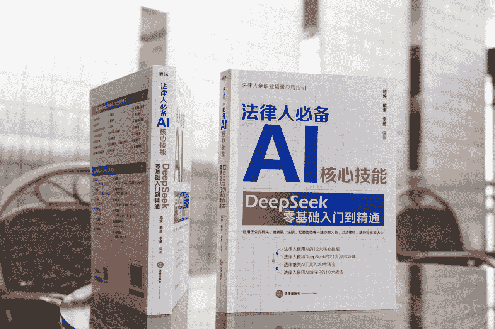
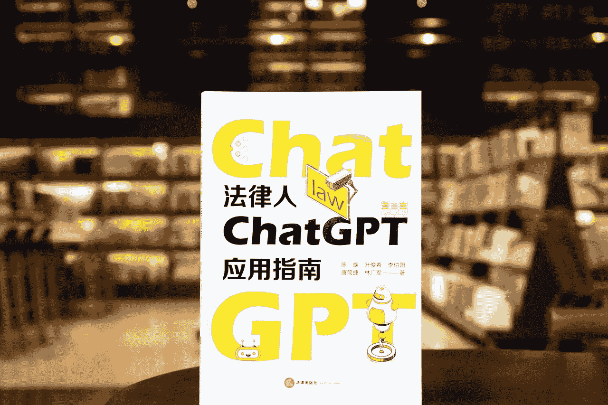

# AI 合规圈

> 来源：[https://docs.feishu.cn/docx/UXAgdvSnPoHmXFxHz9Lc0wrTntf](https://docs.feishu.cn/docx/UXAgdvSnPoHmXFxHz9Lc0wrTntf)

---

# 一、基本信息

「AI合规圈」是熟练IT技术的律师团队，面向法律人、AI行业人员开放、共享「AI+合规」法律实务的平台，在这里您将获得与人工智能、数据合规、数据跨境、网络安全、计算机网络犯罪领域相关的实务指南。AI创新之路，有懂行、懂法、更懂你的专业团队相伴。

# 二、主理人介绍

## ✨陈焕

+   《法律人必备AI核心技能》作者

+   《法律人ChatGPT应用指南》作者

+   隆安全国合规委副主任

+   广东省人工智能产业协会理事

+   广州市律协协会数据与数字经济委秘书长

+   中国电子信息行业联合会数据与治理专业委员会执行委员

+   隆安湾区人工智能法律研究中心主任

+   国家工业信息安全发展研究中心《生成式人工智能数据应用合规指南》标准起草人

+   广东财经大学法学院人工智能法研究中心兼职研究员

+   广州市涉外律师领军人才

+   广州市南沙区政府全球数源中心数据合规项目组副组长

+   某市市场监督管理局（知识产权局）知识产权专家库专家

+   深圳数据交易所入库专家

+   广州数据交易所入库数据合规辅导师

陈焕律师曾就读于广东外语外贸大学、中国政法大学，著有《法律人必备AI核心技能》《法律人ChatGPT应用指南》等，系隆安全国合规委副主任、广东省人工智能产业协会理事、广州市律师协会数据与数字经济委员会秘书长、隆安湾区人工智能法律研究中心主任、广州市涉外律师领军人才、广州数据交易所入库数据合规辅导师、👸号“AI合规圈”主理人。主要从事人工智能专项合规、数据合规、数据资产入表、知识产权、计算机网络等业务。

## ✨李琪瑶

+   《法律人必备AI核心技能》法律畅销书编者

+   隆安广州制裁和双反专业委员会专家顾问

+   广东省人工智能产业协会理事

+   隆安湾区人工智能法律研究中心研究员

+   广州数据交易所入库数据合规辅导师

+   北京市隆安(广州)律师事务所律师

+   华南理工大学法律硕士

+   英语专业八级

+   👸号「AI 合规圈」主理人

李琪瑶律师主办首个“基于数字经济公共基础设施，数据资产入表”供应链数据资源入表专项、某公安研究所个人信息保护数据合规专项、某企业画像数据合规专项、某跨境旅游行业小程序合规专项、某智能设备制造业人工智能合规专项等前沿AI和数据专项。

李琪瑶律师具有上市公司法务及知识产权代理机构经验，擅长处理人工智能、数据合规、知识产权诉讼和非诉业务、民商事争议解决事务及企业法律事务。曾代理邓白氏码冒用系列案、QSV解析软件不正当竞争案、某🛰️小程序爬虫侵权案、多起知名国际文旅品牌维权案等案件同时为多家企业和学术机构提供法律服务。曾为腾讯公司、广汽公司、京信通信、索尼、丰田等大型企业提供法律服务。

# 三、出版著作

## 📘《法律人必备AI核心技能》

## 📗《法律人ChatGPT应用指南》

