# 「何者科技」企业服务

> 来源：[https://docs.feishu.cn/docx/Eo4kdC6OFolagUxKHc3coa8Znic](https://docs.feishu.cn/docx/Eo4kdC6OFolagUxKHc3coa8Znic)

---

# **一、公司简介**

上海何者科技有限公司（“何者He**zher”），是一****家专注于法律科技创新**的**整体解决**方案服务商，致力于构建法律人与科技人之间的桥梁，聚焦法律 AI 通识教育与技术落地，以科技驱动法律行业的高质量发展。

目前，我们构建了一个专注于法律科技领域的高质量社区（Community），链接 2W+ 关注法律科技的先锋人群，包括 AI 及法律科技从业者、律师、法务、法学师生和投资人等，可以提供精准曝光和深度链接。我们通过搭建交流平台，分享 AI 在法律行业的应用实践和全球法律科技前沿资讯，组织法律 AI 系列活动，致力于推动法律科技行业之间的交流、教育和创新，不论是学习 AI 技能，还是了解法律 AI 前沿发展趋势，都可以在这里获得。

何者社区包括以下若干平台：

## 法律修音机

+   **简介**：何者社区旗下「法律修音机」是一个深耕法律科技领域的产业媒体，致力于输出和传播法律科技前沿资讯和洞察，定期同步知识库精选内容。

+   **用户画像**：对法律科技感兴趣的精准人群

+   **活跃人数**：1W+

扫码关注👉

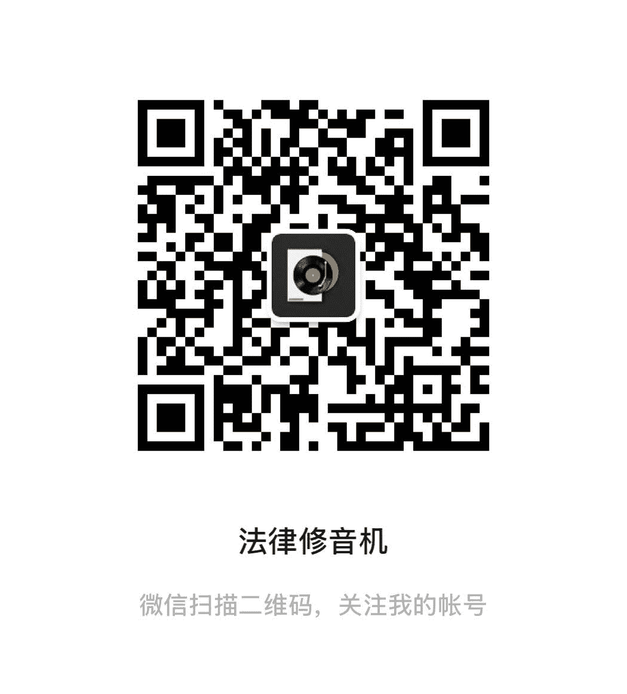

## 法律科技社群

+   **简介**：何者Hezher 是一个高质量的法律科技社区，覆盖数千名法律科技爱好者，包括但不限于 AI 及法律科技从业者、律师、法务、法学师生和投资人等，日常分享交流 AI 和法律科技相关的资讯和话题

+   **用户画像**：对法律科技感兴趣的精准人群

+   **社群人数**：自有社群 3000+ 实名制群友，同时可覆盖 1W+ 对法律科技感兴趣的人群

## 法律科技智库

+   **简介**：业内领先、专注于法律科技领域的深度智库，汇集法律科技相关前沿资讯和深度内容，被字节跳动旗下办公平台「飞书」官方收录并推荐，在飞书社区知识库「法律」品类中排名第一

+   **用户画像**：对法律科技感兴趣的精准人群，尤其是大中型企业法务与合规部门，对数智化建设充满热情的律所及律师团队，大厂或法律科技公司从业者，投资人等

+   **活跃用户**：总访问人次 10W+，每天有数百人前来访问学习

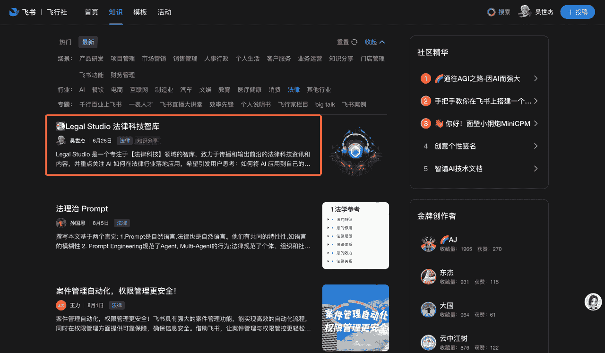

## 法律 AI 系列活动

### 【线上】直播栏目｜法律 AI 夜校

《法律 AI 夜校》是何者社区推出的一档教育栏目，每周更新一期，由何者社区发起团队及伙伴，分享近期最值得关注的法律 AI 新闻和实操技能。2025 年 3 月启动至今，本栏目定期更新中。

### 【线上】培训课程｜法律人的 AI 应用课

《法律人的 AI 应用课》是何者社区联合社区伙伴法天使举办的线上课程，邀请善用 AI 的法律人分享自己使用 AI 的方法，涵盖 AI 通识、日常办公、诉讼、非诉、营销等法律人常用场景，帮助法律人学习如何使用各种 AI 工具。

其中，第 0 期《法律人的 AI 应用课》为期 7 天，定价 99 元/人，最终招募了 500 多名学员。

> 了解更多：[【线上课程】法律人的 AI 应用课](https://legalstudio.feishu.cn/wiki/DTnvwFBoWiCbPhkMHvLcHK49nre)

### 【线下】培训课程｜法律 AI 通识及应用培训

何者社区发起人吴世杰主理的**《法律 AI 通识课》**，涵盖：法律 AI 前沿发展趋势、AI 在法律行业中落地的核心场景、法律人 AI 能力进阶行动指南、AI 在律所或企业内部落地的挑战和解决方案等内容，帮助法律从业者拥抱 AI。

这门课程内容非常全面，覆盖绝大多**数培****训场**景，不论你是律师、法务、法**学生等个体，还是律所、法律**部门、**法律 AI** 创业公司、投资机构等组织，亦或是律师协会、司法局等监管部门及产业政策制定机构，以及高校法学院，何者社区都可以安排合适的讲师，提供相应培训讲座。

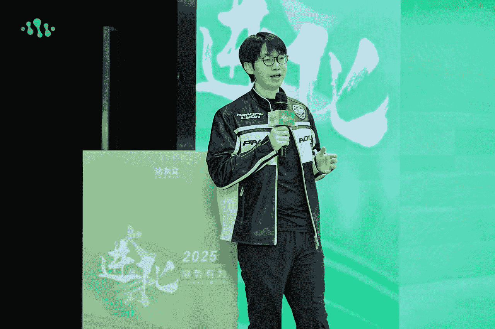

### 【线下】训练营｜法律 AI 共创营 / 工作坊

何者社区联合社区伙伴，面向【法律从业者/律所/企业法务部】举办的线下付费培训活动，通过培训+实操的方式，分享法律 AI 和数字化转型相关的内容，并辅导创建 AI 智能体，帮助法律人和组织开展法律 AI 和数字化转型。

> 了解更多：[#法律 AI 共创行](https://mp.weixin.qq.com/cgi-bin/appmsgalbummgr?action=edit&type=8&id=3435805156338319364&lasttab=-1&token=804809582&lang=zh_CN)、[#活动后续](https://mp.weixin.qq.com/mp/appmsgalbum?__biz=MzUzOTcwMTE5OQ==&action=getalbum&album_id=3435805156338319364&scene=142#wechat_redirect)

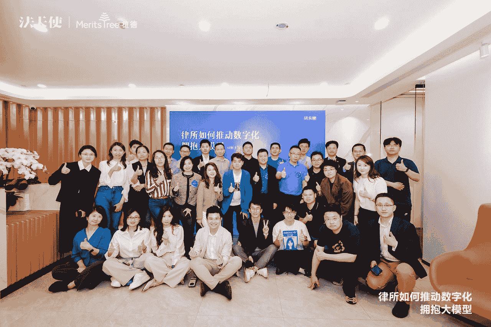

上海站：[活动照片](https://live.photoplus.cn/live/6760407?accessFrom=qrcode&userType=null&code=051rCV000BknQS19xf400uWJsC2rCV0K&state=STATE#/live)

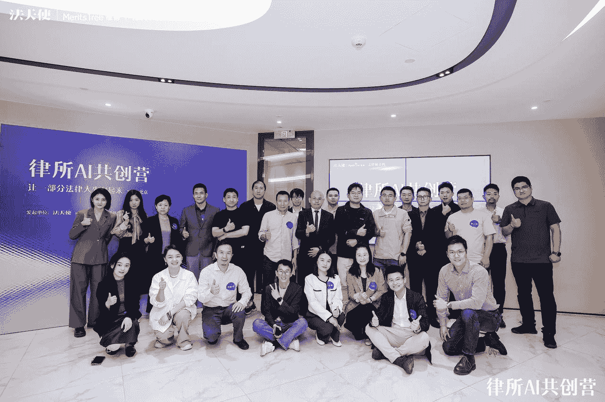

北京站：[活动照片](https://live.photoplus.cn/live/pc/96595029/#/live)

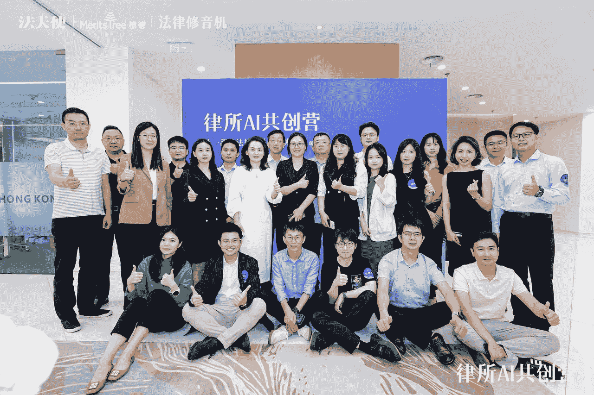

深圳站：[活动照片](https://live.photoplus.cn/live/pc/94871797/#/live)

### 【线下】参访活动｜法律 AI 共创行

何者社区联合社区伙伴，面向【广大法律人】举办的【走进互联网大厂/ AI 公司】线下访学活动，通过培训+走进大厂学习的方式，帮助法律人和组织了解 AI 和法律科技最前沿的实践经验。

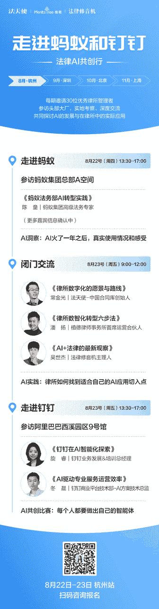

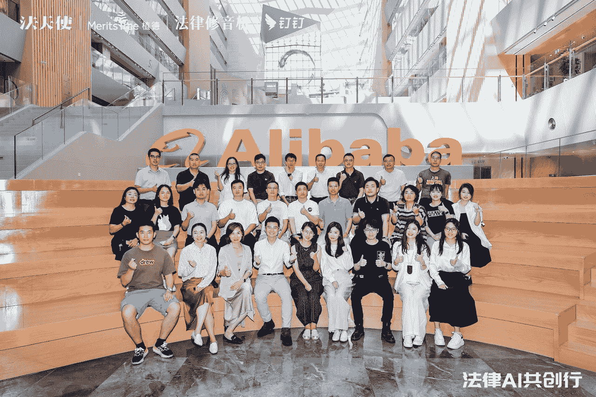

走进阿里巴巴：[活动照片](https://live.photoplus.cn/live/pc/96746332/#/live)

### 【线下】竞赛活动｜法律 AI 共创大赛（案例：厦门市律师协会）

何者社区联合社区伙伴，面向【律所/企业/律协】举办的 AI 竞赛活动，以赛促学、以赛促用，分享法律 AI 相关的干货内容，并通过比赛的方式，邀请法律人分享 AI 在法律行业的应用场景，促进新技术的落地。

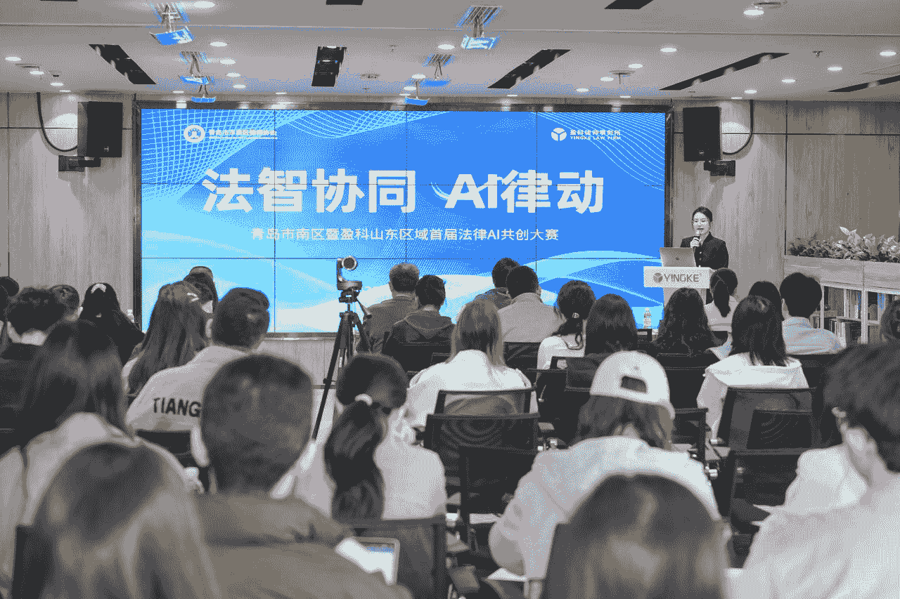

青岛盈科：[活动报道](https://legalstudio.feishu.cn/wiki/KepCw6I5niRYcjkEy1JcJsvjnnv)

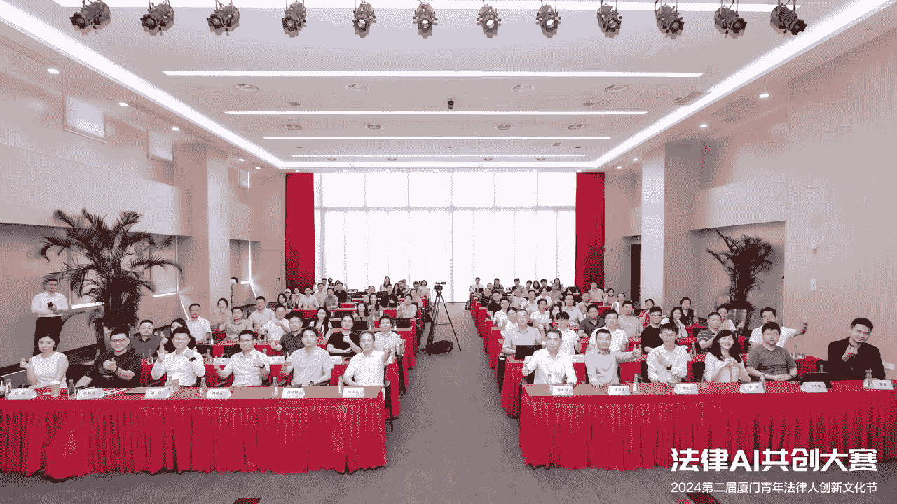

厦门律协：[活动报道](https://mp.weixin.qq.com/s/LEKXZaUSbFgzcwO-cfLZ0g)、[活动照片](https://live.photoplus.cn/live/pc/64988334/#/live)

# **二、产品介绍**

> 目前，何者社区提供以下合作方案，如有更多合作思路，欢迎交流探讨。

## 私有化 AI 平台｜面向律所/团队/企业

面向法律专业人士（律师事务所、律师团队、企业法务部等）提供的安全、智能的法律 AI Agent 平台，促进内部知识共享、减少数据孤岛，实现业务流程自动化，提高工作效率、赋能营销展业，打通 AI 落地「最后一公里」。

同时，可以根据客户的使用需求，如模型尺寸、并发人数等，选配云端算力或一体机。

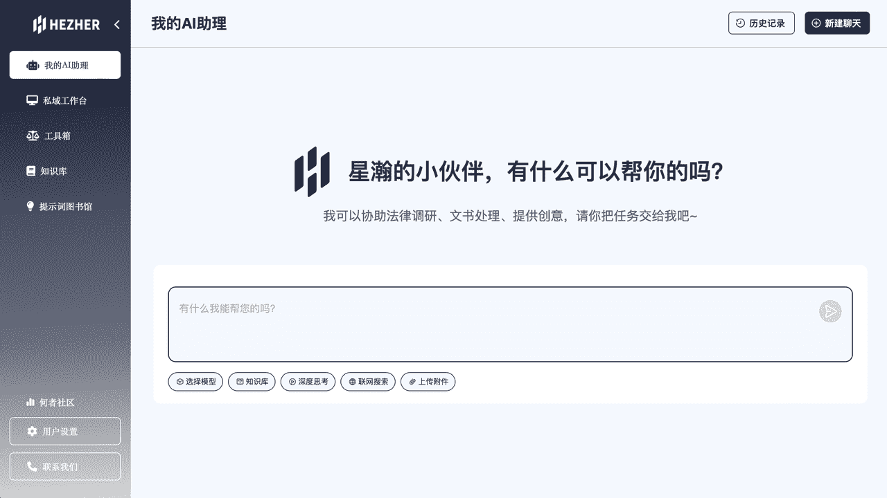

### **私有模型部署+外部模型接入**

私有化部署 DeepSeek-32b、QWQ-32b 等开源推理模型，保证数据安全不出域。同时，接入常用的大模型，如DeepSeek R1 671b 满血版、ChatGPT、Gemini 等，并支持选择多模型问答，律师提问一次多个模型同时作答，便于律师使用各种 AI 工具，也可以使用多个 AI 交叉验证。

### **RAG+知识库能力**

针对私有模型提供 RAG 检索增强优化，可以有效提高 AI 输出的准确度。同时，律师还可以使用自己的知识沉淀建立知识库，对历史数据进行精确检索、问答、输出洞察，并基于 RAG 和知识库能力，创建各种 Agent 应用。

注：为了提高 AI 输出的准确率，律师须配合技术人员整理知识文档。

### **Agent 智能体/应用**

围绕律师实际工作场景提供若干个 Agent 智能体/应用，包括脱敏、翻译、文本纠错、可视化图表制作、影印件对比检查、内部制度查询等，并支持律师自定义创建 Agent。服务期内，不定期上新各类 Agent 智能体/应用。

### **外部法律科技产品接入**

根据客户需求接入各种法律科技或效率工具，打造一站式法律 AI 平台。

## AI 落地咨询｜面向律所/企业/律协

面向面向法律专业人士（律师事务所、律师团队、企业法务部等）提供 AI 及数字化落地方案设计、合同管理体系构建、伦理合规政策制定等转型咨询，以及 AI 应用培训和 AI Agent 大赛等培训型咨询服务 —— 鼓励律师分享自己使用 AI 的经验和心得，培养管理层的 AI 认知和基层律师的 AI 技能，为 AI 产品的落地建立文化基础。

### **🤖数智化转型咨询**

助力企业法务部门、律所从“传统事务型成本部门”向“数字化创新型战略部门”转型，通过标准化流程梳理、精准需求定位与优质法律科技工具匹配，构建短期可落地、中期可优化、长期可拓展的数字化体系，提升律所、法务部门的工作效率与战略支持能力。咨询服务总体分为三个核心阶段，各阶段环环相扣，从“诊断现状”到“匹配资源”，最终输出“全周期方案”，确保转型可落地、可追溯、可迭代。

### **👨🏻‍🏫培训课程**

根据客户需求定制培训内容，AI、[法律科技、新媒体、律](https://legalstudio.feishu.cn/wiki/VAItwomkJiW5sWk7Gn0cOtvEnfh?fromScene=spaceOverview#SaENdZgSnotd8kxgxkuconLvnNe)师业务等均可，参考：法律 AI 系列活动。

> 了解更多：[吴世杰及何者社区对外活动汇总](https://legalstudio.feishu.cn/wiki/Z7LQw3INwiPEtKkmUNKch7HDnph)｜[律协 AI 共创大赛及付费课程方案](https://legalstudio.feishu.cn/docx/JKBYd1QTsonUNtxw9ZScDqr7nHf)

> 价格：单场培训 3000 元/h+差旅费，法律 AI Agent 大赛 5W 元/场起。

### **📑定制研究**

根据客户要求研究特定领域，并按照特定形式交付研究成果。例如，研究合同管理（CLM）产品的市场情况，撰写研究报告，并按照每双周的节奏给客户推送该领域的资讯。

参考：[融资1.35亿，估值超10亿美元的法律AI](https://mp.weixin.qq.com/s/BKBRAgV3XHfWsXJXYZvz7g)公司，帮1000家律所追回了15亿赔偿金（与极客公园合作）

> 价格：2000元/人/天，具体时长须根据客户需求评估。

### **💬专项咨询**

根据客户需求提供法律科技产品策略和方案支持：不定期到现场，在重要节点到现场了解情况，如遇上优质项目，会增加到现场的频次；现场工作之外，每周开 1-2 次远程会跟踪进度，提供建议，并为客户提供长期咨询。

除了法律科技领域，何者社区还可以提供市场营销领域的咨询服务，具体包括：

+   全年营销规划：明确组织当年重要的营销节点，从而有章法地开展营销动作，逐步建立品牌影响力

+   参考：[ 【示例】年度营销日历](https://legalstudio.feishu.cn/wiki/HrUwwm8CZij0mDkFPAecoww5nsc?from=from_copylink)

+   重要营销事件 PR：针对重要营销事件，提供策划、撰写和视觉设计等服务

+   参考：[【示例】公司年度回顾（总结+视觉设计）](https://legalstudio.feishu.cn/wiki/HAz6w5znTirUfSkuKTycOOQtncf?from=from_copylink)

+   视觉设计：提供日常营销设计、重要营销物料、品牌 VI 等视觉设计需求

+   参考：[【示例】视觉设计需求汇总](https://legalstudio.feishu.cn/wiki/Ld4Dw9fUDix9PgkY7bEcAyUSnth)

+   知识库建设：构建组织内部的知识库，促进内部知识的共享和流动，也可以对外公开构建影响力

+   参考：何者 Hezher 法律科技智库（组织内部知识库示例可私聊获取）

> 价格：2000元/人/天，具体时长须根据客户需求评估。

## **社区会员｜面向广大人群**

### **🌟会员体系**

> [订阅会员](https://legalstudio.feishu.cn/wiki/DLtSwmrQYibygZklZ4NcuuASnJg)：以下部分权益暂未正式上线，敬请期待社区正式发布。会员权益详见：

<https://legalstudio.feishu.cn/sync/HBKWd05K4sZKaVboPDVc9tk5nNe>

## 媒体推广｜面向法律科技公司和科技型律所

何者社区与法律科技公司和科技型律所合作，输出产品介绍及行业洞察，帮助客户在日益激烈的竞争中，阐明自身的独特价值，建立思想领导力，影响核心用户，从而推动业务目标的实现。

目前，何者社区提供以下合作方案，如有更多想法，欢迎交流探讨：

### **✍🏻文章撰写及推广**

+   **文章撰写**：由何者团队策划并撰写稿件，也可以由合作方供稿，法律修音机直接转发。

+   案例：[律商联讯](https://mp.weixin.qq.com/s/iniB21m0_H-TF_09wObraA)｜[秘塔](https://mp.weixin.qq.com/s?__biz=MzUzOTcwMTE5OQ==&mid=2247489851&idx=1&sn=faa55058950fbea3e94ae4daf472eaf3&scene=21#wechat_redirect)｜[跨盈数字名片](https://mp.weixin.qq.com/s?__biz=MzUzOTcwMTE5OQ==&mid=2247489905&idx=1&sn=45978b898219f1d73b5dde8666df8ef5&scene=21#wechat_redirect)｜[幂律智能](https://mp.weixin.qq.com/s?__biz=MzUzOTcwMTE5OQ==&mid=2247490845&idx=1&sn=3d0c2b77ae6bfd7f5de118b80d649183&scene=21#wechat_redirect)｜[无忧吾律](https://mp.weixin.qq.com/s?__biz=MzUzOTcwMTE5OQ==&mid=2247491278&idx=1&sn=a63771d9fff80e518266761a8ccdf419&scene=21#wechat_redirect)｜[法大大](https://mp.weixin.qq.com/s/aRISdf8pPdAFj59jfraOlw)｜[慧卷卷](https://mp.weixin.qq.com/s?__biz=MzUzOTcwMTE5OQ==&mid=2247489338&idx=1&sn=9bc5dc342e969507676b39de7c4df84c&scene=21#wechat_redirect)｜[金山晓法](https://mp.weixin.qq.com/s?__biz=MzUzOTcwMTE5OQ==&mid=2247488909&idx=1&sn=add1cb28042bcba27f7eac6e13f36453&scene=21&token=442954942&lang=zh_CN#wechat_redirect)｜法保网｜法智

+   **文章发布**：在「法律修音机」👸号头条发布文章，能够精准覆盖 1W+ 对法律科技感兴趣的活跃人群。

+   **智库收录**：文章被收录至「何者 Hezher 法律科技智库」（飞书官方社区收录并推荐，部分页面被搜索引擎收录），长期留存，覆盖飞书企业用户，如大企业法务部、数字化良好的律所、关注法律科技的律师等。

+   **社群转发**：在「何者 Hezher 法律科技社区」自有社群及合作社群进行转发（非法律科技类内容不提供社群转发），覆盖 5000+ 对法律科技感兴趣的人群。具体操作：将文章转发到社群，匹配合适的传播话术，引导大家关注+联系；同时，文章会被收录进社区当周的《法律 AI 日报》，在社群推送文案中持续放送，每周至少推送 3 次。

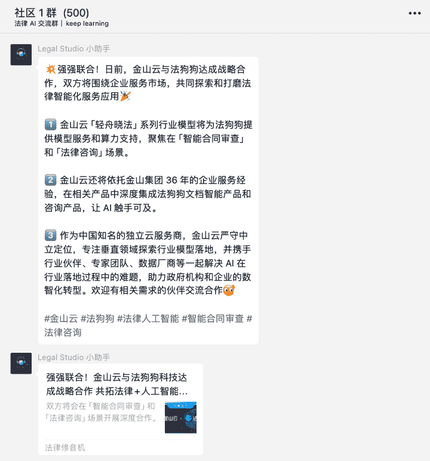

> **价格：**

> 原创行业观察文章：10000 元/篇

> 原创产品测评文章：5000 元/篇

> 客户直接供稿：3000 元/篇

### **👥协助建立用户群**

为客户建立产品用户群，将群二维码转发到社区自有社群拉新，供客户持续运营，并提供运营建议。

例[**如，客户**](https://legalstudio.feishu.cn/wiki/VAItwomkJiW5sWk7Gn0cOtvEnfh?fromScene=spaceOverview#TGUWdP4VRoHdQhxeKbacKiLTnDf)要发布新产品或提供产品试用权益进行拉新，何者社区可以协助建立用户群——据以往经验，如果客户同时与何者社区合作推广文章，并由何者社区协助建立用户群，可以大幅提高推广带来的转化效果。

> **价格：**3000 元/次。

### **🎤活动露出及推广**

在何者社区举办的[**各类活动**](https://legalstudio.feishu.cn/wiki/VAItwomkJiW5sWk7Gn0cOtvEnfh?fromScene=spaceOverview#SaENdZgSnotd8kxgxkuconLvnNe)中露出宣传，有助于与潜在客户直接建立联系。

> **价格：**根据具体项目沟通确定，联合举办活动或主题发言 5W 元起，以下是何者社区品牌活动：

> [【课程报名】法律 AI 工作坊｜AI 律所转型路线图 —— 2 天 1 夜，带你用 AI 重塑法律业务](https://legalstudio.feishu.cn/wiki/Kcm9wWveLihylPkoDx9cHCBcnfh)

> [【产品路演日】LegalTech Show｜法律科技创新产品路演日](https://legalstudio.feishu.cn/wiki/Sv0xwtXiCizGXakggJacUeAQnDq)

> [【线下交流会】法律 AI Café Day](https://legalstudio.feishu.cn/wiki/C6o4wQGolieUXlkD4iScWFc9ncd)

### **💡年框合作方案**

+   **推广文章：**[**撰写原创推广文章 2**](https://legalstudio.feishu.cn/wiki/VAItwomkJiW5sWk7Gn0cOtvEnfh#TGUWdP4VRoHdQhxeKbacKiLTnDf) 篇/年，详见：✍🏻文章撰写及推广

+   **建立社群：**[**建立 1 个用户群**](https://legalstudio.feishu.cn/wiki/VAItwomkJiW5sWk7Gn0cOtvEnfh#B4jtd6P8UotIKwxLfV4cnzVcnOc)，并协助开展日常运营，详见：👥协助建立用户群

+   **联合活动：**配合[**产品推广节奏，举办**](https://legalstudio.feishu.cn/wiki/VAItwomkJiW5sWk7Gn0cOtvEnfh#IeFwdI1BAoAO14xqztrc05d0nhf)线上线下活动，包括 1 场《法律科技产品路演》线上直播，发表不超过 1 小时的主题演讲；1 场《法律 AI Café Day》线下活动，发表不超过 30 分钟的主题演讲，详见：🎤活动露出及推广

+   **内容植入：**合作伙伴的产品资料以「何者社区生态合作伙伴」名义，在各类内容和活动中植入，包括但不限于文章、智库、视频、直播、培训课件、AI 日报/周报、AI 应用指南、行业研报、年度榜单等，并得到优先推荐

+   **专家入库：**[**合作伙伴专家成员进入何者**](https://legalstudio.feishu.cn/wiki/VAItwomkJiW5sWk7Gn0cOtvEnfh#SaENdZgSnotd8kxgxkuconLvnNe)社区「行业专家库」，优先参与社区举办的《法律 AI 系列活动》并担任助教或讲师，且社区在采访或约稿行业专家时，优先从专家库中选取，可以获得更多产品和个人 IP 曝光

+   **资源链接：**优先获得社区的各类资源推荐，如行业协会引荐、法律科技人才评选等

> **价格：**10W 元/年。

### **🙌🏻社区开源赞助**

赞助开源「何者 Hezher 法律科技智库」（年访问人次 50W+），为此何者社区将提供：

+   付费内容公开发布（详见：[订阅会员](https://legalstudio.feishu.cn/wiki/DLtSwmrQYibygZklZ4NcuuASnJg)）

+   在何者社区自有社群的日报推送文案中冠名：每周至少 3 次，每月至少 12 次

+   在智库所有文档的 banner 和文首中添加合作方名称和 logo 等元素，每周覆盖数百名精准人群

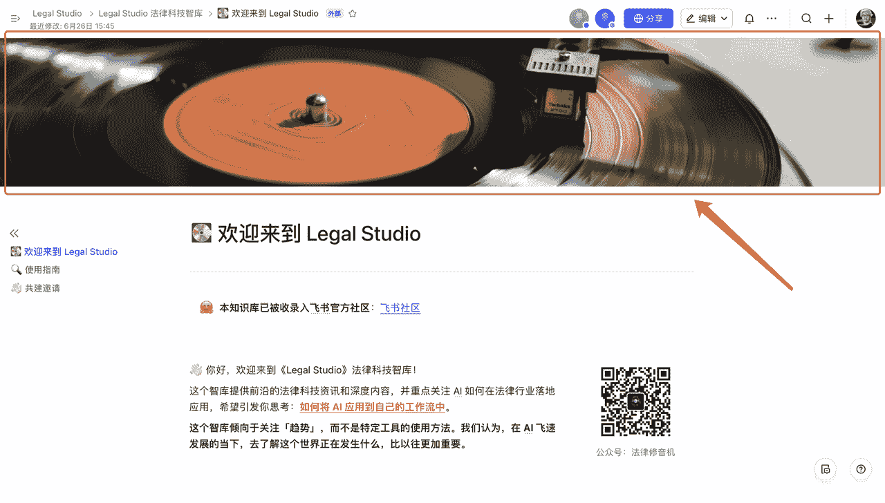

> 价格：10W/年。

# **三、生态合作**

> 何者社区以“共创、共享、共赢”为宗旨，以推动 AI 技术在法律行业落地应用为目标，搭建法律科技生态合作伙伴体系，建立协同合作机制，致力于推动形成资源供给充裕、应用落地见效、合作机制灵活的良性发展趋势，共同为客户提供优质服务。目前，何者社区正在寻找的合作伙伴包括——

## 合作伙伴定义

**何者科技生态合作**伙**伴体系，目前分为**【**代理合作伙伴】、【**专家合作伙伴】和【供应商合作伙伴】三大类。

### 代理合作伙伴

“代理合作伙伴”是指利用自身技术、人才、行业、渠道等优势，面向直接客户推广何者科技产品及服务的渠道伙伴。

### 专家合作伙伴

“专家合作伙伴”是指基于自身专业能力，面向客户直接提供何者科技产品及服务的专家伙伴。

### 供应商合作伙伴

+   算力伙伴：提供多元、高质量的算力资源及开发环境支持，保障何者科技开展模型训练、场景研发和技术创新，降低社区的算力使用门槛，扩大法律 AI 发展集聚引领优势。

+   数据伙伴：提供包括高质量的法律行业知识、语料标注在内的数据资源，为法律垂直模型的训练和优化提供数据支持，实现训练数据的有效供给及合规高效、安全有序的流动。

+   模型伙伴：提供优质的通用大模型底座，在通用大模型的基础上开发法律行业模型并提供相关服务，打通“模型即服务”的最后一公里，并以行业模型反哺通用大模型技术的迭代。

+   应用伙伴：利用 AI 技术开发各类产品的厂商或个人开发者，通过开放代表性应用场景，联合打造基于行业数据的精准模型，驱动 AI 在法律行业实际应用场景中落地。

+   投资伙伴：以资本赋能法律 AI 产业发展，发挥孵化、引导、带动的作用，驱动科技创新、培育标杆企业、促进项目落地，推动法律 AI 产业高质量发展。

## 合作伙伴加入条件和流程

### 准入条件

+   合作伙伴须为具有完全民事行为能力的自然人或依法注册成立的企业，且无重大法律纠纷记录

+   专家合作伙伴由何者科技认定相关能力后择优授权

### 加入流程

+   合作伙伴向何者科技提交真实的企业/个人身份信息

+   何者科技审核，双方确认合作意向、签署合作协议

+   完成合作协议签署后，成为何者科技的合作伙伴

# **四、联系我们**

吴世杰，何者科技 CEO、法律修音机主理人，多年法律科技创业者，业内法律科技知名讲师，上海法律科技协会、中国经济[法学会 AI 应用专委会](https://legalstudio.feishu.cn/wiki/EVbUwoDxpiSachkBvh2cEGYLnlD)理事，《赛博法律指北》作者、《[法律与人](https://legalstudio.feishu.cn/wiki/MVwhwkvP5iIZaCkO7DDcGtYMn7d)工智能》编委会专家委员，曾任前法律 AI Agent 平台「INSSENT AI」CEO，前腾讯投资法律科技公司「易参」创始团队及 Marketing 负责人。

> 了解更多：[吴世杰个人介绍](https://legalstudio.feishu.cn/wiki/V5hSwC3eViWhrjk97IJcsyoUncc)

---

Created by Hezher