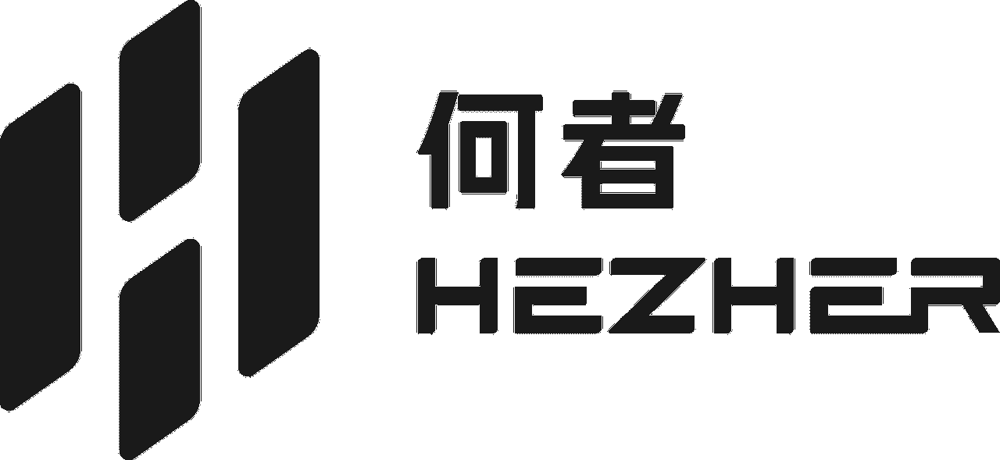
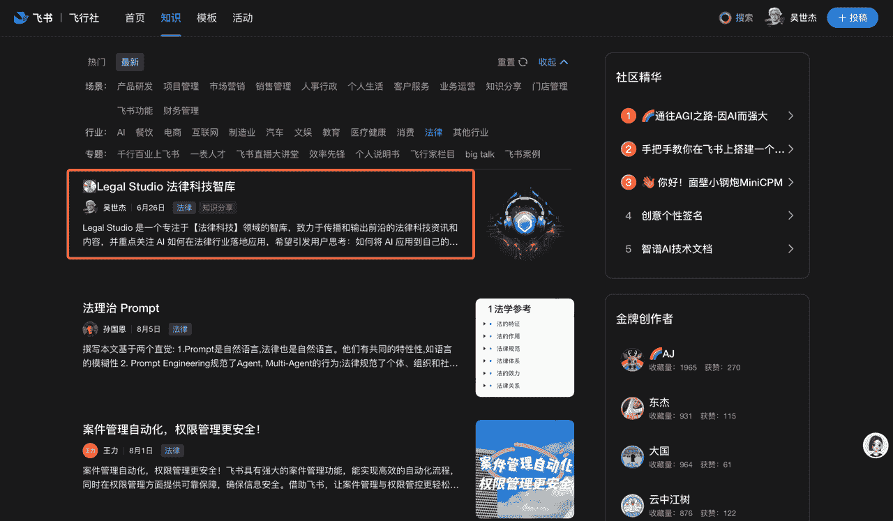
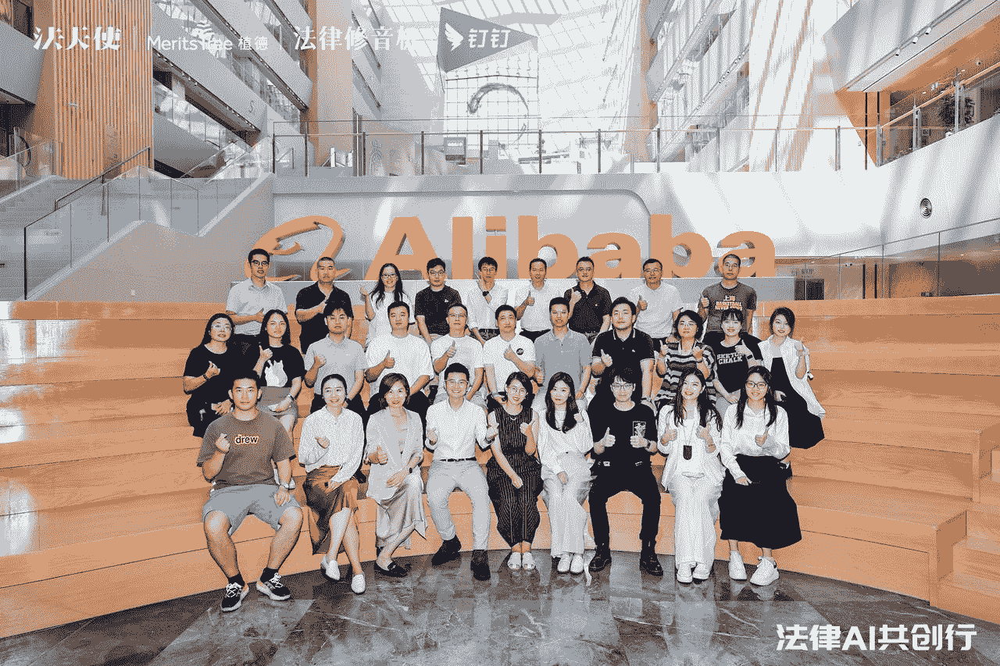
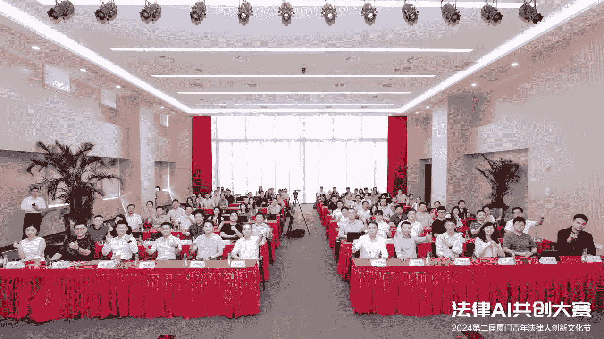
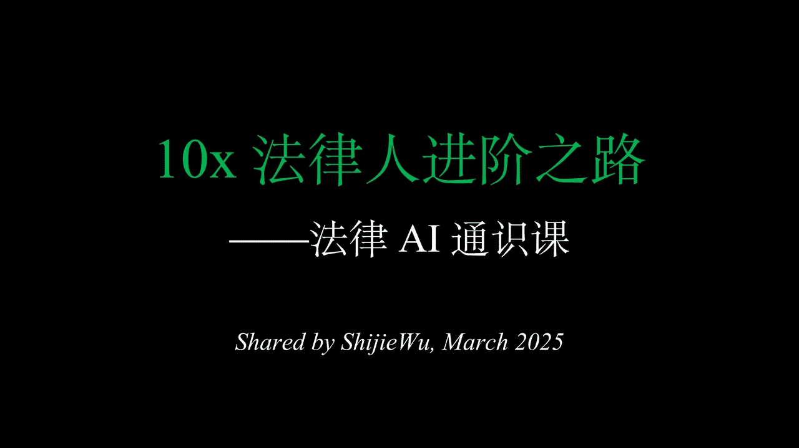

# 何者 Hezher 法律科技社区

> 来源：[https://docs.feishu.cn/docx/CSHbdGNRBoH5W4xHMiJcWg3lnGd](https://docs.feishu.cn/docx/CSHbdGNRBoH5W4xHMiJcWg3lnGd)

---

> Hey！欢迎来到「何者 Hezher」法律科技社区！

> 这里提供法律科技前沿资讯和深度内容，重点关注 AI 如何在法律行业落地应用，既有工具，更有用户的奇妙创造，希望引发你思考：如何将 AI 应用到自己的工作流中。

> [如果你对何者](https://legalstudio.feishu.cn/wiki/NnAAw32YKiyitFkyBWqcPX2MnIE?fromScene=spaceOverview#UB9RdCUbsovDXHxk9tucCg4JnUf) Hezher 社区有任何反馈，欢迎联系我们。

# 🙋🏻 关于「何者社区」

---

「何者 Hezher」是一个高质量的法律科技社区，我们搭建交流平台，分享法律 AI 应用实践以及全球法律科技前沿资讯，致力于推动法律科技行业的交流、教育和创新，以科技驱动法律行业高质量发展。不论是学习 AI 技能，还是了解法律 AI 前沿趋势，都可以在这里获得。

1.  **我们的使命**：在源头驱动法律科技创新

1.  **我们提供**：

+   **社群网络**：数千名法律科技爱好者共建的社区，交流分享全球法律科技前沿资讯、技能和最佳实践。通过这个网络，不论是产品测试或推广，还是与优秀公司近距离接触，前往 AI 及法律科技公司、数字化律所参访、工作/实习的机会，亦或是引荐人脉资源、投资孵化，大概率这个网络里会有人能够帮助你

+   **行业智库**：专注于法律科技领域的智库，收录全球最前沿的法律科技资讯和深度内容

+   **培训课程**：由一线法律科技专家、AI 技术专家、资深法律专家倾心打造的线上线下培训课程，包括法律 AI 通识启蒙课程、实操 Workshop 等，支持定制化，以满足不同人群的多样性需求

+   **产品服务**：面向律所、律师团队、公司法务部门，提供 AI 及数字化转型的专业咨询和技术服务

1.  **面向群体**：

+   不限行业、方向、领域

+   不限年龄、性别、背景

+   无论你是执业律师、公司法务、法学院师生、司法工作者，还是对法律科技感兴趣的创业者、开发者、投资人，何者 Hezher 都可以成为你在法律科技行业中探索、学习和创新的枢纽

「何者 Hezher」旗下包括以下平台：

## 🎙️ 媒体

+   **简介**：何者 Hezher 旗下「法律修音机」是一个深耕法律科技领域的自媒体，致力于输出和传播法律科技前沿资讯和洞察，定期同步知识库精选内容。

+   **用户画像**：对法律科技感兴趣的精准人群

+   **活跃人数**：1W+

## 👥 社群

+   **简介**：数千名法律科技爱好者共建的社区，社区成员覆盖 AI 及法律科技创业者、律师、法务、法学院师生、投资人等，日常分享交流 AI 和法律科技相关的资讯和话题。其中，线上社群包括🛰️+飞书群，每个群以达到 500 人为目标，在每个群内打造良好的交流氛围。同时，社区还会举办各种线下活动，加强学习社交，促进深度连接。

+   **用户画像**：对法律科技感兴趣的精准人群，面向广大用户开放

+   **社群人数**：自有社群数千名实名制群友，同时可覆盖 1W+ 对法律科技感兴趣的人群

## 📚 智库

+   **简介**：业内领先、专注于法律科技领域的深度智库，汇集法律科技相关前沿资讯和深度内容，被字节跳动旗下办公平台「飞书」官方收录并推荐，在「法律」品类中排名第一

智库链接：何者 HEZHER 法律科技智库

+   **用户画像**：对法律科技感兴趣的人，尤其是：大中型企业法务与合规部门，对数智化建设充满热情的律所及律师团队，各地律协的理事会、专业或专门委员会，大厂或法律科技企业代表，投资人

+   **活跃用户**：总访问人次 10W+，每天有数百名精准人群前来访问学习

> [「何者科技」对外合作方案（2025.1）](https://legalstudio.feishu.cn/wiki/VAItwomkJiW5sWk7Gn0cOtvEnfh)于「何者 Hezher」社区提供的产品及服务，可移步：

# 🔥 最新社区活动

[【课程报名】法律 AI 工作坊｜超越提效 聚焦增长 —— 2 天 1 夜，带你用 AI 重塑法律业务](https://legalstudio.feishu.cn/wiki/Kcm9wWveLihylPkoDx9cHCBcnfh?from=from_copylink)

[「法律修音机」要出书啦！](https://legalstudio.feishu.cn/wiki/CVZpwXVU6iAUTTkp2pUcIQsynhb)

# 🤗 加入「何者社区」

---

一直以来，法律行业都是保守的行业，但随着市场的变化和技术的发展，越来越多的法律人希望借助科技工具来提高效率。然而，市面上的法律科技攻略内容参差不齐，很多朋友苦于寻找优质的使用攻略和课程，因此我们将全球法律科技的前沿资讯、攻略教程和最佳实践汇总到智库中，希望可以帮助你快速获得法律科技的最佳用法。

## **🔍 **获取最新最全法律科技攻略

> The tools we use sharp the way we work.

+   【简介】关于「何者 Hezher」社区

+   [欢迎来到 Legal Studio](https://legalstudio.feishu.cn/wiki/NnAAw32YKiyitFkyBWqcPX2MnIE)

+   [社区伙伴介绍](https://legalstudio.feishu.cn/wiki/Tic0wFtCoim4rZk7Y42cDbysnjb)

+   【资讯】与 AI+法律、法律科技和大模型相关的前沿资讯，助你快速上手 AI

+   [法律 AI 应用学习手册 1.0](https://legalstudio.feishu.cn/wiki/YJvUwoMVfirhCTk4HfVcFVzJngc)

+   [法律科技快讯](https://e9w56z965d.feishu.cn/wiki/GX31woXivi0JHTktLxYcrhBvnVc)

+   [法律科技数据库](https://legalstudio.feishu.cn/wiki/UJaiwDfbIiLeqck0PxOc1hv5n2c)

+   【活动】何者社区与共创伙伴推出的 AI 及法律科技精品活动，助你快速 get 到前沿认知，结识优质人脉

+   [【网络研讨会】法律 AI 夜校](https://legalstudio.feishu.cn/wiki/YSPbweJgYi3Pdbk8mJBcsSJmnbg)：何者社区推出的直播栏目，每周四晚开播，由何者社区伙伴和大家分享近期全球法律科技最值得关注的新闻和实操技能。免费用户仅直播时可看，Pro 会员可回看所有历史直播

+   [【线下交流会】法律 AI Café Day](https://legalstudio.feishu.cn/wiki/C6o4wQGolieUXlkD4iScWFc9ncd)：何者社区每月举办的线下交流分享会，我们会在这里探讨法律 AI 最新趋势、落地实践、实操技能等当下最最热门的话题，帮助你迅速 get 到前沿认知，结识法律 AI 核心人脉圈。法律 AI Café Day 为付费活动，部分社区伙伴及 Pro 会员可免费参与

+   [法律科技活动公告板](https://legalstudio.feishu.cn/wiki/PoGWwXN39ieFSTkglXxcJx6Znub)

+   【报告】：权威机构发布的，以及何者 Hezher 智库出品的深度研究报告，涵盖法律科技各大赛道。

+   [【研究报告库】](https://legalstudio.feishu.cn/wiki/ViX5wIG3aiIZSXkxnLWcy3E1nyg)

+   【数据】权威机构发布、何者 Hezher 智库出品的法律科技行业数据库，助你全景式了解法律 AI 市场

+   [【融资并购库】](https://legalstudio.feishu.cn/wiki/I3ujwA4FFi6X4pkCkP9cQOeGnL2)

+   [【公司项目库】](https://legalstudio.feishu.cn/wiki/IsMrwljO5iLOn5kF2xUcBosonog)

+   [【支持政策库】](https://legalstudio.feishu.cn/wiki/RcIawncoeiXftPkj2Wic8ZUZnig)

+   [【宏观数据库】](https://legalstudio.feishu.cn/wiki/Y5q0wcYWfiGGPZkI5DHcXG1rnpc)

+   【专题】围绕「AI+法律」和「法律科技」推出的深度专题研究内容

+   [【专题】律师事务所如何拥抱 AI](https://legalstudio.feishu.cn/wiki/HddAwrbafioMOLkh6cZcc486nTb)

+   [【专题】司法系统如何监管 AI](https://legalstudio.feishu.cn/wiki/TLlWwUIvhiO2m9kMIQEclLuinGb)

+   [【专题】法学院如何拥抱 AI](https://legalstudio.feishu.cn/wiki/TLwIwlmwuiwc9Uk2gHdcMFsfnf7)

+   智库大部分内容可免费访问，付费内容：

+   [订阅智库](https://legalstudio.feishu.cn/wiki/DLtSwmrQYibygZklZ4NcuuASnJg)

+   [「何者社区」对外合作方案（2025.4）](https://legalstudio.feishu.cn/wiki/VAItwomkJiW5sWk7Gn0cOtvEnfh)

+   [通往 AGI 之路 ](https://waytoagi.feishu.cn/wiki/QPe5w5g7UisbEkkow8XcDmOpn8e?from=from_copylink)果希望了解更多 AI 相关的知识，推荐访问 👉

## 👋🏻 连接线上线下行业精英大咖

### 👥 国内最大的法律科技线上社群

何者科技组建的法律科技社区，致力于输出和传播法律科技前沿资讯和洞察，覆盖数千名法律科技爱好者，包括法律科技创业者、律师、法务、AI 创业者、投资人等多元人群。日常分享交流 AI 和法律科技相关的资讯和话题，高质量的讨论内容还会收录进何者 Hezher 法律科技智库，形成法律科技市场教育的良性循环。

### 👩🏻‍🏫 法律 AI 系列课程

何者社区打造的法律科技线上课程，涵盖法律科技的方方面面，通过学习该课程，使用工具提高日常工作效率。

#### 法律 AI 共创营｜案例：上海、北京、深圳

何者社区联合社区伙伴法天使、植德律所，面向【律所】举办的线下付费培训活动，通过培训+实操的方式分享法律 AI 和律所数字化转型相关的干货内容，并根据实际场景创建 AI 智能体，帮助律所和律师实现数字化和 AI 转型。

👉 了解更多：#[法律 AI 共创行、](https://mp.weixin.qq.com/cgi-bin/appmsgalbummgr?action=edit&type=8&id=3435805156338319364&lasttab=-1&token=804809582&lang=zh_CN)#[活动后续](https://mp.weixin.qq.com/mp/appmsgalbum?__biz=MzUzOTcwMTE5OQ==&action=getalbum&album_id=3435805156338319364&scene=142#wechat_redirect)

上海站：[活动照片](https://live.photoplus.cn/live/6760407?accessFrom=qrcode&userType=null&code=051rCV000BknQS19xf400uWJsC2rCV0K&state=STATE#/live)

北京站：[活动照片](https://live.photoplus.cn/live/pc/96595029/#/live)

深圳站：[活动照片](https://live.photoplus.cn/live/pc/94871797/#/live)

#### 法律 AI 共创行｜案例：走进阿里巴巴

何者社区联合社区伙伴法天使、植德律所，面向【广大法律人】举办的【走进互联网或 AI 大厂】的线下访学活动，通过培训+走进大厂学习的方式，了解法律 AI 和法律科技最前沿的实践经验。

杭州站：[活动照片](https://live.photoplus.cn/live/pc/96746332/#/live)

#### 法律 AI 共创大赛｜案例：厦门市律师协会

何者社区联合社区伙伴法天使等机构，与【厦门律协】合作举办的活动，通过以赛促学、以赛促用的方式，分享法律科技相关的产品和干货，并通过比赛的方式，邀请青年法律人分享法律科技产品的应用场景，促进新技术落地。

厦门站：[活动报道](https://mp.weixin.qq.com/s/LEKXZaUSbFgzcwO-cfLZ0g)、[活动照片](https://live.photoplus.cn/live/pc/64988334/#/live)

### 🧑🏻‍🏫 社区公开课（法律 AI 通识）

何者社区伙伴共同打造的公开分享内容，为你的业务和场景提供 AI 的最佳解法。

2023 年以来，我们通过组建法律科技社区、智库，组织法律 AI 共创培训和比赛、参访 AI 大厂等活动，和一部分法律人先 AI 起来了。在这个过程中，我受很多机构的邀请，在多个场合分享「法律 AI」相关的课程。经过一年多的打磨和迭代，最终我把这个课程命名为：《法律 AI 通识课：10x 法律人进阶之路》。

这**门课****程的**的课件超过 100 页，**可以根据具体需求**增减内**容，时**长可在  1 到 3 个小时灵活调整，覆盖大多数培训场景，不论是律师、法务等个体，律所、法律部门、法律 AI 创业公司、投资机构等组织，还是律师协会、司法局等产业政策制定机构，以及法学院，都可以提供相应的内容。本着开源精神，我们决定公开这个课件的最新版本：

> 点击下载：

[法律 AI 通识：10x 法律人进阶之路.pdf](https://internal-api-drive-stream.feishu.cn/space/api/box/stream/download/all/ApxGblhJkoiYVCx8TKycVUcpnwf)

## 🏆 获得何者社区官方认证与权益

### ⭐️ 专属成员身份认证/权益兑换

**成为何者**社区成员后，您在社区的一系列社区共建行为都将会获得社区积分， 这些积分能用于兑换各种权益（包括但不限于：何者社区身份标识；何者周边文创礼品；何者社区大会、法律 AI 系列精品活动名额）。

| 社区权益 | 初学者 | 探索者 | 共建者 |
| --- | --- | --- | --- |
| 法律科技线上社群 | ✅ | ✅ | ✅ |
| 法律科技智库公开内容 | ✅ | ✅ | ✅ |
| 智库 Pro 会员深度内容 | - | - | ✅ |
| 法律科技线下交流 | - | 2次/年 | 4次/年 |
| 法律 AI 线下培训 | - | 1次/年 | 2次/年 |
| 法律科技轻咨询 | - | 1次/年 | 无限次 |
| 法律科技新品试用 | 不定期 | 不定期 | 不定期 |
| 法律科技产品优惠 | - | - | ✅ |
| 组织社区活动 | - | 1次/年 | 无限次 |
| 社区建设探讨 | - | - | ✅ |

> 注：社区成员身份及权益机制持续完善中。

> 智库 Pro 会员权益：[订阅智库](https://legalstudio.feishu.cn/wiki/DLtSwmrQYibygZklZ4NcuuASnJg)

### 🎁 法律科技新功能/产品先行体验

何者社区与国内优秀法律科技公司深度合作，每一位社区共建者都可以优先获得法律科技产品的优先体验权益。

## 🚀 成为社区共建者，解锁更多权益

积极参与社区共创的伙伴，可以成为何者社区「共建者」，您将进入共建者专属社群，获得以下权益。

### 🎟️ 免费查看智库会员权益

免费查看「何者 Hezher」法律科技智库 Pro 会员权益，价值 499元/年。

### 🤝 与社区管理团队深度链接

与社区深度链接，一起探讨社区建设方案，提高个人 IP 影响力。

### 🥳 有机会参加何者社区年度大会

每年底，何者都会召开线下年度大会，届时将会开放部分席位邀请何者社区共建者线下一同参与。

# 💬 加入社群

---

何者 Hezher 法律科技社区已聚集数千名对法律科技感兴趣的群友，日常分享交流关于 AI 及法律科技相关的前沿资讯、话题和活动，同时也会将好的分享内容和讨论吸收进知识库，因为你的参与知识库才会越来越完善。

**如需加入🛰️群，可添**加社区发起人🛰️（18825075686），备注姓名-所在机构-职位申请入群。

# 👋🏻 共建邀请

---

搭建一个优质的行业智库并非易事，不仅需要持续的输入和输出，也要求构建者本身具备系统的知识框架。所以，这个智库也要像打造产品一样不断打磨和迭代，欢迎大家投稿优质内容、参与共建。

如果你在使用何者 Hezher 法律科技智库的过程中遇到任何困难，或者对内容有更多需求，又或者是一些优化建议，欢迎联系社区发起人 （18825075686）提出你的宝贵建议，非常感谢！

# 👥 社区伙伴

---

[吴世杰个人介绍](https://legalstudio.feishu.cn/wiki/V5hSwC3eViWhrjk97IJcsyoUncc)

[法天使-中国合同库](https://legalstudio.feishu.cn/wiki/KTIUw7DGeihDgikBzNccoveYnOd)

[潘扬个人介绍](https://legalstudio.feishu.cn/wiki/HUvWwAx2EiAy13kGrdNc6LU5npb)

[王杰文律师个人介绍](https://legalstudio.feishu.cn/wiki/B5dUwGrKwigWR0k9ayfcXh8unb0)

[上海震亚律师事务所-新媒体律所](https://legalstudio.feishu.cn/wiki/ZxBNwhvPHiHxISkQNKacImDBnOK)

[AI 合规圈](https://legalstudio.feishu.cn/wiki/VhBKwAuXRiplNBkKUSqcmOFsnmd)

[田莉律师个人介绍](https://legalstudio.feishu.cn/wiki/QWbjwHaSziD6MVkDiJfcvmfqnbe)

> 何者 Hezher 法律科技智库大部分免费开[会员体系](https://legalstudio.feishu.cn/wiki/DLtSwmrQYibygZklZ4NcuuASnJg?from=from_copylink)，如果您有更深度的内容需求，欢迎联系：

>

>

>

> 更多内容还在路上，敬请期待～如有任何问题，可随时和主创们唠唠👉

>

>

>

---

Created by Hezher