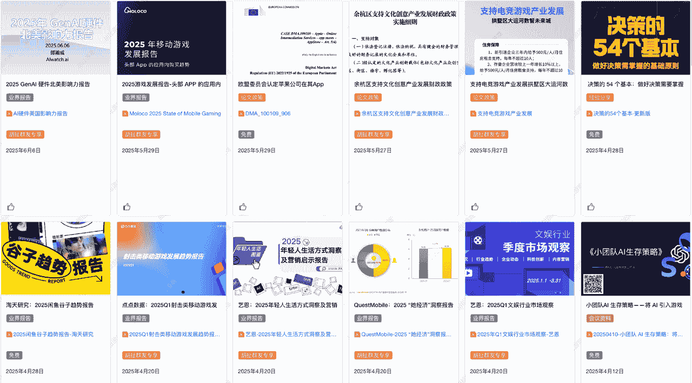

# 加入胡扯资源/知识库

> 来源：[https://huchegames.feishu.cn/docx/OziRdjDvrouUQKxEUypcwCM7nhf](https://huchegames.feishu.cn/docx/OziRdjDvrouUQKxEUypcwCM7nhf)

> **胡扯资源库**

> [https://docs.qq.com/smartsheet/DVXZNTEp](https://docs.qq.com/smartsheet/DVXZNTEpRYWhUalFq?viewId=vEjgSC&tab=BB08J2&nlc=1)RYWhUalFq?viewId=vEjgSC&tab=BB08J2&nlc=1

> **2025 年 **6 月 16 日起，「胡扯资源库」从邀请访问改为公开访问。

> 权限为「免费」的资源，所有网友均可查看。

>

> **「胡扯知识库」**[入库必读](https://huchegames.feishu.cn/wiki/F8qywlxNGi9EuXkmjXgcNpHXnLg)曾老师二十多年工作经验的积累与输出，落地在飞书知识库：

>

> 胡扯资源库&知识库创建者介绍：[关于曾老师](https://huchegames.feishu.cn/wiki/Fh3Uwg78yiijp1kgZNHcXMwtnWf)。添加[曾老师🛰️号](https://huchegames.feishu.cn/wiki/ADROwoBUViGQHdk4aG4c8VkEnYb)。

# 胡扯知识库

[工作习惯](https://huchegames.feishu.cn/wiki/EaAhweqIhi7QATklyKkcNFeBnff)，关注日常合作与沟通，曾老师管理百人团队积累的经验。

[创业之路](https://huchegames.feishu.cn/wiki/Jj09wCALPiTXXKkWfkGczvyOnRf)，关注创业心态，包含曾老师三次创业经历的分享。

[自研自发](https://huchegames.feishu.cn/wiki/FTuvwZP3SijeAmkRgIhcjhA6n7c)，整理和分享曾老师了解的研发经验和发行经验。

[认知成长](https://huchegames.feishu.cn/wiki/Lwqwwsw3gigEvwk2cAxcXD0En9g)，曾老师整理的有助于提升个人认知的资料。

[时间管理](https://huchegames.feishu.cn/wiki/GbefwTOEoia3CbkU9ZDcmzVenOb)，是提升效率的基础。

[行业政策](https://huchegames.feishu.cn/wiki/NioIwkCdYiqLupknXTncUT4pnDb)，分享行业发展政策。

[人事管理](https://huchegames.feishu.cn/wiki/Oa2PwiRE6ili7dkLcffcxHMDnMb)，企业和组织发展到一定程度，不可避免地涉及到人。

[胡扯AI](https://huchegames.feishu.cn/wiki/IO5xwnpMliiHdfkAMHDcoCP0nDf)，曾老师人肉撰写和整理的 AI 前沿知识和信息。

[读书笔记](https://huchegames.feishu.cn/wiki/TTqJwdxRWi7fPnkv8B0coB0GnOe)，曾老师的读书笔记。

[会议实录](https://huchegames.feishu.cn/wiki/CgDzwqmjqikThukx13jcG9aLn9b)，记录参加会议的内容，包括但不限于会议摘要，主题分享 PPT，主题分享逐字原文，主题分享现场声音录制。

# [胡扯资源库](https://docs.qq.com/smartsheet/DVXZNTEpRYWhUalFq?viewId=vEjgSC&tab=BB08J2)

点击链接访问胡扯资源库：

https://docs.qq.com/smartsheet/DVXZNTEpRYWhUalFq?viewId=vEjgSC&tab=BB08J2

## 资源权限申请说明

> 申请一般在1天内审批通过。

+   对于胡扯游戏群友：申请权限请注明胡扯游戏群名称，以及自己在群中的昵称

+   对于付费文章朋友：申请权限请注明付费文章名称和付费个人昵称。

> 使用**无法分辨昵称和头像****，无法确认是否为**胡扯游戏群友者，会遭到无！情！拒！绝！

权限为「胡扯群友专享」的资源，需要进入[胡扯社群](https://huchegames.feishu.cn/wiki/U6WhwNpMwiPWoMkaVPUcY1zmn0e)才可以查看。

权限为「胡扯VIP专享」的资源，需要付费成为[胡扯VIP](https://huchegames.feishu.cn/wiki/TILZwj2Vrit8tqkmUa2ciMtanhg)才可以查看。

[对进入社群有](https://huchegames.feishu.cn/wiki/U6WhwNpMwiPWoMkaVPUcY1zmn0e)兴趣的朋友，请阅读：胡扯社群指南。

因为[各种原因不希望进入胡扯社群的](https://mp.weixin.qq.com/mp/appmsgalbum?__biz=MzA5NzQ3NDM3MA==&action=getalbum&album_id=3742634867411042315#wechat_redirect)朋友，可付费任何一篇文章获得阅读权限。

## 资源共建说明

如果你有资源想分享，可以在下面[上传或者提交资源](https://docs.qq.com/smartsheet/form/UvMLJQahTjQj%2FtSkz6H%2FvccTdn?tab=tSkz6H)，然后联系曾老师拉入「胡扯知识群」。同样拥有「胡扯群友专享」资源权限。

提交资源后，添加[曾老师🛰️号](https://huchegames.feishu.cn/wiki/ADROwoBUViGQHdk4aG4c8VkEnYb)，进入「胡扯知识群」。

提交共建资源：

[https://docs.qq.com/smartsheet/form/U](https://docs.qq.com/smartsheet/form/UvMLJQahTjQj%2FtSkz6H%2FvccTdn?tab=tSkz6H)vMLJQahTjQj%2FtSkz6H%2FvccTdn?tab=tSkz6H

<https://huchegames.feishu.cn/sync/T6k8dTlOasggdDbWUwacAaarnDe>