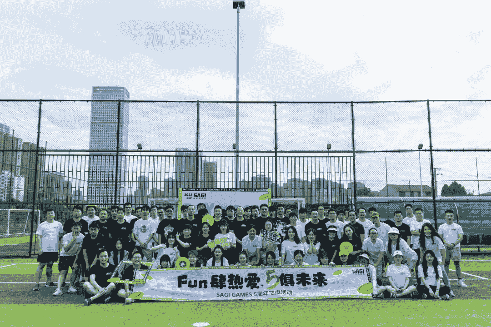
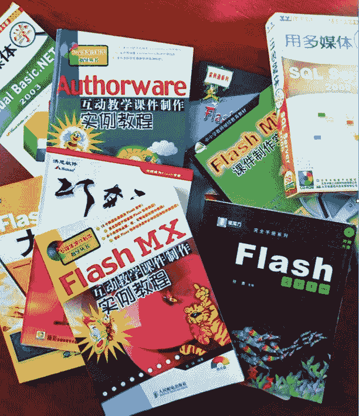
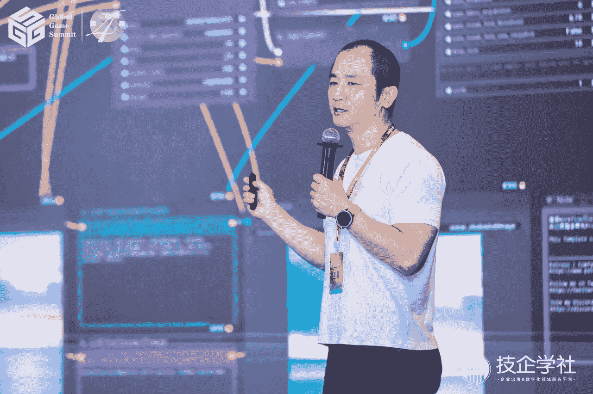
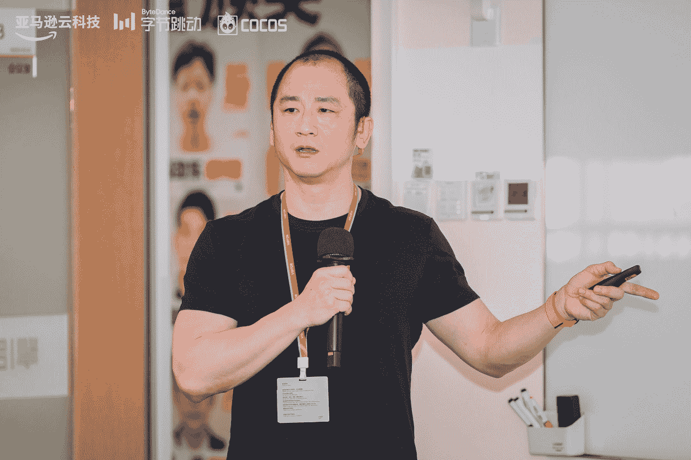
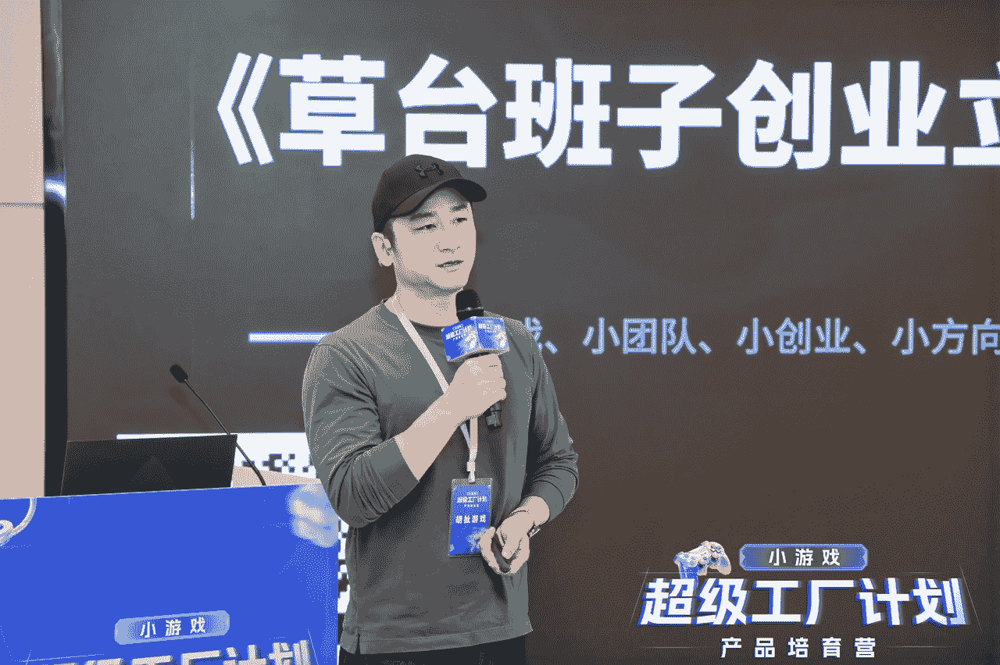
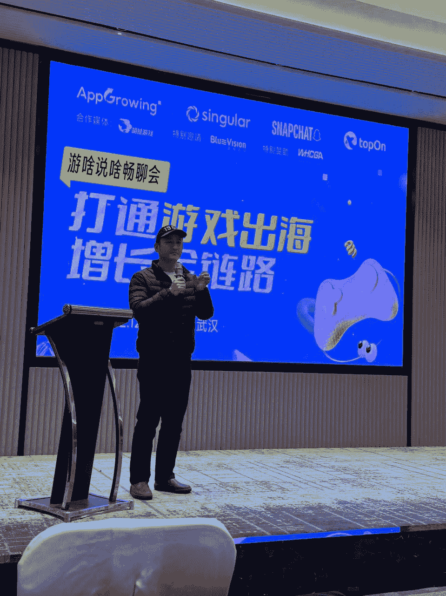
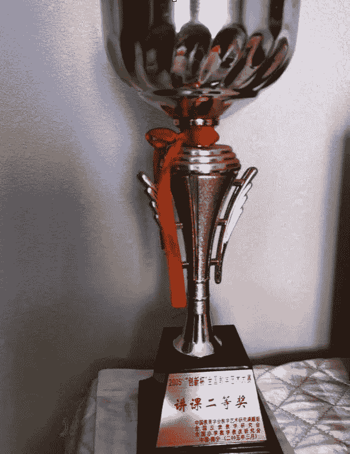

# 关于曾老师

> 来源：[https://huchegames.feishu.cn/docx/YYDQdoPpXoWoi3xQdhvca9KKn5g](https://huchegames.feishu.cn/docx/YYDQdoPpXoWoi3xQdhvca9KKn5g)

# 曾嵘 Jacky

持续创业者，游戏热爱者，沦为程序员的美术老师，15年游戏行业老兵。

**武汉虎澈科技有限公司 **创始人 & CEO。游戏自媒体「胡扯游戏」唯一撰稿人。

## 更正式的介绍

美术老师跨行技术，程序员出身的创业者，自研自发百人游戏公司从0到1的实践者。

从研发、管理、发行、商务到运营均有一线实践：

+   人事管理

+   项目管理

+   发行管理

+   产品策划

+   技术管理

+   财务管理

## **更轻松的介绍**

+   二十年中老年野生程序员（会修电脑会超频）

+   十年一线教学、六年培训和会议组织

+   精通用十八种编程语言写 Hello World

+   页游/手游/网站前后端/APP/服务器

+   SAGITEAM 的IT+运维+架构师

+   千万日活，分离架构，一键部署的小游戏通用服务器 MJP 发起和主要（可能唯一）维护者

+   封笔美工+菜鸟策划+兼职投放+核心运营+高端引入商务

+   有成功项目的制作人

# **自媒体、社群、公众号、博客**

## **胡扯游戏社群**

[胡扯社群指南](https://huchegames.feishu.cn/wiki/U6WhwNpMwiPWoMkaVPUcY1zmn0e)

## **个人网站**

https://zengrong.net/

## **写了20年的博客**

https://blog.zengrong.net

<https://huchegames.feishu.cn/sync/T6k8dTlOasggdDbWUwacAaarnDe>

# 创业经历

## 第三次创业：胡扯游戏创始人（2024~）

AI漫剧制作

## 第二次创业：SAGI GMAES创始人（2017～2023）

+   来SAGI GAMES，一起创造长期伟大的游戏

+   [SAGI 新家我们啦](http://mp.weixin.qq.com/s?__biz=MzA5NzQ3NDM3MA==&mid=2656289551&idx=1&sn=92b4637e0ad40648f6fa4d2d669e769c&chksm=8b072122bc70a83410cdfeecf982f65b0df2eae5ec9c300e268d1d85f79b7088e6f288c21fc6&scene=21#wechat_redirect)

+   SAGI GAMES曾嵘：国内海外如何做好休闲游戏运营？

+   来 SAGI GAMES，一起创造长期伟大的游戏

+   [给 SAGI 新同学的一封信](http://mp.weixin.qq.com/s?__biz=MzA5NzQ3NDM3MA==&mid=2656289418&idx=1&sn=7a6ef297b8eb11ab14ff2fa0b1b59585&chksm=8b0720a7bc70a9b109cf20d174741d499c0aebebcaac6f47a0463a5397b8aa9274b6132e9fde&scene=21#wechat_redirect)

+   新同学在SAGI的成长：自下而上

+   [高效在线办公的核心实现](http://mp.weixin.qq.com/s?__biz=MzA5NzQ3NDM3MA==&mid=2656288607&idx=1&sn=f3bb7f053b4dbdbc606ec758a8c200b6&chksm=8b075d72bc70d4647163074025d0a365e593f5d5f25614f3db88035a4db873f67aee79b55d7e&scene=21#wechat_redirect)

+   [小CP如何搭建发行团队](http://mp.weixin.qq.com/s?__biz=MzA5NzQ3NDM3MA==&mid=2656289262&idx=1&sn=d3a163bfce09440f78ac89f16d7d6169&chksm=8b0723c3bc70aad537090d82a35c54fb6d5caed5e72c9cf1970e599429c10ca32d507bf40ae6&scene=21#wechat_redirect)

+   当自研自发成为另一种出海的标配，作为小团队如何从零到一组建发行团队？

+   [SAGI GAMES曾嵘：《Genius ](http://mp.weixin.qq.com/s?__biz=MzA5NzQ3NDM3MA==&mid=2656289124&idx=1&sn=175c1c69c0bcd0a70665a096f4503f06&chksm=8b072349bc70aa5f0ad173c9081a8b053ffef5112584ce0fb98e9af1771b7d1e3a0d3ac04a17&scene=21#wechat_redirect)Shooter》，小团队如何搏击北美市场

+   [从小游戏到APP，登顶iOS排行](http://mp.weixin.qq.com/s?__biz=MzA5NzQ3NDM3MA==&mid=2656289484&idx=1&sn=07e0a41874cf963f21fe386f8a1df710&chksm=8b0720e1bc70a9f73c7f80dc7c94fc7d1445dd174aba49a5ea576e96f7c8fa718396c60c917e&scene=21#wechat_redirect)榜，这款PVP竞技篮球手游都做了些什么？

+   更多：2017年7月～2023年12月我关于创业的所有思考

## 第一次创业：TEAM1201技术合伙人（2010～2015）

**小小联盟** Cocos2d-X Android iOS

一个 MOBA 手游。这个产品立项很早，但中间推倒重来好几次，错过了融资和发布的时机。

**卧龙传** Adobe AIR Android iOS

三国题材的 SLG 手游。第一次创业时的作品，作为主要开发者参与。在中国大陆、香港、台湾、韩国运营。

# 斜杠经历

## 写作与出版物（2001～2006）

+   以下出版物均为 2006 年前的古董书，不一一列举。

+   主编：《Flash MX互动教学课件制作实例教程》（人民邮电出版社）

+   参编：《用多媒体学 SQL Server 2000》（北京中电电子出版社）

+   参编：湖北省中小学信息技术教材 《信息技术与网络（小学版）》《网络技术应用（初高中版）》（华中科技大学出版社）

+   参编**《Flash完全手册》** （清华大学出版社）

+   参编多套课件制作书籍...

## 研发与管理（2015～2017）

游戏部门（300+人）技术负责人，负责前端技术团队+服务器技术团队+大数据技术团队。

## **程序员（2003~2023）**

项目：https://zengrong.net/career/

开源：https://github.com/zrong?tab=repositories

# 现场活动宣传/主持/专题演讲/圆桌

## 2023~2025

[2025年 4 月23 日：Singular Growt](https://mp.weixin.qq.com/s/Lwk61GlhJAI74HFt1cGbbw)h Masterminds 深圳闭门沙龙

[2025年 4 月 11 日：GGS 2025 第四届全球游](https://mp.weixin.qq.com/s/vPuG9TrnDsqxaI7q0RnK3w)戏峰会主题演讲：将AI引入游戏研发工作流

2025年 4 月 10 日：聚焦和突破：游戏和 AI 如何互相成就

2025 年 2 月 28 日：白鲸出海星光城市武汉站沙龙

[2024 年 12 月 12 日：小游戏出海，差异化](https://mp.weixin.qq.com/s/xWm44Avu_V2P6nF4pg_9GQ)和本地化如何做？12月12日武汉现场畅聊

2024 年 12月 23 日：苏州「抖音小游戏行业生态新视野」

[2024 年 9 月 5 日：9月5日我](https://mp.weixin.qq.com/s/YXLpVe-g43K1LCXEvfAjSQ)讲了什么？小游戏创业/韩国发行/游戏投资

2023 年 6 月 16 日：第二届中国游戏出海峰会

## 2000~2023

+   曾老师的Python课（全部索引）

+   全国教学艺术大赛讲课二等奖

+   新东方 IT 教育讲师、湖北总部教学主管

+   连续五年每年组织300人以上培训两次

# **摄于2018年2月**

