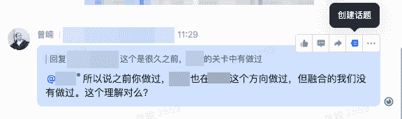
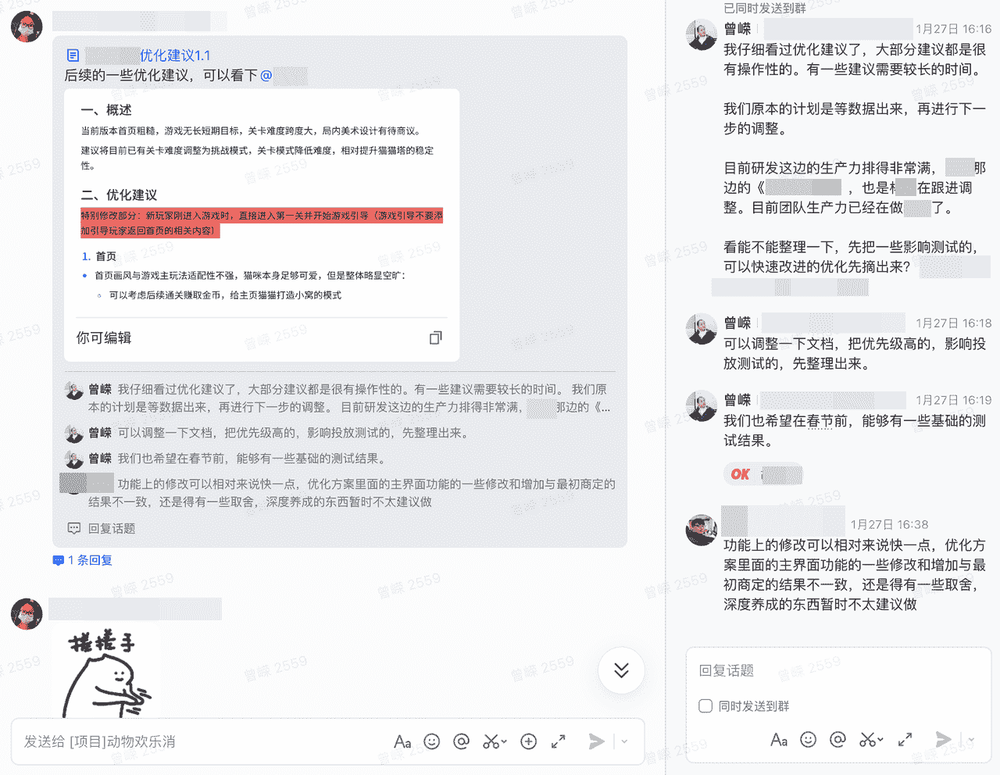
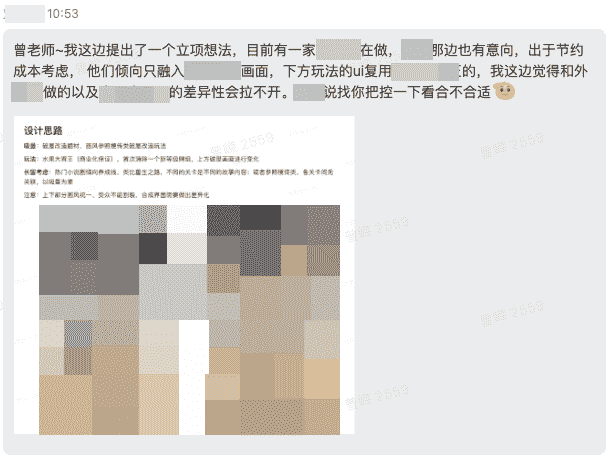
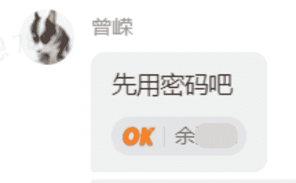

# 你会聊天吗

> 来源：[https://huchegames.feishu.cn/docx/IXTQdiyHToaYLrxhay5cz0nlnnh](https://huchegames.feishu.cn/docx/IXTQdiyHToaYLrxhay5cz0nlnnh)

<https://huchegames.feishu.cn/sync/BOzGdo6LGss460bjx8Lch2vbnHx>

# **你以为你以为的就是你以为的吗？**

## 「作为 Leader，我在群里是不是会影响他们的输出」

**No****，**你可以假装自己不存在，但你的存在会大幅提升整体效率。

## 「这个工作和其他人没关系，所以可以私聊」

**No，**你的工作需要别人的帮助和知情。

## 「Leader 在群里蛮讨厌的，总在提要求」

**No****，**Leader 能大幅提升你工作的成功率。

## **「私聊的话做砸了也没人知道」**

**No，**事情做砸了全公司都会知道。

## 「别人不知道，我就能降低工作要求，我不想努力了」

想成事儿，就要对自己高标准，对别人严要求。

不想努力了今天就早点下班，明天再继续努力！

# **指导方针**

1.  Entities should not be multiplied unnecessarily. 如无必要，勿增实体。

1.  **工作** 必须在群内谈，禁止私聊安排工作。涉及到多个部门的工作要报相关的负责人知晓；

1.  **工作外** 拉小群，聊心情聊感情和吐槽都可以，但不要发H图，不要讨论ZZ，不要背后议论其他同事。

# **线上信息沟通**

## 要群聊，不私聊

关于工作内容的交流，**用群聊@关键人，****不要私聊！不要私聊！不要私聊！**

## 善用「话题」功能

对于群中讨论的，可能只涉及几个人，但需要深**入讨论，又担心影响群中其它无关**人的情况，可以善用飞书提供的「话题」功能，在需要的时候 @相关人 加入话题：

使用「话题」功能，相当于在群聊里面开了个小窗，后续的聊天会单独得到提醒，不会打扰群中其他人员。

如果要临时把群中的某个人拉入「话题」，那么在回复话题的时候加入@那个人即可。

## 用文字，一句话说清楚

能用**文字说明**清楚的事情就不要口头去说。

能用**一句话**说完的内容就不要用多句话。

### 正确的一句话✅

下面这段话简明扼要，介绍了背景信息，具体需求，期待的目标。

在工作沟通中，当发起一段话的时候，就尽量提供足够简明和全面的信息，方便对方在第一时间就判断回应方式和内容，节省对方的时间，也是节省自己的时间。

> 要练习自己的归纳能力，可参考：[SMART原则](https://umaf71ft2r.feishu.cn/wiki/XpIdwr7uTiTN2qkIdEGcNex2nAh)

> 沟通保持礼貌和效率：[公民论坛对话原则](https://umaf71ft2r.feishu.cn/wiki/BXMYwerVOiCfQrk3tCqc4jkqntb)

> 想要更进一步？可参考：[「靠谱」是极高的标准](https://umaf71ft2r.feishu.cn/wiki/Vsfvw2iwiiDkhZkbeRicVpPvndf)

> [XY问题](https://umaf71ft2r.feishu.cn/wiki/Wilqwn8bai9L6ekBrdKcMYQqnyg)是得不到正确答案？你可能问错了问题：

### 错误的一句话❌

下面这段话全是废话，毫无价值，很可能打断了 B 的工作心流。

> A：在么？

> B：……

> A：我有件事想请教一下你？

> B：什么事？

> A：你现在有空可以接一下语言么？

> B：我在开会。

> A：好，那等你有空我再找你。

> B（心理活动）：你就不能一次说完么……下次还这么来一遍累不累

## 善用「回复」功能

某一话题的讨论可以使用 「回复」功能，可以通过持续使用回复功能，让对话更具可读性（在大群里更是如此）。

## 善用表情确认

「明白」、「没问题」一类的回复使用 「OK 表情（或者人类认为能代表 OK 的表情）」来完成。

# **群聊时要注意什么**

+   每个项目只有一个项目大群，项目大群必须包含：项目负责人、职能负责人、HRBP、部门负责人；

+   项目相关的工作，在项目大群讨论，直接 AT 对应人；

+   每条职能线只有一个职能大群，必须包含：职能负责人；

+   职能群一般讨论职能线成长、学习、技能相关的内容。

# **什么时候应该私聊**

+   需要发送的工作内容比较敏感；

+   非常早期的两人讨论和交流；

+   不涉及工作的个人讨论。

# **怎么避免群里人越来越多的情况？**

+   如果一项工作相对独立，在大群讨论会影响大部分人，就可以将其拆分到小型项目群中。例如，项目发布机器人消息、数据分析、某个项目细节的专题讨论，可以设定专项工作群（小群）。

+   每隔一段时间梳理大群，对于工作调整的同学，及时与其充分沟通后，将不相关的同学移出群聊。

# **怎样拉小群？**

1.  当开展专项工作时，为了减少信息干扰，可以拉临时小型项目群。

1.  专项工作群必须包含：项目相关人员，业务联系人，业务决策人。

1.  由该专项工作责任人负责拉群。

1.  如何判断是否需要将 Leader 拉入群中？这取决于这项工作是否由你全权负责。为了避免 Leader 进入太多群造成信息干扰，你可以在与 Leader 充分沟通后，将其拉入群；或者不让其入群，换用其他的方式定期向 Leader 汇报进展；

1.  若专项工作结束，由专项工作负责人将群禁言，零星的该工作讨论转到大群；

1.  一切判断均以能实现 **更高效的工作** 为目标。