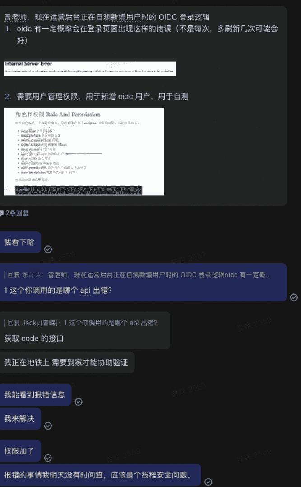
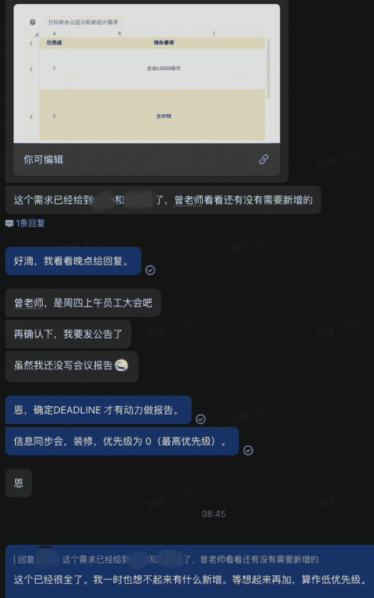
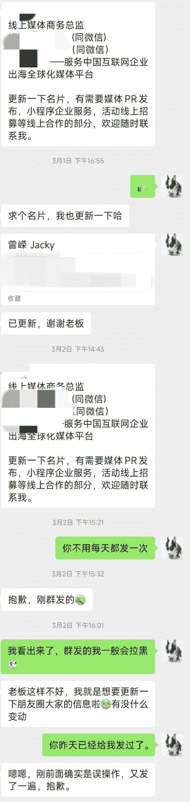
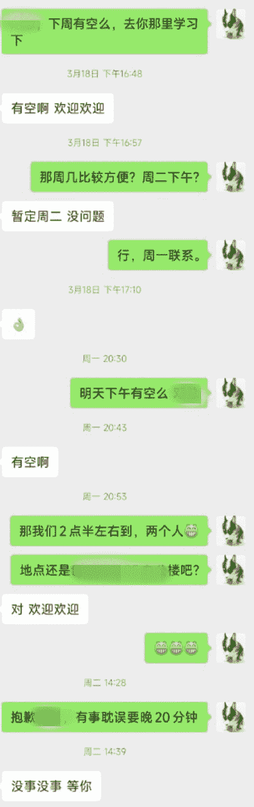

# 「靠谱」是极高的标准

> 来源：[https://huchegames.feishu.cn/docx/F4trdH2FqodhqdxZVl4cbL7ynrg](https://huchegames.feishu.cn/docx/F4trdH2FqodhqdxZVl4cbL7ynrg)

<https://huchegames.feishu.cn/sync/BOzGdo6LGss460bjx8Lch2vbnHx>

> 靠谱的三个表现：及时回应，闭环思维，阶段性反馈。

>

+   「靠谱」是一个极高的标准，但仅仅是你成长的入门标准。

+   越靠谱，越幸运。

+   做事要找靠谱的人，聪明人只能聊聊天。

# **及时回应**

无论是否能解决，第一时间给出对事件的反馈。

在提供信息时尽量详细，并提供上下文。

尽量一次提供完整的信息。

正面例子✅

负面例子❌

# **闭环思维**

+   凡事有交代

+   件件有着落

+   事事有回音

## 0 分

> 曾老师交代了一件任务给小 A 同学，小 A 完成了任务并发邮件/飞书消息回复给我。

> 过了两天，曾老师询问小 A 是否完成了任务。

> 小 A：我已经给你发了邮件/飞书消息了啊！

> 曾老师不会说什么，因为没看到消息或者邮件是曾老师的责任。但降低了曾老师对小 A 的信任和认可度。下次交代任务，可能就不会找小 A。

## 负分

> 曾老师交代了一件任务给小 A 同学，小 A同学忘了。

> 过了两天，曾老师询问小 A 是否完成了任务。

> 小 A：啊我已经完成了，但忘了向你报告了。

> （然后小 A 加班完成了任务）

> 你以为曾老师是个傻子么？

## 满分

> 曾老师交代了一件任务给小 A 同学。

> 小 A：什么时候完成？

> 曾老师：明天下班前。

> （----这是明天的分割线----）

> 小 A：曾老师我已经完成了（飞书消息）。

> （曾老师已读不回）

> 小 A（2 小时后，冲到曾老师工位）：昨天布置的任务已经完成。我发现这里有个安排不合理，换了一种实现方式，因为时间原因，没有提前通知你，但效果是一样的。

> 曾老师：你修改得很好。

# 阶段性反馈

+   有需求必问档期，成交与否必给答复，未成交必告知原因。

+   任何变动给利益相关者带来的影响，必须第一时间通知给TA。

+   对于长期任务，需要阶段性地进行汇报。

## **聊天社死现场**

互联网是有记忆的。有个东西叫做聊天记录。在沟通中尊重别人，别人才会尊重你。

## 做一个靠谱的人，就是让别人有掌控感

闭环思维强调的不仅仅是责任性，更强调团队配合和人际敏感性。

## 靠谱的人都是「傻子」

你以为靠谱的人是「傻子」？傻子才有更多机会做事。

推荐《阿甘正传》《射雕英雄传》。

做事要找靠谱的人，聪明人只能聊聊天。