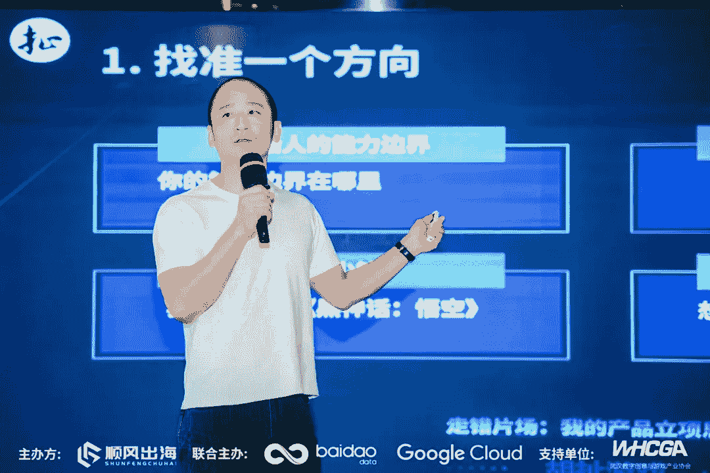
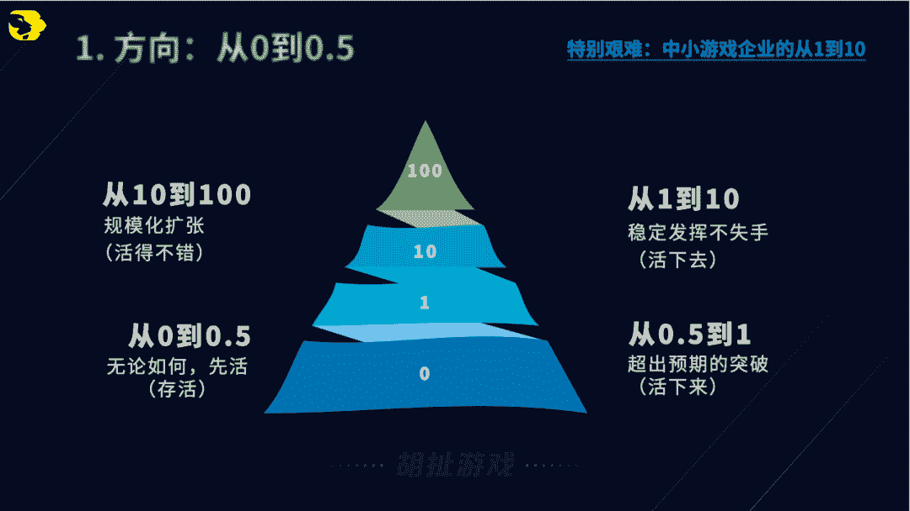
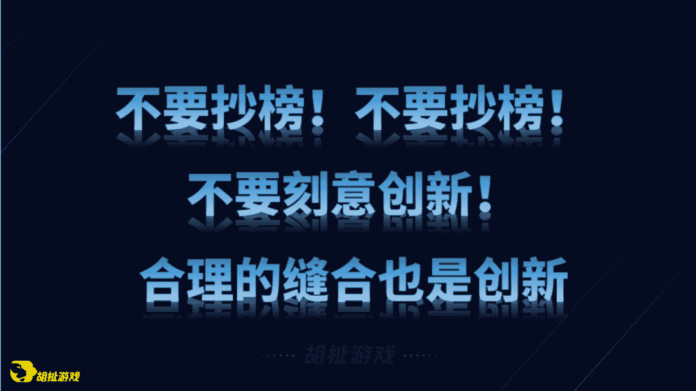

# 看完少烧一百万：小游戏创始人避坑指南（上）

> 来源：[https://huchegames.feishu.cn/docx/AcjzdxtmPoTpiHxPMwQclqVcnNd](https://huchegames.feishu.cn/docx/AcjzdxtmPoTpiHxPMwQclqVcnNd)

<https://huchegames.feishu.cn/sync/MGI1d8zcLsDO0Tb1po5cCxZanMg>

> 🔗 原文链接： h[ttps://mp.weixin.q](https://mp.weixin.qq.com/s?__biz=MzA5NzQ3NDM3MA==&mid=2656292944&idx=1&sn=0317d38dae7c95366edd037c23127aae&scene=21&poc_token=HL28VGijy1SZ34U🐧w3R4WOtO088MEdPgU9HjtrX)q.com/s?__biz=Mz...

> ⏰ 原创 曾嵘 曾嵘胡扯的地方2024年12月03日 13:00  广东

---

这篇内容是我9月5日在 「全球游戏研发发行对接会（武汉站）」 上的分享。

[看完少烧一百万：小游戏创始人避坑指南（上）](https://huchegames.feishu.cn/wiki/WS3XwjglciWZzhkwUPucmCMBnTe)

[看完少干三百天：小游戏创始人避坑指南（下）](https://huchegames.feishu.cn/wiki/Jv3vwywMRiWEvWkJStGc6uVPnje)

分享完毕后，我答应群友会把PPT发出来，这三个月一直忘(mei)了(kong)发。现在分成上下两篇发出来，以飨读者。

这次分享会上还有很多精彩的内容，可以看这篇： 9月5日我讲了什么？小游戏创业/韩国发行/游戏投资

+   目录：创业的核心问题

+   1. 找准一个方向

+   1.1 创始人的能力边界

+   1.2 团队的能力边界

+   1.3 赚多少钱

+   1.4 从0到0.5

+   团队和执行

## **目录：创业的核心问题**

对于创业公司来说，最重要的六个方面是： 方向、团队、执行、商业化、发行、运营。

**由于篇幅有限，这次**的演讲重点围绕 方向、团队、执行 三个更偏管理层面的内容进行探讨。

1.  方向：找准一个方向（本篇）

1.  团队：你才是团队的核心（下篇）

1.  执行：执行的细边界（下篇）

## **1. 找准一个方向**

选对方向可以决定一个项目甚至一个公司的生死。

无论是项目立项还是整个公司在市场中的定位，方向始终是最优先要考虑的问题。而作为小团队的创始人，你不仅需要掌握方向，还要清楚自身的能力边界。

+   1.1 创始人的能力边界

+   1.2 团队的能力边界

+   1.3 赚多少钱

+   1.4 从 0 到 0.5

## **1.1 创始人的能力边界**

对于游戏人来说，人生就是一场游戏。

**创业也是一场游戏。**

创始人，就是这个游戏的主角。遗憾的是， 你没有主角光环，也没有无限复活机制。

作为主角，你需要具备足够强的初始属性：

**体力**

体力是你全力思考和工作的时间，不仅要996，还要007。创始人需要旺盛的精力，不仅是指身体素质好，能连续工作较长时间；也包括适应性强，可以迅速转换时差、环境甚至饮食习惯；还包括无论顺境逆境，都能以积极心态，从容面对。

**智力**

你需要高效、高质量地进行输出；你需要辅导别人；你最好能一次做到位，不求每次都对，但求每次都做到极限。

**敏捷**

创始人要学会控制节奏，把握平衡，紧跟变化。这也是游戏设定中敏捷的含义。

**气运**

这里用的是气运而不是运气。气运是更大的运气。**小成功可**能需要一点点运气，大成功则需要 借势。 气运，影响有限机会中成功的概率。

**经验**

我们还没有成功，是因为我们失败得太少。 在历史的失败中，总结出认知的闭环，是极其宝贵的创业养料，能对未来的决策提供决定性的帮助。

这些能力的综合体，决定了创业者在游戏中的起跑线。

> 可参考： 2024：我应该去做独立游戏吗？

## **1.2 团队的能力边界**

史蒂芬·柯维的「重要紧急四象限」，是每个创业者的必修课。相关的资料互联网上太充分了，创业者一定要掌握。

在一个游戏开发生命周期中，我们关注下面8个方面事情：

1.  品类

1.  题材

1.  美术

1.  程序

1.  系统

1.  商业化

1.  性能

1.  优化

1.  发行

曾老师吧这8个方面放入重要紧急四象限，看看小游戏创业团队需要如何分配精力。

+   最紧急且至关重要的决策，是选择品类。

+   其次是题材，题材决定了后续的推广成本。

+   美术虽然也很紧急，但并不比品类和题材更重要，因为美术风格通常是服务于题材的。

+   程序的重要性相对次之，它只是实现游戏的工具，重点是确保品类、题材、美术这些核心要素先行。

+   商业化和性能优化则可以在游戏进行到一定阶段后再进行调整，过早地优化这些内容可能会导致资源浪费。

+   发行，等产品出来了DEMO再说吧。

> 可参考： 快速项目质量保证：上线前的三次验收

我在 职场黑神话：老板[和员工的共情取经路 和 特](https://mp.weixin.qq.com/s?__biz=MzA5NzQ3NDM3MA==&mid=2656292165&idx=1&sn=197fefcbe492b08f268fd88c60900c10&scene=21#wechat_redirect)别艰难： 中小游戏企业的从1到10 两篇文章中，都提到过团队分类概念：

+   **小公司，**初创团队，业内老鸟，简称 小初老。

+   **小公司，**初创团队，生瓜蛋子，简称 小初生。

+   **小公司，**熟悉团队，业内老鸟，简称 小熟老。

其中，前两个概念是 @车老师（👸号：车尔斯基的游戏运营杂谈） 提出来的，最后小熟老的概念是我增加的。我认为，小熟老成功的概率会更大一些。

为什么 **小熟老 **团队的 **敏捷、经验 **是满分？因为他们足够老，因为他们长期合作，默契更高。

为什么 **小熟老 **团队的 **气运 **得分最高？因为他们的坏运气都用光了。

团队能力可以划分为技术、美术和经验三大方面。创业团队必须清楚自己的能力边界。

要根据团队的技术能力边界来选择品类。

团队的技术能力决定了品类实现效果。看看这下面这些品类：PvP、动作、Roguelike、策略、放置、RPG……哪些品类是资金不足，生存压力拉满的小创业团队能碰的？

有些刚从大厂出来的开发者，还没融到钱，上来就想做动作游戏，做 MMORPG，技术够吗？能用低价找到合适的人才吗？

要根据团队的美术能力边界来选择题材。

题材决定买量成本。团队的美术能力决定了题材的实现质量。选择动物、水果题材可能会更吸引女性用户，而Low Poly 风格则更吸引小学生用户群体。

基于团队的产品能力边界设计系统。

经验是关键——如果团队之前擅长做超休闲游戏，创业时仍应延续赛道，而不应贸然挑战自己不熟悉的领域。

有些重度团队尝试制作小游戏，结果并不理想。虽然这些游戏的美术和系统设计都非常出色，但与休闲用户的需求脱节。一定要清楚自己面向的用户群体是什么样的，并避免将重度游戏的思路强加到轻度游戏中。

这是经常出现的错误，不论初创还是老团队都会犯：

+   中国美术心中的欧美风

+   男性美术心中的女性向

+   重度心中的休闲游戏

> 立项参考： 混合变现从入门到放弃（下）——我的立项思考

## **1.3 赚多少钱**

相信游戏创业者们都有过这样的心态变化：

+   我要做一个《黑神话：悟空》

+   做个好玩的游戏，挣不挣钱不重要

+   公司做到1000人，再买栋楼

+   创意优先，扁平化管理

+   做一个Top1爆款

+   流水1000万就够了

+   能发工资就行……

但我们都很清楚， **我们只能挣到认知范围内的钱。**

## **1.4 从0到0.5**

很多人都谈论如何从0到1，但曾老师更关注从0到0.5。

在创业初期，最重要的不是如何实现超越，而是如何先活下来。

创业者不应追求完美，也不应过于关注项目能带来的大收益和长线收益。

要关注生存的关键—— 不断做出小突破，确保项目可以持续发展。

> 可参考： 特别艰难：中小游戏企业的从1到10

五菱在口罩时代有个广告语「人民需要什么，五菱就造什么」。

对于创业者来说，也应该把这句话贴在墙上：「市场需要什么，我们就做什么」。

**在践行这句话之前，首先要**问自己： 你对市场的理解，正确吗？

小团队创业，要做自己擅长的事，切忌盲目模仿或追求过度创新。

> 可参考：

> 小游戏创业：塔防Like赛道思考（上）

> 小游戏创业：塔防Like赛道思考（下）

「不要抄榜，不要刻意创新，合理的缝合也是一种创新。」

## **团队和执行**

[看完少干三百天：小游戏创始人避坑指南（下）](https://huchegames.feishu.cn/wiki/Jv3vwywMRiWEvWkJStGc6uVPnje)次分享还有两个章节内容，请看下篇：

+   团队：你才是团队的核心

+   执行：执行的细边界

---

<https://huchegames.feishu.cn/sync/UZIod6tpos5E6ob7w2EclHC5nh5>

**这些会议相关文章值得读一下：**

+   消除类小游戏前中后期调优细则——2024腾讯广告IAA🛰️小游戏私享会

+   [IAA小游戏之什么值得做：逆袭和塔防—](https://mp.weixin.qq.com/s?__biz=MzA5NzQ3NDM3MA==&mid=2656292775&idx=1&sn=475552d19adcbb60ac5a86e7361e9bc1&scene=21#wechat_redirect)—2024腾讯广告IAA🛰️小游戏私享会

+   CGDC上《潜水员戴夫》关于Steam推荐算法的分享

+   9月5日我讲了什么？小游戏创业/韩国发行/游戏投资

+   《小游戏团队创始人避坑指南》PPT ｜ 欢迎来现场胡扯

+   2024🛰️公开课小游戏开发者大会PPT（部分）

+   2024🛰️小游戏开发者大会逐字稿

+   IAA异军突起，基于抖小IAA用户研究报告的立项思路分析

+   让创造产生价值：2024(武汉)🛰️小游戏公开课IAA专场实录

+   智游破浪启迪未来：2024抖音IAA小游戏生态大会实录

+   游无界创未来：2024(广州)巨量引擎抖音小游戏行业峰会实录

+   CJ五日-2023 ChinaJoy 回归新增长