# 看完少干三百天：小游戏创始人避坑指南（下）

> 来源：[https://huchegames.feishu.cn/docx/XbnzdFEhpoF4jixtjDGcvjqKnBd](https://huchegames.feishu.cn/docx/XbnzdFEhpoF4jixtjDGcvjqKnBd)

<https://huchegames.feishu.cn/sync/MGI1d8zcLsDO0Tb1po5cCxZanMg>

> 🔗 原文链接： h[ttps://mp.weixin.q](https://mp.weixin.qq.com/s?__biz=MzA5NzQ3NDM3MA==&mid=2656292977&idx=1&sn=24154094004d8a15e15f20e38672580f&scene=21#wechat_redirect)q.com/s?__biz=Mz...

> ⏰ 原创 曾嵘 曾嵘胡扯的地方2024年12月05日 12:05  湖北

---

这篇内容是我9月5日在 「全球游戏研发发行对接会（武汉站）」 上的分享。

[看完少烧一百万：小游戏创始人避坑指南（上）](https://huchegames.feishu.cn/wiki/WS3XwjglciWZzhkwUPucmCMBnTe)

[看完少干三百天：小游戏创始人避坑指南（下）](https://huchegames.feishu.cn/wiki/Jv3vwywMRiWEvWkJStGc6uVPnje)

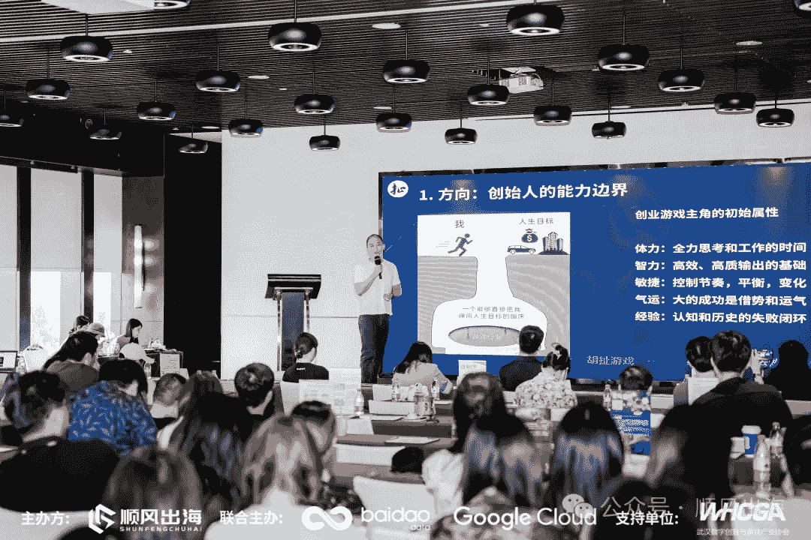

分享完毕后，答应群友会把PPT发出来，这三个月一直忘(mei)了(kong)发。现在分成上下两篇发出来，以飨读者。

这次分享会上还有很多精彩的内容，可以看这篇： 9月5日我讲了什么？小游戏创业/韩国发行/游戏投资

阅读上篇： 看完少烧一百万：小游戏创始人避坑指南（上） 。

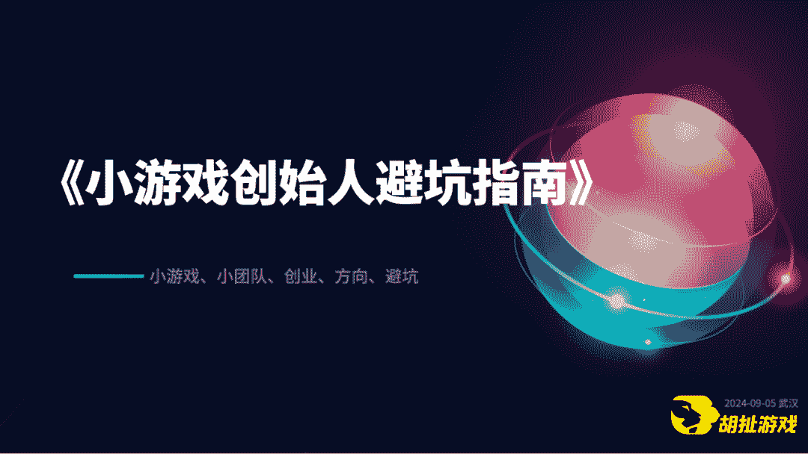

+   2. 你才是团队的核心

+   2.1 合伙人是背靠背的战友

+   2.2 员工没有深度思考

+   2.3 赚钱是创始人的事

+   2.4 放权和扁平化管理就能创新吗？

+   3. 执行的细节边界

+   3.1 事无巨细

+   3.2 完美的标准

+   3.3 完美的完成，让完成尽量完美

## **2. 你才是团队的核心**

创业者/创始人自己就是团队的核心，除此之外没有别人。

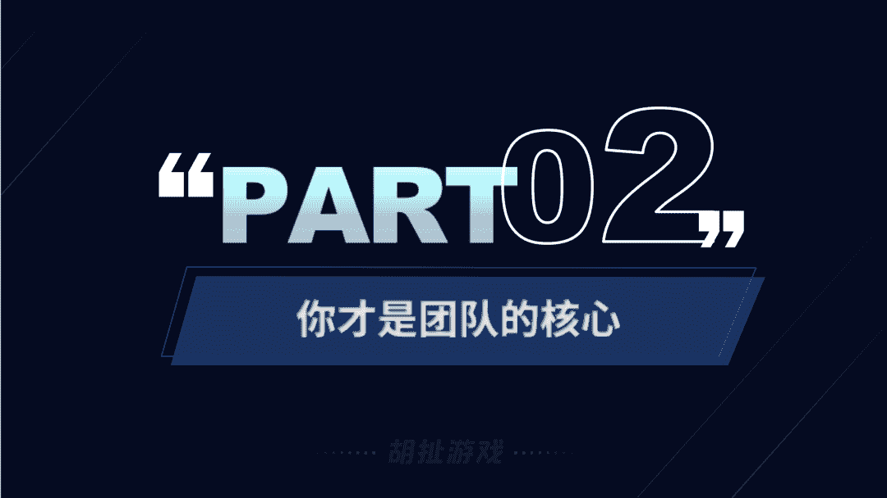

+   2.1 合伙人是什么

+   2.2 员工没有深度思考

+   2.3 赚钱是创始人的事

+   2.4 放权和扁平化就能创新吗？

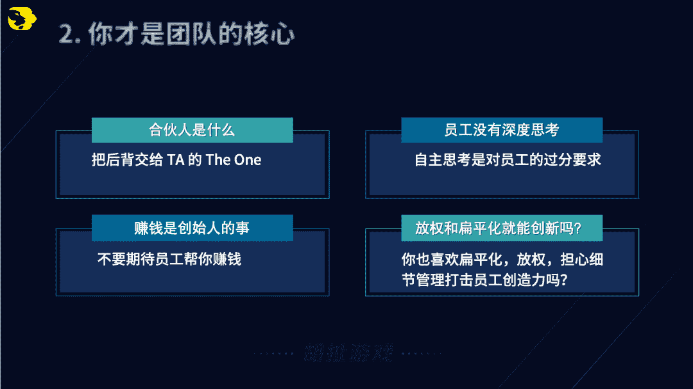

## **2.1 合伙人是背靠背的战友**

创业者总是天真地认为：

+   拿工资的是打工人

+   拿股权的是合伙人

真实创业中，尽管有人拿到了股权，也并不意味着TA们是合伙人。

很多我们认为的 **合伙人 **，本质上和打工人没有什么不同。

前几天有个群友和我聊起 **合伙人大事不管小事投票 **的事儿。曾老师的观点是：

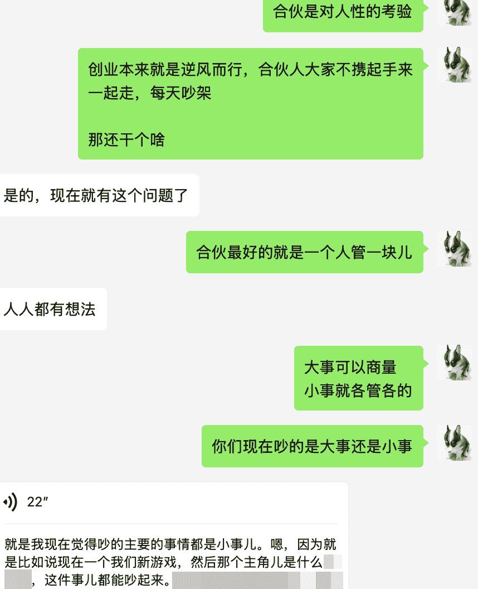

**创业是逆风而行，合伙人必须携手一起走。各人管一**块儿，大事儿可以商量，小事儿就各管各的。

> 可参考： 小游戏创业：为什么你不需要技术合伙人？

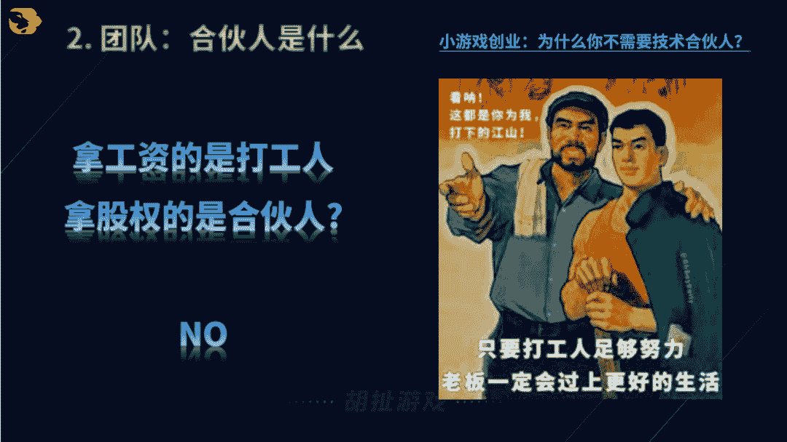

**合伙人是背靠背作战的战友， **合伙人能独立负责一整块工作，能帮助创始人在合伙人负责的领域完全释放精力。

如何判断一个人能否成为合伙人？

当你在寻找合伙人的时候，可以问自己这六个问题：

1.  这个人想创业吗？有多想？

1.  这个人渴望成功吗？

1.  这个人的能力足够吗？能为创业增加成功率吗？

1.  这个人身体健康吗？情绪稳定吗？逻辑清晰吗？

1.  [读书笔记：《奈飞文化手册》](https://huchegames.feishu.cn/wiki/CEowwjq4FidrktkVeducIgX0nre)个人是成年人吗？这里的成年人，指的是 中定义的成年人。

1.  没有这个人，我一个人能成功吗？

这六个问题，有任何一个是负面答案，作为创始人，都应该仔细思考这个人选是否合适。因为任何一个负面答案，都可能会导致创业失败，或者合伙反目。

创业寻找合伙人，不能扶贫心态，不能拼资源心态，不能站台心态，更不能抱团心态。

**创业是孤独之旅，创业是死亡之旅，这样的**旅途上，找个不靠谱的战友，而且还分股权？

> 参考： [小游戏创业：为什么你不需要技术合伙人？](https://huchegames.feishu.cn/wiki/LqlDwUNTNiJyeakHTumckjyLnjh)

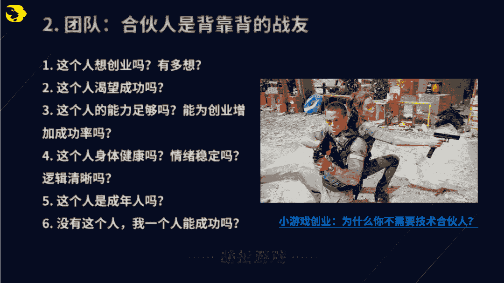

## **2.2 员工没有深度思考**

创业者和员工，是完全不同的两个立场。 员工没有深度思考，创业者也不要在员工身上寻找共情。

创业者和员工的差异主要表现在三个方面：

1.  **立场差异： **屁股决定脑袋，位置决定利益诉求。

1.  **认知差异： **经验和知识水平导致的视角差异。

1.  **信息差异： **高层信息流和基层信息流导致的观点和结论差异。

员工和创始人之间的差距不仅体现在认知和立场上，还表现在他们关注的问题上。

创始人每天思考的是如何赚钱、如何让公司成长；员工更多关注的是培训、创新机会、公司福利、工作与生活的平衡。这是两种截然不同的心态。

> 参考：

+   [自主思考是对员工的过分要求](https://huchegames.feishu.cn/wiki/Aah3wjrlCiwa17kGygycw5uGnbc)

+   职场黑神话：老板和员工的共情取经路

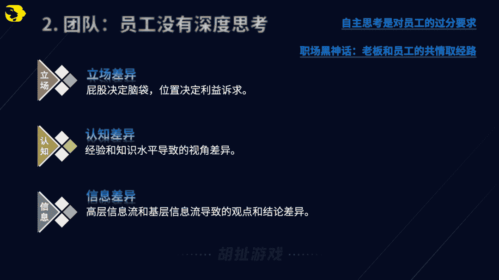

昨天的新闻报道某创始人因为员工不愿意参与直播互动愤而退群，这场景何曾熟悉，让创始人们一声叹息。

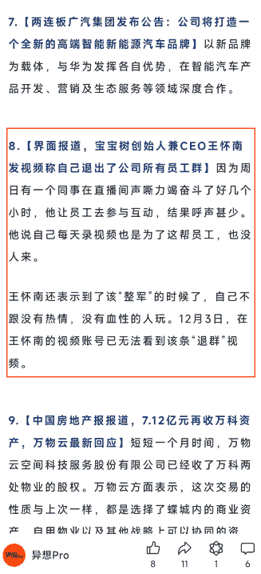

对于创始人而言，这意味着不要指望员工帮你思考公司的未来，员工的目标更多是实现确定性—— 职业成长、稳定的收入，以及更好的生活质量。

看看下面这段话，是不是员工受不了压力离职找你谈(qing)话(su)的时候，经常寻找的理由？

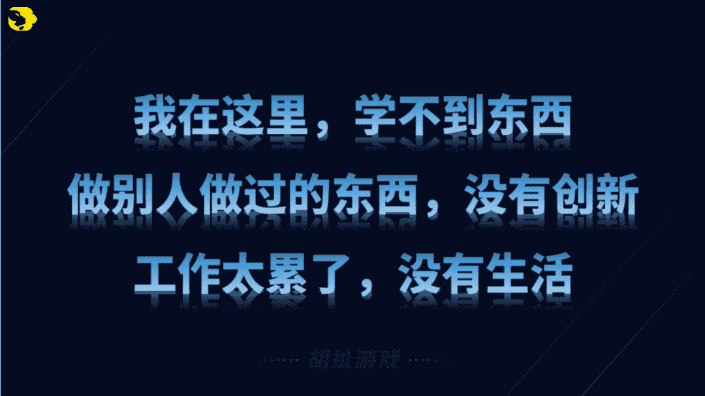

## **2.3 赚钱是创始人的事**

如何选择合适的合伙人呢？有四个选择方向：

**和团队创始人类似的人**

在创业期，创始人就代表了整个团队。和创始人类似的人，更容易理解创始人的思维方式，更能高效执行创业团队的意图。

有明确的目标，有踏实愿景或疯狂愿望的人

有明确的目标意味着缜密的思辨力，有踏实的愿景意味着准确的自我判断力，有疯狂的愿望意味着无限的精力。

**有创业经历，且经历过失败的人**

经历过创业的人更容易开始另一段创业，大多数失败的创业在于坑太多，踩着踩着就掉进去了。经历过创业失败的人更容易脚踏实地避开大坑，眼光也更长远。但也要注意，有些人的创业失败，很可能是因为本来不适合创业。

**有复杂经验，和丰富兴趣的人**

和经验单一的人相比，这样的人更容易看出项目中的问题，也更容易迸发出奇思妙想。

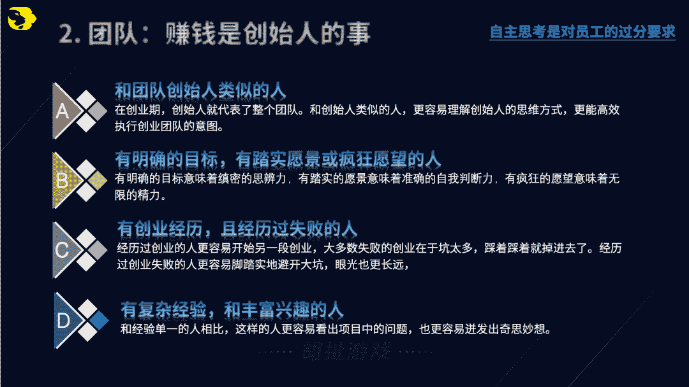

**发工资的人每天想着赚钱。**

领工资的人每天想的是：

1.  确定性

1.  增加确定性

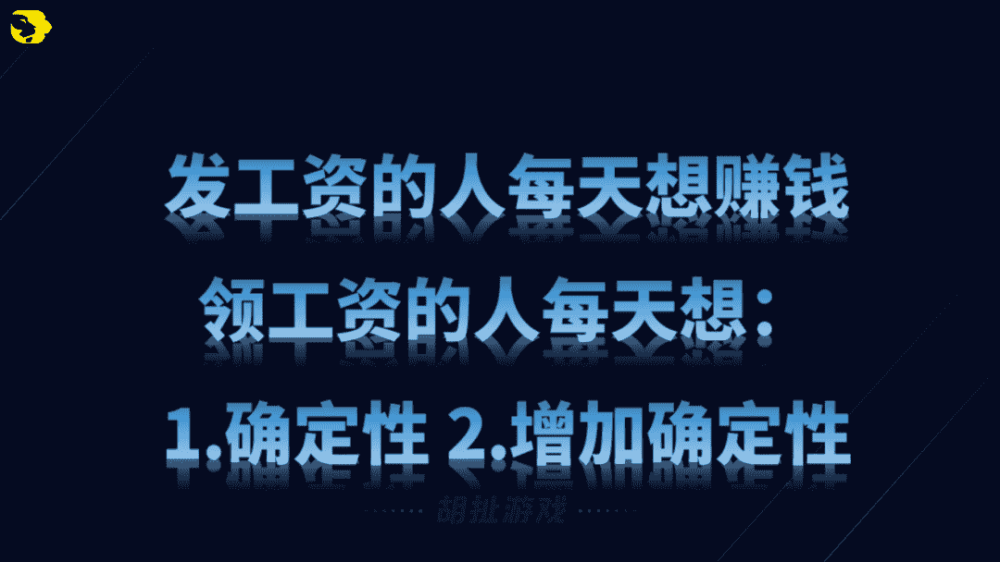

赚钱是创始人的事。创业者期待依靠员工来为自己创造财富，而自己躺平，这是不现实的。

创始人找人来是干你一个人干不完的活儿。

TA可以是手，可以是脚，但不可能是脑袋。

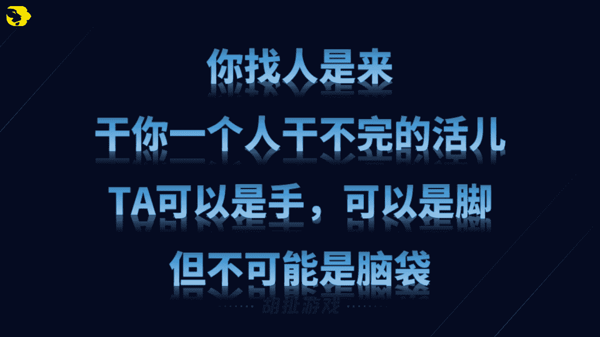

只有创始人才能真正承担赚钱的责任。

没有人能帮你赚到钱。如果一个打工人和你一样，能「熬夜工作，只睡两三个小时」，就是为了确定性地赚到钱，那么TA为什么不自己干？

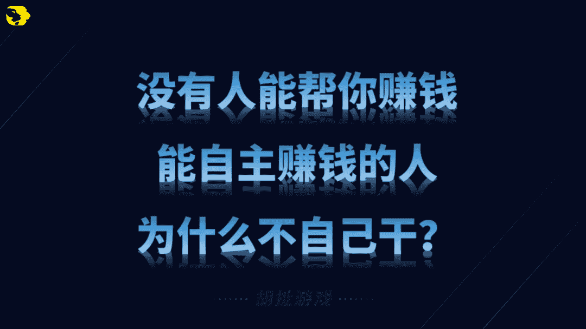

## 2.4 放权和扁平化管理就能创新吗？

游戏行业的的员工，经常会和管理者聊放权。用的理由基本上都一样：对于游戏这样的创新产品，为什么不让我们执行者全力以赴？

但具体到执行上并没有那么简单。放权经常碰到的是这三种情况：

**一管就死，一放就乱**

失败的放权流程通常是下面这两个标准流程。

1.  员工热情高涨 -> 遭遇挫折 -> 自我怀疑 -> 退缩、放手

1.  员工将信将疑 -> 小幅尝试或保持现状 -> 管理介入，要求绩效 -> 恍然大悟（原来老板在找背锅侠） -> 退缩、放手

**甩手掌柜式放权**

「所有事的决策都交给你来决定，没有大事儿别找我」。

员工接到这种授权的时候心里是犯嘀咕的：「你啥都让我决定，是为了让我背锅么？」

**用力过猛式放权**

口头上说都「让你做主」，实际上管得很细，天天盯着具体细节。

关于放权，在胡扯游戏群里也进行过几次激烈的讨论，可以看下面两篇文章：

> 老板苦不苦？员工累不累？超额回报行不行？

> 小游戏团队管理：人性本懒吗？民主集中，关注结果，用好挣工资的人

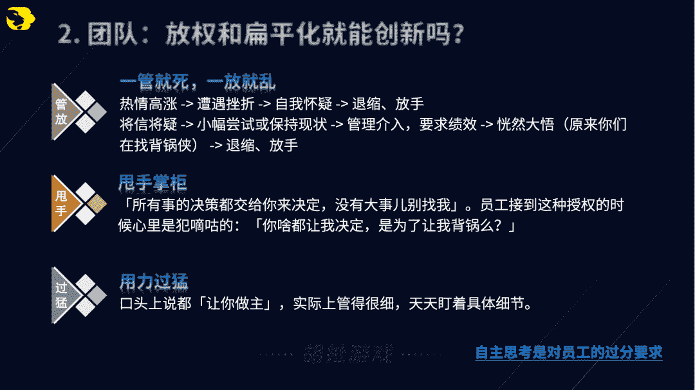

放权并不意味着创新，而是意味着边界的明确和责任的分配。

想要做好放权，创始人要做好下面三点。

**目标的内化**

要让被授权者应该能感到清晰的边界。你需要让被授权者知道，哪些事情可以自己决定，哪些事情必须找你拍板。

**控制感**

放权导致的失败，由谁来承担责任？当然是老板和创业者自己。

因此，下面这个能表现出老板魄力的命令就不成立：「你怎么干我不管，但一定要干成！」

**效能感**

需要对被授权者进行足够明确的培训：

1.  什么样的决策是正确的？

1.  什么样的成绩会得到表扬？

1.  什么样的表现必须受批评？

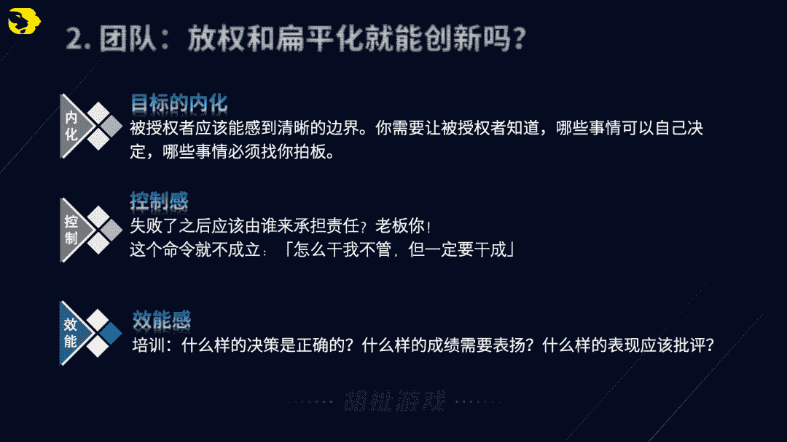

不要轻易相信一个自称是「游戏人」的人。TA们可能玩过很多游戏，也可能了解很多套路，但他们很可能不是真正能带领团队做出优秀产品的人。

我在 2024：我应该去做独立游戏吗？  中写过：

> 很多自称的游戏人，其实只是玩游戏的人。

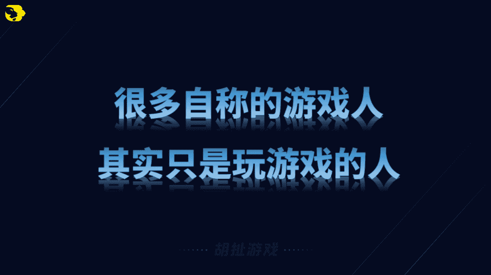

真正的创新力是不可能被扼杀的，它们会一直在那里，等待被创业者发掘出来。但不当的管理会扼杀员工的积极性。

一个没有积极性的团队，即使有强大的创新力，也不可能被发挥出来。

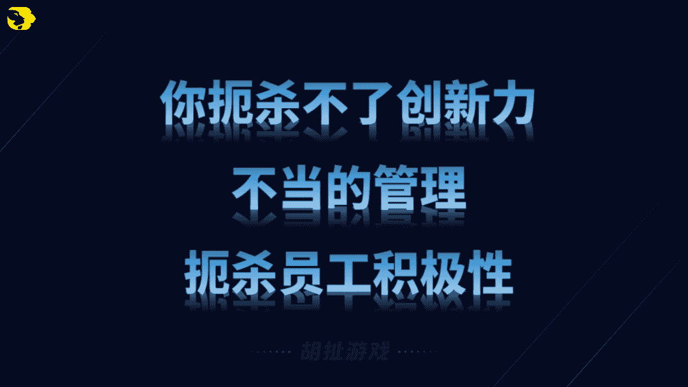

只有一种正确的授权：

把可由别人做的事情，交付给别人。

别人无法承担的任务，是创始人自己的责任。

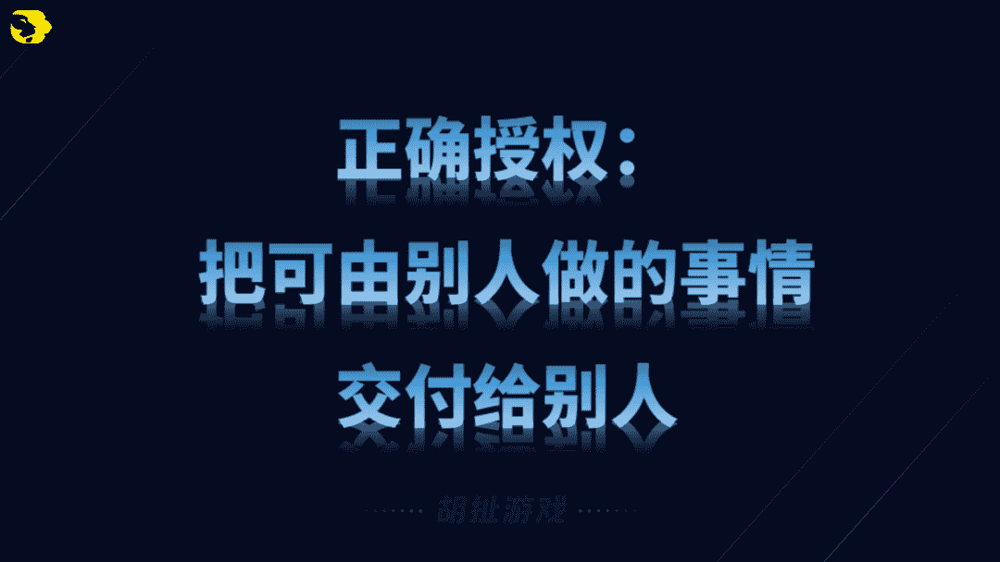

## **3. 执行的细节边界**

在执行的过程中，细节边界是影响效率的首要因素。而在瞬息万变的创业领域，效率的高低，区别就是成功和失败。

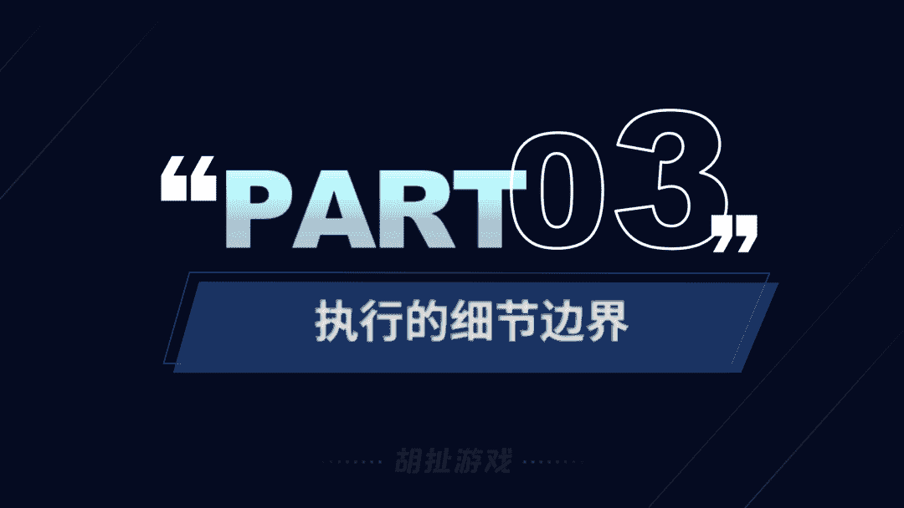

1.  事无巨细

1.  完美的标准

1.  完美的完成，让完成尽量完美

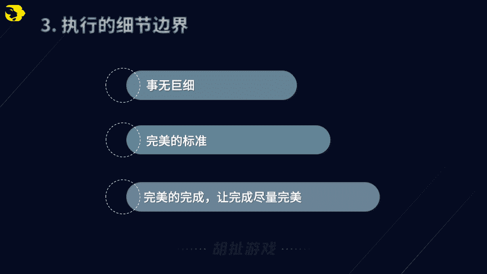

## **3.1 事无巨细**

成功的创业，就必须 **全面、完整地还原创始人的想法。**

因为所有的失败，都是创始人的错误，创始人对创业的失败负全责。

在执行的过程中， **创始人只有，也只能深入一线，才可以事**无巨细，完整地要求团队执行创始人的想法。

这是绝对正确的选择，而且无比重要。

至于绝对的前提，预设了创始人选择的方向是正确的，这点不需要讨论。创始人当然是想明白才创业。创始人想不明白的，其他人也不可能想明白。

创始人理解了这一点，就不要在意他人的评价，也不必在意不负责任的意见。 是的，很多人都喜欢提意见，但这些人很少想怎么解决问题。

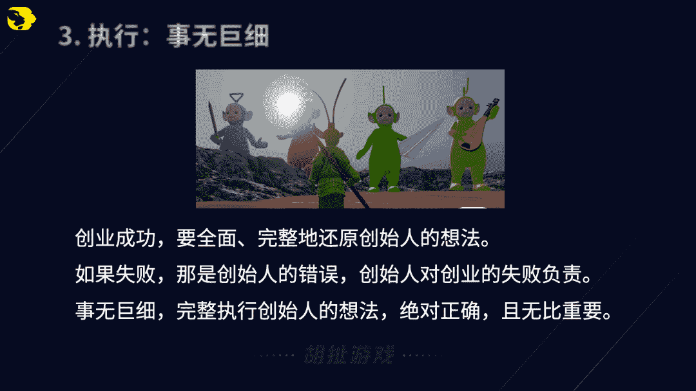

## **3.2 完美的标准**

我在 [游戏人，要不要沉迷在技术中？ ](https://mp.weixin.qq.com/s?__biz=MzA5NzQ3NDM3MA==&mid=2656291974&idx=1&sn=2779a2bf7368517da3a0740e6f3d653e&scene=21#wechat_redirect)一文中讲过一个故事：

> 很久以前，有个程序员和我说，如果他 35 岁找不到工作，就回去卤猪肘子。他家祖传技艺卤猪蹄在当地非常有名。

> 卤猪肘子是很强的技艺，我们写代码，和卤猪肘子差不多，我们都是匠人。

> 那为什么程序员的地位这么高？收入这么多呢？

> **因为程序可以批量复**制，程序是互联网的基础构建， 而互联网是放大器。

> 猪肘子没有放大器，猪肘子如果想做到批量放大的效果，就需要做好供应链管理，食品安全管理，口感统一性管理，新产品开发管理。这比部署一个程序要难太多了。而且也不容易标准化。

> 程序工匠，和卤猪肘子工匠，只是当前社会下得到的红利不同罢了。

> 当程序基础系统足够完善的时候，程序在时代发展时得到的红利自然会消退。

我们做的是体验产品，我们都是体验的工匠。

产品的验证标准，或者说完美产品的标准，来自于真实玩家的体验。

因此， 我在 2024：我应该去做独立游戏吗？  中提到过：

> 你必须是一个全能选手。

> 我们不得不承认，游戏人想做出心中的那个游戏，必须得是一个全能选手。

> 自己写代码，自己做美术，自己编文案，自己配数值。

**在无法达成玩家的完美标准时，制作人自己的标准**，就是完美标准。 制作人要实践自己的标准，就必须亲力亲为，尽量理解所有岗位的工作，才可能做到那个标准。

**技术没有价值，技术生产价值。 **我在 小游戏创业：为什么你不需要技术合伙人？ 一文中也讲述过这个细节，可以读读看。

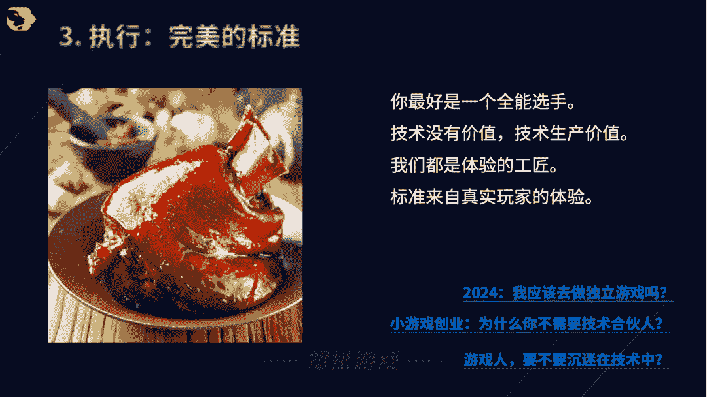

## 3.3 完美的完成，让完成尽量完美

做项目，完成和完美都很重要。 **做商业项目，完成大于完美。 **游戏是可迭代的娱乐商品，做到让完成尽量完美，是制作人的责任。

要做好下面几件事：

1.  管理创始人的精力。

1.  想法要快速验证。

1.  控制好，并保持自己的节奏。

1.  时时默念：所有的预期都是过于乐观。

1.  互联网是放大器，要理解放大器的规则。

1.  追求长线，追求长线，追求长线。

1.  发行是放大器，放大的倍数取决于产品的质量。

1.  开放心态，主动理解市场趋势。

1.  商务很重要。

1.  商务只解决信息问题。

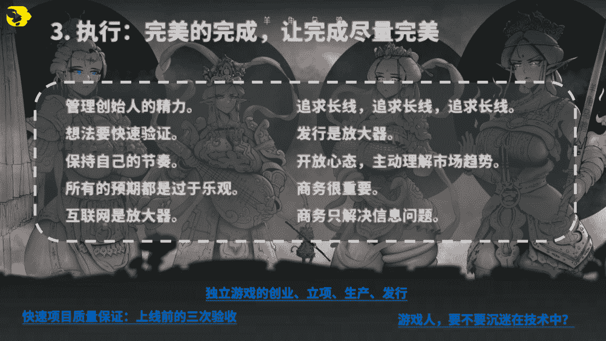

> 参考：

> 独立游戏的创业、立项、生产、发行

> [快速项目质量保证：项目上线前的三次验收](https://huchegames.feishu.cn/wiki/IJygwKZDQi9lGako5mscgGt1nJf)

> [游戏人，要不要沉迷在技术中？](https://huchegames.feishu.cn/wiki/G2nvwDT3niRTACkPAG7clF0Hnv0)

创业路上的坑难以避免，通过清晰的思考和坚定的执行，小团队也能够在小游戏创业的大潮中找到自己的生存之道。

> **与创业路上的诸君共勉。**

---

<https://huchegames.feishu.cn/sync/UZIod6tpos5E6ob7w2EclHC5nh5>

**这些文章值得读一下：**

+   [看完少烧一百万：小游戏创始人避坑指南（上）](https://huchegames.feishu.cn/wiki/WS3XwjglciWZzhkwUPucmCMBnTe)

+   消除类小游戏前中后期调优细则——2024腾讯广告IAA微信小游戏私享会

+   [IAA小游戏之什么值得做：逆袭和塔防—](https://mp.weixin.qq.com/s?__biz=MzA5NzQ3NDM3MA==&mid=2656292775&idx=1&sn=475552d19adcbb60ac5a86e7361e9bc1&scene=21#wechat_redirect)—2024腾讯广告IAA微信小游戏私享会

+   CGDC上《潜水员戴夫》关于Steam推荐算法的分享

+   9月5日我讲了什么？小游戏创业/韩国发行/游戏投资

+   《小游戏团队创始人避坑指南》PPT ｜ 欢迎来现场胡扯

+   2024微信公开课小游戏开发者大会PPT（部分）

+   2024微信小游戏开发者大会逐字稿

+   IAA异军突起，基于抖小IAA用户研究报告的立项思路分析

+   让创造产生价值：2024(武汉)微信小游戏公开课IAA专场实录

+   智游破浪启迪未来：2024抖音IAA小游戏生态大会实录

+   游无界创未来：2024(广州)巨量引擎抖音小游戏行业峰会实录

+   CJ五日-2023 ChinaJoy 回归新增长