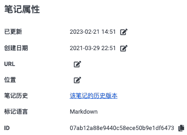

# 系列：电子游戏是怎么挣钱的？

> 来源：[https://huchegames.feishu.cn/docx/Wk2Jdnl3ZorwaIx24Y3c8nSZn1c](https://huchegames.feishu.cn/docx/Wk2Jdnl3ZorwaIx24Y3c8nSZn1c)

## 前言

**这篇文章是**我在2021年3月挖的一个坑。我一直想写一篇几万字的 「大作」 来分析游戏行业的商业模式，三年多过去了，因为精(neng)力有限，这坑没填。

最近出现了一些有趣的事情，如果再不填，某些内容就该成为历史了。为了见证历史，开始填坑！

下面是计划的目录，我估计五万字起。看看我的 TODO LIST（叹口气），五千字起吧😊。

+   **商业游戏的商业模式**

+   **史前时代**

+   **不要拿过去的眼光看现在**

+   互联网时代

+   渠道为王时代

+   广告变现：新时代的开启

+   变现是一门技术活

+   买量时代

+   白piao渠道

+   前辈、大佬、著名企业的商业模式

+   小团队的决策

## [电子游戏是怎么挣钱的：史前时代](https://huchegames.feishu.cn/wiki/KPIJwmAYaiPtm5kqpMlc2GRgnAh)

## [你不会以为上了渠道就一定能挣钱吧？能挣钱的游戏渠道有……](https://huchegames.feishu.cn/wiki/J6IhwR4OTiEWKjkaGuBcrBqYnne)

## [羊毛出在猪身上：广告变现开启新时代](https://huchegames.feishu.cn/wiki/ZmN5wE0HPikZE9kN7X3cgva4nIb)

## [eCPM必然衰减！IAA与混合变现游戏调优的底层认知](https://huchegames.feishu.cn/wiki/ANISwfoCNiYpIJk8f4Vcoyv4nLh)

## [亏100万还得买！深度解读买量本质，看透发行/产品/平台的利益博弈](https://huchegames.feishu.cn/wiki/YWgYw4G1HiK0sXk6lp5cywbVnJh)

## [都2025了，小开发者居然还能白嫖流量？](https://huchegames.feishu.cn/wiki/EH7LwoCDni87NkkBnBDck9BCnyc)

---

<https://huchegames.feishu.cn/sync/BpmUdScQAsVWuxb7aJ6ciWu9nib>