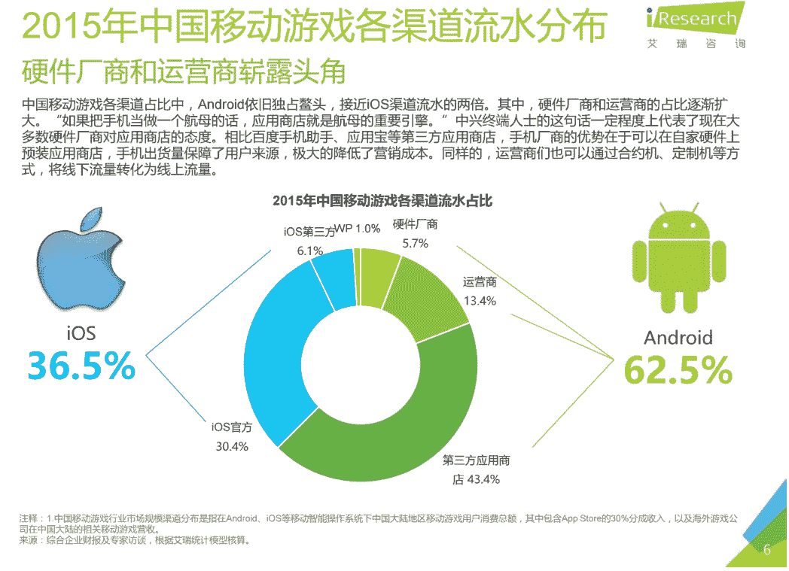
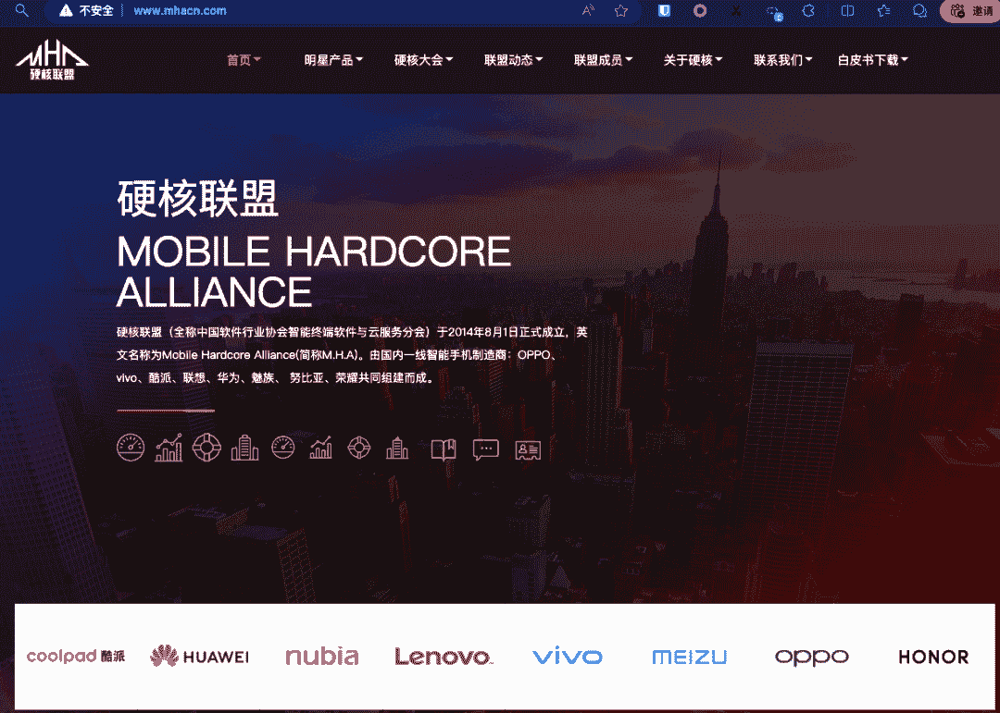
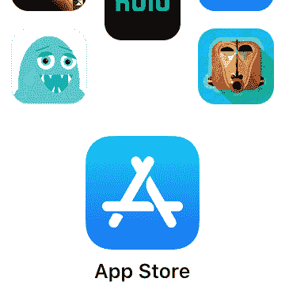
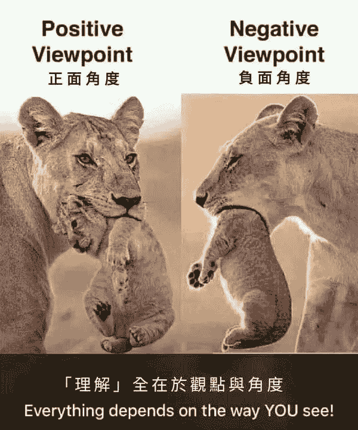
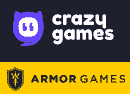
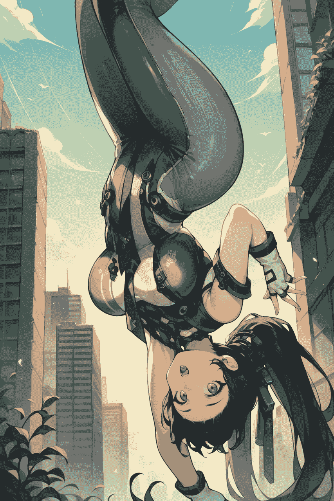

# 你不会以为上了渠道就一定能挣钱吧？能挣钱的游戏渠道有……

> 来源：[https://huchegames.feishu.cn/docx/URMedZ8ldou4aQxQ70GcLbyanJf](https://huchegames.feishu.cn/docx/URMedZ8ldou4aQxQ70GcLbyanJf)

[系列：电子游戏是怎么挣钱的？](https://huchegames.feishu.cn/wiki/Scxpw4K5riN7ZZk5bdwcUYFansb)

> 🔗 原文链接： h[ttps://mp.weixin.q](https://mp.weixin.qq.com/s?__biz=MzA5NzQ3NDM3MA==&mid=2656292033&idx=1&sn=090f4ae1b069aa0c8a2fedecc0acfee1&chksm=8b072eecbc70a7fa34c9ffa56ded4fd1e4dfc8823edf76eb174f2045121443c4b2b2c530728d&scene=178&cur_album_id=3675797934970421252&search_click_id=#rd)q.com/s?__biz=Mz...

> ⏰ 原创 曾嵘 曾嵘胡扯的地方2024年08月07日 17:37  湖北

**渠道为王，只手遮天。**

研发、发行、渠道，这三方一直在博弈。

电影市场，院线渠道，牢牢掌握着电影产品的宣发命运。2020年疫情期间徐峥的《囧妈》版权直接卖给抖音，开了电影线上首发的先河，同时也让徐峥在2024年的新电影受到一些抵制：

+   今日，徐峥《囧妈》免费网播，他们为何抵制？

+   一影院宣布：拒播徐峥新片《逆行人生》！原因是……

**游戏渠道是个什么情况呢？**

我在四年前的一篇文章 周读：202013 被下架到底是谁的错？ 这篇文章中写过：

> 买量方式兴起之后，硬核渠道也会逐渐成为次要渠道。优秀的游戏会优先使用 iOS 渠道买量分发，然后才会选择在其他渠道发行。这对于开发者来说，是好事。话语权将逐渐向优秀的内容倾斜。

先让我们谈谈风光不再的硬核联盟和应用宝吧。

## **硬核联盟和应用宝**

2014年，中国移动游戏市场规模接近240亿，同比增速超过100%。彼时的渠道有百度手机助手、UC应用商店、腾讯社交软件、应用宝以及以九游为代表的垂直分发渠道，这些都算做社交分发渠道。

当时手机**厂商官方商店为**代表的终端渠道地位较低。为了解决这个问题，2014年8月1日，OPPO、 vivo、 酷派、 金立、 联想、 华为这6家手机厂商成立了「安卓智能手机生态系统联盟」，后解读为「中国软件行业协会智能终端软件与云服务分会」，英文名称为Mobile Hardcore Alliance(简称M.H.A)，这就是 「硬核联盟」。

魅族、努比亚、荣耀在后来加入。

**应用宝是什么呢？**

只要你在🛰️中下载过游戏，实际上就已经是腾讯应用宝的用户了。有相当长的一段时间，在🛰️中下载游戏，游戏包体就必须上架应用宝。否则，就只能跳转出外部浏览器才能下载。

硬核联盟由于手机硬件预装分发的优势，一度做到与社交分发渠道分庭抗礼的局面，也做了一些上不了台面的事。例如对没有上架的游戏包标记为恶意软件啊，或者游戏在没有主动提交的前提下自动出现在手机官方商店啊之类。

当然，我相信这些事情都不是官方所为，一定是个人行为或者不法开发商所做。

硬核联盟和应用宝的共同特点是，提成比例较高，且手续费计算方式不透明。

**上架硬核联盟的评分机制也让游戏**开发者们颇有微词： 你凭什么能给我评个 B- 呢？

原神发布，明确不进入手机官方市场。今年6月19日，DNF手游运营团队也表示，游戏将从华为、OPPO、vivo 等手机厂商的应用商店中撤出，停止更新手游包。

如今，硬核联盟是不是已经名存实亡？官网连 HTTPS 访问都没有提供。

+   “怎么才7成！7成那还是人家的…”

+   腾讯准备掀桌子了？

+   [“硬核联盟”浮沉考](https://mp.weixin.qq.com/s?__biz=Mzk0MTEyODUyMA==&mid=2247485921&idx=1&sn=b61310d30a3474b1d793e296054f40ea&scene=21#wechat_redirect)

+   “硬核联盟”：荣光与风险并存的10年

全面撤退的号角，可能才刚刚吹响。

## **无处不在的野鸡市场**

由于安卓操作系统的开放特点，只要有技术能力，完全可以自己成立一个分发渠道。

之前的豌豆荚、安智市场、91手机助手、木蚂蚁都是这么做成的。

但这么做的人实在太多，多到数不过来。因此业内将这些规模较小，管理不专业的渠道，称为「野鸡市场」。

就算软硬一体化的苹果，在越狱盛行的那几年，也硬生生被越狱野鸡市场分去了一小块蛋糕。

而现在，野鸡市场已经退出市场，再也翻不起浪花。

## Google Play 和 App Store

由于苹果公司一直不遗余力对越狱市场进行打击，对越狱人才进行收编，在苹果设备上，App Store 是绝对独家。

早年可以通过企业证书绕过渠道的发行方案，被棋牌和匿名社交产品用烂之后，也逐渐收紧，不再可能成为渠道了。

对国内政策的执行，从实名验证，版号政策，到游戏备案，App Store 国服跟进越来越迅速，全面合规时代已然到来。

安卓阵营，Google Play 可能永远无法进入中国。甚至国产手机也难以使用合法的方式安装 Google 组件。但出海以及优秀的新游戏获取，Google Play 必须是最快最全的渠道。

如今，占据了霸主地位的 App Store，已经在和🛰️、抖音抢蛋糕了：

> 上周五的时候，外媒彭博社报道称苹果公司跟中国的腾讯和字节跳动两大互联网巨头产生了冲突，而且事情剑指中国开发者都非常关注的小游戏和小程序内购问题。

> GameLook： 苹果要对中国iOS小游戏抽税，🛰️抖音在做最后抵抗！

同样的，在海外，Google Play 平台也在和开发者争利。2020年2月20日，猎豹旗下的 45 款 App 被谷歌下架，其广告账户也被终止。

当时记者问傅盛：「当时没想到钱来这么容易，有可能是不持续的？」傅盛反问：「要是你，你会这么想吗？」

我在 2020 年的文章 周读：202013 被下架到底是谁的错？  中记录过这个事件，当时我的评论是：

> 曾嵘：我会这么想。

> 孩子才谈论对错，成人只谈利益。猎豹要利益，Google 一样也要利益。从不同的角度能看到不同的信息。就像下图一样：

>

>

>

## **网页小游戏平台**

大家总是说，2012年开始，国内就进入了手游时代。然而， Crazy Games 和 Armor Games 这些老牌的网页小游戏平台，抱着把页游进行到底的执念，一直在默默耕耘，而且越来越好。

以至于很多手游也会从这些网页游戏中汲取创意。

网页小游戏平台的盈利方式，大多是网页广告为主。除了这些大型的平台，也有一些独立的 H5 游戏站，用 AdSense 变现，用 Google 买量，规模不大，但收益可观。

无论是换装向、益智向、成语向（海外Word），还是找茬向，生命周期都相当漫长。

国内游戏从业者习惯了小游戏和App，认为网页游戏是落日余晖。但在欧美日韩这些 T1 国家，H5 游戏发行仍方兴未艾。

## **个人私域**

这是一种你可能不知道，但可行的游戏发行方式。

国内由于版号的限制，很多个人开发者难以获得游戏付费收益，又不会（或者不愿意）制作广告游戏，不得已采用了这种不合规的形式。

游戏在正常渠道以免费形式上架（或者不上架），通过个人渠道（邮件、🛰️🐧群）推广，再通过个人账号接受付款（🛰️/支付宝/银行转账）。

这当然是不合规的，甚至是有风险的。若玩家对游戏不满意，要求开发票或者举报，开发者就真的欲哭无泪了。

## **乱入渠道**

还有一些不太能说的渠道挣钱方式。

### **棋牌游戏如何挣钱**

至少有十六个朋

这个领域我完全没有了解过，真的。

### **NFT/WEB3**

很遗憾，这部分稿件被猫吃了。

### **扒包**

这是开发者们（尤其是个人开发者）最讨厌也是最害怕的形式。

+   你的游戏刚在国内上线，有个朋友给你发来外网链接。你发现一毛一样。

+   外网的主体，你要怎么找呢？

+   同样的故事反过来也一样：

+   你的游戏刚在海外上线，有个朋友在🛰️上给你发来小游戏卡片。你发现一毛一样。

+   国内的主体，是个人。你要怎么找呢？

**你的朋友好厉害。**

更有甚者，破解 APK，换掉变现 SDK 重新上架。当然也有连 SDK 都不换就直接上架的。我曾经有一个停更2年并且下架的产品，一直有广告收入，百思不得其解，直到我找到别人帮我上架到某个野鸡市场的包。

**对这种别人帮你上架到野鸡市场的包，一定要投诉或者联**系下架。否则罚款可能就会落到你的主体上。

### **马甲包**

马甲包一般是指，为了延长一款游戏的生命周期，基于经过验证的游戏设计，通过修改游戏美术素材和题材设定，将游戏当成一款新品上线，从而获得更多价值的行为。

严格的说，马甲包是一种发行模式，很可能已经是主流的发行模式。🛰️小游戏目前就支持代码授权的方式，让游戏开发者能够更多地获取收益。

而且，在买量算法黑箱导致投放跑废了的时候，马甲包就是唯一的拯救方案。

## **小团队的渠道护城河**

这个系列文章，一直是站在小团队的角度思考的。

小团队要怎样建立起自己在流量和渠道上的护城河呢？

**后续文章，会逐渐展开我的思考。**

---

本文原标题为： **去特么的渠道！ **由号称游戏圈邱淑贞的胡扯游戏群友 Leo 提供。但我担心过不了审。标题放在文章末尾，以示对球速真的尊重。

https://civitai.com/images/21098708

---

<https://huchegames.feishu.cn/sync/BpmUdScQAsVWuxb7aJ6ciWu9nib>