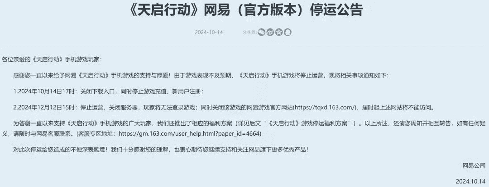
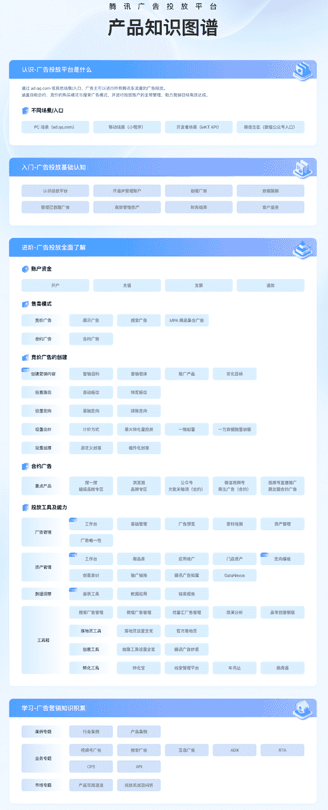
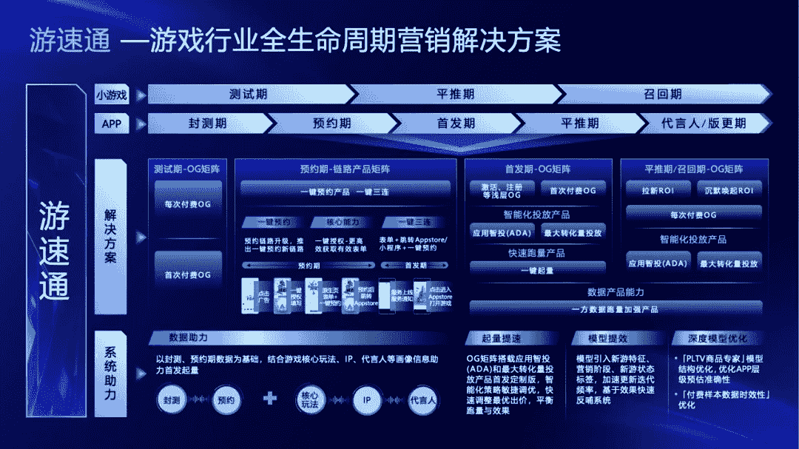
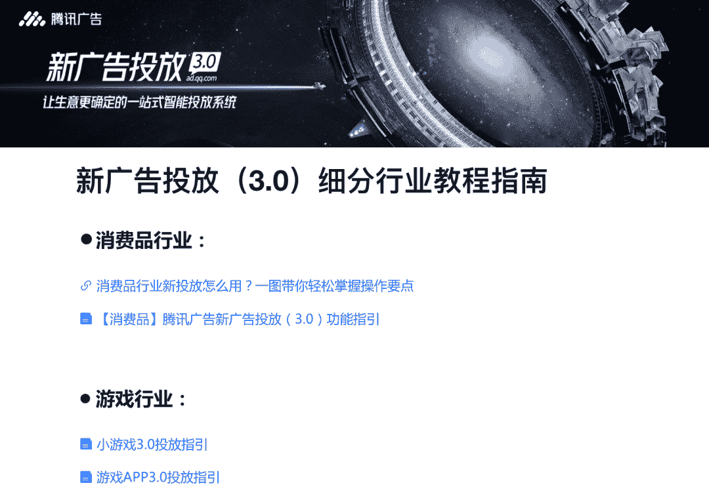
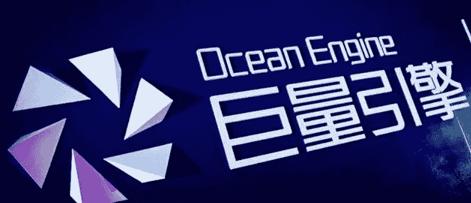
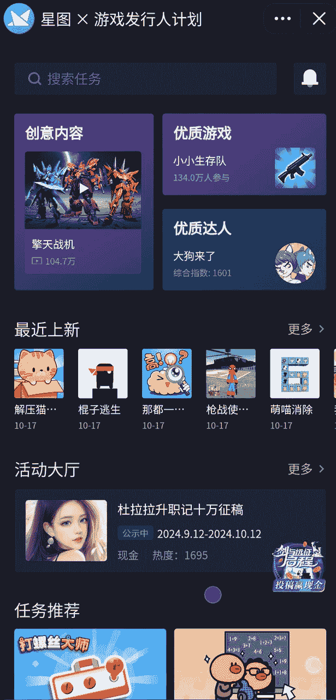
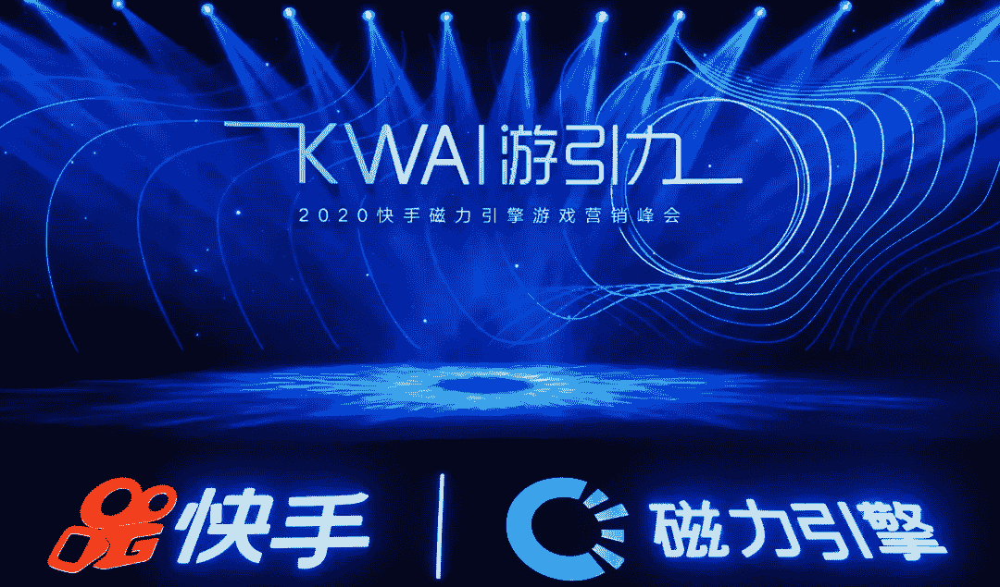

# 亏100万还得买！深度解读买量本质，看透发行/产品/平台的利益博弈

> 来源：[https://huchegames.feishu.cn/docx/Cd82dxAduoXLEpxHJKmcE0A5nmg](https://huchegames.feishu.cn/docx/Cd82dxAduoXLEpxHJKmcE0A5nmg)

[系列：电子游戏是怎么挣钱的？](https://huchegames.feishu.cn/wiki/Scxpw4K5riN7ZZk5bdwcUYFansb)

> 🔗 原文链接： h[ttps://mp.weixin.q](https://mp.weixin.qq.com/s?__biz=MzA5NzQ3NDM3MA==&mid=2656292656&idx=1&sn=8e147b0d08ceee17489dc8ba574e4d0a&chksm=8b072d1dbc70a40b694059869a12c5c22cc3121ef6a334785d663aa313225f122e4d5d2553f5&scene=178&cur_album_id=3675797934970421252&search_click_id=#rd)q.com/s?__biz=Mz...

> ⏰ 原创 曾嵘 曾嵘胡扯的地方2024年10月18日 14:31  四川

## **IAA小游戏商业化调优的坑**

我之前在 IAA小游戏商业化调优秘籍.xlsx 一文中挖了个坑：

> 这里讨论的价值，是建立在 **流量主角度 ****的用户价值。但**对于**整个计算广告系统**来说，还有 平台角度价值 和 广告主角度价值 。把这些价值综合在一起思考，才能弄清整个 IAA 广告系统的价值。

> 在弄清了这个价值基准系统之后，再来思考 IAA 游戏应该如何优化，就足够通透了。

> 要展开这些内容，需要更多篇幅，我们以后再说。

> 转自： IAA小游戏商业化调优秘籍.xlsx

现在到了填坑的时候了。

## **买量大佬的江湖 **

### **买量发展简史**

在国内，2015年前，主要是渠道占领市场。Google退出中国，硬核渠道作为一个巨大的装机流量来源，几乎垄断了流量市场。一众野鸡手机市场也发展得红红火火，产品主要依赖手机市场资源位获取流量。

这段历史，我在 [你不会以为上了渠道就一定能挣钱吧？能挣钱的游戏渠道有……](https://huchegames.feishu.cn/wiki/J6IhwR4OTiEWKjkaGuBcrBqYnne)一文中做过详述。

随着流量红利的变大，市场逐渐发生了变化。

**2014-2015 萌芽**

这一时期是买量市场的培育期，市场上存在大量的流量红利。以今日头条等平台为代表，为买量提供了基础的流量环境。当时的广告形式主要是小图、组图、大图等形式的信息流广告。买量的操作流程和技术相对简单，竞争也不激烈。从业者只要能走通买量流程、掌握基本的账户操作，就具备较强的竞争力。

**2016-2017 崛起**

买量模式的崛起，让一些处于 B 级甚至更低评级的产品摆脱了应用市场评级的限制。大量资本看到了其中的潜力，纷纷进入买量市场。仙侠类、传奇类产品陆续加入买量竞争，通过买量获得了大量用户，开启了品类买量的统治时期。

这一时期买量的玩法开始多样化，除了基本的账户操作外，出现了**马甲包、多账户等操作手法。一些团**队开始 采用人海战术，通过优化师和设计师的小组内部竞争，追求创意的 「爆款率」 ，以提高买量效果。这是买量的工业化时期。

**2018-2019 高速**

抖音、快手等超级 APP 快速发展，巨大的流量池为买量提供了支持。但随着越来越多的企业参与买量，市场竞争日益激烈，获客成本不断上升。同时，行业也面临着 人口红利逐渐消失、同质化竞争严重、国家政策监管加强 等挑战。企业必须更加注重买量的策略和效果，买量的创意、数据监测需要更高要求。

**2020-今 成熟**

随着行业的发展和监管的加强，买量市场逐渐走向规范。广告平台对买量行为的审核更加严格，打击虚假流量等违规行为；企业也更加注重买量的质量和效果，追求精准投放和用户的长期价值。

一方面，企业开始探索多元化的营销方式，如 内容营销、社交营销、私域流量运营等，与买量相结合， 以提高营销效果和用户的忠诚度。另一方面，巨量引擎这样的平台也推出了发行人计划等更灵活，更依赖个人创意的流量推广模式。

## 买量是发行/产品/平台之间的利益博弈

做游戏的人，必须首先理解生意的本质，才能赚到钱。

从利益的角度去理解决策，再从感情的角度去设计好产品，总是没错的。

买量结果基于计算广告的算法逻辑。发行千万不能和平台对抗，而是要遵守平台规则，寻找算法漏洞，发现低价红利。我在2021年搭建发行团队的时候写过一些学习和思考文章，仅供参考：

自研搭建发行团队、计算广告、构建BI（全系列索引）

在买量的过程中，有三个利益相关方：

1.  发行

1.  产品

1.  平台

我在 [羊毛出在猪身上：广告变现开启新时代](https://huchegames.feishu.cn/wiki/ZmN5wE0HPikZE9kN7X3cgva4nIb)一文中提到过 IAA 产品的盈利模式：

> **广告主 **付钱展示广告， **流量主（游戏开发商） **在游戏中播放广告并获得收益，玩家观看广告获得游戏资源。

> 转自： [羊毛出在猪身上：广告变现开启新时代](https://huchegames.feishu.cn/wiki/ZmN5wE0HPikZE9kN7X3cgva4nIb)

把上面三个利益相关填充到这个模式中，我们可以发现：

1.  发行方是广告主（出钱买量）

1.  产品方是流量主（很可能使用发行方的账号）

1.  平台方提供展示广告，撮合买量的基础设施（小程序、小游戏、买量行为，广告展示行为均处于平台之上）

### **发行方的利益诉求**

对于发行方来说，核心诉求是：

1.  获取更低价格的用户。

1.  在产品方同意的前提下，寻找更高利润的可能性。

1.  考虑投放到回收的周期， **平衡回款风险。**

1.  控制人工成本，利用信息差和运营能力， 用最低的成本引入最高质量的产品 （实际上是分走更多属于产品方的利润）。

**可以看出，发行**方最喜欢的就是流量价格较低的红利期，而 红利期的产生 可能有下面几个路径：

1.  市场上出现了突然的流量爆发，例如2016年抖音在线人数的大幅提高（可参考下文「巨量引擎的发展」 ）。平台还 没有来得及针对这种突发量级进行价格调整；

1.  **出现了新的模式，由于技术无法**做到精确监控，相当于平台 被动让出了一部分利润空间。 例如下文中提到的 「游戏发行人、巨量投放跳转🛰️小游戏」 等等；

1.  平台自行让利。下文讲到平台方的时候详述。

### **产品方的利益诉求**

对于产品方来说，核心诉求是：

1.  尽量留住用户。

1.  通过优秀的产品设计，在用户身上获取到更高的价值。

1.  控制人工成本，基于优秀的产品能力，让发行方承担更多的研发成本。

1.  在发行方同意的前提下，寻求利润更大的分成方式和比例。

可以看出，产品方相对弱势。因为产品进入研发后，产品方就必须承担研发成本。一旦产品上线后无法盈利或盈利能力弱，这些研发成本就打了水漂。

比**如网易的《天启行动》，**今年2月拿到版号，8月公测前全网预约量破1000万，公测当天登上国区iOS游戏免费榜榜首， 上线46天就宣布停运。

### **平台方的利益诉求**

对于平台方来说，核心诉求只有一条：

如何在最低限度保证发行方收回投放成本的前提下，获得更多利润。

因为平台方知道产品方和发行方的大部分数据（依赖买量主动回传）， 平台方有理由也有意愿根据发行方的数据， 在保证发行方有利润的前提下，持续提升平台利润。

这就好像在货币体系从金本位转化为信用货币之后，没有哪个政体的央行，能抵抗住印钱的诱惑。

但平台方不能无限度索取。如果产品方赚不到钱，平台方也不会有足够多的流量主提供广告位。进而导致平台的填充不足，广告主逐渐流失。

### **深入一点点技术**

让我们以 IAA 品类为例，深入技术层面讨论一点点：

我们知道，对于 IAA 品类来说， 发行方的收入=广告收入-投放消耗。

IAA 游戏的商业化设计，是希望更多人看广告。哪些人更愿意看广告，产品方就希望这些人进入游戏。

广告主付钱，发行方买量，流量主收钱。

+   游戏的题材和商业化设计，是产品方的活儿。

+   让愿意看广告的人进入游戏，是平台方的活儿。

+   理解平台规则和广告算法，执行买量这个行为，是发行方的活儿。

平台要让发行方回本，有两条路可走：

1.  提高广告收入。

1.  降低投放消耗（关注单用户注册成本）。

由于广告收益和广告消耗都掌握在平台方手中，平台方可以采用的方法：

1.  提供补贴，让发行方能够平衡整体成本，降低买量单价。

1.  不分成，所有的广告收益都给到发行方。

我在[eCPM必然衰减！IAA与混合变现游戏调优的底层认知](https://huchegames.feishu.cn/wiki/ANISwfoCNiYpIJk8f4Vcoyv4nLh)一文中提到过，由于留存和广告次数随着时长变化， eCPM 必定会随着用户在产品中观看的广告数量而持续衰减。

尤其是产品触达的用户量级非常庞大之后，长期衰减是难以控制的，表现为一个产品模型跑出来，大概一个月左右就没办法跑了。 通过换包解决衰减问题是一个可行的办法。 这也是为什么能在 IAA 产品排行榜上看到那么多马甲包的原因之一。

要**在产品层面解决衰减问题，提升**广告次数是一个方案，调整长期留存也是一个方案。对于IAA 游戏的投手来说，最有效的关键行为， 就是关注愿意看广告的人群， 本质就是看广告的转化率。

**产品方进行游戏商业化设计，就**是 要让玩家主动心甘情愿看广告。

**平台方要找到愿意在**这个产品中心甘情愿看广告的用户，就需要优 化广告的呈现算法 。

吸引用户看广告之后，还需要转化用户（用户点击广告）才有价值。 这里有个悖论：

+   如果用户一直看广告但不点击广告，无法发生转化，用户的价值就会越来越低。因为只有转化了，广告主才会付钱给流量主。

+   如果用户看广告转化出去了，用户价值再高也和当前跳出的产品没有关系。

注意： **看广告 **和 **点击转化 **是两个行为。只有转化才能得到广告主的收益。也只有转化，才对 eCPM 有足够大的影响。

因此，广告算法应该针对每个广告位进行单独价值权重判断。

让这些心甘情愿看广告的人，心甘情愿转化，这挺**难的，这不是发行方的投手**能解决的问题， 这是平台需要解决的问题。

**现**在大家应该能理解，为什么某平台就是比某平台用户价值高了吧？即使是每个平台都让利，也是算法更优秀的平台为流量主带来的利润更高。

**注意，上面的讨论仅针对IAA**游戏，如果要了解 IAP和混合变现产品的买量 相关思路，可以阅读这个系列：

[混合变现从入门到放弃系列](https://mp.weixin.qq.com/s?__biz=MzA5NzQ3NDM3MA==&mid=2656292616&idx=1&sn=7ee2fb63ac133757abe6247bdfbcbec9&scene=21#wechat_redirect)

## **腾讯广告**

腾讯拥有 🐧 和🛰️两大社交平台，涵盖了各个 年龄段、各个地域和各个行业，具有广泛的覆盖面，这为腾讯广告提供了庞大的流量基础和丰富的场景。用户在社交平台上的活跃度高、停留时间长，为广告的曝光和传播提供了良好的条件。例如，朋友圈广告能够基于用户的社交关系进行高效投放，提高广告的可信度和传播效果。

### **腾讯广告、🛰️广告**

**腾讯广告 **是一个较为宽泛的概念，是腾讯公司旗下所有广告业务的统称，涵盖了腾讯旗下众多产品和平台的广告投放服务，包括但不限于🛰️广告、腾讯视频广告、腾讯新闻广告等。

腾讯广告的版位较多，旗下的信息流广告投放渠道包括视频号、朋友圈、👸号、小程序、腾讯新闻、腾讯视频等，还有 🐧 生态的浏览器、🐧 音乐、🐧 空间、游戏、购物等，能够满足广告主不同的投放需求和营销目标。

**🛰️广告 **基于🛰️生态体系，整合朋友圈、👸号、小程序、视频号、搜一搜和看一看等多重资源，是专门针对🛰️平台的广告业务。

### **游戏行业解决方案**

腾讯广告结合小游戏全生命周期营销特点，以小游戏三大场景为切入点，从测试期稳定冷启动和达成效果、探索优质用户数据，到平推期快速拿量，再到最后召回期有效预估用户价值、实现拉新促活，针对各场景提供定制化解决方案及系统助力。

对于App的游戏产品，腾讯广告也能对封测、预约、首发、平推、代言人更等多元场景提供模型策略，配合数据助力及数据产品能力，联动封测-预约-首发，实现营销前置，提升广告影响效果。

全面落地应用，升级解决方案覆盖小游戏全生命周期

### **新广告投放（3.0）**

最近很多投放优化师都在关注新的新广告投放系统（3.0）。

新广告投放（3.0）对广告系统进行了全面升级，赋予广告唯一的专属身份、减少同质化广告数量，避免堆基建。提升系统算力，让系统更懂营销诉求，大幅提升拿量稳定性。同时建设丰富的广告资产库，让系统和模型开始理解生意。

新广告投放（3.0）来了！模型懂生意，效果更确定

## **字节：巨量引擎**

### **巨量引擎的发展**

巨量引擎在2016年11月11日成立，当时的广告业务主要依托今日头条信息流推广，抖音的广告价值尚未被充分挖掘。

随着抖音的迅速崛起，越来越多的广告主开始关注到抖音平台的商业价值。抖音的火爆也让巨量引擎的广告业务得到了快速发展，更多的广告主开始尝试在巨量引擎平台上进行广告投放。

2020 年，受疫情影响，抖音的用户量突破了 5 亿。2021年，巨量引擎发布了广告品牌 —— 巨量千川，专注电商广告，与抖音小店做耦合。

可见，巨量引擎的发展主要依托字节系类App的流量崛起，基于短视频和直播形式的不断发展，广告主也有了更多的选择。

大约在2022年底，巨量引擎开始支持在选定的第三方外链工具平台上，根据提示选择推广类型为「🛰️小程序」，然后填写相应的信息，如🛰️小程序的名称、路径等，生成一条跳转🛰️小程序的链接。也就是说， 可以在抖音买量，跳转到🛰️小游戏了。

由于两个封闭平台之间的归因差异，导致精确收益计算**的缺失，这**种缺失表现在买量行为上，就是 平台让利 。这个红利持续了大半年的时间。

### **游戏发行人计划**

抖音的游戏发行人计划于 2021 年推出，起初更侧重于小游戏的推广。小游戏厂商在平台上投放不需要充值金额，投放后在下个月的广告流水中扣除买量费用，扣除额不够就延续到下个月，相当于可以赊账入驻。

后来发行人计划逐渐加入了手游（含休闲游戏），手游的结算方式包括预约人数、安装人数、激活人数、游戏收入、播放次数等。

随着游戏发行人计划的影响力不断扩大，越来越多的游戏厂商开始在平台上发布推广任务，也吸引了大量的抖音创作者参与。2023 年，星图对该计划进行了升级，允许厂商通过招募达人加反选的方式，保证后链路的效果转化和回收。

## **快手：磁力引擎**

2018 年，快手开启商业化，推出了营销平台。2019 年，该营销平台正式升级为 「磁力引擎」。2020 年，磁力引擎推出了「快手广告创意节」 和 「磁力大会」等IP。其中，「快手广告创意节」 强调邀请普通人成为创意的共创人；「磁力大会」 则全方位输出了磁力引擎在用户、内容、社交、商业等方面的能力。

快手在下沉市场拥有庞大的用户群体，对于三四线城市及农村地区的广告主来说，磁力引擎是一个重要的广告投放平台。

## **买量已经到了临界点吗？**

用前几天我在触乐关于 买量已经到了临界点吗？丨问20人 文中的观点作为本文的结尾。

如果命题「买量已经到了临界点」为真，那么后续应该无论发明什么样的新模式，买量总量都会持续下滑。

如果命题「买量已经到了临界点」为假，那么买量的总量依然会持续增长。

[曾经说再也不相信买量 ](https://mp.weixin.qq.com/s?__biz=MjM5NTE0ODc2Nw==&mid=2650633742&idx=1&sn=c4d7d04e0cca68aecafb851f0dbecd36&scene=21#wechat_redirect)，元梦之星就来了 [一波买量爆发 ](https://mp.weixin.qq.com/s?__biz=MzA5NzQ3NDM3MA==&mid=2656291414&idx=1&sn=13655e3aa81a4aa9dca1f47ff6cf1507&scene=21#wechat_redirect)。去年，我们还在为巨量买量跳转🛰️小游戏这个模式欢呼。上个月，小游戏的买量预算就已经超越了App游戏。

能打败油车的，只能是电车。能打败🛰️的，不可能是更好的🛰️。 能让买量到了临界点的，一定不能是买量。

君不见，抖音发行人、直播游戏推荐的体量已经增长到无法忽视？君不见，视频号也一步步建立起自己的小手柄和小风车？

只不过，巨量星图也正在试图将直播量、发行人和买量结合在一起，以实现对所有流量的强掌控（是的，发行人和直播带给游戏的利润，也在逐渐被平台蚕食）。对于平台来说，掌控一切可以掌控的入口，才是本质。

而「买量」只是一个行为罢了，无论如何蜕变，都在平台之手。

---

<https://huchegames.feishu.cn/sync/BpmUdScQAsVWuxb7aJ6ciWu9nib>