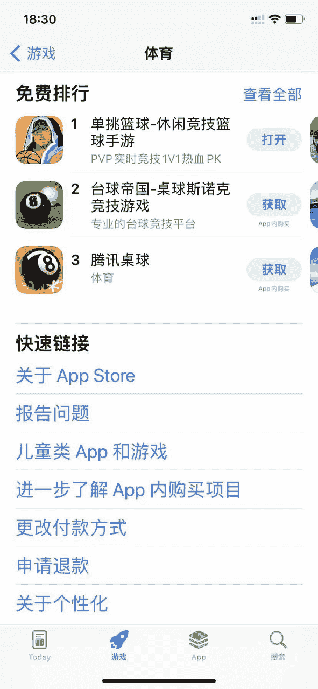
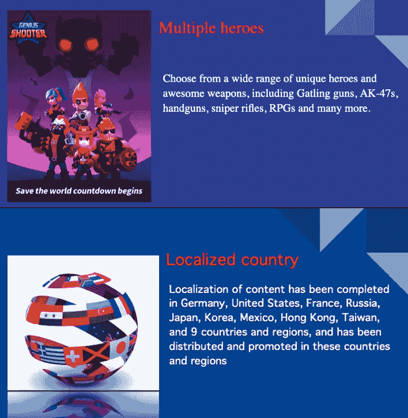
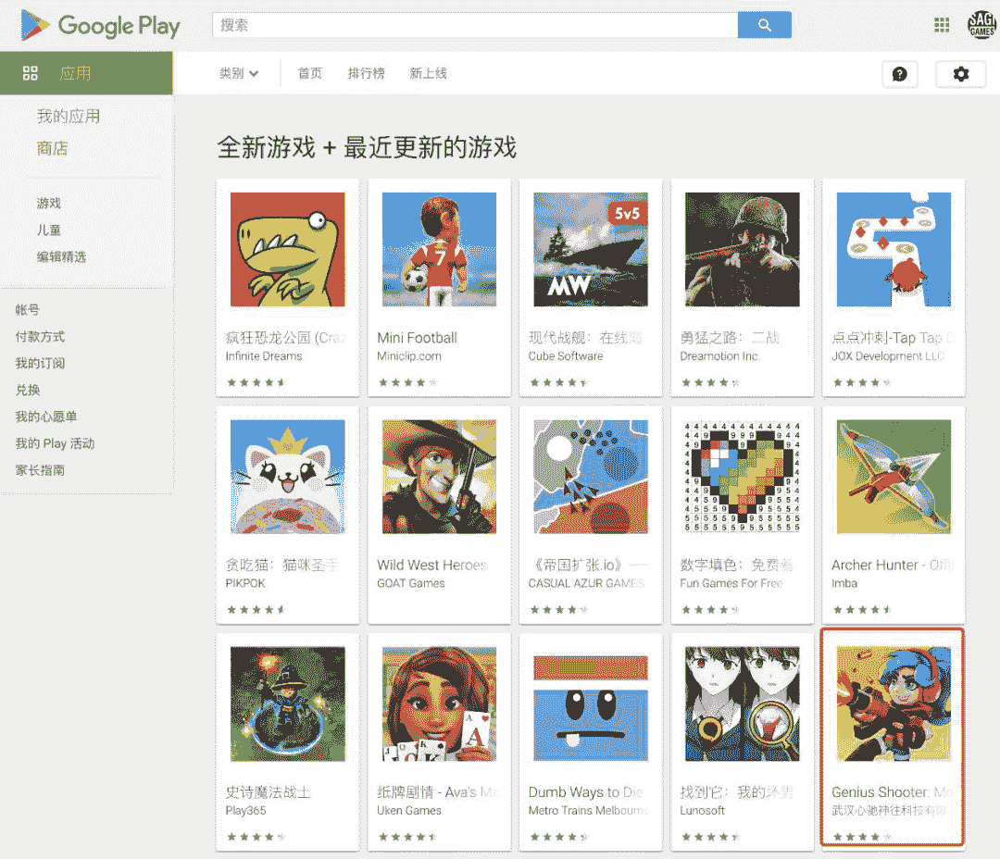
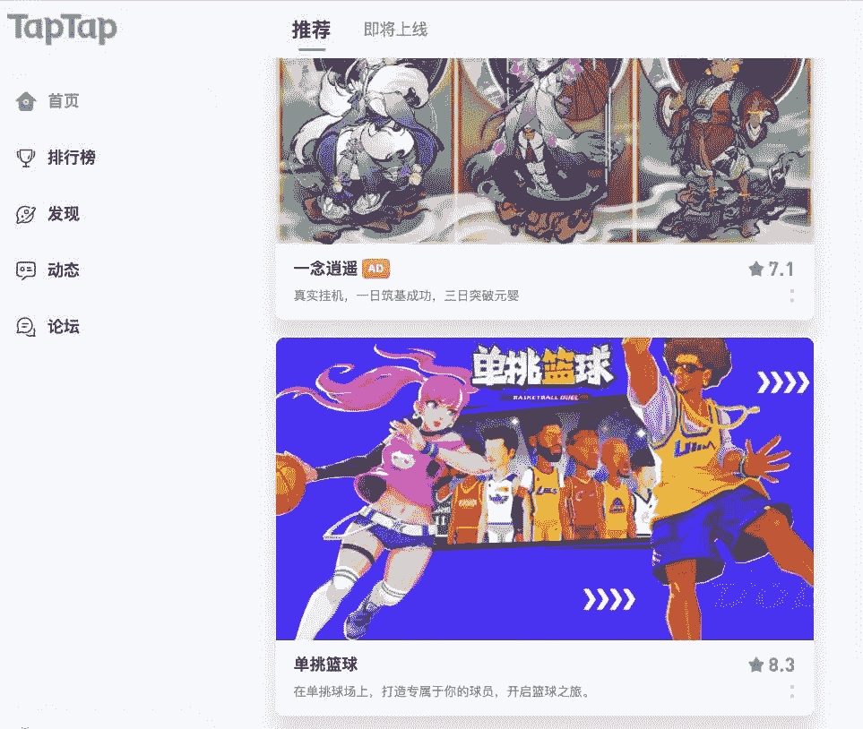
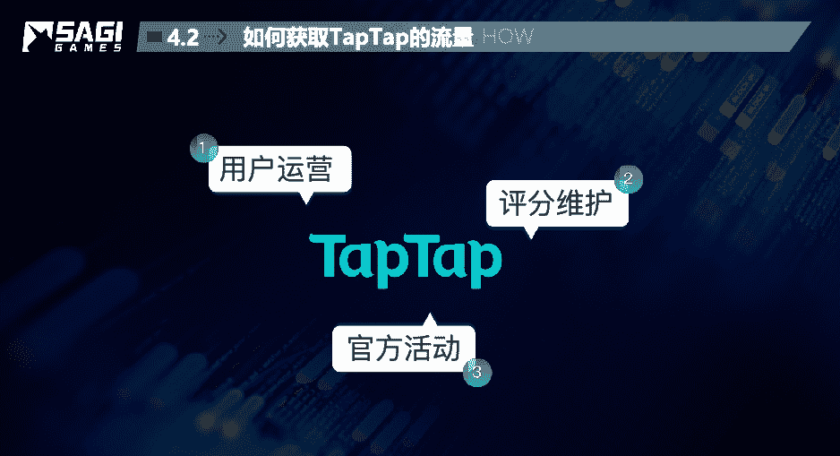
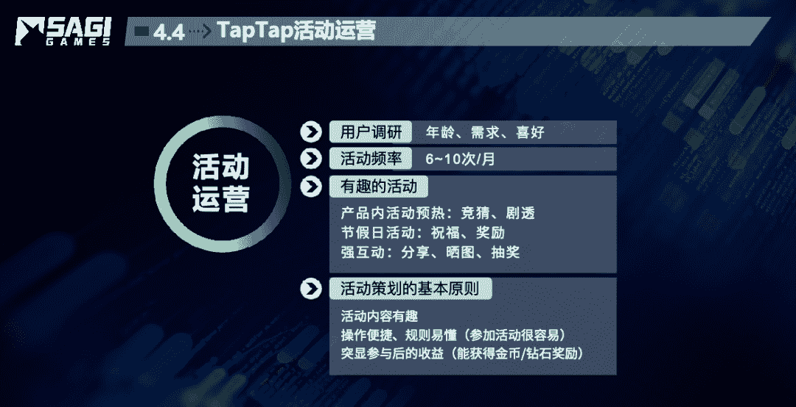
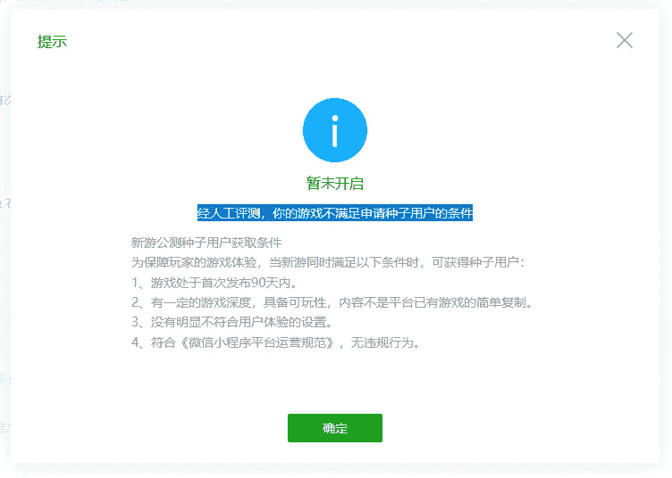
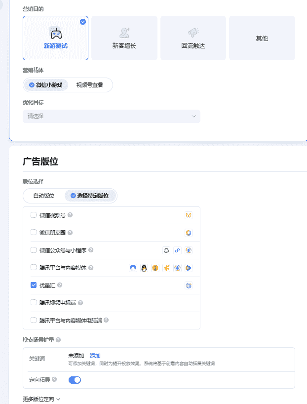

# 都2025了，小开发者居然还能白嫖流量？

> 来源：[https://huchegames.feishu.cn/docx/HYG7dJWxCoijWuxaZUccu7wQnjh](https://huchegames.feishu.cn/docx/HYG7dJWxCoijWuxaZUccu7wQnjh)

[系列：电子游戏是怎么挣钱的？](https://huchegames.feishu.cn/wiki/Scxpw4K5riN7ZZk5bdwcUYFansb)

> 🔗 原文链接： h[ttps://mp.weixin.q](https://mp.weixin.qq.com/s?__biz=MzA5NzQ3NDM3MA==&mid=2656293010&idx=1&sn=1ac44bb0e331fbf63b41a62166a35f33&chksm=8b0732bfbc70bba982c84ac43f47351d455ddad4bc906bfd6e41f4664de88ae91e12a0e2cb12&scene=178&cur_album_id=3675797934970421252&search_click_id=#rd)q.com/s?__biz=Mz...

> ⏰ 原创 曾嵘 曾嵘胡扯的地方2024年12月11日 11:31  湖北

---

尽管已经 2025 年了，尽管已经处于买量时代，仍然有很多小而美的游戏开发者， 不忘游戏人初心，抱着创造梦想、用游戏改变世界、造福玩家的理念，坚定地认为自己的游戏品质过硬，酒香不怕巷子深，几乎从来不买量。

这样的想法，在 2025 年，还成立吗？**或者换个问法，不买量或者**少买量，完全靠 平台推荐+ASO+换量 ，能养活一个游戏研发团队吗？

## **Google Play 和 Ap**p Store 的爸爸 Featured

苹果 App Store 和 Google Play 的官方推荐，业内戏称为爸爸 Featured。

自**从苹果修改国区的排行榜规则，并取**消热搜词的展示之后，刷榜这个行为，就变得越来越没有性价比了。要知道，刷榜也曾经是一种主流的推广手段。 位于榜单 Top10 的游戏，1 买量最高可以为游戏带来 3 个新增。 无论如何都是一件很划算的事情。

（2022年4月1日体育免费榜一）

所有的发行都知道 App Store 的 Today 推荐威力，单日新增几十万不是梦。

问题来了，要怎么申请爸爸推荐？本文不讲细节，只讲技巧。

**申请爸爸 Featur**ed 的黄金三法则，追过女朋友的大概都用过： 不要脸，坚持，不要脸 。

（用来申请GooglePlay Feature的 PPT）

（2021年6月28日的 GooglePlay 推荐）

无论是Google还是苹果，基本都遵循下面几条原则：

1.  关注 Android 和 iOS 最新的开发规范，尽快配合实现操作系统的新功能。什么 3DTouch 啊 Siri 唤醒啊，八竿子打不着的鸡肋功能，你加上就增加通过概率。

1.  每个大版本， **提前和编辑发邮件沟通。 **推荐位置就那么多，产品是海量的，因此要提前排期。应用商店编辑权限再大，也不可能帮你调整排期。那可是爸爸。

1.  应用市场编辑的 KPI 是营收流水。

1.  如果推荐后流水大幅增加，持续获得推荐的概率就会增加。毕竟小编也是有考核的啊。在不改变游戏商业化前提下，能促进流水的功能要加上。比如订阅啥的，懂？

1.  产品要有符合编辑审美，要独特，最好是独一份儿。这需要在立项和美术上下功夫。

1.  情怀很重要。头悬梁锥刺股，用买包子的钱续费开发者账号的故事大家都爱听（编多了也腻了不是？）。当时我们运营负责人写了一个 LGBTQ 开发团体+爱心社团的故事，有没有用不知道，反正有推荐。

对于 Google Play 的推荐，要准备好和编辑来回通信几十封邮件的精力，同时做好产品要进行几十处修改的准备。

对于 App Store 的推荐，需要线上视频会议和同步定期排期邮件，Today 还需要现场会议 PPT 展示。

注意， **不是所有的邮件都会得到回复。 **所以，对于上面提到的黄金三法则，需要烂熟于胸。

## **中小开发者的福音：TapTap**

TapTap 是最良心的安卓市场了。不分成，对于开发者来说，提现花费就是只是支付渠道的通道费而已。

我在 你不会以为上了渠道就一定能挣钱吧？能挣钱的游戏渠道有…… 一文中提到过昨日黄花的硬核联盟和应用宝之恶，有兴趣的可以去看原文。

但所有的渠道，如果没有流量和曝光，产品也不可能自动跑到玩家面前。

（单挑篮球在 TapTap 上的首页推荐）

TapTap 有一群相对专业的玩家，他们愿意在平台上发声，也愿意主动做游戏的评测。

更高的游戏评分，就能带来更多的免费流量。TapT**ap 的运营核心，就是围绕评**分做文章， 不要让产品评分低于 8 分。

TapTap 中的用户差评，是游戏运营者必须认真面对的。面对两种玩家，采用不同的方案：

1.  配合型：了解诉求，及时处理问题/安抚，请求玩家修改评论和留言。

1.  不配合型：盘点差评，孜孜不倦地向 TapTap 官方投诉。

对于低分评论，有更多细节，曾老师建议采用下面的规则：

1.  纯喷/骂人的评论投诉处理最快，投诉时选择「恶意引战」即可；

1.  抓住玩家评论中的逻辑漏洞；

1.  优先处理较高权重的账号；

1.  准备投诉模板；

1.  安排投诉周期。

投诉差评一定要做到持之以恒。要安排专人定期盘点差评并进行归纳分类，同类型差评可以总结出通用投诉话术以提高效率。部分差评一次投诉可能不会被处理，要坚持投诉。

对于小团队来说， 这个持之以恒的岗位，要找一[看完少干三百天：小游戏创始人避坑指南（下）](https://huchegames.feishu.cn/wiki/Jv3vwywMRiWEvWkJStGc6uVPnje)足够负责人的人来做。 选人之前，一定要看过这篇：

关于TapTap的活动运营，建议如下。

1.  调查玩家的年龄、需求、喜好

1.  活动频率 6~10次/月

1.  设计有趣的活动

+   产品内活动预热：竞猜、剧透

+   节假日活动：祝福、奖励

+   强互动：分享、晒图、抽奖

1.  活动策划的基本原则

+   活动内容有趣

+   操作便捷、规则易懂（参加活动很容易）

+   突显参与后的收益（能获得金币/钻石奖励）

[今天车老师写了一篇关于 TapTap 的](https://mp.weixin.qq.com/s?__biz=MzkyOTQ5ODQwNA==&mid=2247487418&idx=1&sn=b8b1011d07ec9a38b36ac2787817a609&scene=21#wechat_redirect)文章相当好，建议阅读： 还在做 IAA 游戏 APP 的小团队，都应该有条件时候给taptap上一注香 。

## **🛰️小游戏种子计划、开通流量主**

在🛰️小游戏后台，可以申请种子计划作为游戏的冷启动量。

种子计划能带来的量级一般为数百到数千不等。量级质量良莠不齐，看运气。

种子计划的流量，展示的位置在 **🛰️->发现->游戏 **这个界面中。

对于一定需要 500 访问才能开通流量主这个限制，可以通过买量破除，一般需要花几百元。

更省钱的方式， 通过优量汇买量，大概 20 元就能买够 500 人。

## **📕和B站**

最近有胡扯群友在群中讨论B站和📕宣传，为游戏冷启动带量的案例。据说用户质量奇高，效果贼好。

由于没有进行亲自尝试，曾老师就不写这部分内容了。有兴趣的读者可以进群讨论。

## **曾老师说：能吗？不能吗？**

的确有一些游戏企业是不怎么买量，完全通过渠道推荐获取流量（不列举了名字了，你猜猜？）。来到 2024 年末，自然量的持续下滑也是有目共睹的。原因有三：

1.  App Store 和 Google Play 商业化压力的增大，Featured难度与日俱增， 流量质量参差不齐。推荐约定是 T1 国家用户，最后被推荐的绝大多数是 T3 国家用户，行为数据糟糕。

1.  买量是最快的方案，也是能保持大规模流量的唯一方案。

1.  推荐是一波流，由于第一条的原因，持续推荐更有难度。

1.  玩家获取信息方式和习惯的变化。研发品牌价值建立是长期的过程，但使用买量把产品推到玩家面前，只是一瞬间的事。

曾老师的建议是：

**保持一个精简的小团队和较低**的研发成**本，利用 自然量+ASO+产**品优势 ，配合 B站、📕、TapTap ，或许依然可以保持不错的增长。

---

<https://huchegames.feishu.cn/sync/BpmUdScQAsVWuxb7aJ6ciWu9nib>