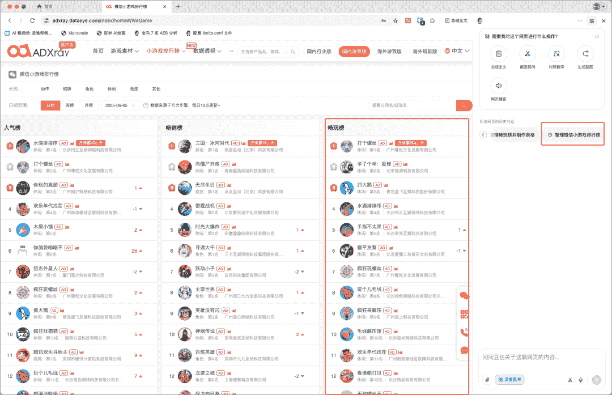
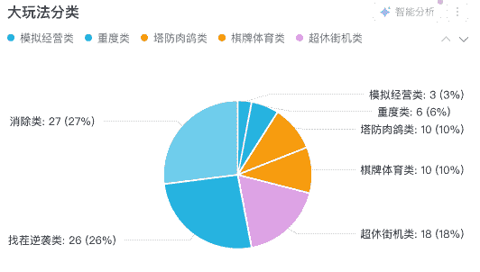
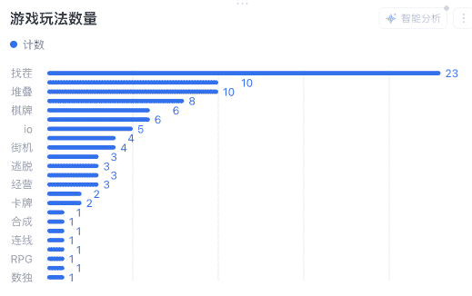
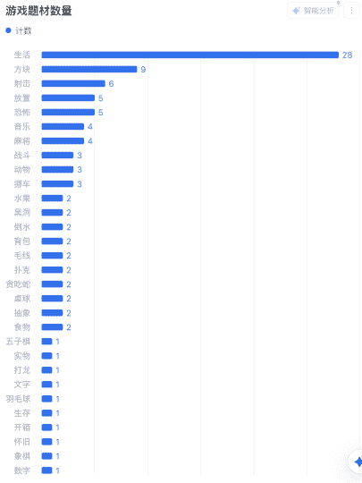
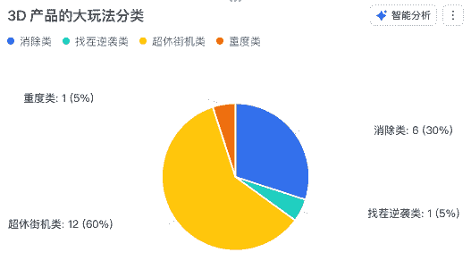
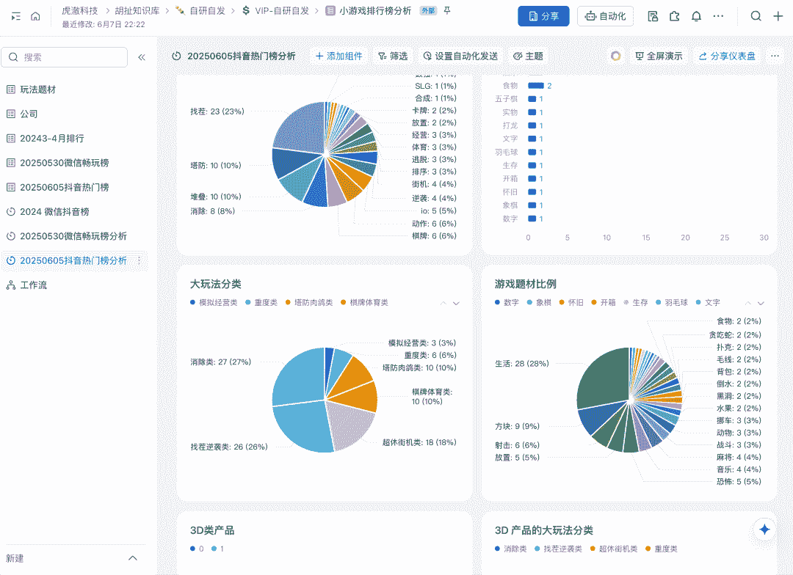

# 关于抄榜立项：抖音小游戏热门榜单深度分析

> 来源：[https://huchegames.feishu.cn/docx/EgKXdgapKovlGaxdZwbcUlcHn9g](https://huchegames.feishu.cn/docx/EgKXdgapKovlGaxdZwbcUlcHn9g)

> 🔗 原文链接： h[ttps://mp.weixin.q](https://mp.weixin.qq.com/s?__biz=MzA5NzQ3NDM3MA==&mid=2656294067&idx=1&sn=8c3c94de843a1a418028b21c646c7e1b&scene=21#wechat_redirect)q.com/s?__biz=Mz...

> ⏰ 原创 曾嵘 曾嵘胡扯的地方2025年06月09日 11:39  湖南

[从榜单反推立项思路：🛰️小游戏畅玩榜单深度分析](https://huchegames.feishu.cn/wiki/YvEQw1Zgki81BjkbUnxcDX25n3g)周我刷了一遍🛰️小游戏畅玩榜的榜单产品，完成了一篇：  。

我们知道，小游戏领域里最有价值的两个平台，就是🛰️和抖音。因此我周末花了一点时间，刷完了抖音热门榜的 100 个产品，完成了这篇文章。

和上篇一样，这篇文字的目的是通过榜单的分析，思考小游戏团队（30 人以内）在品类和题材上的立项方向，方便创业小团队寻找立足点，避免在创业伊始的错误抉择。

能力有限，文章难免有错漏，欢迎留言指出。

去年我写过一个消除品类调优策略系列，欢迎阅读：

+   [消除品类的商业化调优（一）](https://mp.weixin.qq.com/s?__biz=MzA5NzQ3NDM3MA==&mid=2656291564&idx=1&sn=c94b75d326ae911fc72b91747c2839c2&scene=21#wechat_redirect)

+   消除品类的商业化调优（二）小游戏榜单分析

+   消除品类的商业化调优（三）失败的失败反馈

+   🛰️小游戏榜单上几个消除游戏的商业化分析

+   消除类小游戏前中后期调优细则——2024腾讯广告IAA🛰️小游戏私享会

+   抖音小游戏排行榜

+   游戏发行人计划榜单

+   分析目标：抖音小游戏热门榜

+   品类分析

+   题材分析

+   3D 产品分析

+   曾老师：数据给我的立项思考

+   胡扯社群：关于抄榜的讨论

+   更多立项方向

## **抖音小游戏排行榜**

抖音小游戏的排行榜在「抖音游戏中心」小程序中可以找到。它的榜单编排方式与🛰️小游戏非常不同。

抖音小游戏的收益排行榜没有区分 IAP 和 IAA 产品，而是将所有产品混合成了一个「畅玩榜」。「热门榜」代表产品的生欢迎程度，「新品榜」则给了新游戏更多的露出机会。

[从榜单反推立项思路：🛰️小游戏畅玩榜单深度分析](https://huchegames.feishu.cn/wiki/YvEQw1Zgki81BjkbUnxcDX25n3g)于🛰️小游戏排行榜标签的分析可以看这里： 。

## **游戏发行人计划榜单**

**抖音小游戏**中还有一个重要榜单， 更能反映 当前抖音大盘对于游戏的热度，这就是「星图 x 游戏发行人计划」中的「小游戏榜单」。

之前我也写过几篇相关的文章，可以读读看：

+   [抖音小游戏发行人计划，排行榜上的直播和短视频标签，可能是错的](https://huchegames.feishu.cn/wiki/IHB2w85HyiVMCkkYHbtcV0YcnOg)

+   [🛰️视频号互选平台 VS 星图游戏发行人](https://huchegames.feishu.cn/wiki/VvOZwQdC0itXIqkhREdcVrbhnRg)

+   [什么是垂类？为什么要关注垂类？分析抖音🛰️年度大会后的2025小游戏立项思考](https://huchegames.feishu.cn/wiki/YIT9wJh8Ci2sJAkNoIJcR6Nmnzb)

**我认为，关注发**行人计划榜单，对于在抖音小游戏上立项和创业的团队来说， 「更有价值」。

## **分析目标：抖音小游戏热门榜**

本文仅针对 2025 年 6 月 5 日的抖音小游戏热门榜单做分析。

为了解到排名涨跌信息，以及和其他榜单比较，我使用 ADX 中的小游戏排行榜数据：

## **品类分析**

**与🛰️小游戏**畅玩榜消除品类一家独**大不同，抖音小游戏热门榜中**， 找茬逆袭类 产品的占比非常高。 街机、塔防肉鸽、重度产品 的数量也不少。

当然，重度产品的量级增长，也有一部分，是由于热门榜混合了 IAA 和 IAP 产品所致。

小品类分布中， **找茬 **玩法独占鳌头。23 个产品中，至少有 3 批以上马甲包存在。

更有趣的是 **街机和 io 类 ****产品的受欢迎程**度。一些四五年前火爆过的玩法，例如 龙卷风、黑洞 等，换了一个包装又能跑了。

注意，我对消除大类的定义： 堆叠、消除、排序、连线、数独、合成。

## **题材分析**

和🛰️的题材相对集中不同，抖音热门小游戏中的题材集中度并不高。

**放置、射击、体育 **类别均有不错成绩。 **挪车、毛线、螺丝 **等品类，没有🛰️榜单中的压倒性优势。

## **3D 产品分析**

有**趣的是，抖音**热门榜产品中 3D 产品的占比，与🛰️一样也是 20%。其中，街机类多来自海外超休产品的移植， 射击外星人 产品在抖音和🛰️跑得都不错，也有几个马甲包存在。消除类3D产品的质量越来越好了。

## **曾老师：数据给我的立项思考**

上篇 从榜单反推立项思**路：🛰️小游戏畅玩榜单**深度分析 末尾，我提到了 不建议做消除类产品， 以及 非常不建议初创游戏研发从消除品类入门 。

看完抖音热门榜之后，我有了一些新的看法：

1.  棋牌体育类目，无论在哪个平台，都能长期占有一席之地。

1.  **抖音对于 io** 类和街机类产品的接受程度更高，可能与巨量引擎更高的 首日 ROI 有关系。如果出海团队储备了大量的超休闲游戏资源，可以移植之后在抖音小游戏上试试投放。

1.  找茬逆袭类产品在抖音平台上跑得比🛰️好很多，可能是由于抖音信息流方法的特点，精准的算法，以及游戏直播流量的加持。

1.  塔防等男性向产品，前期更适合在抖音测试，可能因为巨量引擎的算法优势，导致抖音早期投放的回报率更高（与找茬逆袭类似原因）。

## **胡扯社群：关于抄榜的讨论**

上篇文章结尾处，我提到不要抄榜：

**不要抄榜！不要抄榜！不要抄榜！**

胡扯游戏群的大佬们进行了激烈的讨论，主要观点如下：

1.  我认识的朋友，抄榜的活了俩下来，做原创的全解散了。

1.  抄榜是现实，原创是理想。

1.  原创的事儿留给稳定的团队就好了，小团队还是抄吧。

1.  抄榜可以暂时活下来，但是是做不久的，利润一定会越来越薄，这个模式其他行业也一样。

1.  有些公司又不会设计创作，不抄咋活。

1.  没有稳定项目收入，就短平快吧，先解决生存问题。

1.  但是大部分的小公司忽然决定开始做游戏——老板多半是不懂游戏就是看别人赚钱眼红、容易出现外行指导内行的管理混乱的公司的经营状态。

1.  ……

观点太多，我无法一一摘录。

胡扯群友胡萝卜的理解，我觉得很准确：

> 所以曾老师的不要抄榜单的意思是，榜单≠趋势，榜单是结果，而非趋势的起点。能这么理解吗？

> by 胡扯群友胡萝卜

胡扯群友麒麟子的观点我也很认可：

> 不要抄top榜 要抄趋势榜。

> by 胡扯群友麒麟子

关于 **不要抄榜 **，重点不是 **榜 **，而是 **抄 **。

许多 抄榜 的团队赚到钱了，原因也是因为他们知道为什么抄，以及抄的重点是什么。明白了之后，抄榜才有价值。

所以我一直说不要抄榜，而没有说不能抄榜。

上面我提到 **发行人榜单更有价值 **，也是这个意思。

## **更多立项方向**

**此小游戏榜单中，包含了公司**和产品信息的详细分析表，是 胡扯社群的 VIP 服务 ，有兴趣可查看文章底部了解。

更多立项方向的信息，可以看看去年底到今年的行业会议中平台的分享。

---

<https://huchegames.feishu.cn/sync/OrihdFNVesPoTXbhZHEcKud4nfh>

#排行榜  #小游戏  #会议  #行业热点

---

<https://huchegames.feishu.cn/sync/BpmUdScQAsVWuxb7aJ6ciWu9nib>