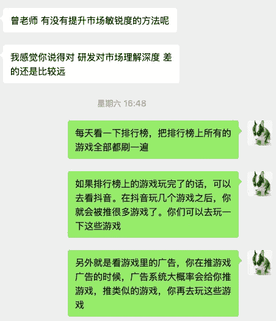
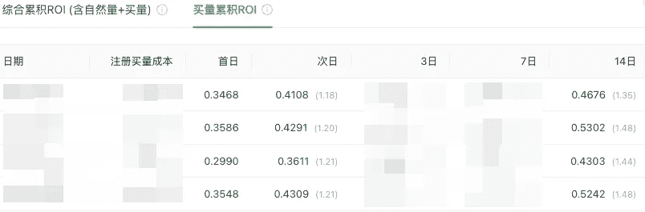
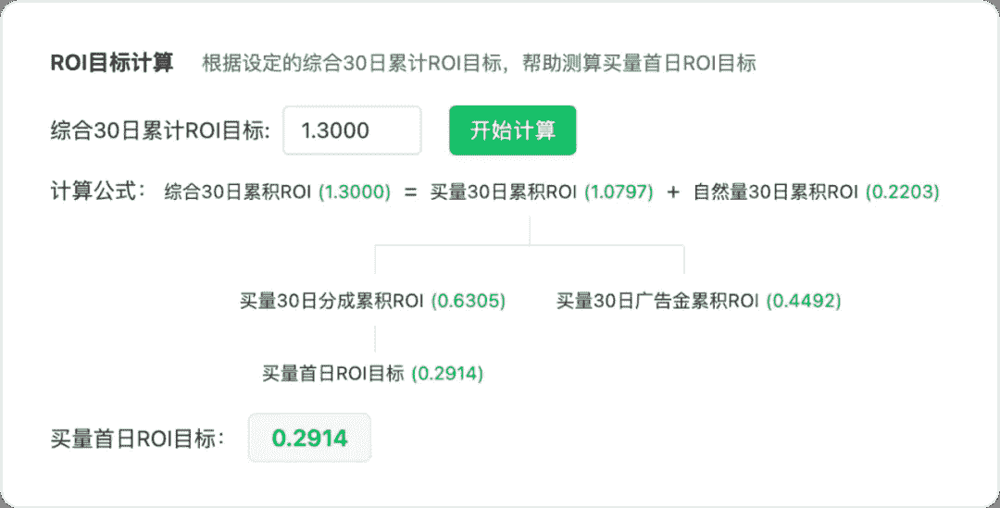

# Excel拉表救星！IAA 产品 ROI 自动计算放量分析

> 来源：[https://huchegames.feishu.cn/docx/Oesdd9EQuobcwYxt7IOc7Goenag](https://huchegames.feishu.cn/docx/Oesdd9EQuobcwYxt7IOc7Goenag)

> 🔗 原文链接： h[ttps://mp.weixin.q](https://mp.weixin.qq.com/s/3SrlXfbUJKJcW6hWsh_ULQ)q.com/s/3SrlXfbU...

> ⏰ 原创 曾嵘 曾嵘胡扯的地方2025年07月07日 17:33  湖北

经常会有研发找曾老师吐槽发行，曾老师听下来之后却发现，大部分问题都是研发自己的问题。随便举几个例子：

1.  **吐槽发行不放量**

1.  —— 产品是亏的，放多少亏多少啊。

1.  **吐槽发行不给调优建议**

1.  ——你信不信，大多数情况下，发行也不知道怎么调优？

1.  **吐槽发行不给数据**

1.  ——你不知道怎么看数据，不知道需要什么数据，发行当然也乐得清静了。

## **提升市场敏锐度的方法**

但研发们是也大多热爱学习。周末有个群友问我：

> 曾老师，有没有提升市场敏锐度的方法？

要说方法也简单，就是 **往死里玩游戏 **：

1.  **刷排行榜。**

1.  把排行榜上所有没玩过的游戏刷一遍。

1.  **刷抖音。**

1.  玩过几个游戏之后，你就会算法推很多游戏，一个个刷就好。

1.  **看广告。**

1.  在游戏里点击激励视频广告，去下载激励视频推荐的游戏，盘它。

以上3条，每天花 1～2 小时做，先坚持一个月，再坚持一年。

这玩意和健身一样， **刚入门的时候很累， **但坚持一段时间之后， 你就习惯很累了。

注意以上方法仅针对商业化小游戏。如果是独游、手游、海外市场，不要使用以上方法。

曾老师写过两篇分析榜单的相关文章，可以参考：

+   [从榜单反推立项思路：🛰️小游戏畅玩榜单深度分析](https://huchegames.feishu.cn/wiki/YvEQw1Zgki81BjkbUnxcDX25n3g)

+   [关于抄榜立项：抖音小游戏热门榜单深度分析](https://huchegames.feishu.cn/wiki/RFV5wtQ8QiOxkdkLz0fcrtpon4O)

## **怎么分析产品的 ROI**

IAA 产品的 ROI 的计算并不复杂，无非是计算每日的成本和回收。用 Excel 拉数据，或者使用自研的 BI 平台都能做到。

自研搭建发行团队、计算广告、构建BI（全系列索引）

但很多研发只关注产品，不关注数据。发行也没有有意去告知研发应该怎么看数据（或许是发行认为这是非常基础的技能，没必要教），这就导致本文开头的研发吐槽。

[从愚昧之巅推向绝望之谷 ｜ 达克效应](https://huchegames.feishu.cn/wiki/LQYbwZTSKi2qZ3k3Lq5cLxr7nsd)故事告诉我们：永远不要忽略达克效应的普遍性：  。

**近期🛰️小游戏商业化工具**箱推出了 「IAA 经营看板」， 能在其中直接展示出之前需要手动拉表以及自建 BI 的商业化数据，直接在小游戏后台即可查看。

官方👸号也出过相关的介绍，讲得很清晰，可直接跳转学习： 商业化工具箱新增：IAA 小游戏经营看板 。

这是其中最重要的部分：

> 在 ROI 分析模块，系统支持下述三种维度计算每日买量的 ROI，有效帮助流量主观察买量和自然量的 ROI 变化。

+   仅买量分成视角：选择「买量累积 ROI 」栏，并取消勾选「注册广告金」。

+   含买量广告金视角：选择「买量累积 ROI 」栏，并勾选「注册广告金」。

+   含自然量分成视角：选择「综合累积 ROI 」栏，并勾选「注册广告金」。

曾老师来啰嗦一些研发比较容易误解的点。

下图是某产品的买量累计 ROI，开启了「展示倍率」，未开启「注册广告金」。

从图中可以看到，该产品的 14 日回收平均为 0.5，倍率不到 1.5，但依然进行了放量。

关于倍率：[一文讲透「倍率」是什么](https://huchegames.feishu.cn/wiki/Si8BwtVXLiViYHkJmRuc9f99n5c)。

我们来讨论几个问题。

1. 为什么看买量累计 ROI 而不看包含自然量的 ROI？

IAA 是纯粹依赖买量的产品，将其看成金融**产品即可**（不要看做游戏）。自然量用户是 纯利润 ，在买量的前提下，不用关注意外利润。

自然量能来的多当然好，完全没有也没关系（实际上大多数产品就是完全没有），只要买量能回收即可。

对于买量产品来说：

+   **自然量是不可控的，**

+   买量产品必须保证赚钱的控制权。

+   小游戏的广告主和流量主严格处于平台的管控之下。如果没有认真做裂变和分享，不太可能有较多自然量。一个仅供参考的数据： 对长期 ROI 的影响 < 0.05（不同品类差别非常大，仅供参考）。

+   一旦认真做裂变和分享，就要考虑分享对广告点的侵占。具体可以去研究《抓大鹅》。

2. ROI 在什么情况下可以放大？

预估生命周期回收大于 1.1 的时候，可以进行适当放大（但不赚钱）。

真的有研发问我：为什么是 1.1 而不是 1.0 呢？

认真回答就是：因为我们自己也要挣钱的啊…… 那 0.1 就是我们挣的钱，还要和发行对半分……

**所以大部分发行，在 **1.1 的时候当然也不会放量， 因为不够分啊。嘿嘿！

那为什么上图中的产品，在 ROI 0.5 的时候也放量了？因为有广告金啊……

至于广告金是什么以及怎么计算，在后台都有提供，请自行查看，不要问我。

根据产品类型，以及每个产品的生命周期不同，ROI 数据需要进行具体分析。有的产品只看 7 日回收，有的产品要看 14 日回收，现在小游戏消除类产品甚至要看到 30 日。

3. 预估 ROI 和首日 ROI

投放 7 天之后，商业化工具箱就能进行 14～90 日 ROI 预估。这个数据不一定准确，仅供参考。

ROI 目标计算器也能根据目标 ROI 计算出首日 ROI，方便提前放量。

## **曾老师给研发的建议**

大多数想赚钱的发行是靠谱的。很多时候，只是对接的人不懂研发的思维方式。多沟通，多沟通，多沟通。如果对接的人无法沟通，就找 TA 老板。

打工人只想完成 KPI，但老板们都是想挣钱的。

了解自己的产品数据，是研发必须要做的事情，不要依赖发行给的基础数据。如果对数据没有基础的认知，叠加对接的运营是新来的菜鸟。那你就真是被坑死了也不知道。

做个渣男/绿茶吧，找个更适合你的发行（产品烂的话谁也救不了哈）。

会看商业化数据，会打点，会分析游戏行为数据和用户数据，是产品调优的基础。

如果真的不想学习这些，还是去做独立游戏吧： 2024：我应该去做独立游戏吗？。

---

关于🛰️小游戏商业化工具箱的更详细使用说明，可以看这个链接：

https://docs.qq.com/doc/DUHdSUWRxd09zWFV1

#胡扯发行 #自研自发 #发行

---

<https://huchegames.feishu.cn/sync/BpmUdScQAsVWuxb7aJ6ciWu9nib>

**这些文章值得读一下：**

[面向CP的发行知识：关于流量的理解](https://huchegames.feishu.cn/wiki/XR6fw8T6xiJ68PkodyaciAMLnmd)

[小CP如何搭建发行团队](https://huchegames.feishu.cn/wiki/LiQywae7eifGTFklaREcUayfnVb)

[当自研自发成为另一种出海的标配，作为小团队如何从零到一组建发行团队？](https://huchegames.feishu.cn/wiki/Y4RMw8DXPi2NedkzPlJcgYAdnNe)

[7条秘术，提升IAA小游戏老用户eCPM](https://huchegames.feishu.cn/wiki/Fj1xwoBUFiwAIEk6qipcPxoUnOe)

[eCPM必然衰减！IAA与混合变现游戏调优的底层认知](https://huchegames.feishu.cn/wiki/ANISwfoCNiYpIJk8f4Vcoyv4nLh)