# Raph Koster：游戏设计其实很简单（2025）

> 来源：https://huchegames.feishu.cn/docx/GsbZdl2ZpoTovKxV4XCcQBCVn5c

> 🔗 原文链接：https://zhuanlan.zhihu.com/p/2002103577703899774?share_code=1cEmD2HsIN1dL&utm_psn=2002285254950544705

> ⏰ 剪存时间：2026-02-04 10:21:42 (UTC+8)

> ✂️ 本文档由 [飞书剪存](https://www.feishu.cn/hc/zh-CN/articles/606278856233?from=in_ccm_clip_doc) 一键生成

> 原文链接：Game design is simple, actually

> 作者：Raph Koster

> 翻译基于 Claude Code Opus 结果进行了人工润色。

> 图片汉化：豆包

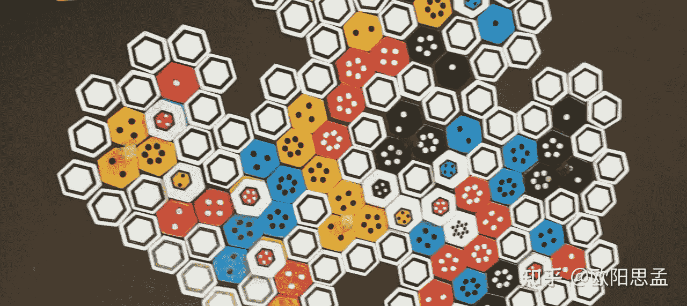

## 游戏设计十二步：完整指南

好，让我们从头到尾梳理一遍。这是一份理解游戏设计的"十二步纲领"。

> So, let's just walk through the whole thing, end to end. Here's a twelve-step program for understanding game design.

### 一：乐趣

人们把很多东西都叫做"乐趣"。但其中大部分对提升游戏制作水平没什么用——而这通常才是人们阅读此类文章的目的。派对拉炮喷出彩屑的快乐，和徒手攀岩时痛彻心扉、九死一生的快乐，这两者放在一起讨论完全没有可比性。

> There are a lot of things people call "fun." But most of them are not useful for getting better at making games, which is usually why people read articles like this. The fun of a bit of confetti exploding in front of you, and the fun of excruciating pain and risk to life and limb as you free climb a cliff are just not usefully paired together.

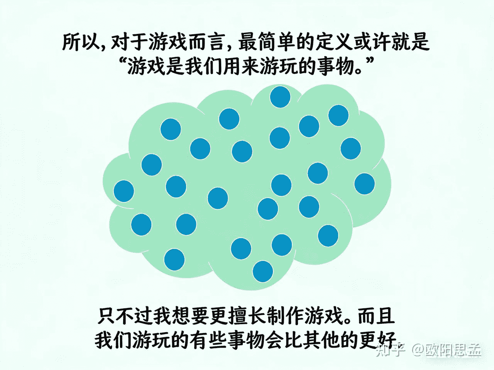

我在《快乐之道》里说过：对游戏设计师来说，真正管用的"乐趣"是"征服问题"的乐趣。照这个标准，徒手攀岩虽然又吓人又疼，但它确实符合条件。而按照我们前面说的，这也就意味着——你做一件事的时候，不一定会觉得好玩！很多时候，乐趣是做完之后才感受到的。关于这个话题，还有神经心理学等更多内容可以深入，有兴趣的话可以自行查阅。任何与"解决问题"无关的东西，都不会是游戏系统设计的核心。但这并不意味着它对游戏体验设计没用，或者在其他方面没有价值。

> In Theory of Fun I basically asserted that the useful bit for game designers was "mastery of problems." That means that free climbing a cliff is in bounds even though it is terrifying and painful. Which given what we already said, means that you may or may not find the activity fun at the time! Fun often shows up after an activity.

> There's neuropsych and lots more to go with that, and you can go read up on it if you want.

> Anything that is not about a form of problem-solving is not going to be core to game systems design. That doesn't mean it's not useful to game experience design, or not useful in general.


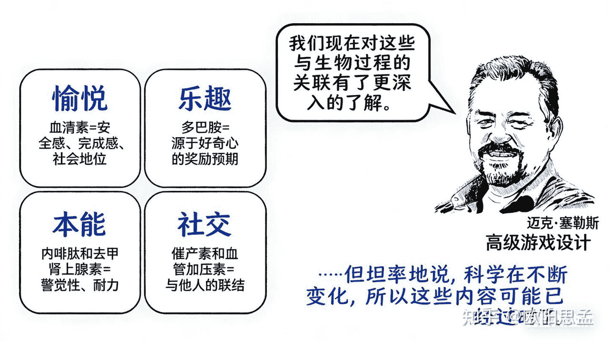

另外，显而易见的是——你完全可以制作不以"乐趣"为目的的互动娱乐产品。你也可以从现实世界中找到某样东西，然后把它变成一个游戏！你还可以看着一个游戏，选择不把它当游戏来对待，于是它可能就变成了真正的工作（这通常被称为"训练"）。这就排除了派对拉炮。一个游戏如果只是让你拉响拉炮，别无他物，很快就会让人厌倦。

> Also, in case it isn't obvious – you can make interactive entertainment that is not meant to be about fun. You can also just find stuff in the world and turn it into a game! You can also look at a game and choose not to treat it as one, and then it might turn into real work (this is often called "training").

> This rules out the bit of confetti. A game being made of just throwing confetti around with nothing else palls pretty quick.

> Bottom line: fun is basically about making progress on prediction.

### 二：问题与玩具

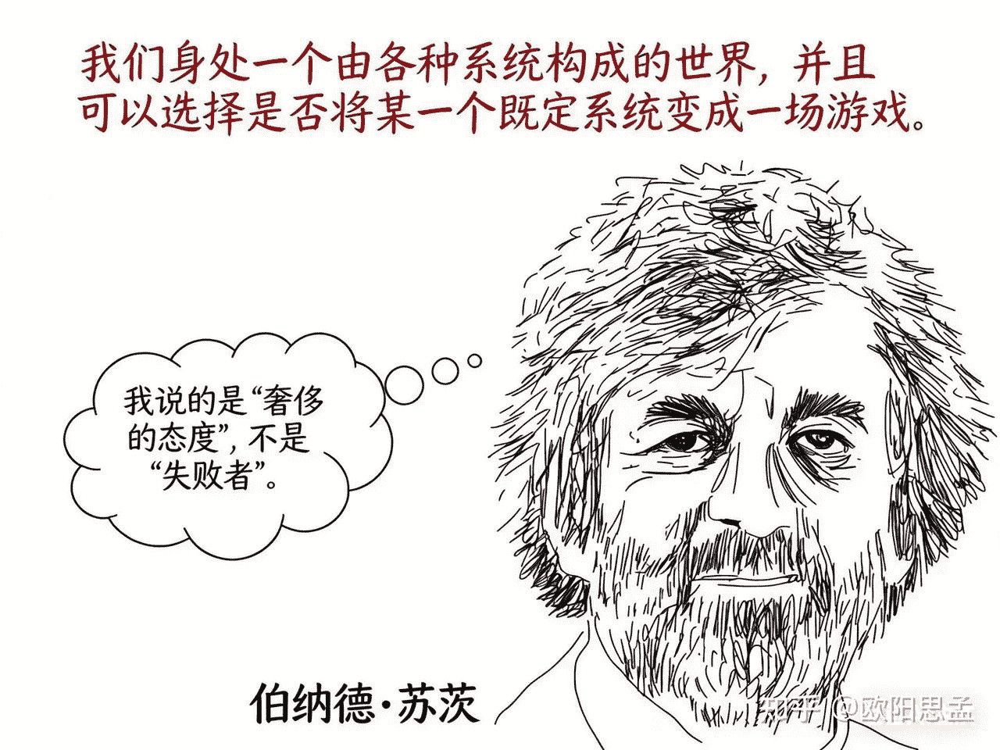

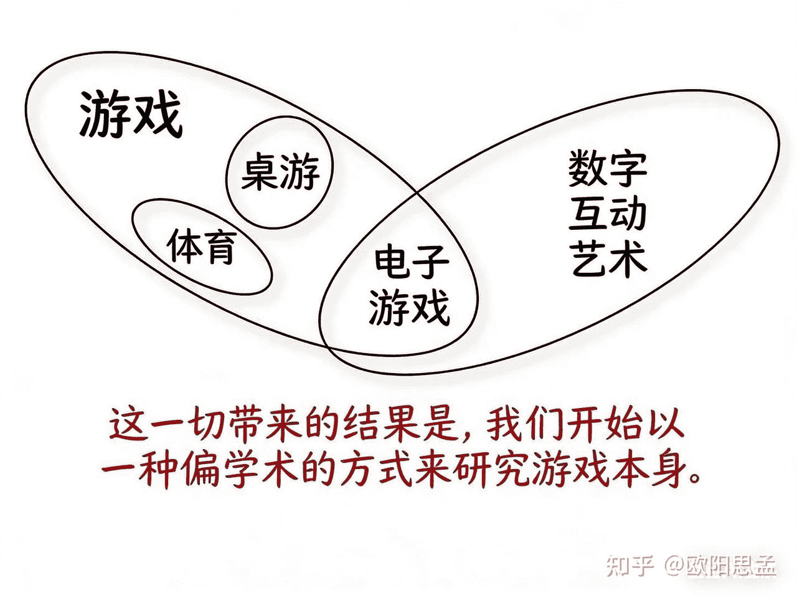

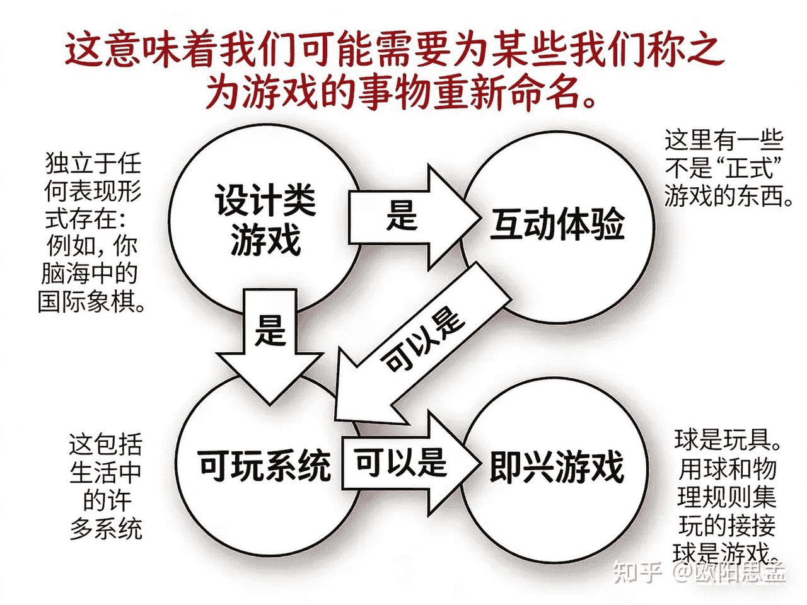

世界上有很多种问题。有一点非常重要：你必须尽可能宽泛地理解"游戏能提出什么问题"。所谓问题，就是任何需要你动脑子去琢磨的东西。好电影也会提出问题，这就是为什么你看完之后会一直想着它。

[你可以去看看各路理论家的分类，](https://zhida.zhihu.com/search?content_id=269941575&content_type=Article&match_order=1&q=Nicole+Lazzaro&zhida_source=entity) 比如 [Nicole Lazzaro](https://zhida.zhihu.com/search?content_id=269941575&content_type=Article&match_order=1&q=Roger+Caillois&zhida_source=entity) 、 Roger Caillois 、Mark LeBlanc，他们都列过"乐趣的类型"。但你会发现，他们列的其实大多是"问题的类型"，而不是"乐趣的类型"。比如"我喜欢随机性带来的问题"或者"我喜欢和人互动产生的问题"之类的。

这不是坏事。恰恰相反，这正是这些列表有用的原因。你的游戏机制本质上就是在提出问题，所以知道存在哪些问题类型的聚类，非常有价值。

> There are a lot of types of problems in the world. It is really important to understand that you have to think about problems games can pose as broadly as possible. A problem is anything you have to work to wrap your head around. A good movie poses problems too, that's why you end up thinking about it long after.

> You can go look at theorists as diverse as Nicole Lazzaro, Roger Caillois, or Mark LeBlanc for types of fun. You'll find they're mostly types of problems, not types of fun. "I enjoy the types of problems that come from chance" or "I enjoy the types of problems that come from interacting with others" or whatever.

> This is not a bad thing. This is what makes these lists useful. Your game mechanics are about posing problems, so knowing there's clumps of problem types is very useful.

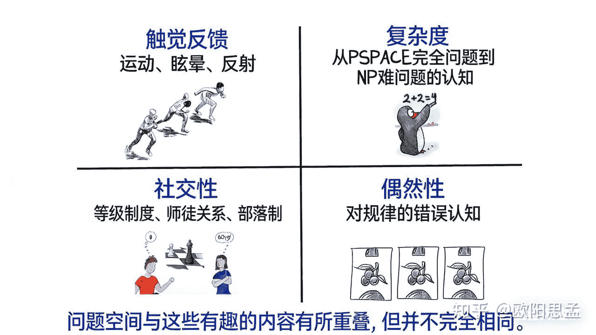

```
译者注：NP问题像「猜密码，猜对了容易验证」；PSPACE问题像「下棋，得考虑对手所有可能的应对」。
```

说到底，一个问题是由一组约束条件构成的。这些约束条件，我们通常叫它规则。但问题还需要一个目标。通常，如果我们碰到一套规则，但没有问题要解决，我们就只是玩玩它，然后管它叫玩具。

做玩具很难！确定那些规则和约束条件，定义出一个有嚼劲的好问题，是非常有挑战性的。你可以把玩具理解为一个"待解之物"——一个邀请你来把玩的问题。

另一方面，把玩具变成游戏并不难，人们一直在这么做。你只需要给它加一个目标就行了。别忘了，玩家们经常自己就会这么干。

从设计一个玩具开始，是设计游戏的绝佳起点。

> In the end, though, a problem is built out of a set of constraints. We call those rules, usually. It also, though, has a goal. Usually, if we come across a set of rules with no problem, we just play with it, and call it a toy.

> Building toys is hard! Arriving at those rules and constraints to define a nice chewy problem is very challenging. You can think of a toy as a problematic object, a problem that invites you to play with it.

> On the other hand, it's not hard to turn a toy into a game, and people do it all the time. All you have to do is invent a goal. We shouldn't forget that players do so routinely.

> Building a toy is an excellent place to start designing a game.

> 我们玩的是有约束、有变化的系统，我们给它贴上目标来挑战自己。

> Bottom line: we play with systems that have constraints and movement, and we stick goals on them to test ourselves.

### 三：预测与不确定性

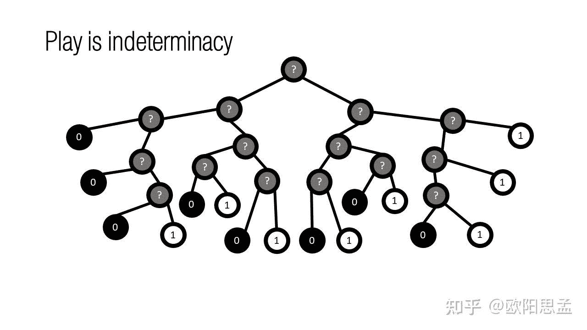

游戏是围绕不确定性构建的机器。几乎所有游戏的结局，都是把一个不确定的结果变成确定的。你面前有个问题，你不知道能不能克服它、达成目标。而克服它，靠的就是预测未来。

如果说好游戏和好故事有什么共同点，那就[是尽可能](https://zhida.zhihu.com/search?content_id=269941575&content_type=Article&match_order=1&q=%E5%A4%9A%E5%B7%B4%E8%83%BA&zhida_source=entity)长时间地保持不可预测。（这也是多巴胺发挥作用的地方，它和预测有关；但这事儿很复杂，有很多细微差别。）

如果一个问题基本上只有一个答案，我们通常称之为谜题。一个非此即彼的结构里，没有太多不确定性。你可以把一堆谜题摞在一起，用它们构建一个游戏（这就在整体上引入了不确定性），但单个谜题，大多数人不会把它叫做游戏。

> Games are machines built around uncertainty. Almost all games end by turning an uncertain outcome into a certain one. There's a problem facing you, and you don't know if you can overcome it to reach that goal. Overcoming it is going to be about predicting the future.

> If there's one thing that good games and good stories have in common, it's about being unpredictable as long as possible. (This is also where dopamine comes in, it's tied to prediction; but it's complicated and nuanced).

> If a problem basically has one answer, we often call it a puzzle. There's not a lot of uncertainty built into a binary structure. You can stack a bunch of puzzles one on top of the other and build a game out of them (which then introduces uncertainty into the whole), but a singular puzzle isn't likely to be called that by most people.

经常发生的情况是：我们曾经以为某个东西是游戏，后来发现它其实是个谜题。数学家管这叫"解开游戏"。他们对四子棋就这么干过——而你小时候对井字棋也这么干过。

所以，好的游戏问题都有这些共同特征：

+ 答案会随着你深入挖掘而演变——所以它们要有深度。你的第一个答案应该只管用一阵子。通往解决方案的路径也可能有很多条。这就是为什么那么多游戏有分数——分数帮你看出解决方案的范围有多大！

+ 答案要有不确定性。（当你还小的时候，这个宇宙比你长大后要大得多——躲猫猫在某个年龄之前是有不确定性的！）

+ 这个问题应该能在很多情境中出现。

> It happens quite often that we used to think something was a game, and it turned out it was actually a puzzle. Mathematicians call that "solving the game." They did it to Connect Four – and you did it to tic-tac-toe, when you were little.

> Good problems for games therefore all have the same characteristics:

> They need to have answers that evolve as you dig in more – so they need to have depth to them. Your first answer should only work for a while. There might be many paths to the solution, too. This is why so many games have a score – it helps indicate how big a spread of solutions there are!


> They need to have uncertain answers. (When you're little, this universe is a lot larger than it is when you're older – peek-a-boo is uncertain up to a certain point!).

> The problem should be something that can show up in a lot of situations.

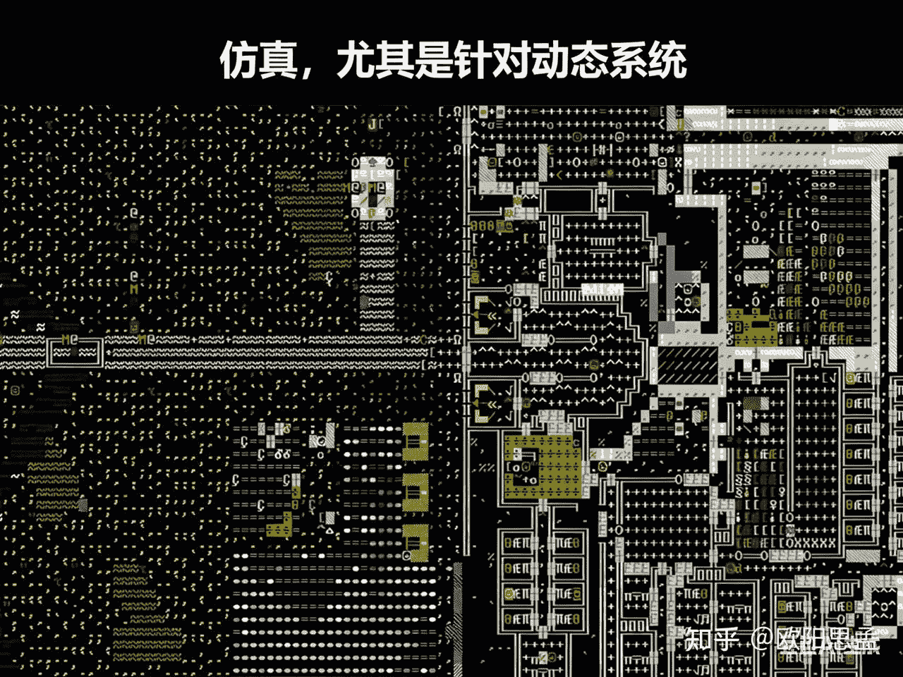

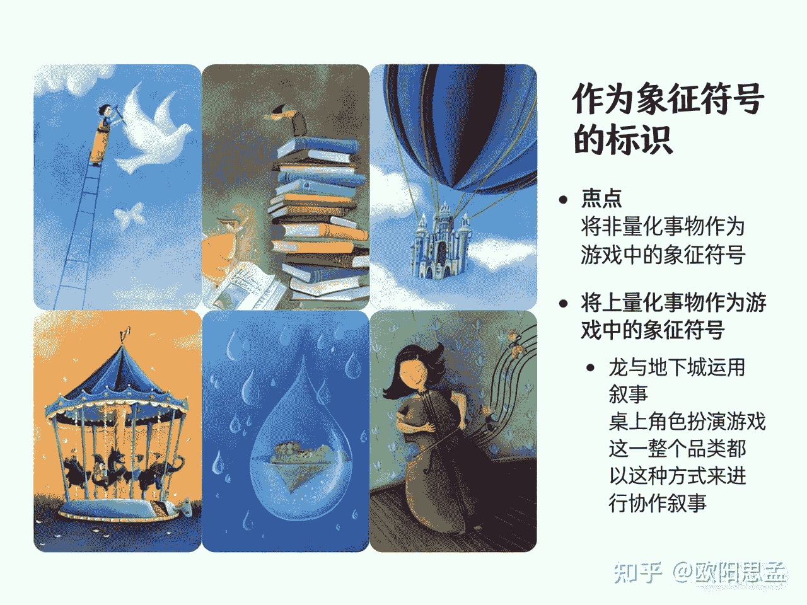

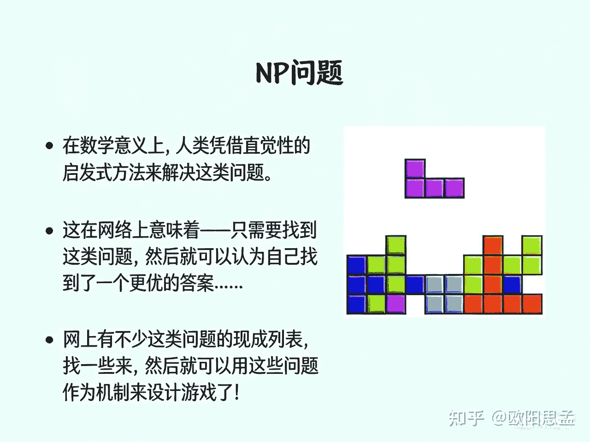

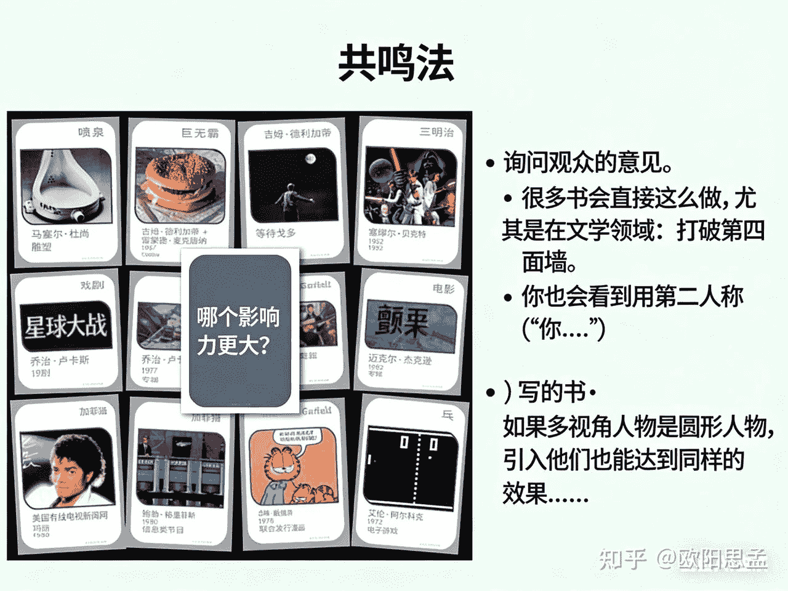

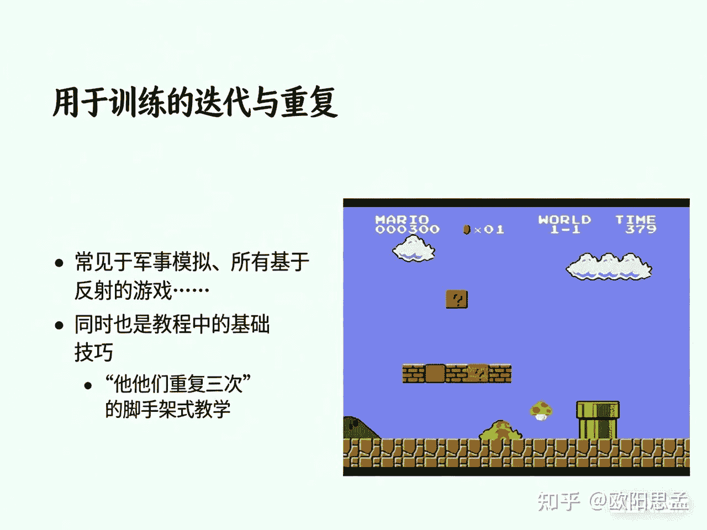

很多非常好的问题看起来简单得可笑，但背后有深度。数学问题比如"穿过这个院子的最佳路径是什么？"故事性问题比如"出售：婴儿鞋，从未穿过。"

我最近看了一个视频，里面有人说"捡木棍"不是一个有用的循环。想象一下：屏幕中央有一根木棍。你的任务是把光标移过去，点击它。点完了，你可以再点一次。

你猜怎么着？初代 Mac 电脑出厂时就自带游戏，教你怎么移动鼠标、怎么点击。曾几何时，用鼠标是一项有挑战性的技能；说不定你爷爷奶奶现在还在为此头疼。对他们来说，这有不确定性。对你来说，大概没有。

> A lot of very good problems seem stupidly simple, but have depths to them. Math ones, like "what's the best path to cross this yard?" but also story ones like "For sale: baby shoes, never worn."

> I recently watched a video that included the statement that "picking up sticks" is not a useful loop. Picture a screen with a single stick in the middle. The problem posed is to move the cursor over it and click it. Once you do it, you get to do it again.

> Guess what? The original Mac shipped with games that taught you how to move a mouse and click things. Once upon a time, mousing was a skill that was challenging; for all I know, you have grandparents who still have trouble with it. For them, it has uncertainty. For you, probably, it doesn't.

一句话总结：游戏里的不确定性、不定性、模糊性越多，深度就越大。

> **Bottom line: the more uncertainty, indeterminacy, ambiguity in your game, the more depth it will have.**

---

## 四：循环

现在，想象一下木棍每次弹到一个随机位置。是不是更好了？

循环的核心是一个你反复遇到的问题。"我怎么拿到下一个？"但得有什么东西在跟你对抗，这才让它成为一个有趣的问题，通常也是让它超越谜题的关键。我喜欢说"每个游戏里都有一个对手"——哪怕它只是物理定律。

> Now, imagine that the stick pops to a random location each time. Better, yes?

> The core of a loop is a problem you encounter over and over again. "How do I get the next one?" But something needs to be pushing back, that's what makes it an interesting problem and is usually what takes it past being a puzzle. I like to say "in every game, there is an opponent." Even it's just physics.

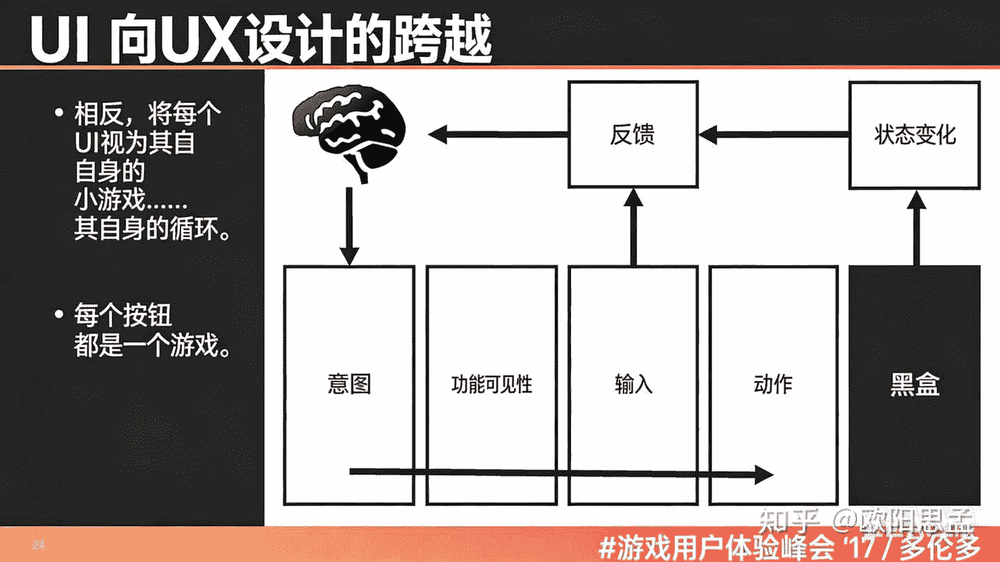

人们常说游戏的"核心循环"。但其实有两种循环。

一种我们可以叫它操作循环。这是你和问题之间的循环，是你与问题互动的方式。观察->形成假设->尝试->看到结果。可能成功也可能失败。然后你更新假设，决定下一步怎么办。

第二种其实是你的进程循环，但更好的理解方式是把它看作一个螺旋。这才是人们说"游戏循环"时通常指的东西。他们说的是一遍又一遍地捡木棍。我说它是螺旋，因为一遍又一遍点击屏幕中央同一根木棍，通常不是我们设计游戏的方式。那其实是在反复做同一个谜题。

> People talk about the core loop of a game. But there's really two types of loops.

> One is what we might think of as the operational loop. This is the loop between you and the problem, it is how you interact with it. You look at it. You form a hypothesis. You poke the problem. You see a result. Maybe it was success, and you grabbed the stick. Maybe it was failure. Maybe it was partial success. You update your hypothesis so you can decide what to do next.

> The second loop is really your progression loop but is better thought of as a spiral. It's what people usually mean when they say "a game loop." They mean picking up the stick over and over. I say it's a spiral, because clicking on the same stick in the middle of the screen over and over is not usually how we design games. That would actually be repeatedly doing the same puzzle.

相反，我们每次把木棍移到屏幕上的不同位置，也许再给你一个时间限制。现在有了你需要对抗的东西，有了需要锻炼的技能，有了需要识别的模式。更多人会觉得这是一个值得花时间的问题。这是一个更好的游戏。如果木棍出现在某处而不是另一处是有原因的，而且玩家能随着时间推移弄明白这些原因，那就更好了。

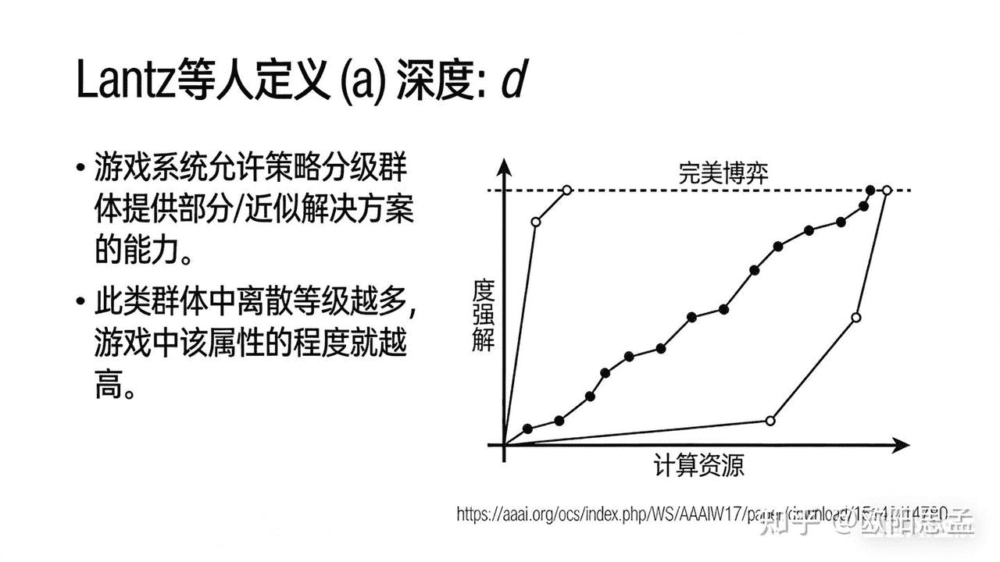

这很重要：动词是在循环中的。"捡起"，一遍又一遍。但情境不是。而且你在学习如何减少结果的不确定性：把鼠标移到这里点击，下一次移到那里。这就是为什么它是螺旋：它在螺旋式地走向一个结论。它会一直有趣，直到变得可预测。

你可以把操作循环想象成你转方向盘的方式，情境就是你滚过的路面。方向盘上的一个点在你移动时形成一个进程螺旋。一台机器，多种情境——我们管这些规则叫"机制"是有原因的。

> Instead, we move the stick on the screen each time, and maybe give you a time limit. Now there's something you're pushing against, and there's a skill to exercise and patterns to try to recognize. Far more people will find this a diverting problem for a while. It's a better game. It'll get even better if there are reasons why the stick appears in one place versus another, and the player can figure them out over time.

> This matters: the verbs are in a loop. "Pick up," over and over. But the situation isn't. And you are learning how to reduce uncertainty of the outcome: move the mouse here and click, next move it there. That's why it is a spiral: it is spiraling to a conclusion. It'll be fun until it's predictable.

> You can think of the operational loop as how you turn the wheel, and the situations as the road you roll over. A spot on the wheel makes a progression spiral as you move. One machine, many situations — we call these rules mechanics for a reason.

**一句话总结：玩家需要理解怎么使用这台机器，而关键是通过在不同情境中测试它，逐渐推断出它是怎么运作的。**

> **Bottom line: players need to understand how to use the machine, and the point is to gradually infer how it works by testing it against varied situations.**

---

## 五：反馈

你没法学习、没法进步，除非你能获得一大堆信息。

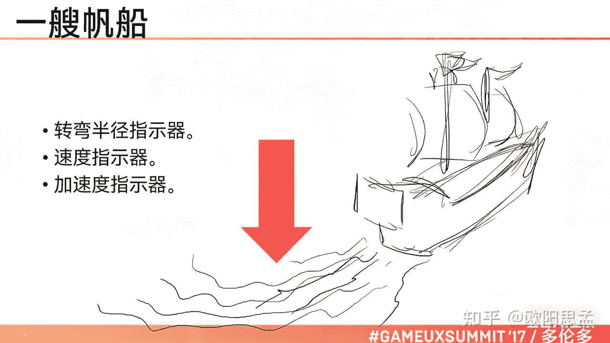

+   你需要知道有哪些动作——我们通常叫它们动词——是可用的。有一个油门踏板。

+   你需要能感知到你用了一个动词。你踩下踏板时听到引擎轰鸣。

+   你需要看到使用动词影响了问题的状态，以及它怎么变化的。速度表动了！

+   你需要被告知问题的状态对你的目标来说是变好了还是变差了。你是想开这么快吗？

这些每一项都有专业术语，你可以去学。从"可供性"（affordance）和"果汁感"（juice），到"状态空间"（state space）和"完美信息"（perfect information），还有"正向"和"负向"配上"反馈"这个词时那些非常让人困惑的矛盾用法。

> You can't learn and get better unless you get a whole host of information.

> You need to know what actions – we usually call them verbs — are even available to you. There's a gas pedal.

> You need to be able to tell you used a verb. You hear the engine growl as you press the pedal.

> You need to see that the use of the verb affected the state of the problem, and how it changed. The spedometer moved!

> You need to be told if the state of the problem is better for your goal, or worse. Did you mean to go this fast?

> There are fancy names for each of these, and you can go learn them all. Everything from "affordance" and "juice," to terms like "state space" and "perfect information" and very confusing contradictory uses of the words "positive" and "negative" paired with the word "feedback."

总的来说，反馈可以、也应该是令人愉悦的。这意味着这是你可以用上那些我在开头扔掉的"乐趣形式"的地方。它可以是惊喜。它可以是一场华丽的多媒体盛宴。它可以是一段深深触动人心的悲剧过场动画，推进游戏故事。

如果反馈太少，玩家就没法完成互动循环。想象一下俄罗斯方块，如果你放下的方块在落地之前都是隐形的。

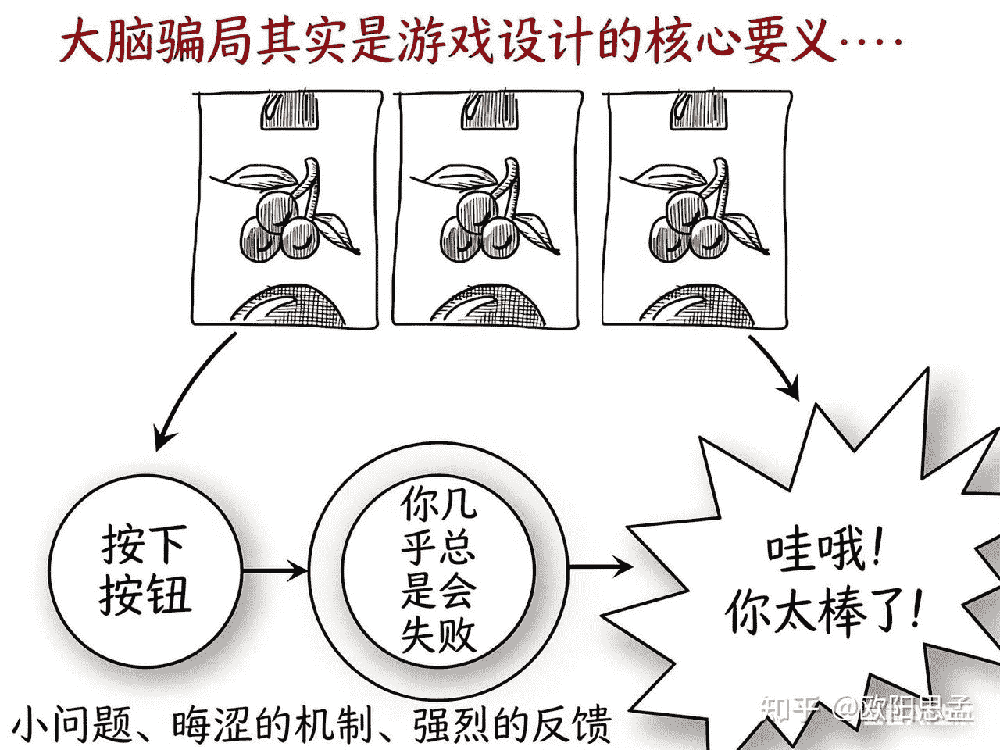

如果反馈很糟糕，玩家也没法完成学习循环。想象一下俄罗斯方块，如果有时候消除一行分数下降，有时候分数上升。在那个烂版本的俄罗斯方块里，你根本没法判断阻碍你达成目标的问题到底是什么。反馈需要起到奖励的作用，帮助你得出结论。

> Feedback in general can, and should be, delightful. That means it's where you get to use all those forms of fun that I threw away at the beginning. It can be surprising. It can be a juicy multimedia extravaganza. It can be a deeply affecting tragic cutscene that advances the game story.

> If you have too little feedback, players cannot go around the interaction loop. Picture Tetris if the piece you drop is invisible until it lands.

> If you have bad feedback, players cannot go around the learning loop either. Picture Tetris if sometimes your score goes down when you complete a line and sometimes it goes up. You can't draw any conclusions about what the problem in the way of the goal actually is, in that crappy version of Tetris. Feedback needs to act as a reward to help you draw conclusions.

但还有第三种错误：你可以提供一套华丽又吸引人的反馈，但下面根本没有真正的问题。往轻了说，你在做浅薄的娱乐。往重了说，你在做剥削性的娱乐。

只要反馈足够好，人们愿意接受相当简单、相当熟悉的问题。

> But there's a third mistake: you can supply a gorgeous and compelling set of feedback and not actually have a real problem under there. At minimum you're making shallow entertainment. At worst, you are building exploitative entertainment.

> People will be willing to go along with pretty simple and pretty familiar problems as long as the feedback is great.

**一句话总结：展示你能做什么，展示你做了什么，展示产生了什么影响，展示是否有帮助。**

> **Bottom line: show what you can do, that you did it, what difference it made, and whether it helped.**

---

## 六：变化与升级

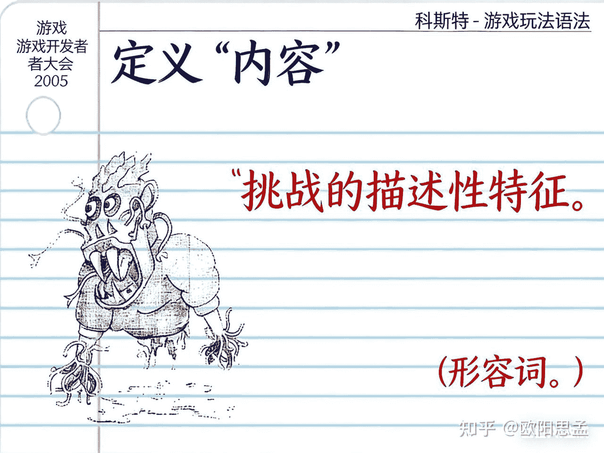

如果你设计的时候想的是某个具体的问题场景，你做的就不是游戏系统设计。你在做的是关卡设计。"怎么做乘法"是一个问题。"6 × 9 等于多少"不是问题，它是内容。


现在想想贪吃蛇，或者吃豆人。它们也是核心循环是"捡木棍"的游戏。区别在于有东西阻碍你捡木棍：贪吃蛇里，你捡起东西会变长，可能撞到自己。吃豆人里，你得躲开幽灵才能收集豆子。

贪吃蛇里，你有多长是一种情境。苹果出现在哪里是另一种情境。具体来说，你面对的是同一个问题，但在不同的拓扑结构中。吃豆人里，你相对于幽灵的位置、还剩哪些豆子、迷宫里你能往哪些方向走，都是不同的情境。

> If you are trying to design and are thinking of a specific problem scenario you are not doing game systems design. You are doing level design. "How to multiply numbers" is a problem. "What is 6 x 9" is not a problem, it's content.

> Now consider the game of Snake, or Pac-Man. They are also games where the core loop is picking up a stick. The difference is that something is an obstacle to you picking up the stick: you get longer when you pick up the stick, and can crash into yourself. You have to avoid ghosts as you gather the stick.

> How long you are in Snake is a different situation. Where the apple to eat is located is a different situation. To be specific, you have the same problem in different topology. Where you are relative to the ghosts, and which dots are left, and what directions you can go in the maze are different situations in Pac-Man.

你希望你在循环中使用的动词能够面对很多很多情境。如果你的动词做不到，你的核心循环可能就有问题。你的核心问题（也就是你的核心游戏机制）可能太浅了。

你想要的是能够向玩家抛出越来越复杂的情境。这就是他们攀登学习阶梯的方式。理想情况下，他们应该能得出一些阶段性的解决方案（这个也有很多术语：启发式方法、策略），而这些方案后来会失效。

顺便说一下，吃豆人其实被解开了！这就是为什么后来发明了吃豆人小姐。有时候，升级的方式就是改变规则，而吃豆人小姐就是这么做的。它通过增加随机性来做到这一点。事实上，使用随机性是在游戏中创造情境变化的最大（也是最古老的）方式之一。

> You want the verbs you use in the loop to end up confronting many many situations. If your verb can't, your core loop is probably bad. Your core problem (aka your core game mechanic) is probably shallow.

> What you want is to be able to throw increasingly complex situations at the player. That's how they climb the learning ladder. Ideally, they should arrive at interim solutions (lots of words for that, too: heuristics, strategies) that later stop working.

> Pac-Man actually got solved, by the way! That's why Ms. Pac-Man was invented. Sometimes, the way to escalate is to change the rules, and that's what Ms. Pac-Man did. It did it by adding randomness, and in fact using randomness is one of the biggest (and oldest) ways to create situation variation in games.

一句话总结：升级情境，让理论可以被测试、被完善、被抛弃。

> **Bottom line:** escalate the situations so that theories can be tested, refined, and abandoned.

---

## 七：节奏与平衡

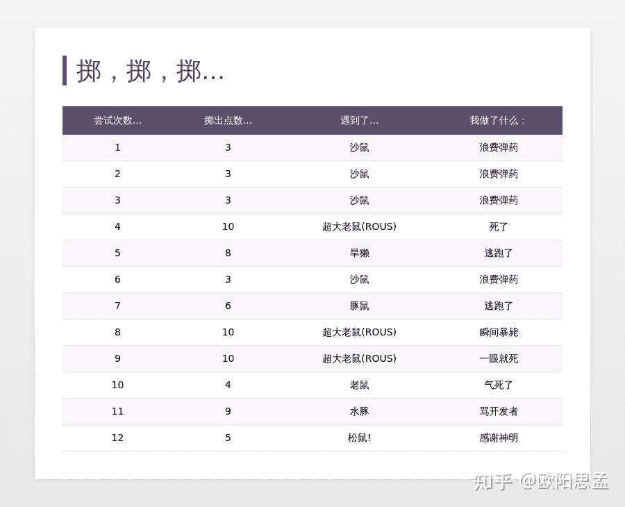

既然我们可以把这一切归结为解决问题、学习、掌握，那就意味着我们可以从其他领域偷来一大堆知识。

人们在能够反复实验的时候学得最好，这我们也叫"练习"。这就是为什么循环是有道理的。关于怎么训练、怎么练习，外面有很多科学研究（还有大量高度重叠的教育理论），如果你的游戏遵循其中一些原则，它会更好。

人们在问题刚好超出他们能力边缘的时候学得最好。如果超出太多，他们可能连问题是什么都感知不到！而如果反过来，他们一眼就看到了答案，要么会觉得无聊，要么可能就一遍又一遍做同样的事，永远不会发展新策略，也不会进步。

> Since we can put all this this down very much to problem solving and learning and mastery, it means we can steal a whole bunch of knowledge from other fields.

> People learn best when they can experiment iteratively, which we also call "practicing." That's why loops make sense. There's a lot of science out there about how to train, how to practice (and also a lot of educational theory that overlaps hugely), and your game will be better if it follows some of those guidelines.

> People learn best when the problem they are tackling is right past the edge of what they can do. If it's too far past that edge, they may not even be able to perceive the problem in the first place! And if the reverse is true and they see a solution instantly, they'll either be bored, or they might just do that over and over again and never develop any new strategies and not progress.


有一个最佳的节奏曲线。它看起来就像你在文学教科书里看到的张力图：有点像上升的正弦波。你开始时慢，然后加速，达到挑战峰值，然后稍微放松，给一个喘息的机会但不完全降下来，然后再加速……我们有关于在那些峰值放什么的惯例（Boss战！）。但重要的是曲线的形状。

你需要构建你的游戏来推动玩家向上走。他们可能需要以不同的速度攀登这条曲线，这就是为什么你可能也需要难度滑块。他们可能爬不到顶端，这没关系。

你还需要安排节奏，为所有不是"掌握问题"的事情留出空间——比如和朋友社交玩乐。但与此同时，游戏中要做的事情也需要以合适的节奏出现！

> There's an optimal pacing shape. It looks just like what you see in your literature textbooks when they diagram tension, or whatever: sort of like a rising sine wave. You start slow, then speed up, hit a peak challenge, then back off a bit, give a breather that falls back but not all the way, then speed up… we have conventions for what to put at those peaks (bosses!). But what matters is the shape of the curve.

> You need to structure your game so that you push players up. They might need to climb the curve at different paces, which is why you might also have difficulty sliders. They might not be capable of getting all the way to the top, and that's okay.

> You also need to pace to allow room for everything that isn't mastering the problem — such as having fun with friends socially. But at the same time, things to do in the game need to come along at the right pace too!

一句话总结：变化强度和压力，给玩家练习的机会，也给他们接受考验的时刻。

> **Bottom line:** Vary intensity and pressure, give players a chance to practice and moments to be tested.

---

## 八：游戏由游戏组成

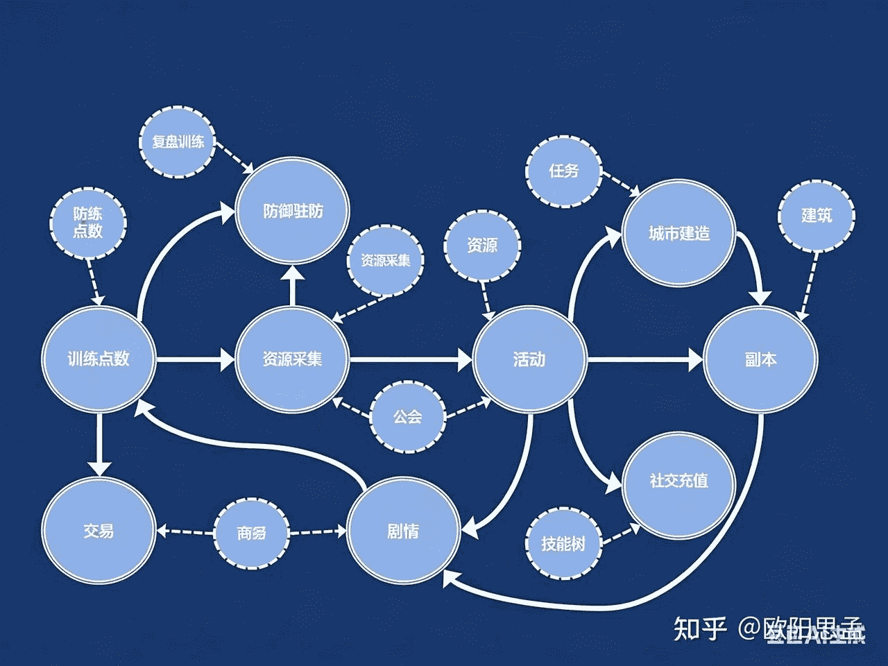

还记得那个在屏幕随机位置点击木棍的游戏吗？它也是一个轨道射击游戏。你移动鼠标，在二维空间里点击一个点。这和 FPS 也没太大区别——只不过现在你移动的是摄像机，不是光标。

几乎没有游戏只由一个循环组成。相反，我们把循环串在一起——完成循环 A，它可能会输出一些东西，成为另一个循环的工具或约束。

FPS 有移动摄像机（而不是鼠标）来点击木棍的问题。它还有一个关于在三维空间里移动的循环。而移动本身其实可能由好几个循环组成，因为它可能包括跑步、跳跃、空间定向。这些都是问题类型！

> Remember the game about clicking on a stick that appeared at a random location on screen? That's also a rail shooter. You move the mouse and click on a spot in 2d space. Which is also not that different from an FPS — only now you move the camera, not the cursor.

> Almost no games are made of only one loop. Instead, we chain loops together – complete loop A, and it probably outputs something that may serve as a tool or constraint on a different loop.

> An FPS has the problem of moving the camera (instead of the mouse) to click on the stick. It also has a loop around moving around in 3d space. Moving around is actually made of several loops, probably, because it may be made of running and jumping and spatial orientation. Those are all problem types!

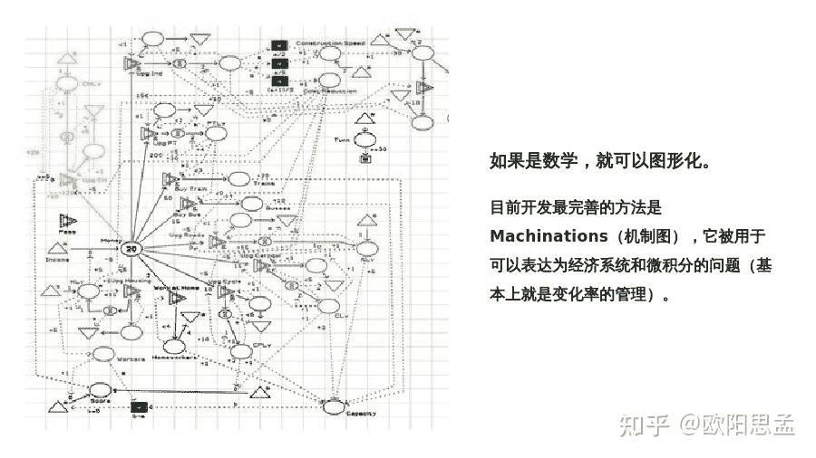

我们有时说"价值链"：就是一个循环向下一个循环输出东西。我们也说"游戏经济"，这是循环以非线性方式连接时发生的事，更像一张网。这不是你模拟金钱或商业的那种经济。相反，它是对存量和流量以及实际系统动力学科学其他方面的隐喻。在这个视角下，你的生命值是一种"存量"，或者如果你愿意，是你在战斗中花费的"货币"。

游戏以分形方式嵌套，它们织成复杂的经济体，它们展开成连锁的循环链。这就是为什么它们可以用很多种方式画成图。

但在核心，你可以把它们全都分解成那些基本的小问题，每个问题都有一个以它为中心的互动循环和学习循环。

> We speak sometimes of value chains: that's where one loop outputs something to the next loop. We speak also of game economies, which is what happens when loops connect in non-linear ways, more like a web. This is not the sort of economy where you are simulating money or commerce. Instead it's a metaphor for stocks and flows and other aspects of actual system dynamics science. In this view, your hit points is a "stock" or, if you like, a "currency" you spend in a fight.

> Games nest fractally, they web into complex economies, and they unroll chains of linked loops. That's why they can be diagrammed in a multitude of ways.

> At heart though, you can decompose them all into those elemental small problems, each with an interaction loop and a learning loop centered on that problem

一句话总结：把小问题构建成更大的网络，画出它们是怎么连接的。

> **Bottom line:** build small problems into larger webs, and map them so you understand how they connect.

---

## 九：实际的系统设计

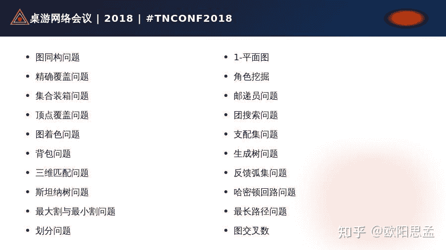

常见的问题是"好吧，那我到底怎么设计这样的问题？"这确实是游戏独有的部分，因为这里的其他要点在很多别的领域都很常见。

如前所述，可能的问题列表是巨大的。这是一个很深的兔子洞。一旦你考虑到可以堆叠、交织、以各种方式连接问题，这就意味着有一个巨大的可组合的游戏（和游戏变体）宇宙等待创造。

只要记住，由于品味和经验各不相同，你提出的问题集的多样性会影响谁想玩你的游戏。

基本上有一组我们知道有效的问题类别，这是最简版本：

+   数学上复杂的谜题
+   弄清楚其他人类怎么想
+   掌控你的身体和大脑

> The common question is "okay, so how do I design a problem like that?" And that is indeed the unique bit in games, because the other items here are common to lots of other fields.

> The list of possible problems is, as mentioned, enormous. This is a big rabbit hole. And once you consider that you can stack, web, and otherwise interlink problems, it means that there's a giant composable universe of games (and game variants) to create.


> Just bear in mind that because of varied tastes and experience, the diversity of the set of problems you pose is going to affect who wants to play your game.

> There are basically a set of categories of problems that we know work, and this is the absolute simplest version of them:

> Mathematically complex puzzles

> Figuring out how other humans think

> Mastering your body and brain

这些可以分解成大量子问题，但比你想象的要少，而且你实际上可以找到它们的列表。难的是，它们每一个看起来往往太小太琐碎，我们觉得不值得去看！

它们也常常是伪装的：抛出的球会落在哪里这个问题，如果你保持这个速度开下去还剩多少油这个问题，以及你身上有中毒状态、生命值什么时候会耗尽这个问题——是同一件事。

但你作为设计师搞懂的问题越多，你就越能把它们组合起来。你会发现它们非常有可塑性，非常好捏。事实上，你几乎可以为每一个做一个 YouTube 视频。

那你从哪里获得它们？偷。当然可以从其他游戏偷，但世界上也到处都是提出棘手问题的系统。你可以抓过来换个皮。

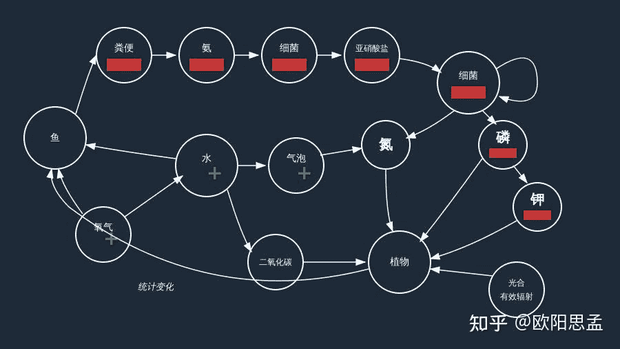

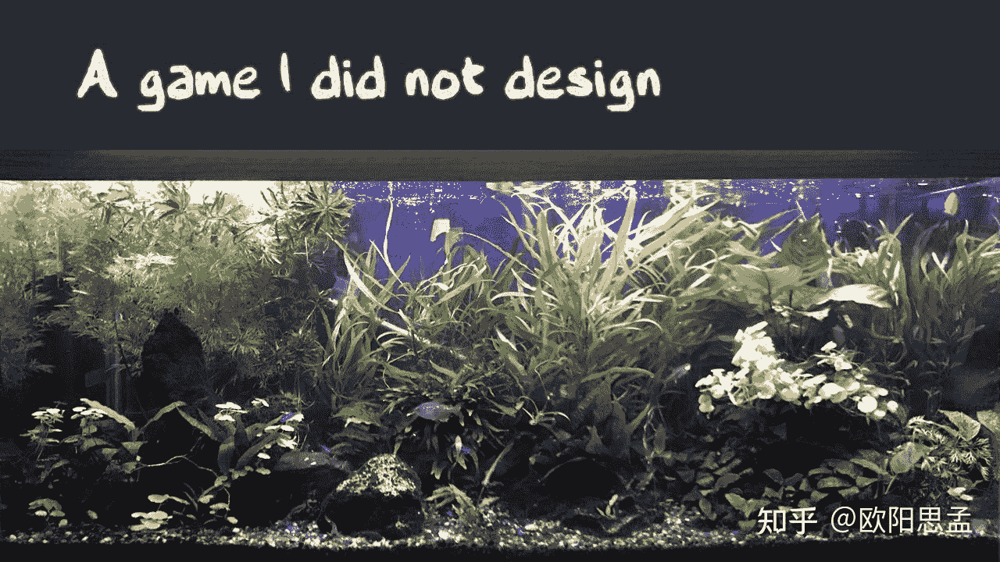

实际上表现出来的样子

> These break down into a ton of sub-problems, but there are less than you think, and you can actually find lists of them. The hard part is that often they each seem so small and trivial that we don't think of them as actually being worth looking at!

> They are also often in disguise: the problem behind where a tossed ball will land, and the problem of how much fuel you have left in your car if you keep driving at this speed, and the problem of when your hit points will run out given you have a poison status effect on you are the same thing.

> But the more of them you as a designer have wrapped your head around, the more you can combine. And you'll find them very plastic and malleable. In fact, you could almost make a YouTube video about each one.

> So where do you get them? Steal them. Other games, sure, but also, the world is full of systems that pose tough problems. You can grab them and reskin them.

**一句话总结：不是每种机制都已经被发明了**，但已经有很多了。建立你的目录和工作台。

> **Bottom line: not every mechanic has been invented, but a ton have. Build your catalog and workbench.**

---

## 十：包装与体验

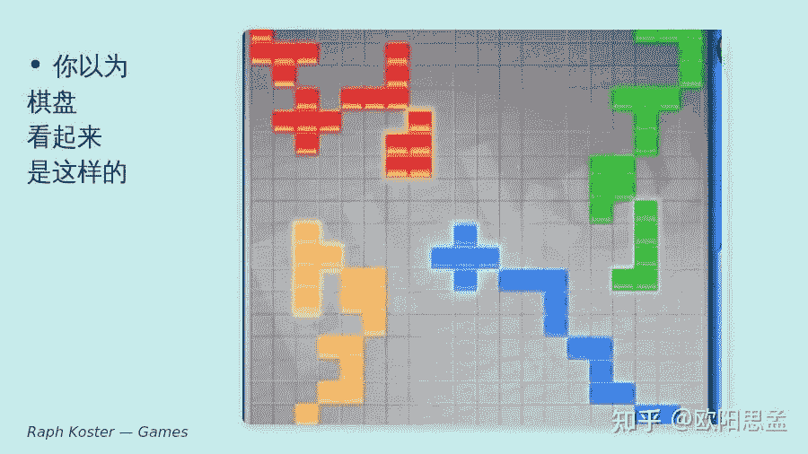

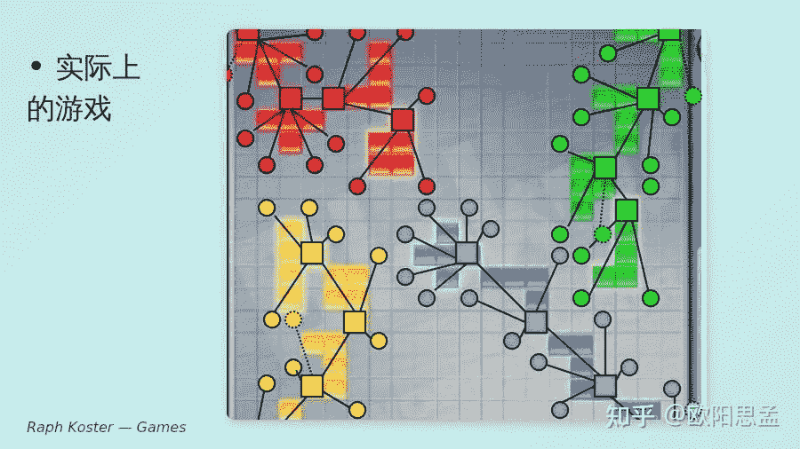

最终，游戏的反馈层就是你如何呈现它的一切。设定、背景故事、音效、剧情、美术……

你怎么包装问题，可以改变玩家从中学习的一切，改变他们如何感知问题。完全相同的底层问题，可以是捡木棍，也可以是朝某人脸上开枪。或者如前所述，估算系统中变量轨迹的微积分问题（球、车和汽油、生命值和毒药）可能是一样的，但包装却天差地别。

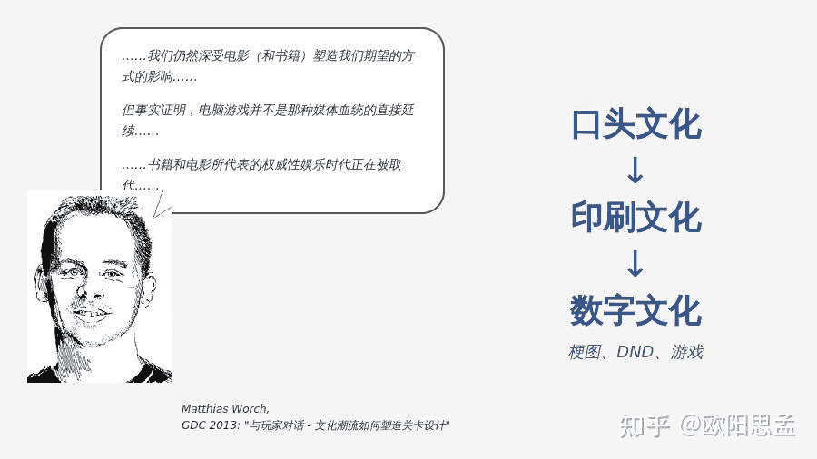

当你思考怎么包装问题的时候，你就进入了隐喻的领域。你在从事绘画、诗歌、音乐创作、修辞学、吟游诗人的传统，以及所有那些人文学科的东西。

这是一个广阔而深邃的宇宙，等着你这个设计师去探索。很多这些东西被叫做"游戏设计"，但话说回来，我们也常说某个游戏设计师其实是个受挫的电影人。

创造出一个与它所教授的底层问题相冲突的体验，是非常容易的。这有专门的批评术语。你还需要非常清楚自己是在构建一个游戏来向玩家讲述故事，还是让玩家能够用你的游戏讲述故事。

> In the end, the feedback layer of a game is everything about how you present it. The setting, the lore, the audio, the story, the art…

> How you dress up the problems can change everything about how the player learns from it, and how they perceive the problem. The exact same underlying problem can be as different as picking up sticks or shooting someone in the face, or as mentioned, the calculus problem of estimating the trajectory of a variable in a system of rates of change (the ball, the car and its gas, the hit points and poison) might be the same but dressed extraordinarily differently.

> When you think about how you dress up the problems, you are in the realm of metaphor. You are engaging in painting, poetry, and music composition, and rhetoric, and the bardic tradition, and all that other humanities stuff.

> This is a giant and deep universe for you as a designer to dive into. A lot of this stuff gets called "game design," but then again, we also often say that a given game designer is a frustrated moviemaker, too.

> It is really easy to create an experience that clashes with the underlying problems it is teaching. There are fancy critical terms for this. You also need to be very conscious about whether you are building your game so that you are telling the player a story, or so that the player can tell stories with your game.

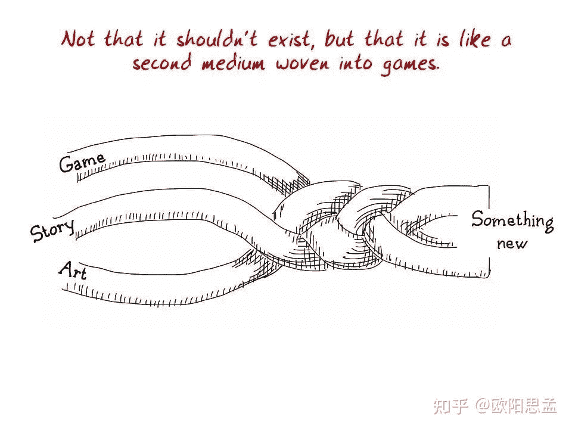

所以要点应该是：这些东西和本文讨论的"游戏系统"深度协同，但它们不是同一回事。而且游戏不是学习怎么做这些事情的最佳场所。

那些其他领域有更长的传统，有大量的专业知识和教训。它们不会全部适用于"我怎么最好地包装这组问题"这个问题，但大部分会。

你是从想要创造有趣的问题开始，还是从想要提供酷炫的体验开始，真的他妈的无所谓。你两者都得做好，才能把游戏做得真正出色。

> So the takeaway should be: this stuff is deeply, deeply synergistic with the "game system" stuff that this article is about, but they are not the same thing. And games is not the best place to learn how to do these things.

> Those other fields have much longer traditions and loads of expertise and lessons. They won't all apply to the issue of "how do I best dress up this collection of problems" but most of them will.

> It does not frickin' matter if you start out wanting to make interesting problems, or if you start out wanting to provide a cool experience. You are going to need to do both to make the game really good.

**一句话总结：游戏开发是一种复合艺术形式。你可以去学习那些单独的艺术，以及游戏所独有的部分。**

> **Bottom line: game development is a compound art form. You can go learn those individual arts and the part unique to games.**

---

## 十一：动机

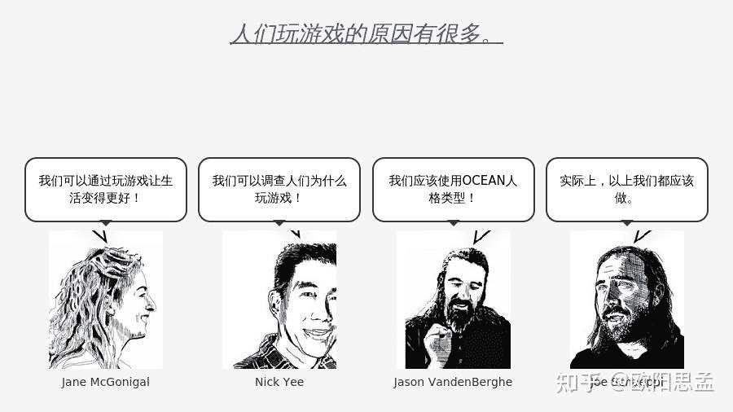

研究人员做了大量关于"人们为什么玩游戏"的研究。这被称为"动机"。

动机基本上是关于人们对问题类型和问题呈现方式的个人口味，以及这些问题的特征和你在什么情境中遇到它们。有些人喜欢毁灭东西的问题。有些人喜欢和他人建立联系的问题。有些人难以信任别人。有些人想要合作。

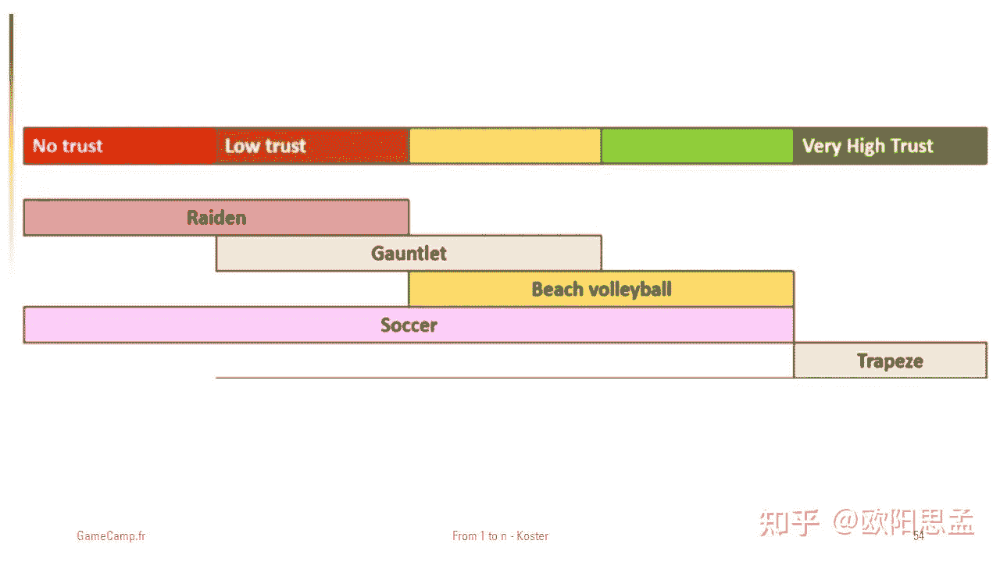

不是每个人都喜欢同样类型的问题或同样类型的包装。部分原因是人格类型，部分原因是社会动态、成长环境、当地文化、经历过什么创伤，以及无数其他心理因素。这就是为什么一个专业术语叫"心理统计学"（psychographics）。

> Researchers have done a ton of studying "why people play games." This gets called "motivations."

> Motivations are basically about people's personal taste for groups of problems and how those problems are presented, and characteristics of those problems and the situations in which you find them. Some people like problems where you destroy stuff. Others like problems where you bond with others. Some have trouble trusting other people. Others want to cooperate.

> Not everyone likes the same sorts of problems or the same sorts of dressings. Some of this is down to personality types, some of it is down to social dynamics, how they were raised, what their local culture is like, what trauma they have had, and countless other psychological things. That's why one fancy term for this is psychographics.

重要的是，问题不仅需要对你来说不明显、也不能让你困惑，它们还必须对你有趣。什么问题符合这个范围，完全取决于你是谁、你的人生经历是什么、你有什么技能，甚至你当时的心情。

选择动机、据此选择问题，是一种很好的设计方式。但动机和乐趣不是同一回事。它们是一个过滤器，在做营销和构建游戏支柱（这是一个聚焦和范围的练习）时很有用。

科学家们花了大量时间调查大量人群，得出了各种结论，把人映射到玩游戏的原因上，再从那里映射到具体问题上。

如果你从动机开始，你可以从那里走向问题类型、体验类型，甚至玩家人口统计。然后，如果你想要关于与人互动的问题，好，有这样的列表。如果你想要关于管理资源或解决数学问题的问题，也有这样的列表。

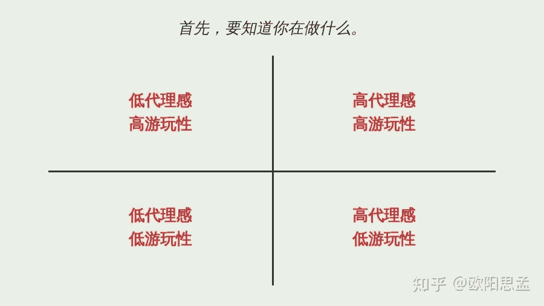

代理感-&gt; 代入感

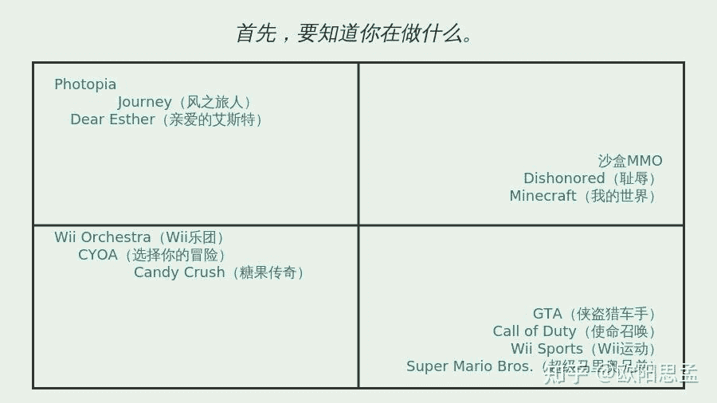

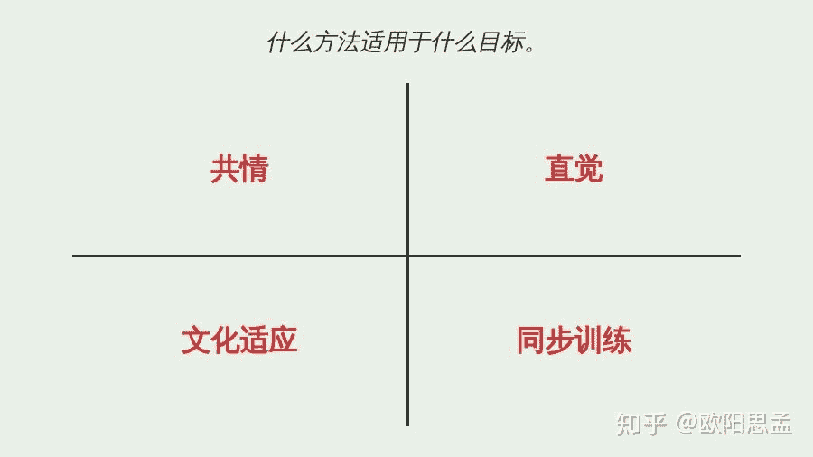

> The big thing is, it's not enough that the problems need to not be obvious to you, and also not be baffling to you. They also have to be interesting to you. What problems fit in that range is going to depend entirely on who you are, what your life experiences have been, what skills you have, and even what mood you are in.

> Picking motivations and selecting problems based on them is a great way to design. But motivations are not the same thing as fun. They're a filter, useful in marketing exercises and in building your game pillars (which is an exercise in focus and scope).

> Scientists have spent a bunch of time surveying tons of people and have arrived at all sorts of conclusions that map people onto reasons to play and from there onto particular problems.

> If you start with motivations, then you can go from there to types of problems, types of experience, and even player demographics. And then, if you want problems that are about interacting with people, well, there's lists of those. If you want problems that are about managing resources, or solving math issues, there's lists of those too.

**一句话总结：没有一款游戏适合所有人，所以如果你知道你是在为谁提出问题，你会做出更好的游戏。**

> **Bottom line: no game is for everyone, so you will make better games if you know who you are posing problems for.**

---

## 十二：简单，但并不简单

我一直遇到不理解上面这十一步的游戏开发者。而理解全部十一步比只在一个方面建立专长更有价值，因为它们相互依赖。十一件事中任何一件做错了都可能毁掉你的游戏。真正的问题是，这十一件事中的每一件通常都是好几个研究领域。是的，你确实需要在至少一个领域成为专家。

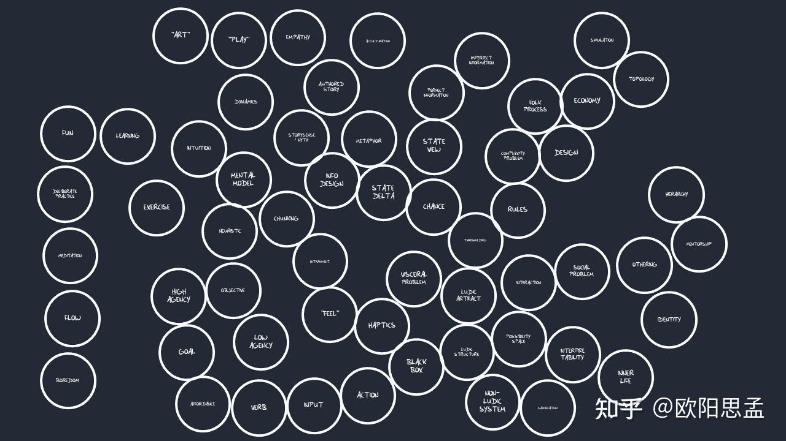

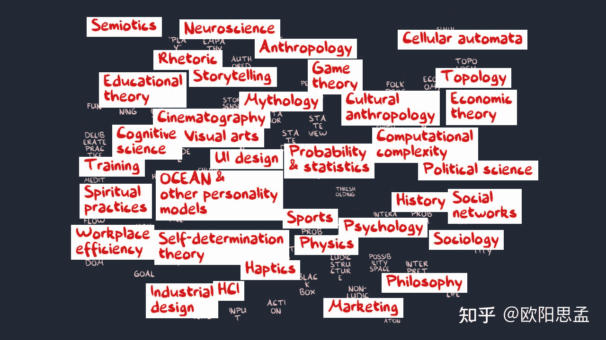


# 游戏设计速查表

## 认知深度与专业领域

举个例子，我们中的一些人花了整整二十多年，研究怎么把循环连接成一个更大的问题网络的规则集。

还有人整个职业生涯就做一件事——弄清楚怎么最好地提供反馈中"可供性"那一部分。

> I run into game developers who do not understand the above eleven steps all the time. And understanding all eleven is more valuable than building expertise in just one, because they depend on one another. This is because getting any one of the eleven wrong can break your game. The real issue is that each of these eleven things is often multiple fields of study. And yeah, you do need to become expert in at least one.

> To pick one example, some of us have been working out the rule set for how you can link loops into a larger network of problems for literally over twenty years.

> Others have spent their entire career doing nothing but figuring out how best to provide just the affordances part of feedback.

所以游戏设计挺简单的。但魔鬼就在表面下不远处的细节里。解释为什么某样东西对特定受众来说有趣，相当容易。为任意一个人构建一些新的有趣的东西，要困难得多。话虽如此，这些领域中的每一个都有最佳实践，而且大多已经被写下来了。只是要学的太多了。

换句话说——这篇文章里的每一段都可以写成一本书。实际上，大概已经是好几本了。

> So game design is pretty simple. But the devil is in details that are not very far below the surface. It's fairly easy to explain why something is fun for an given audience. It is much harder to build something new that is fun for an arbitrary person. That said, every single one of those fields has best practices, and they are mostly already written down. It's just a lot to learn.

> Put another way — every single paragraph in this essay could be a book. Actually, probably already is several.

一句话总结：这些话题中的每一个都很深，但你需要对所有话题都有一些了解。

> Bottom line: each of these topics is deep, but you want a smattering of all of them.

---

## 设计视角与实践路径

你们中的一些人可能不喜欢这种对游戏设计的解构视角。没关系。我个人觉得最好的方式是去戳、去探索一个问题，比如"我怎么才能更好地做游戏？"，然后把它当作一个游戏来对待。我整个职业生涯就是这么做的。上面这些只是我的攻略指南。别人肯定会有不同的策略，我敢打包票。

> Some of you may not like this deconstructive view on how games are designed. That's okay. Personally, I find it best to poke and prod at a problem, like "how do I get better at making games?" and treat it as a game. And that's what I have done my whole career. The above is just my strategy guide. Someone else will have different strategies, I guarantee it.

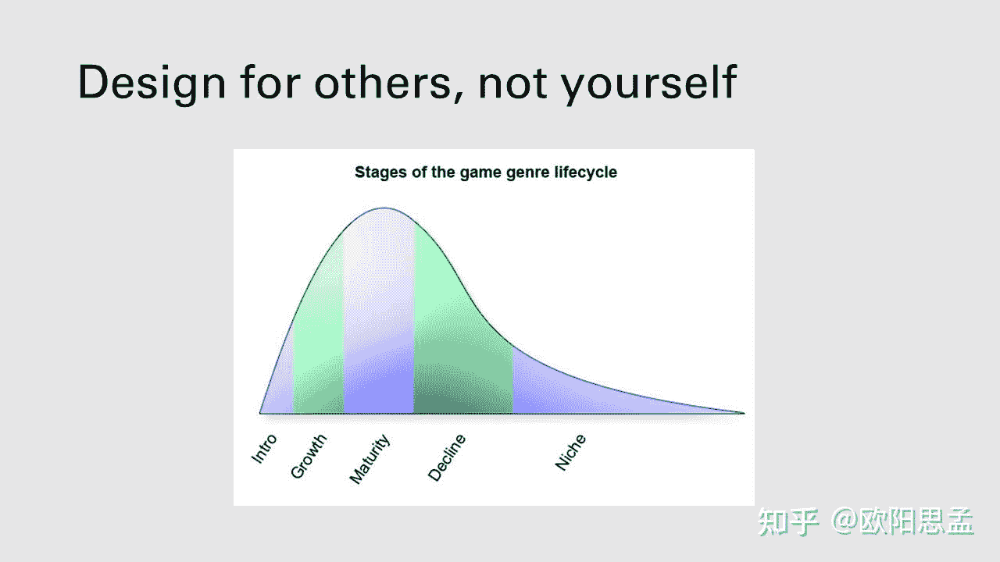

但我也敢打包票：如果你在上面这十二件事上变得更好，你就会在做游戏上变得更好。这是一个实用的清单。不管你做叙事游戏、解谜游戏、桌游、动作游戏、RPG，什么都行，它都有帮助。我只是走马观花地过了一遍，但在这十二件事中的每一件下面，都有非常具体的工具可以拾取。它真的就是这么简单，但也这么难——因为如果你真的想深入每一条，那是一个他妈的长清单。

> But I also guarantee that if you get better at the above twelve things, you will get better at making games. This is a pragmatic list. And it will be helpful for making narrative games, puzzle games, boardgames, action games, RPGs, whatever. I breezed through it, but there are very specific tools you can pick up underneath each of these twelve things. It really is that simple, but also that hard, because that's a frickin' long list if you want to actually dive into each of the twelve.

这也意味着设计游戏的人经常失败。你可能会说，"他们不能只做他们知道怎么做的部分，然后可预测地做出好游戏吗？"

不行，因为玩家和设计师一起学习。如果你只是做同样的游戏、你知道怎么做的那个，玩家会觉得无聊，因为里面全是他们见过的、已经有答案的问题。有时候，他们会无聊到整个品类都死掉。

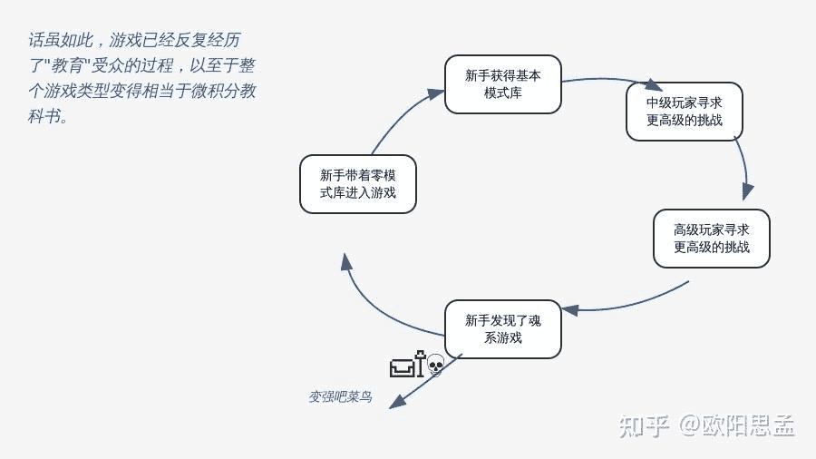

而如果你反过来，通过添加更多问题把它搞得超级复杂，它对大多数人来说可能就变成噪音了。然后没人玩。然后品类也死了！

> What that also means is that people designing games fail a lot at it. You might say, "can't they just do the part they know how to do, and therefore predictably make good games?"

> No, because players learn along with the designers. If you just make the same game, the one you know how to make, the players get bored because it's nothing but problems they have seen before and already have their answers to. Sometimes, they get so bored that an entire genre dies.

> And if you instead make it super-complicated by adding more problems, it might dissolve into noise for most people. Then nobody plays it. And then the genre dies too!

游戏设计师经常在"做出有趣的东西"这件事上失败。当"做游戏"这个游戏被正确地玩的时候，它总是刚好在设计师能力边缘之外。

那就是乐趣所在的地方——不仅对设计师如此，对他们的受众也是如此。

> Game designers will routinely fail at making something fun. When the game of making games is played right, it is always right outside the edge of what the designers know how to do.

> That's where the fun lives, not just for the designer, but also for their audience.

---

## 结语

就这样，整份速查表。就这些。

希望对你有帮助。

> That's it, the whole cheat sheet. That's it.

> Hope it helps.
