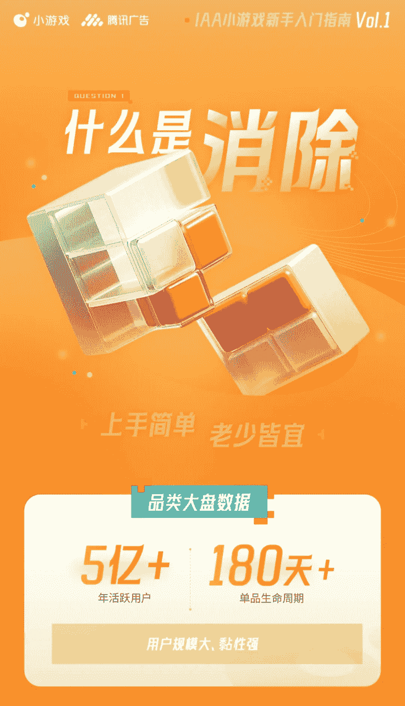
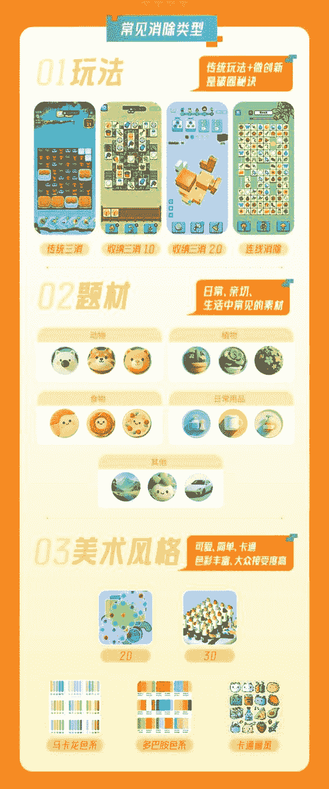
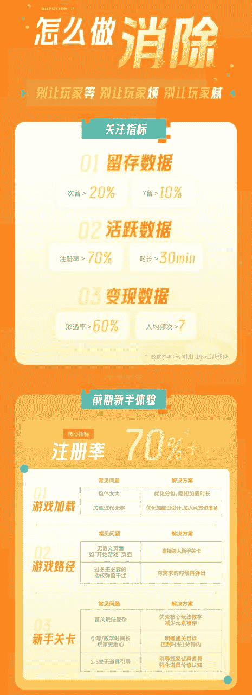
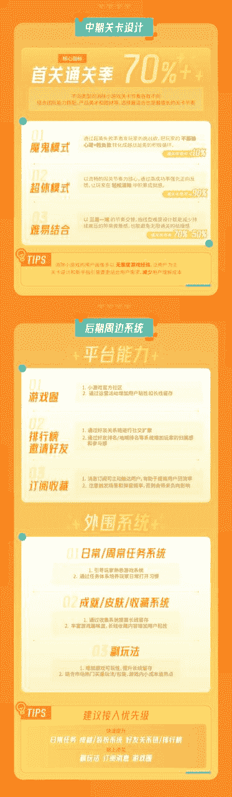
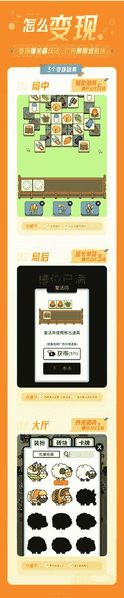
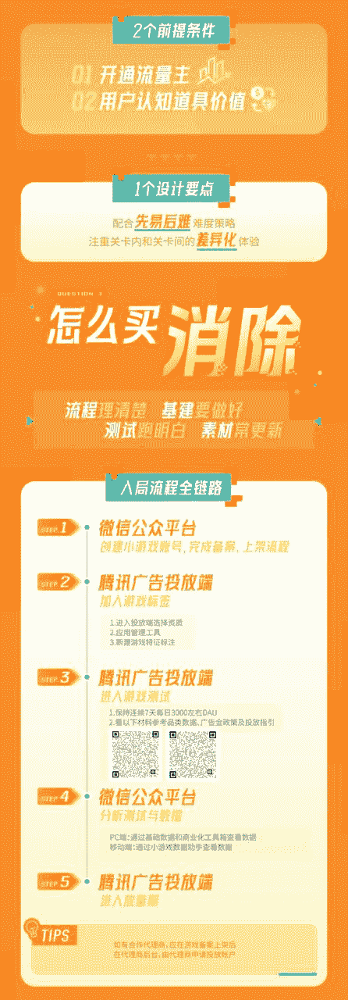
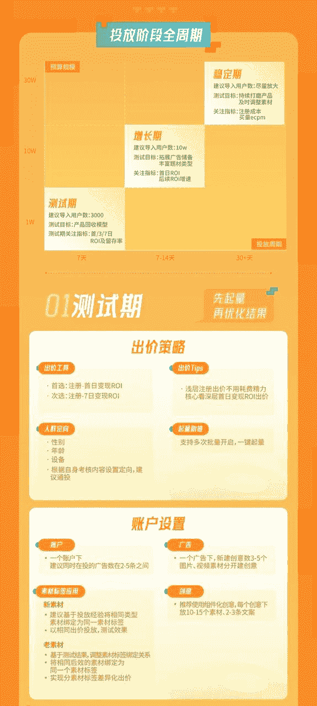
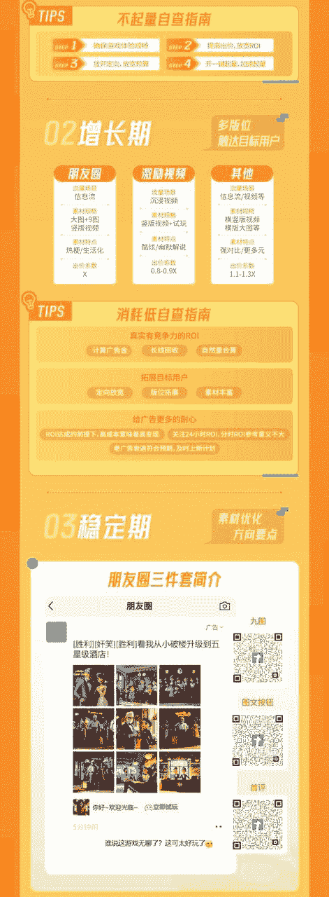
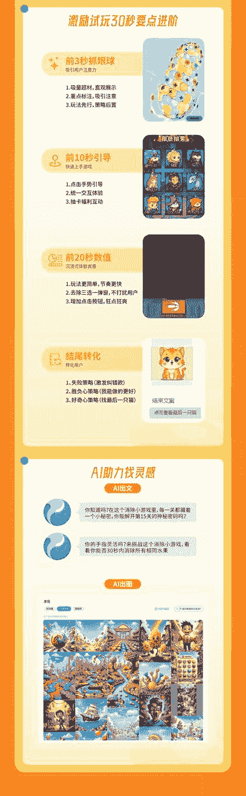
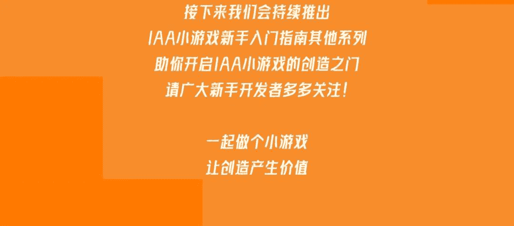

# 做一个消除类小游戏总共分几步？

> 来源：[https://huchegames.feishu.cn/docx/WEssdb6WooCegUxtBEtc1ovungh](https://huchegames.feishu.cn/docx/WEssdb6WooCegUxtBEtc1ovungh)

<https://huchegames.feishu.cn/sync/JTVrd0Be9szPk7bhw9UcFF1dnbe>

---

> 🔗 原文链接： h[ttps://mp.weixin.q](https://mp.weixin.qq.com/s/hXvdl064rhw8nIq_WAJFjA)q.com/s/hXvdl064...

> ⏰ 做个小游戏2025年05月27日 18:11  广东

