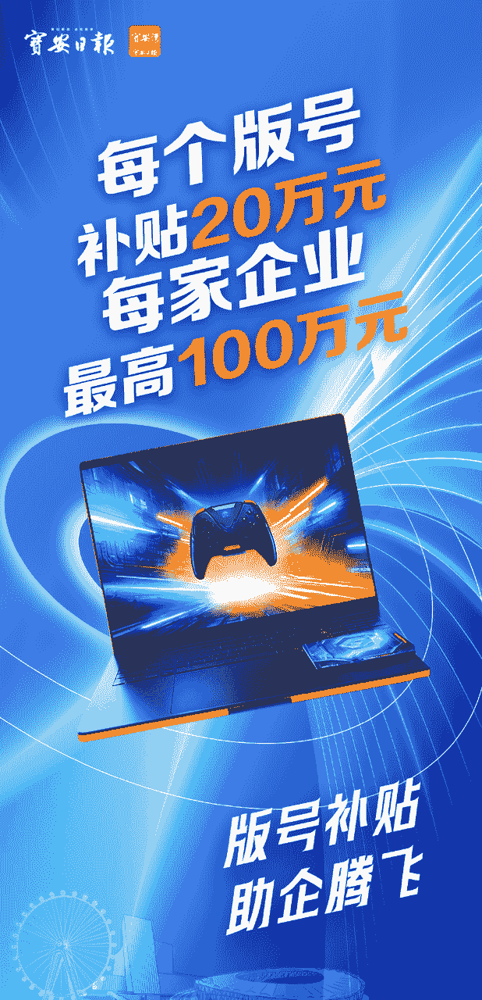

# 游戏上线发行奖励3万元，版号奖励20万元，精品小游戏奖励20万元 | 深圳市宝安区政策

> 来源：[https://huchegames.feishu.cn/docx/LFrWd6ejbopq13x2q38cvJPDncc](https://huchegames.feishu.cn/docx/LFrWd6ejbopq13x2q38cvJPDncc)

> 🔗 原文链接： h[ttps://mp.weixin.q](https://mp.weixin.qq.com/s?__biz=MzA5NzQ3NDM3MA==&mid=2656294029&idx=1&sn=054a57c9a5c6b6145bb95a08b3e76da8&scene=21#wechat_redirect)q.com/s?__biz=Mz...

> ⏰ 首发于宝安日报。曾嵘胡扯的地方转载 2025年05月26日 19:46  安徽

正如 [游戏不再是精神鸦片？主流舆论面对游戏行业口风转变，现在轮到家长们加油了 | 胡扯观点](https://huchegames.feishu.cn/wiki/Xrv1wINHYilzsdkKiR7cdIPMn4f)中讨论的那样，各地逐渐提升对游戏行业的扶持力度。这不，深圳市宝安区的政策也来了。

曾老师也整理了近期武汉、陵水、长沙、广东的政策，见文章底部。

**租金优惠扶持**

对入驻集聚基地优质楼宇的数字文娱企业，给予租金优惠，2025年入驻优质楼宇的企业，可享受12个月免租，后续两年最高享受3折租金优惠；2026、2027年入驻的企业，最高享受30%市场参考价的优惠租金。

**支持优秀游戏企业做大做强**

对优秀游戏企业给予一次性奖励，最高可达1000万元。

**支持游戏开发企业申请版号**

对获得国家新闻出版署审批通过的游戏版号的企业，给予每个版号20万元补贴，单家企业最高补贴100万元。

**支持小游戏产品开发、发行**

鼓励企业开发用户量大、活跃度高的小游戏产品，给予单个产品3万元奖励，单家企业最高奖励9万元；对优质产品给予20万元奖励，单家企业最高奖励100万元。

**营造良好产业生态**

加强游戏平台与开发、发行、运营企业的合作对接，对举办全国性赛事的企业给予50%费用补贴，最高100万元；对获奖企业给予2万元-5万元奖励。

如需了解政策详情，可拨打宝安区工业和信息化局电话：27849120。

---

<https://huchegames.feishu.cn/sync/NsRGdGMTFsRr5XbhwSlcMyY3nzh>

---

<https://huchegames.feishu.cn/sync/JTVrd0Be9szPk7bhw9UcFF1dnbe>