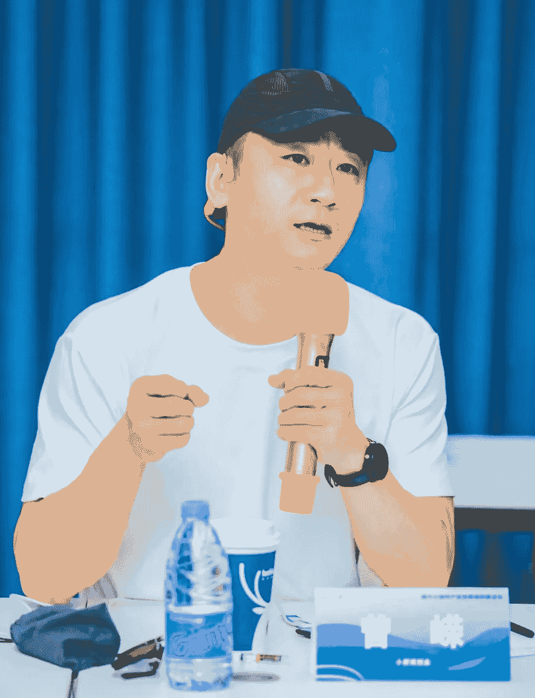
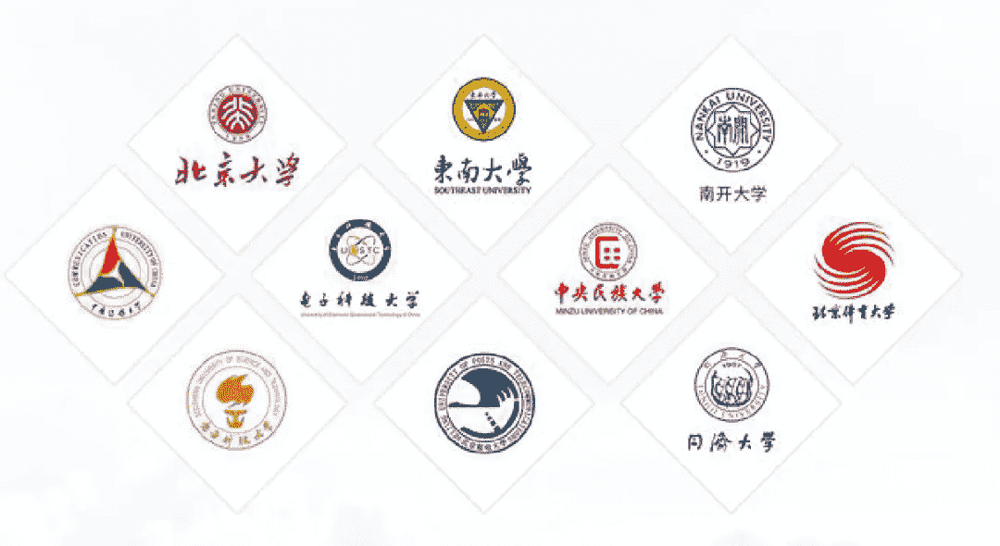
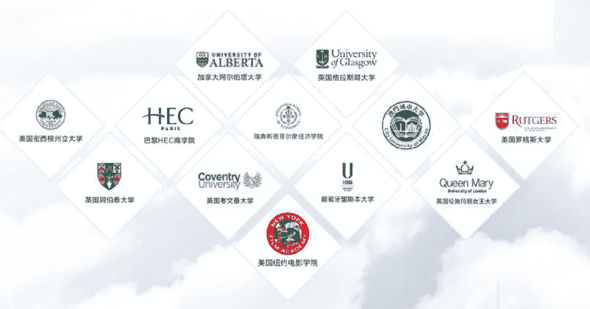
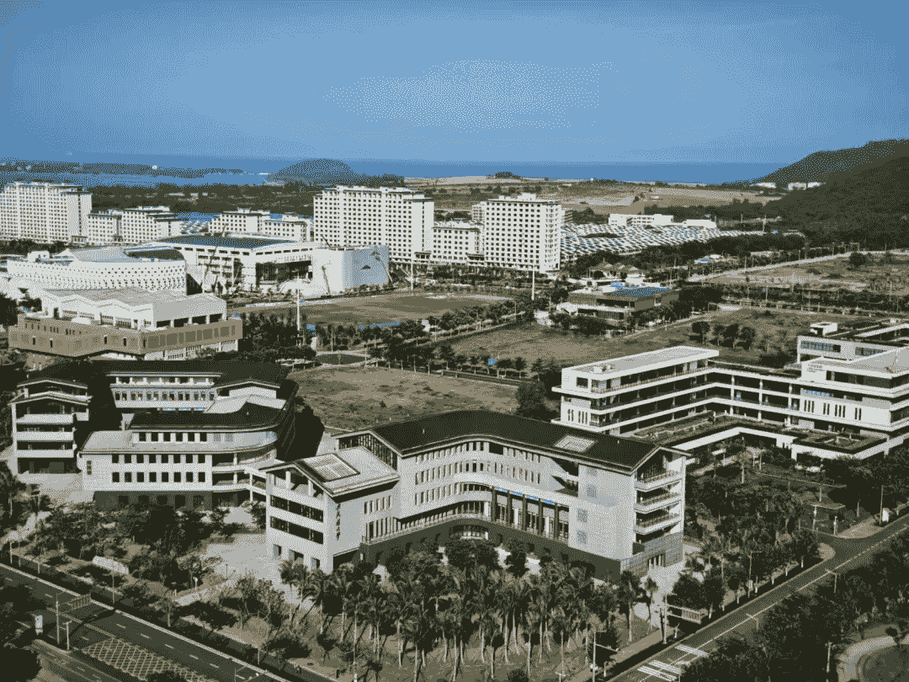
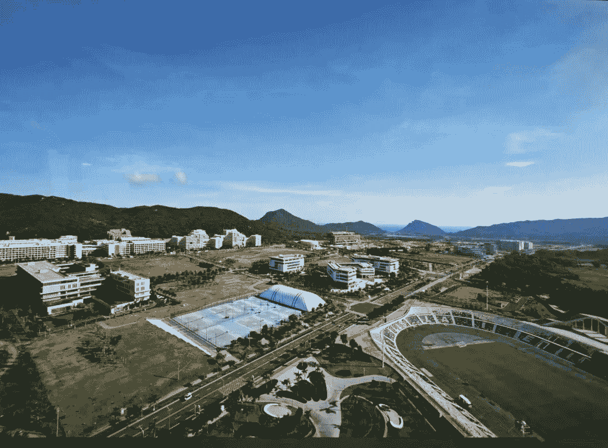
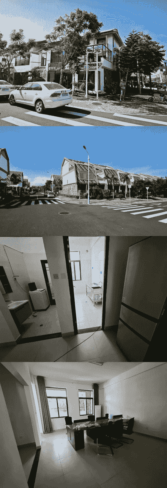
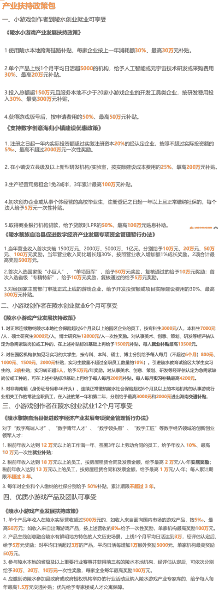
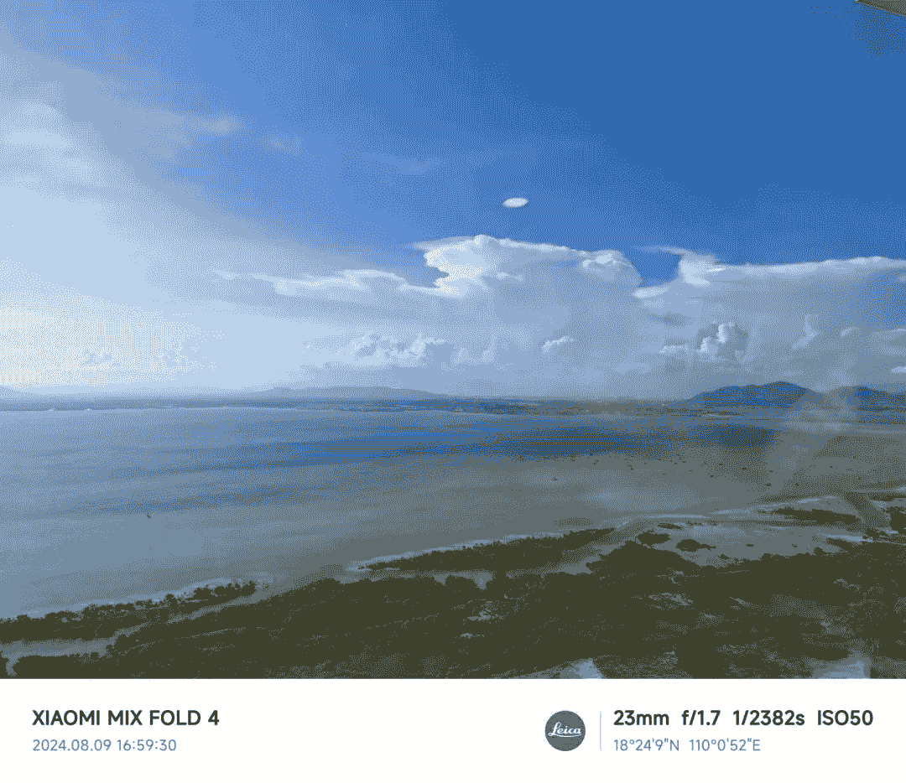

# 陵水小游戏创作者基地政策解读（部分）

> 来源：[https://huchegames.feishu.cn/docx/AZbjds41so4AebxKqJhc2tBinSg](https://huchegames.feishu.cn/docx/AZbjds41so4AebxKqJhc2tBinSg)

> ⏰ 首发： 曾嵘胡扯的地方2024年08月10日 08:36  海南

> 🔗 原文链接： h[ttps://mp.weixin.q](https://mp.weixin.qq.com/s?__biz=MzA5NzQ3NDM3MA==&mid=2656292076&idx=1&sn=64b46db7fc168ed374fd1b7caef6005b&scene=21#wechat_redirect)q.com/s?__biz=Mz...

>

海南陵水的小游戏创意基地考察活动已经做到第10期，我在第3期收到邀请，现在终于有时间来实地考察。

**有用的政策非常多，难**以在一篇推文中说完。我尽量介绍 作为一个游戏创业者 会感兴趣的内容。

## **EF账户**

**优势：利好游戏出海业务。**

**经常出海的同学都知道， **Google Play 的开发者帐号主体，如果是中国公司，国内银行帐号收款，是没问题的。但收到的款如果要付出去（即使没有换成人民币），就有问题了。

**经常换汇的同学都知道， **个人账户每年有 $50,000 限额。若使用公司账户，需要提前申请额度。

如果使用 EF 账户（海南自贸港多功能自由贸易账户Electronic Fense），与境外账户、OSA账户、NRA账户之间是可以自由流动的，没有限额。

当然，你首先需要在自贸港成立一下公司，然后才能有EF账户，你的账户上首先需要有资金，才能进行打款操作。

这是个先有鸡还是先有蛋的问题。资金哪里来？可以从国内同名账户划转，也可以基于境外收入。

所有细节，都在这篇文章里：  海南自由贸易港多功能自由贸易账户介绍

## **按 15% 税率征税**

**优势：企业、高管减税。**

企业所得税直接按15%征收。

个人所得税先按标准征收，年度汇算清缴再退税。

2025年12月31日封关后，税率会调整为阶梯 15%，10%，3%。

自贸港内公司 20+% 控股海外公司，海外公司入账免征企业所得税。

## **国际大学城**

**优势：子女教育。**

标准名称为： **海南黎安国际教育园区。**

已签约中方高校10所：

已签约境外合作高校12所：

中方高校均是国家 「世界一流 大学」 建设高校或有「世界一流学科」建设学科的高校。垸外合作高校中进入全球前100名的高校有4所，其他均是学科特色非常明显的高校。

中央民族大学校舍

高校共享体育场

**简单说： **在这些学校就读，可以同时获得中方和境外高校文凭。

## **别墅1年免费，后面半价**

**优势：办公场所成本。**

别墅三层，253 平米套内面积。冰箱空调床铺办公桌椅备好，可拎包带电脑入驻办公。

## **人才**

**不足：暂缺研发人才。**

本地较难招聘专业人才，上面提到的大学城可以提供部分应届生。

或许也可以采用封闭开发模式，团队定期来海南度（jia）假（ban）。

## **其他政策**

我还挑了一些游戏开发者感兴趣的政策放在下面。

对政策有兴趣可以私信我详细了解。

---

<https://huchegames.feishu.cn/sync/NsRGdGMTFsRr5XbhwSlcMyY3nzh>

---

<https://huchegames.feishu.cn/sync/JTVrd0Be9szPk7bhw9UcFF1dnbe>