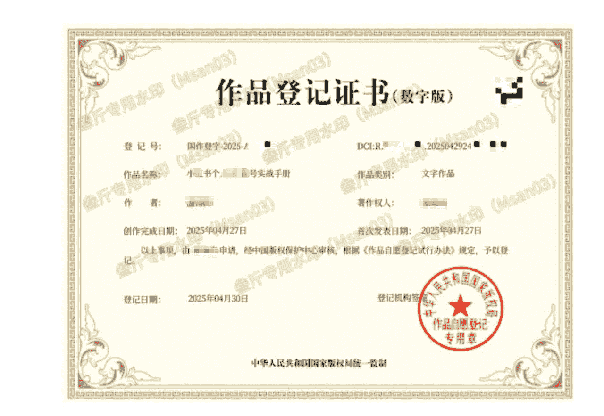

# 版权登记关键问答（Q&A）

> 来源：[https://huchegames.feishu.cn/docx/OPf2dlcVSoxPn1xoVbzcMzswn2e](https://huchegames.feishu.cn/docx/OPf2dlcVSoxPn1xoVbzcMzswn2e)

<https://huchegames.feishu.cn/sync/JTVrd0Be9szPk7bhw9UcFF1dnbe>

**版权登记关键问答（Q&A）**

## （一）版权登记需要准备哪些材料？

**

作品著作权登记所需材料**：

1.  承诺书（JPG或PDF，不大于2M）

1.  委托书（JPG或PDF，不大于2M）

1.  创作说明书（word版及客户盖章版）

1.  作品样稿

1.  主体资质
个人：身份证（JPG格式，不大于2M）
公司：执照（JPG格式，不大于2M）

1.  联系人、联系方式、邮箱

1.  权利归属
法人作品：法人作品说明书（JPG或PDF，不大于2M）
合作作品：合作作品说明书（JPG或PDF，不大于2M）
委托作品：委托作品说明书（JPG或PDF，不大于2M）
职务作品：职务作品说明书（JPG或PDF，不大于2M）
8.其他权属文件：商标证书等

## **（二）哪些作品可以登记版权？**

文字作品；口述作品；音乐、戏剧、曲艺、舞蹈、杂技艺术作品；美术、建筑作品；摄影作品；电影作品和以类似摄制电影的方法创作的作品；工程设计图、产品设计图、地图、意图等图形作品和模型作品；计算机软件；民间文字艺术作品等其他作品。

## ** （三）哪些作品不能登记版权**？

1. 依法禁止出版、传播的作品；

2. 法律、法规、国家机关的决议、决定、命令和其他具体立法、行政、司法性质的文件，及其官方正式译文；

3.时事新闻；

4.历法、通用数表、通用表格和公式

## ** （四）版权保护有效期多久？**

**

1．作者为公民的期**限

保护期为作者有生之年及死亡后50年，截止于作者死亡后第50年的12月31日；如果是合作作品，截止于最后死亡的作者死亡后第50年的12月31日。

**2．作者为法人和其他组织的期限**

保护期为50年，截止于作品首次发表后第50年的12月31日；但作品自创作完成后50年内未发表的，著作权法不再保护。

## （五）版权作品里面哪些东西不可以有，会导致下补正？

个人申请不要出现中国、外国国名、英文和缩写。

不要出现国徽、历法、通用数表、通用表格和公式、律、法规、国家机关的决议、决定、命令和其他具有立法、行政、司法性质的文件，及其官方正式译文；时事新闻。

## **（六）作品版权登记多少钱？**

这个看你在国家版权局申请，还是在地方版权局申请。如果你找代理代办，以美术作品为例，国家版权登记作品收费大概是在500到800元左右，其中包含300元的官费。地方版权每个省份不一样，官费大概在100到200元左右。代理机构收费是在200到500元左右。