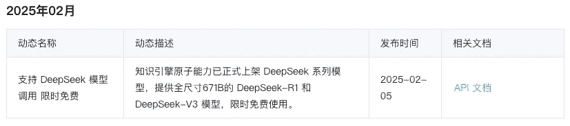
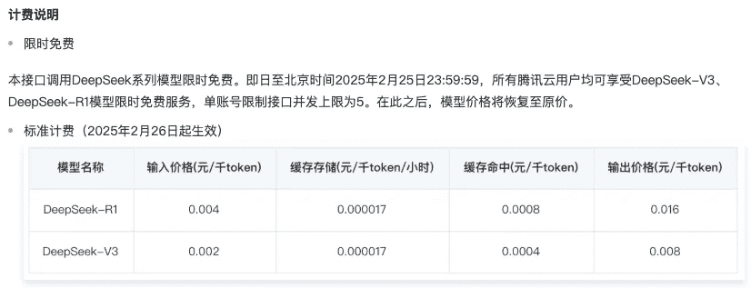
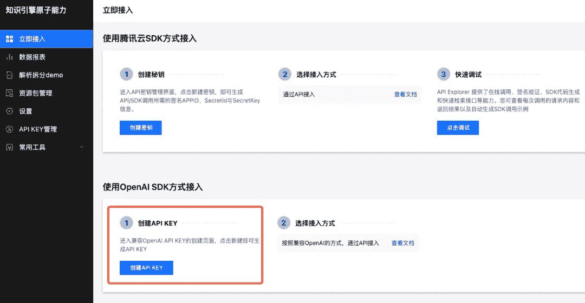
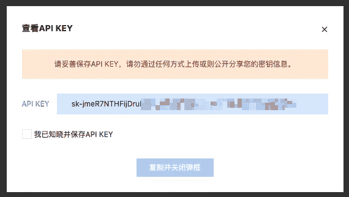
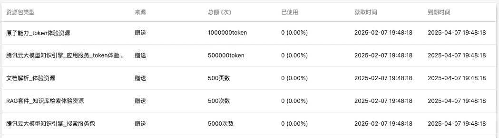
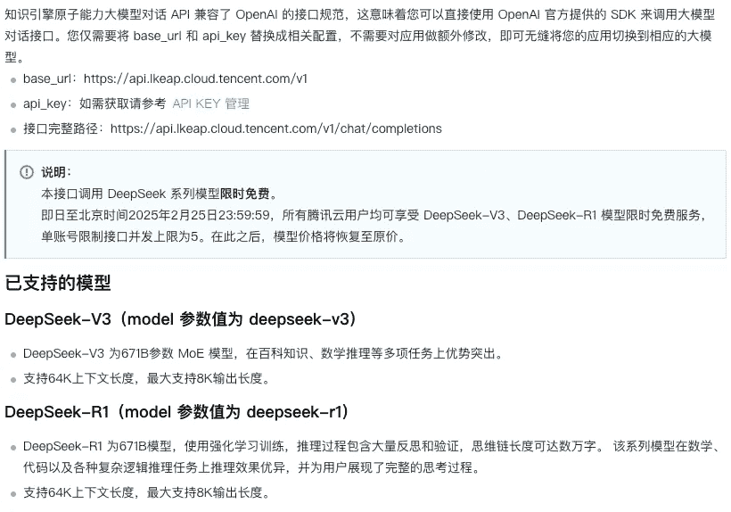
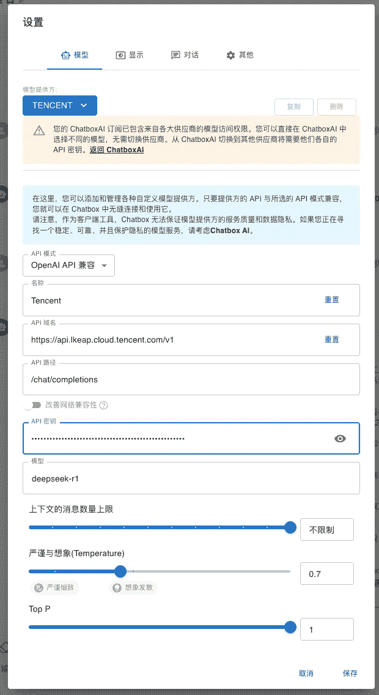
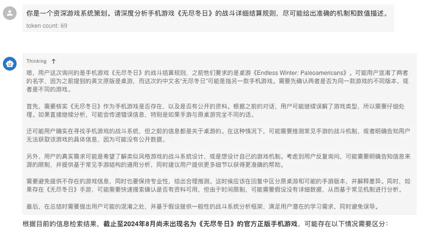

# 羊毛党：腾讯云免费 DeepSeek-R1 671B 满血版模型调用

> 来源：[https://huchegames.feishu.cn/docx/MGA4dDS3IoESh4xWDe4cK9J5nMe](https://huchegames.feishu.cn/docx/MGA4dDS3IoESh4xWDe4cK9J5nMe)

腾讯云知识引擎原子能力在 2 月 5 日接入了 全尺寸 671B 的 DeepSeek-R1 和 DeepSeek-V3 模型，可以免费使用到 2 月 25 日。

https://cloud.tencent.com/document/product/1772/111120

2 月 26 日恢复原价，十几天白花花的羊毛，不心动吗？毕竟原价还挺贵的。

本文介绍**如何薅腾讯云的 DeepSeek 羊毛，以及腾讯云部署的** DeepSeek 模型和官方版的区别。

## 腾讯云创建 API KEY

登录腾讯云账号，进入下面的链接可以开通大模型知识引擎。

https://console.cloud.tencent.com/lkeap

选择 「使用 OpenAI SDK 方式接入」，创建一个 API KEY。

我必须吐槽一下，这个 API KEY 的复制界面，完全看不到光标的变化，我不知道有没有复制成功。

## Chatbox 配置

曾老师在昨天的文章 DeepSeek 服务器繁忙？这里是解决方案 | 胡扯AI 中介绍了 Chatbox 的使用方法。

Chatbox 没有提供腾讯 API 支持，但我们可以采用 OpenAI 兼容 API 的方式进行配置。

以下是腾讯云提供的 OpenAI 兼容接口文档。

https://cloud.tencent.com/document/product/1772/115969

根据文档中的描述，我们对 Chatbox 进行配置：

1.  添加一个自定义模型提供方 Tencent；

1.  按照文档中的设置，填写 API 域名和 API 路径；

1.  填写上一步生成的 API 密钥；

1.  模型填写 deepseek-r1；

1.  上下文消息数量上限填写 64（不限制）。

## 这个 DeepSeek 能打吗？

结论是：比官方 DeepSeek 差远了。

一是不支持联网搜索。

二是模型的内容，还停留在 2024 年 8 月。

# 但是免费啊！不卡啊！还要啥自行车！

**赶紧薅起来！**

<https://huchegames.feishu.cn/sync/Hzv6dRSGJsmHgOb4eSHcN1BHntg>