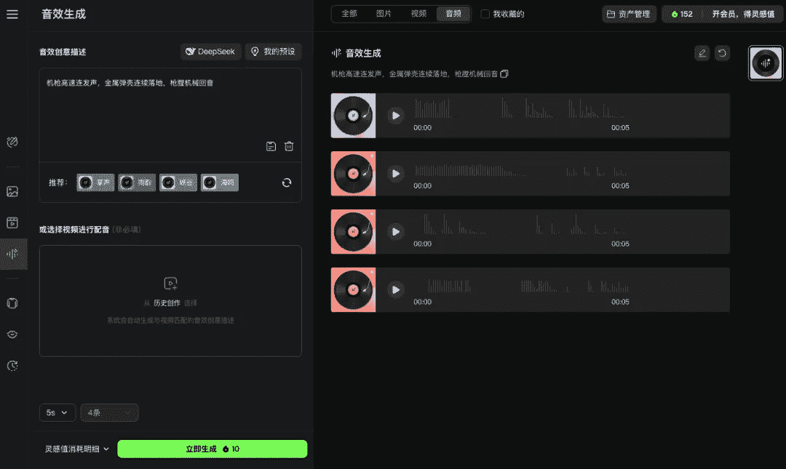
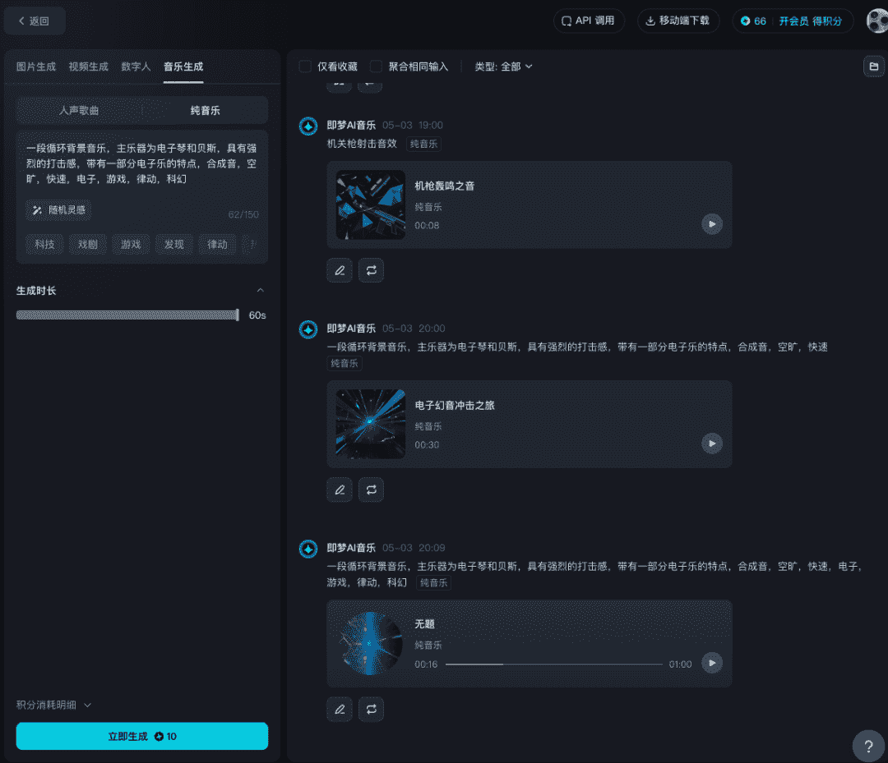
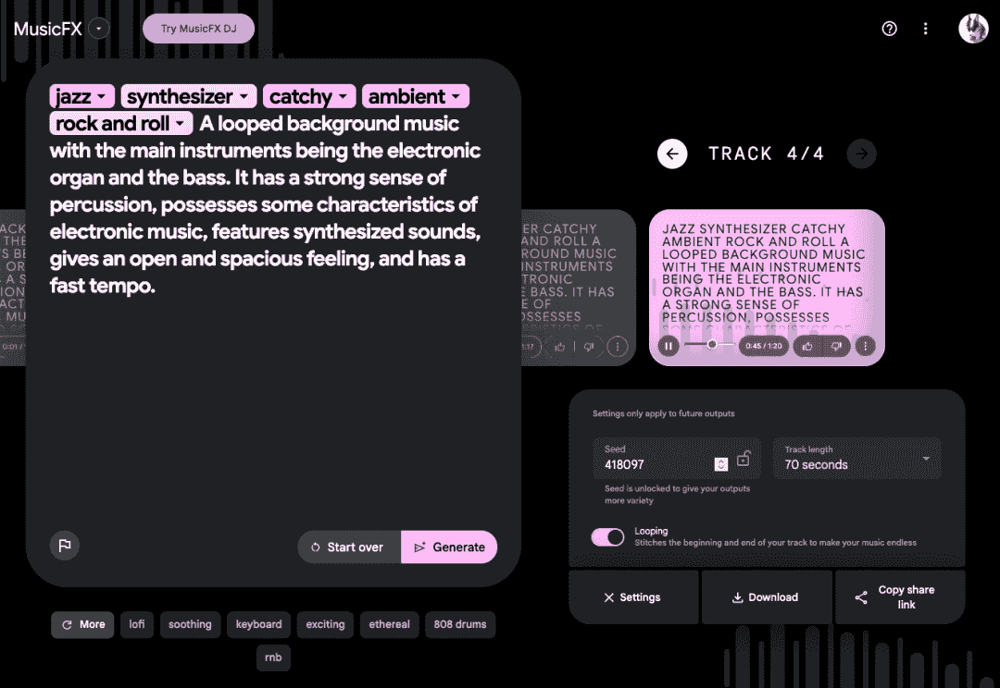
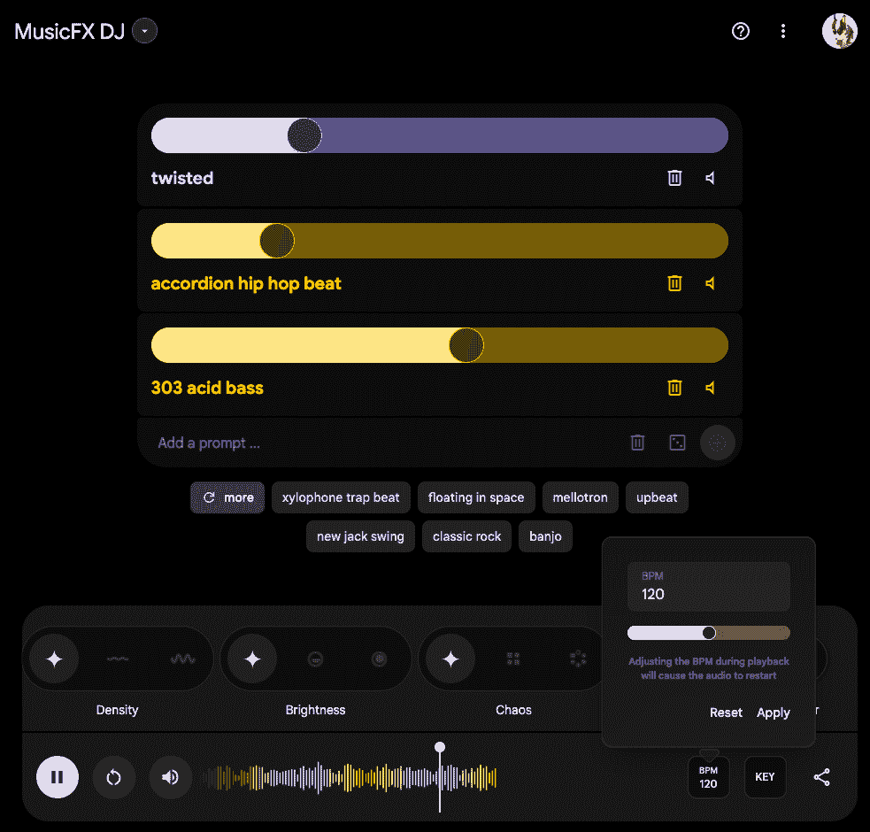

# 10 秒生成游戏音乐音效，快手、字节、谷歌的 AI 工具谁更靠谱？（附实测音频）

> 来源：[https://huchegames.feishu.cn/docx/F93pdM5DGouT62xkym4cIqPGnoh](https://huchegames.feishu.cn/docx/F93pdM5DGouT62xkym4cIqPGnoh)

> 🔗 原文链接：原[创 曾嵘 曾嵘胡扯的地方2](https://mp.weixin.qq.com/s/vm6v0m78sYa4leSv6Fb7Kg)025年05月04日 12:11  湖北

3 月，我写了两篇生成游戏音乐和音效的文章，介绍 Riffusion 和 Optimizer 的使用：

+   [利用 Riffusion AI 生成游戏背景音乐](https://huchegames.feishu.cn/wiki/Ll4mwULJgiLiLzkwsxbcLsaEnzL)

+   [利用 OptimizerAI 生成游戏音效](https://huchegames.feishu.cn/wiki/U20owS6YtiL842kLJRWcEeuIn0b)

两个月过去了，这两个产品都已经开始了商业化运营。

那么，大厂们在这个领域的布局怎么样了？让我们看看三个大厂可灵（快手）、即梦（字节）和 Google 在这个方面的表现。

## **可灵 AI-音效生成**

最长 10 秒，生成自然音效是不错的选择。也可以生成比较短的音乐。

https://app.klingai.com/cn/text-to-audio

[机枪高速连发声_金属弹壳连续落地_枪膛机械回音.mp3](https://internal-api-drive-stream.feishu.cn/space/api/box/stream/download/all/Ceq5bwQnKod2jUxCX57cguLEncd)

## **即梦AI-音乐生成**

最长 60 秒。时长遵循比较稳定，节奏不容易进行精确控制，也没有遵循循环指令。

https://jimeng.jianying.com/ai-tool/audio/generate

[一段循环背景音乐，主乐器为电子琴和贝斯，具有强烈的打击感，带有一部分电子乐的特点，合成音，空旷，快速，电子，游戏，律动，科幻.mp3](https://internal-api-drive-stream.feishu.cn/space/api/box/stream/download/all/DbnDbP3tyoXAKexC7MIcAOccnDd)

## **Google MusicFX**

https://labs.google/fx/tools/music-fx

最长 70 秒。可以实现完美的循环音乐。但指令遵循不太够。曲速也难以控制。

[music_fx_a_looped_background_music_with_the_m.mp3](https://internal-api-drive-stream.feishu.cn/space/api/box/stream/download/all/WhpTbtjTHowSvyxP7O1c6qhRnUf)

## Google MusicFX DJ

https://labs.google/fx/tools/music-fx-dj

使用提示词多生成几种乐器，混合起来，用来做节奏背景音乐是可以的。可惜没有提供下载，需要自己内录一下。

<https://huchegames.feishu.cn/sync/Hzv6dRSGJsmHgOb4eSHcN1BHntg>