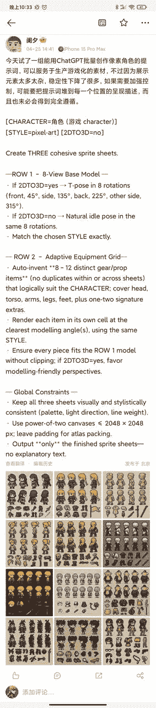
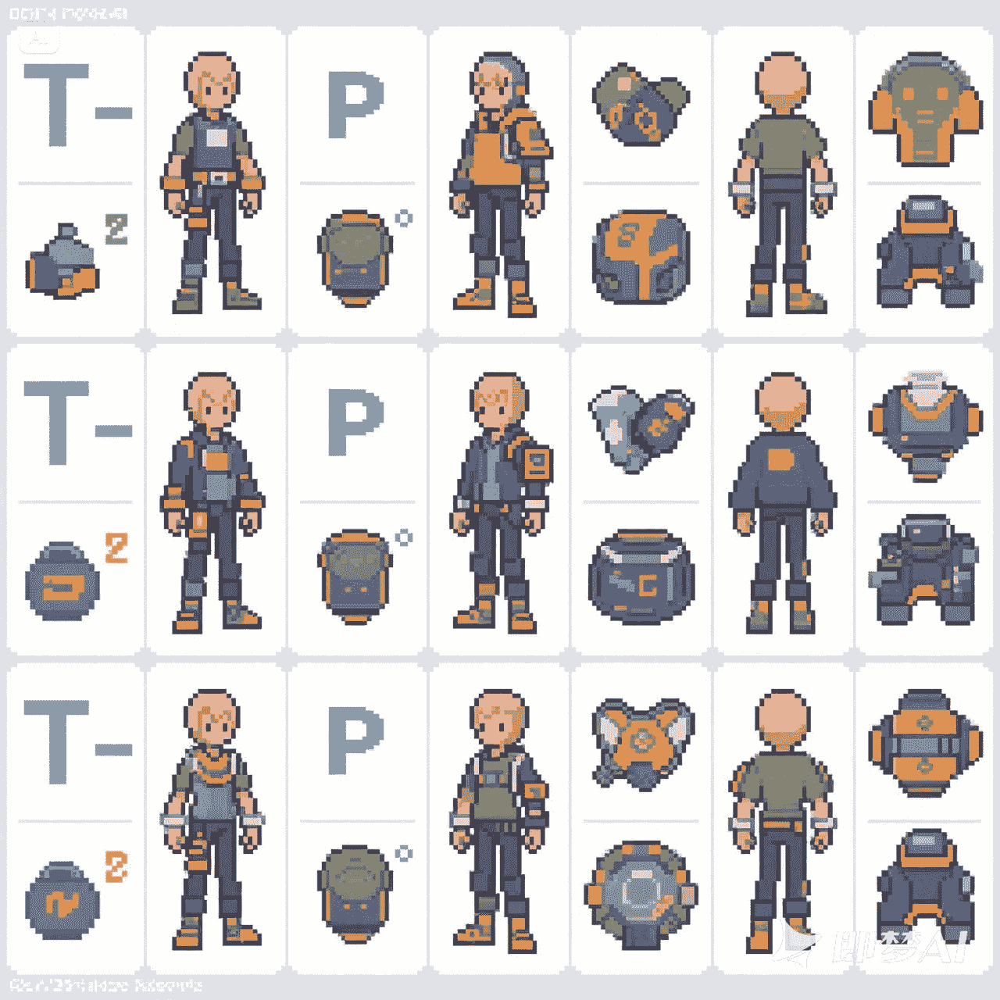
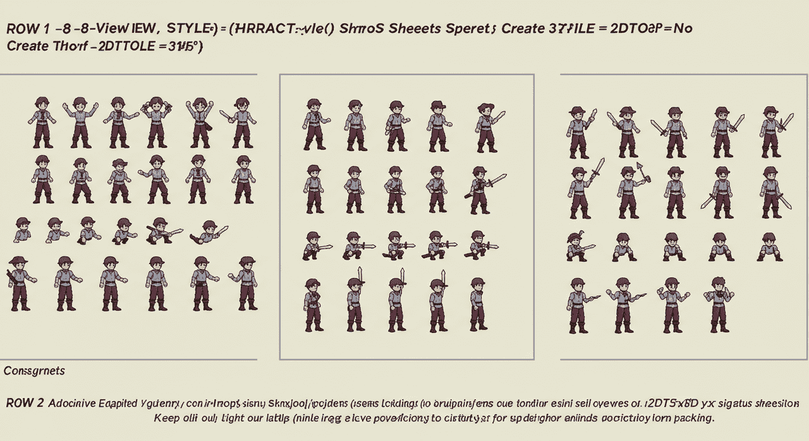
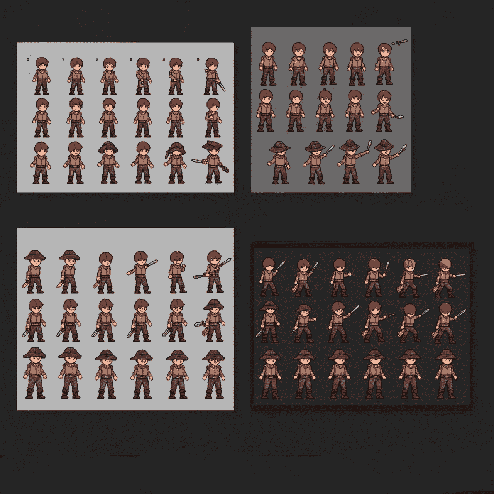

# GPT和即梦尝试像素风格提示词

> 来源：[https://huchegames.feishu.cn/docx/T5CrdYd2LoSzkIxLOxpchcXmnpd](https://huchegames.feishu.cn/docx/T5CrdYd2LoSzkIxLOxpchcXmnpd)

> 今天试了一组能用ChatGPT批量创作像素角色的提示词，可以服务于生产游戏化的素材，不过因为展示元素太多太杂，稳定性下降了很多，如果需要加强控制，可能要把提示词堆到每一个位置的呈现描述，而且也未必会得到完全遵循。

```
[CHARACTER=角色(游戏 character)]
[STYLE=pixel-art][2DTO3D=no]
Create THREE cohesive sprite sheets.

-ROW1-8-View Base Model-
* If 2DTO3D=yes -&gt; T-pose in 8 rotations(front, 45°, side, 135°, back, 225°, other side,
315°).
* If 2DTO3D=no -&gt; Natural idle pose in the same 8 rotations
* Match the chosen STYLE exactly.

-ROW 2- Adaptive Equipment Grid-
* Auto-invent **8-12 distinct gear/propitems** (no duplicates within or across sheets)that logically suit the CHARACTER; cover headtorso, arms, legs, feet, plus one-two signature extras.
* Render each item in its own cell at theclearest modelling angle(s), using the same STYLE.
* Ensure every piece fits the ROW 1 modelwithout clipping; if 2DTO3D=yes, favormodelling-friendly perspectives.

-Global Constraints-
* Keep all three sheets visually and stylisticallyconsistent (palette, light direction, line weight).
* Use power-of-two canvases &lt; 2048x2048 px; leave padding for atlas packing.
* Output **only** the finished sprite sheets - no explanatory text.
```

# ChatGPT



# 即梦

> 曾老师用即梦试了试，由于即梦的提示词有 800 字数限制，无法完整使用上面的所有内容。




# ImageFX

> https://labs.google/fx/tools/image-fx






---

<https://huchegames.feishu.cn/sync/Hzv6dRSGJsmHgOb4eSHcN1BHntg>