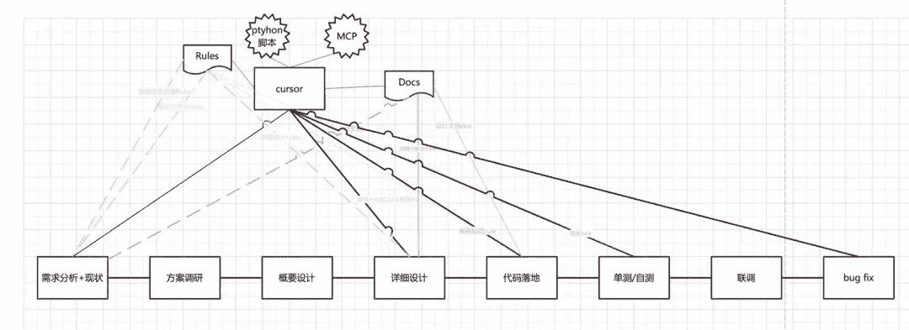
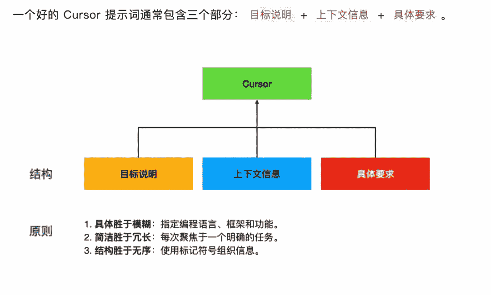
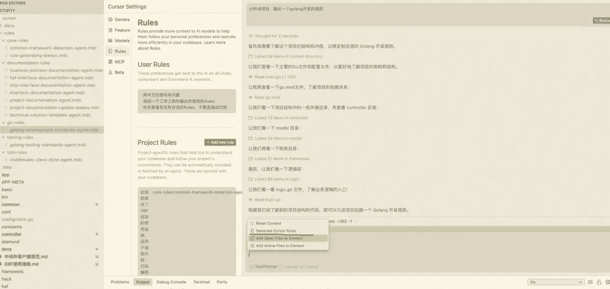
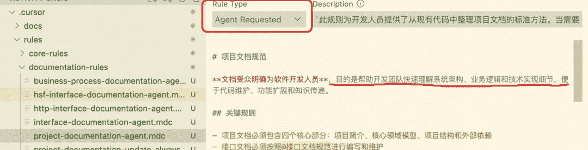
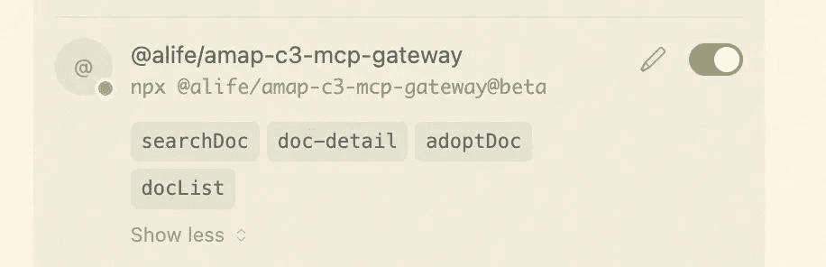
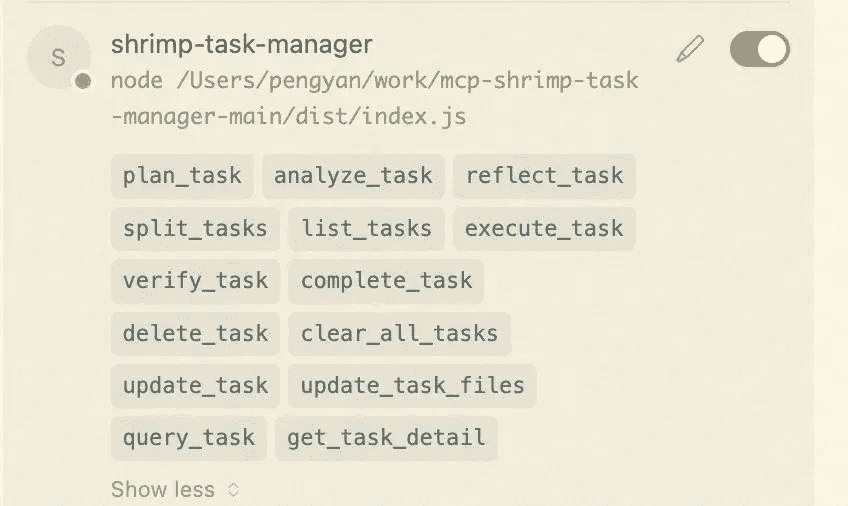
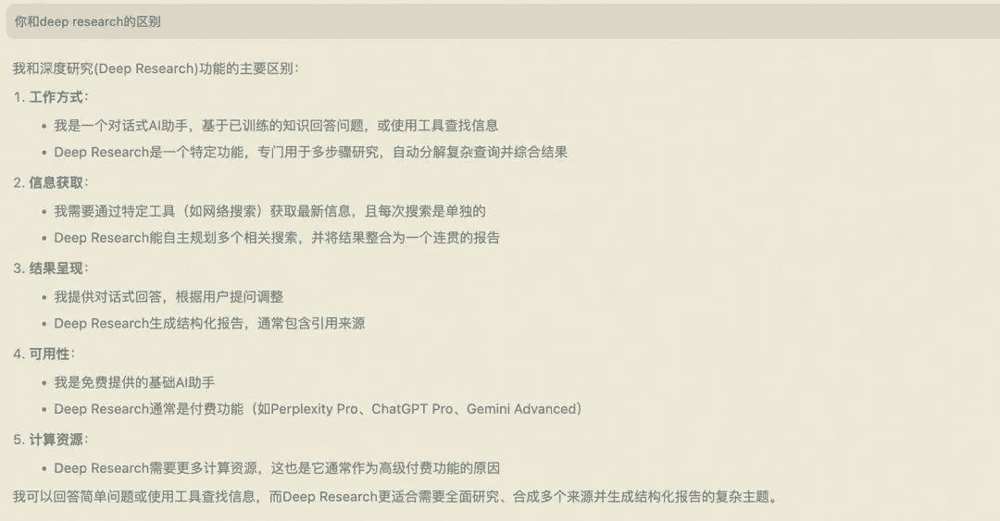
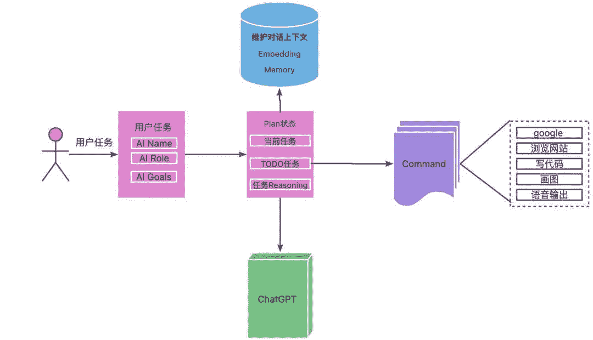
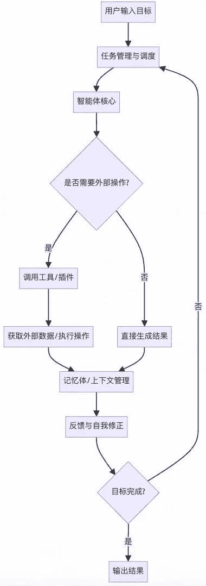
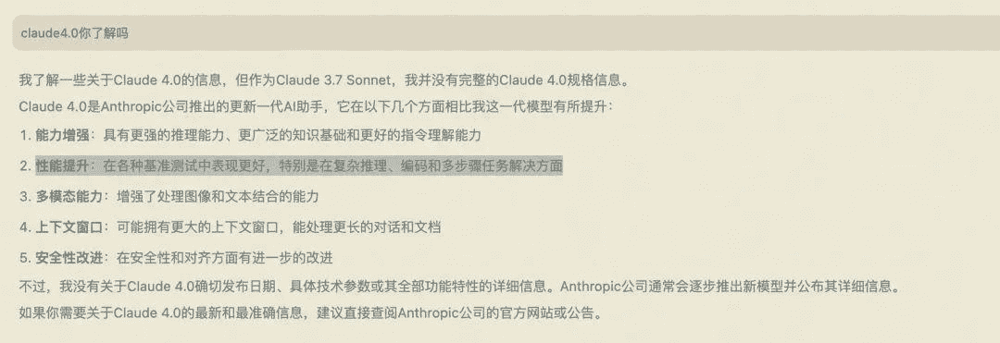

# 深入解析｜Cursor编程实践经验分享

> 来源：[https://huchegames.feishu.cn/docx/WjxcdSlfxocGXnxFJbzceLxJnef](https://huchegames.feishu.cn/docx/WjxcdSlfxocGXnxFJbzceLxJnef)

> 🔗 原文链接： h[ttps://mp.weixin.q](https://mp.weixin.qq.com/s/UQPcxiV4UsTxpPYRjaNZIA)q.com/s/UQPcxiV4...

> ⏰ 原创 芥蓝 阿里云开发者 2025年06月24日 08:31  浙江

# 写在前面

本文是近两个月的实践总结，结合在实际工作中的实践聊一聊Cursor的表现。记录在该过程中遇到的问题以及一些解法。问题概览(for 服务端)：

+   不如我写的快？写的不符合预期？

+   Cursor能完成哪些需求？这个需求可以用Cursor，那个需求不能用Cursor?

+   历史代码分析浅显，不够深入理解？

+   技术方案设计做的不够好，细节缺失，生成代码的可用性不够满意？

# Cursor项目开发流程



通过近两个月的实践，在编程中，cursor的表现取决与有效的Rules+正确的开发流程+标准的Prompt。

在日常需求中按照该流程开发，目前对于编程的提效是接近预期的。在日常使用中主要以提效为主，不纠结一定要cursor写。

下一步我们的方向是基于研发的流程分析，我们还有哪些流程可以使用 AI帮助我们提效？本篇文章主要是介绍我们实践的一些心得体会，以及对未来的一些展望。

# Cursor如何用好

1.  标准的Prompt

1.  好用的Rules

1.  合理的开发流程

1.  有帮助的mcp

## 标准的PE如何写

其**实在聊这个问题**，大家可能会说有时候好用有时候不好用。大家对好用的第一感知就是一句话沟通后Cursor能完成至少 40-60% ，不好用则是超过三次后完成的不如预期。

Cursor用好的第一步是首先学会和cursor对话，是否真的会聊？我们工程研发是否会写PE（ Prompt Engineering ），对于研发工程同学，其实Prompt对于我们是有些门槛，但是在端到端的过程中，Prompt是我们的入门的必备技能。准确有效的提示词能能让Cursor效率事半功倍。

接下来按照每个步骤分析应该给到Cursor的信息，可以不严格按照此格式，精髓是把我们的目标+上下文+要求给到Cursor。

分享一套我们团队同学总结的Prompt经验：

### 提示词基本结构与原则



+   目标：明确Cursor到底是写技术方案、生成代码还是理解项目；

+   上下文信息：必要的背景信息。

+   要求：

+   Cursor要做的事：拆解任务，让Cursor执行的步骤；

+   Cursor的限制；

### 项目理解

```
# 目标
请你深入分析当前代码库，生成项目梳理文档。

# 要求
1. 你生成的项目梳理文档必须严格按照项目规则中的《项目文档整理规范》来生成。（在rules使用不规范的情况下可以明确指出）

# 输出
请你输出项目梳理文档，并放到项目的合适位置。（梳理的文档要落到规定的位置,eg:.cursor/docs中）
```

### 方案设计

```
# 技术方案设计文档

## 目标
请你根据需求文档，生成技术方案。注意你只需要输出详细的技术方案文档，现阶段不需改动代码。（此时需求文档已经以文档的形式放到了我们的项目中）

## 背景知识
为了帮助你更好的生成技术方案，我已为你提供：
1. 项目代码
2. 需求文档：《XX.md》（上下文@文件的方式给到也可以）
3. 项目理解文档:《XX.md》（上下文@文件给到也是同样的效果）

## 核心任务

### 1. 文档分析与理解阶段
在完成方案设计前完成以下分析：
- **详细理解需求**：
  - 请确认你深刻理解了《需求.md》中提到的所有需求描述、功能改动。
  - 若有不理解点或发现矛盾请立即标记并提交备注。
- **代码架构理解**：
  - 深入理解项目梳理文档和现有代码库的分层结构，确定新功能的插入位置。
  - 列出可复用的工具类、异常处理机制和公共接口（如`utils.py`、`ErrorCode`枚举类）。

### 2. 方案设计阶段
请你根据需求进行详细的方案设计，并将生成的技术方案放置到项目`docs`目录下。该阶段无需生成代码。

## 要求
1. 你生成的技术方案必须严格按照项目规则中的《技术方案设计文档规范》来生成，并符合技术方案设计文档模板。

## 输出
请你输出技术方案，并将生成的技术方案放到项目的合适位置，无需生成代码。
```

### 根据技术方案生成代码

```
# 目标
请你按照设计好的方案，生成代码。

# 背景知识
为了帮助你更好的生成代码，我已为你提供：
1. 项目代码
2. 需求文档：《XX.md》
3. 技术方案：《XX.md》
4. 项目理解文档:《XX.md》

# 核心任务
## 1. 文档分析与理解阶段  
在动手编写代码前完成以下分析：  
- **需求匹配度检查**：  
  - 深入理解需求文档和方案设计文档，确认《方案设计.md》与《需求.md》在功能点、输入输出、异常场景上的完全一致性。  
  - 若发现矛盾请立即标记并提交备注。  

- **代码架构理解**：  
  - 深入理解项目梳理文档和现有代码库的分层结构，确定新功能的插入位置。  
  - 列出可复用的工具类、异常处理机制和公共接口（如`utils.py`、`ErrorCode`枚举类）。  

## 2. 代码生成阶段
如果你已明确需求和技术方案，请你完成代码编写工作。

# 要求
1. 你必须遵循以下核心原则：  
   - （1）你生成的代码必须参考当前项目的代码风格。  
   - （2）如项目已有可用方法，必须考虑复用、或在现有方法上扩展、或进行方法重载，保证最小粒度改动，减少重复代码。  

2. 你生成的代码必须符合《Java统一开发编程规范》中定义的规范。

# 输出
请你生成代码，并放到代码库的合适位置。
```

### 生成单测

```
# 任务
请你为《xx.go》文件生成单测。

# 要求
1. 你生成的单元测试代码必须参考当前项目已有的单测方法风格。

# 示例
（从你当前项目中复制一个写好的单测作为提示给大模型的示例）
```

# 好用的CursorRules

经过两个月的实践， **目前Rules趋于稳定 **，从需求到自测基本可以满足我们的日常开发。

## 自己生成Rules

在v0.49版本支持自动生成rules，直接输入/，即可看到生成规则模式；自动生成规则可以有效的把自己的习惯或者项目的开发规范通过Rules的形式落地而不是每次反复在Prompt中提醒约束；



比如：生成golang项目开发规范


golang开发规范，仅适用于当前项目

```
---  
description: 此规则适用于go项目的开发规范，技术方案设计文档的编写保证核心代码符合规范，写代码遵守该规范，确保开发质量和效率。  
globs:  
  alwaysApply: false  
---  

# Go项目开发规范  

## 项目结构规范  
- 采用领域驱动设计(DDD)分层架构，明确划分为以下层次：  
  - `controller` 层：处理 HTTP 请求，参数验证，路由转发  
  - `logic` 层：实现核心业务逻辑，协调各个组件和服务调用  
  - `model` 层：数据访问和持久化，定义数据结构  
  - `framework` 层：基础设施和通用工具  
  - `hsf` 层：服务调用接口定义和实现  

- **依赖方向**  
  - 严格遵循依赖方向：controller → logic → model  
  - 禁止循环依赖  
  - 上层模块不能依赖于下层模块实现细节，应通过接口进行依赖  

## 编码规范  

### 命名约定  
- **包名命名**  
  - 使用小写单词，不使用下划线或混合大小写  
  - 使用简短、具有描述性的名称  
  - 例如：`model`、`controller`、`logic`  

- **文件命名**  
  - 使用小写字母，使用下划线分隔单词  
  - 例如：`user_service.go`、`order_model.go`  

- **变量命名**  
  - 使用驼峰命名法  
  - 局部变量使用小驼峰（`userID`）  
  - 全局变量使用大驼峰（`UserService`）  
  - 常量使用全大写，下划线分隔（`MAX_RETRY_COUNT`）  

- **接口和结构体命名**  
  - 使用大驼峰命名法  
  - 接口名应以 &quot;er&quot; 结尾表示行为，如 `Reader`、`Writer`  
  - 避免使用 &quot;I&quot; 前缀表示接口  

### 代码组织  
- **结构体字段顺序**  
  - 首先是导出字段，然后是非导出字段  
  - 相关字段应分组在一起  

- **函数声明顺序**  
  - 先声明类型和常量，然后是变量  
  - 接着是初始化函数（`init()`）  
  - 最后是其他方法，按重要性或调用关系排序  

- **import 声明**  
  - 将 import 分组为标准库、第三方库和内部包  
  - 组之间用空行分隔  
  - 使用 goimports 自动排序  

```go  
import(  
    &quot;context&quot;  
    &quot;fmt&quot;  
    &quot;time&quot;  
    &quot;github.com/gin-gonic/gin&quot;  
    &quot;github.com/pkg/errors&quot;  
    &quot;amap-aos-activity/framework/mlogger&quot;  
    &quot;amap-aos-activity/model/base&quot;  
) 
```

## 错误处理规范

- **使用项目标准错误类型**
  - 使用 `common.Error` 统一封装业务错误
  - 保持错误码和错误信息的一致性

- **错误传播**
  - 在逻辑层中，使用 `errors.Wrap` 包装错误以保留堆栈信息
  - 谨慎处理空指针和边界情况

- **错误日志记录**
  - 只在错误发生的源头记录日志，避免重复记录
  - 使用项目统一的日志框架 `mlogger`
  - 在记录错误时包含足够的上下文信息
  
```go
if err != nil {  
    tracelogger.XErrorf(ctx, &quot;failed to query data: %v&quot;, err)  
    return nil, common.NewError(common.ErrCodeDB, &quot;数据查询失败&quot;)  
} 
```

## 并发处理规范
- **使用 context 进行超时控制**
  - 所有长时间运行的操作都应接受 context 参数
  - 及时检查和响应 context 取消信号

- **并发安全**
  - 使用 mutex、atomic 或 channel 来保护共享资源
  - 避免 goroutine 泄漏，确保所有 goroutine 都能正确退出
  - 使用项目提供的 `errgroup` 包管理并发任务

- **资源控制**
  - 使用 worker pool 或信号量控制并发数量
  - 使用项目提供的框架组件进行异步任务处理

## 性能优化规范
- **避免不必要的内存分配**
  - 预分配已知大小的切片和 map
  - 使用 pointer 传递大结构体
  - 使用 sync.Pool 复用临时对象

- **高效的 IO 操作**
  - 使用缓冲 IO
  - 批量处理数据库操作
  - 实现合理的缓存策略，使用 mcache 或 mredis

- **高效的 JSON 处理**
  - 使用项目指定的高性能 JSON 库（sonic）
  - 对频繁使用的结构体预定义字段标签

## 测试规范
- **单元测试覆盖**
  - 为所有关键业务逻辑编写单元测试
  - 使用表驱动测试方法
  - 测试文件与被测试文件放在同一目录，使用 `_test.go` 后缀

- **模拟外部依赖**
  - 使用接口和依赖注入以便于测试
  - 使用 mock 框架模拟外部服务和数据库

- **基准测试**
  - 为性能关键路径编写基准测试
  - 使用性能分析工具发现瓶颈

## 项目标准组件使用指南
- **日志记录**
  - 使用 `mlogger` 包进行日志记录
  - 在关键流程节点记录日志，但避免过度记录

- **配置管理**
  - 使用 `mconfig` 包读取配置
  - 避免硬编码配置值

- **HTTP 客户端**
  - 使用 `mhttp` 包进行 HTTP 调用
  - 设置合理的超时和重试策略

- **缓存使用**
  - 使用 `mcache` 或 `mredis` 实现缓存
  - 实现合适的缓存失效策略

## 代码示例
### Controller 层示例

```go
// controller/example/example.gopackage example  
import (  
    &quot;context&quot;  
    &quot;github.com/gin-gonic/gin&quot;  
    &quot;amap-aos-activity/framework/mlogger&quot;  
    &quot;amap-aos-activity/logic/example&quot;  
)  

// Handler 处理HTTP请求  
func Handler(c *gin.Context) {  
    ctx := c.Request.Context()  
    // 参数解析与验证  
    var req struct {  
        UserID string `json:&quot;userId&quot; binding:&quot;required&quot;`  
    }  
    if err := c.ShouldBindJSON(&amp;req); err != nil {  
        mlogger.XWarnf(ctx, &quot;invalid request: %v&quot;, err)  
        c.JSON(400, gin.H{&quot;code&quot;: &quot;INVALID_PARAM&quot;, &quot;message&quot;: &quot;参数不合法&quot;})  
        return  
    }  
    // 调用逻辑层  
    resp, err := example.ProcessRequest(ctx, req)  
    if err != nil {  
        c.JSON(500, gin.H{&quot;code&quot;: err.Code, &quot;message&quot;: err.Message})  
        return  
    }  
    c.JSON(200, resp)  
}
```

### Logic 层示例

```go
// logic/example/processor.gopackage example  
import (  
    &quot;context&quot;  
    &quot;github.com/pkg/errors&quot;  
    &quot;amap-aos-activity/basic/common&quot;  
    &quot;amap-aos-activity/framework/mlogger&quot;  
    &quot;amap-aos-activity/model/example&quot;  
)  

// ProcessRequest 处理业务逻辑  
func ProcessRequest(ctx context.Context, req interface{}) (interface{}, *common.Error) {  
    // 类型断言  
    request, ok := req.(struct{ UserID string })  
    if !ok {  
        return nil, common.NewError(common.ErrCodeParam, &quot;请求参数类型错误&quot;)  
    }  
    // 业务逻辑处理  
    data, err := example.GetUserData(ctx, request.UserID)  
    if err != nil {  
        mlogger.XErrorf(ctx, &quot;failed to get user data: %+v&quot;, errors.WithStack(err))  
        return nil, common.NewError(common.ErrCodeService, &quot;获取用户数据失败&quot;)  
    }  
    // 返回结果  
    returnmap[string]interface{}{  
        &quot;userId&quot;: request.UserID,  
        &quot;data&quot;: data,  
    }, nil  
}
```

### Model 层示例

```go
// model/example/user_model.gopackage example  
import (  
    &quot;context&quot;  
    &quot;time&quot;  
    &quot;github.com/pkg/errors&quot;  
    &quot;amap-aos-activity/framework/mdb&quot;  
    &quot;amap-aos-activity/framework/mcache&quot;  
)  

// UserData 表示用户数据  
type UserData struct {  
    UserID    string    `json:&quot;userId&quot; db:&quot;user_id&quot;`  
    Name      string    `json:&quot;name&quot; db:&quot;name&quot;`  
    CreatedAt time.Time `json:&quot;createdAt&quot; db:&quot;created_at&quot;`  
}  

// GetUserData 从数据库获取用户数据  
func GetUserData(ctx context.Context, userID string) (*UserData, error) {  
    // 尝试从缓存获取  
    cacheKey := &quot;user_data:&quot; + userID  
    var userData UserData  
    cached, err := mcache.Get(ctx, cacheKey, &amp;userData)  
    if err == nil &amp;&amp; cached {  
        return &amp;userData, nil  
    }  
    // 从数据库查询  
    query := &quot;SELECT user_id, name, created_at FROM user_table WHERE user_id = ?&quot;  
    err = mdb.GetDB().GetContext(ctx, &amp;userData, query, userID)  
    if err != nil {  
        return nil, errors.Wrap(err, &quot;query database failed&quot;)  
    }  
    // 更新缓存  
    _ = mcache.Set(ctx, cacheKey, userData, 5*time.Minute)  
    return &amp;userData, nil  
}
```

## 示例

&lt;example&gt;
// 良好实践：正确的错误处理和日志记录 package service 
import (
&quot;context&quot;
&quot;github.com/pkg/errors&quot;
&quot;amap-aos-activity/basic/common&quot;
&quot;amap-aos-activity/framework/mlogger&quot;
&quot;amap-aos-activity/model/user&quot;
)
func GetUserProfile(ctx context.Context, userID string) (*user.Profile, *common.Error) {
// 参数验证
if userID == &quot;&quot; {
return nil, common.NewError(common.ErrCodeParam, &quot;用户ID不能为空&quot;)
}
// 调用模型层
profile, err := user.GetProfileByID(ctx, userID)
if err != nil {
// 包装错误并记录日志
wrappedErr := errors.Wrap(err, &quot;获取用户资料失败&quot;)
mlogger.XErrorf(ctx, &quot;%+v&quot;, wrappedErr) // 记录堆栈信息
// 返回适当的业务错误
if errors.Is(err, user.ErrUserNotFound) {
return nil, common.NewError(common.ErrCodeNotFound, &quot;用户不存在&quot;)
}
return nil, common.NewError(common.ErrCodeService, &quot;获取用户资料失败&quot;)
}
return profile, nil
}
// 不良实践：不规范的错误处理和日志记录 package service 
import (
&quot;context&quot;
&quot;fmt&quot;
&quot;log&quot;
&quot;amap-aos-activity/model/user&quot;
)
func GetUserProfile(ctx context.Context, userID string) (*user.Profile, error) {
// 缺少参数验证
// 直接调用模型层
profile, err := user.GetProfileByID(ctx, userID)
if err != nil {
// 错误：使用fmt直接打印错误
fmt.Println(&quot;Error getting user profile:&quot;, err)
// 错误：使用标准log包而非项目日志框架
log.Printf(&quot;Failed to get profile for user %s: %v&quot;, userID, err)
// 错误：直接返回底层错误，没有包装或分类
return nil, err
}
return profile, nil
}
&lt;/example&gt;
```

结合当前项目总结出golang开发规范，可以免去我们花大量时间补充。

最近新发布的版本， 不建议大家马上更新，涉及到隐私模式权限问题，会有代码泄漏的风险，可以先等等。

新增自动记忆模块：简单来说，这个功能会根据我们和Cursor的历史对话，来自动创建User Rules。只要你的项目持续迭代，那么这个User Rules就会自动更新。之前我们使用每次chat新开就是 它的记忆在每次会话（session）之间会完全重置 ，目前新增了该模块，通过自动创建user rules变得更懂你。

## 一些有帮助的rules

1.项目梳理文档Rule：通过已有的代码进行codebase整理输出项目架构、技术实现细节等



具体的Rule给到大家一个参考：

### 项目梳理文档Rule

```
# 项目文档规范

**文档受众明确为软件开发人员**，目的是帮助开发团队快速理解系统架构、业务逻辑和技术实现细节，便于代码维护、功能扩展和知识传递。

## 关键规则
- 项目文档必须包含四个核心部分：项目简介、核心领域模型、项目结构和外部依赖
- 接口文档必须按照@接口文档规范进行编写和维护
- 业务流程文档必须按照@业务流程文档规范进行编写和维护
- 文档应保持客观性，基于现有代码而非理想状态
- 文档中使用的术语必须与代码中的术语保持一致
- 文档应使用Markdown格式，支持图表、表格和代码块
- 代码示例必须是从实际代码中提取的，而非虚构的
- 图表应使用Mermaid或PlantUML语法，以确保可维护性
- 文档应当引用具体的代码文件路径，便于读者查找相关实现
- 首先判断项目是否使用GBF框架，并根据实际架构选择适合的文档结构和内容
- 所有文档必须统一放置在docs目录下，并使用规定的中文名称
- **文档生成过程中必须确保完整覆盖所有内容，不允许任何遗漏**

## 文档优化与结构指南
- **主索引文档**：每个核心部分创建一个主索引文档，包含子文档链接和简要说明
- **文档内导航**：超过500行的文档必须在开头提供目录
- **分层结构**：按照&quot;金字塔结构&quot;组织（顶层：核心概念；中层：主要功能模块；底层：具体实现细节）
- **文档拆分**：接口超过20个时按业务域拆分；核心实体超过10个时按业务领域拆分

## 文档结构和内容要求

### 1. 项目简介
- docs/项目概述.md必须包含：
  - 项目背景
  - 项目目标
  - 功能概述
  - 技术栈和架构类型（明确是否使用GBF框架）

### 2. 核心领域模型
- docs/领域模型说明.md必须包含：
  - 领域模型概述：核心业务概念的定义和边界
  - 核心实体关系图：使用E-R图或类图表示
  - 关键业务场景下的模型交互
  - 数据流转关系

**强制性领域模型扫描规则**：
- **全面扫描**：包括`*Entity.java`、`*DO.java`、`*PO.java`、`*Model.java`、`@Entity`、`@Table`、`@Document`注解类、服务层核心模型、DTO/VO类
- **按目录结构识别**：位于`model`、`domain`、`entity`目录及其子目录下的Java类文件，以及领域模型专用包路径（如`*.domain.*`、`*.model.*`、`*.entity.*`）下的类文件
- **完整提取**：实体属性和业务含义、实体关系、聚合结构、生命周期和状态流转
- **识别规则**：属性约束、实体关系约束、状态转换规则

**领域模型分析策略**：
- 全域扫描实体类和值对象，支持多种ORM框架
- 提取关联关系（通过字段类型、泛型参数和ORM注解）
- 识别聚合根和聚合边界（通过包结构和类间关系）
- 分析继承结构（包括抽象类、接口和实现类）
- 提取业务方法和状态转换逻辑
- 生成完整属性表和业务规则说明

**GBF框架项目补充**：
- 扩展点定义与实现
- 行业/场景定制点
- 路由条件与动态选择机制

### 3. 接口文档
- docs/接口文档.md
  - 接口文档应遵循专门的@接口文档规范进行创建和维护，以确保API接口的完整记录和更新。

### 4. 业务流程
- docs/业务流程说明.md
  - 业务流程文档应遵循专门的@业务流程文档规范进行创建和维护，以确保业务流程的完整记录和更新。

### 5. 项目结构
- docs/项目结构说明.md必须包含：
  - 项目模块划分
  - 代码组织结构
  - 关键包说明
  - 分层架构说明

**GBF框架项目补充**：
- docs/GBF框架应用说明.md：
  - GBF分层结构
  - 扩展点文件位置
  - 行业定制目录
  - 场景定制目录

### 6. 外部依赖与下游服务
- docs/外部依赖说明.md必须包含：
  - 下游服务概述：依赖的所有外部服务列表和用途
  - 调用关系图：系统与外部服务的调用关系

## 文档生成工作流程
1. **架构识别**：确定项目架构类型、识别关键组件和分层结构
2. **代码分析**：识别核心业务包和类、分析领域模型、提取接口定义、理解调用链路
3. **内容整理**：按文档结构组织信息、提取代码示例、绘制图表
4. **审核完善**：验证文档与代码一致性、补充关键信息、完善图表和示例
   - **接口覆盖性验证**：确认总览文档中的所有接口都在详细文档中有完整描述
   - **文档完整性检查**：确保没有遗漏任何必要的接口和服务描述
5. **定期更新**：与代码审查流程集成、重大变更更新文档、每季度全面审核

## 示例

### 领域模型示例
```markdown
## 核心实体关系图
```mermaid
classDiagram
  class Item {
    +Long id
    +String name
    +BigDecimal price
    +String status
    +validatePrice()
    +changeStatus(String)
  }
    class TyingRule {
    +Long id
    +Long mainItemId
    +List&lt;Long&gt; subItemIds
    +Date startTime
    +Date endTime
    +enable()
    +disable()
  }
    Item &quot;1&quot; -- &quot;n&quot; TyingRule: 被定义为主商品
    TyingRule &quot;1&quot; -- &quot;n&quot; Item: 关联搭售商品
```
    
## 实体属性详细说明
### Item 商品实体
| 属性名 | 类型 | 说明 |
|----|---|---|
| id | Long | 商品唯一标识 |
| name | String | 商品名称，长度限制：2-50个字符 |
| price | BigDecimal | 商品价格，精确到小数点后2位，最小值：0.01 |
| status | String | 商品状态，枚举值：ON_SHELF(上架)、OFF_SHELF(下架)、DELETED(删除) |

#### 业务规则
- 商品价格必须大于0
- 商品状态只能按特定流程转换（上架-&gt;下架-&gt;删除）

### 业务流程示例

```markdown
## 搭售规则创建流程
### 核心流程图
```mermaid
flowchart TD
    A[创建请求] --&gt; B{校验参数}
    B --&gt;|无效| C[返回错误]
    B --&gt;|有效| D[查询主商品]
    D --&gt; E{商品存在?}
    E --&gt;|否| F[返回错误]
    E --&gt;|是| G[查询搭售商品]
    G --&gt; H{商品存在?}
    H --&gt;|否| I[返回错误]
    H --&gt;|是| J[保存规则]
    J --&gt; K[返回成功]
```

### 调用链路
**入口点**: `ItemTyingController.createTyingRule()`
**调用流程**:
1. 请求参数校验 - `validateTyingRequest(request)`
2. 查询主商品信息 - `itemService.getItemById()`
3. 校验主商品状态 - `validateItemStatus(item)`
4. 查询并校验搭售商品列表 - `validateSubItems()`
5. 构建并保存搭售规则 - `tyingRuleRepository.save()`
6. 发送规则创建事件 - `eventPublisher.publishEvent()`

### 关键判断点
| 判断点 | 条件 | 处理路径 |
|-----|---|----|
| 参数校验 | 主商品ID为空 | 返回参数错误 |
| 主商品校验 | 主商品不存在 | 返回商品不存在错误 |
| 搭售商品校验 | 存在无效商品 | 返回商品无效错误 |
```

两个rule可以亲自试试效果，第二个描述规范了Cursor要深入检索，但是目前免费能用的模型很难做到，新出来的Claude4.0可以完成复杂任务的分析研究。

### 梳理项目Rule

```
# 代码分析规则

## 目标
根据代码入口深入分析完整业务流程，生成详细的业务流程文档，便于团队理解和维护代码。
## 关键规则
- **必须生成分析文档保存到项目的docs目录下**
- **必须使用sequential-thinking辅助分析**
- **必须深入方法内部逻辑，因此你可能需要检索代码**
- **建议使用sequential-thinking辅助检索代码**
### 1. 聚焦业务核心逻辑
- 忽略日志打印、参数基础校验等次要逻辑
- 忽略异常处理中的技术细节，只关注业务异常处理逻辑
- 忽略与业务无关的工具方法调用（如字符串处理、集合操作等）
- 聚焦业务状态转换、流程分支、核心计算等关键逻辑
### 2. 深入方法调用链
- 追踪每个关键方法的内部实现，不仅停留在方法调用层面
- 对调用链上的每个重要方法都分析其内部业务逻辑
- 对于外部依赖的服务（如HSF、RPC调用），说明其功能和业务意义
- 深入分析每个关键业务分支的条件和处理逻辑
### 3. 结合已有文档
- 优先使用已有文档中的描述，避免重复分析
- 如果已有文档对某个方法有详细描述，直接引用该内容
- &quot;站在巨人的肩膀上&quot;，基于已有文档进行补充和完善
- 对已有文档与代码实现不一致的地方进行标注
### 4. 文档输出规范
- 分析结果保存到 `/docs` 目录下，使用 Markdown 格式
- 文档命名格式：`业务名称-流程分析.md`（如：`订单创建-流程分析.md`）
- 文档需包含方法调用树，清晰展示调用层级关系
- 使用分步业务流程描述完整处理过程
## 文档结构模板

```markdown
# 业务名称流程分析
## 功能概述
[简要描述该业务功能的目的和作用]
## 入口方法
`com.example.Class.method`

## 方法调用树

```
入口方法
├─ 一级调用方法1
│  ├─ 二级调用方法1.1
│  ├─ 二级调用方法1.2
├─ 一级调用方法2
   ├─ 二级调用方法2.1
   └─ 二级调用方法2.2
      └─ 三级调用方法
```
## 详细业务流程
1. [步骤1：业务逻辑描述]
2. [步骤2：业务逻辑描述]
   - [子步骤2.1：详细逻辑]
   - [子步骤2.2：详细逻辑]
3. [步骤3：业务逻辑描述]
## 关键业务规则
- [规则1：描述业务规则及其条件]
- [规则2：描述业务规则及其条件]
## 数据流转
- 输入：[描述方法输入及其业务含义]
- 处理：[描述关键数据处理和转换]
- 输出：[描述方法输出及其业务含义]
## 扩展点/分支逻辑
- [分支1：触发条件及处理逻辑]
- [分支2：触发条件及处理逻辑]
## 外部依赖
- 标注对外部系统的依赖
## 注意事项
- [列出实现中需要特别注意的点]
```

## 系统交互图
- 如果业务流程包含多个系统模块，请使用PlantUML画出时序图
## 代码分析技巧
### 步骤1：明确业务入口
- 确定代码分析的起点（通常是Controller、Facade或Service层的公开方法）
- 了解该方法的调用场景和业务背景
### 步骤2：构建方法调用树
- 从入口方法开始，追踪所有重要的方法调用
- 使用缩进表示调用层级，清晰展示调用关系
- 忽略非核心方法调用（如日志、参数校验等）
### 步骤3：分析业务流程
- 按照代码执行顺序分析业务处理步骤
- 重点关注业务状态转换和分支逻辑
- 提取关键业务规则和数据处理逻辑
### 步骤4：整理业务规则
- 总结条件判断中隐含的业务规则
- 分析不同场景下的处理差异
- 提炼业务逻辑的核心决策点
### 步骤5：描述数据流转
- 分析关键数据的来源、处理和去向
- 说明数据模型转换和业务含义
- 关注核心业务实体的状态变化

## 示例分析
参考 [订单查询.md](/docs/订单查询.md) 文档了解完整的分析示例:
该示例展示了订单查询业务的完整分析，包括:
- 方法调用树展示了完整调用链
- 详细业务流程按步骤拆解
- 关键业务规则清晰列出
- HSF接口等外部依赖明确说明
- 特殊处理逻辑如推广通退款按钮透出详细解释
## 好的分析的特征
1. **完整性**：覆盖所有核心业务逻辑和分支
2. **层次性**：清晰展示处理流程的层次结构
3. **业务性**：以业务视角描述，而非技术实现细节
4. **精确性**：准确反映代码的实际处理逻辑
5. **可理解性**：业务人员也能理解的表述方式
6. **实用性**：帮助读者快速理解业务流程和规则 
```

### 技术方案详细设计Rule:

在Cursor输出具体的方案，按照此Rule的结构生成，包含了核心实体、具体的时序交互、核心api的修改等等

技术方案详细设计Rule

```
# 技术方案设计文档规范

## 关键规则
- 技术方案文档必须遵循规定的章节结构，包括名词解释、领域模型、应用调用关系和详细方案设计四个主要部分
- 名词解释部分必须建立业务和技术的统一语言，确保术语简单易懂
- 领域模型需清晰表达业务实体及其关系，可使用UML图或ER图进行可视化
- 应用调用关系必须体现跨应用的接口调用关系和MQ的生产消费关系
- 详细方案设计应按应用和业务流程进行分类，对每个接口的改动点、代码分层和文档变更进行详细说明
- 代码改动点需重点突出实现思路，而不仅是罗列代码变更
- 对外接口协议的所有变更（包括字段变更等）必须在接口文档中明确体现
- 首先明确项目是否使用GBF框架，并选择相应的技术方案设计模板
- 使用GBF框架的项目，需明确说明各层级服务规划及扩展点设计
- 非GBF框架项目，应明确说明标准分层架构设计
## 架构识别与方案适配
### 如何判断项目是否使用GBF框架
- 代码中存在Process、NodeService、DomainService等类或注解
- 存在Ability接口和Action实现类
- 包结构中有platform、node、domain、ability等目录
- 有明确的扩展点机制和BizCode、Scenario路由
### 方案适配策略
- 使用GBF框架的项目，技术方案需关注扩展点设计和流程编排
- 非GBF框架项目，技术方案关注传统分层设计和接口实现
- 在方案开头明确说明项目所使用的架构模式
- 根据架构特点选择适当的设计模式和描述方式
## 技术方案设计文档模板
```markdown
# 技术方案设计文档：[方案名称]
## 文档信息
- 作者：[作者姓名]
- 版本：[版本号，如v1.0]
- 日期：[创建/更新日期]
- 状态：[草稿/已评审/已确认]
- 架构类型：[GBF框架/非GBF框架] - 版本：[框架版本号]
# 一、名词解释
[建立业务和技术的统一语言，尽量简单易懂]
| 术语 | 解释 |
|------|------|
| 术语1 | 含义说明 |
| 术语2 | 含义说明 |
# 二、领域模型
[描述业务领域中的核心实体及其关系，推荐使用UML图表示]
## 核心实体
[列出核心业务实体及其属性、行为]
## 实体关系
[描述实体间的关系，可使用ER图]
```mermaid
classDiagram
    Class01 &lt;|-- AveryLongClass : Cool
    Class03 *-- Class04
    Class05 o-- Class06
    Class07 .. Class08
    Class09 --&gt; C2 : Where am I?
    Class09 --* C3
    Class09 --|&gt; Class07
    Class07 : equals()
    Class07 : Object[] elementData
    Class01 : size()
    Class01 : int chimp
    Class01 : int gorilla
    Class08 &lt;--&gt; C2: Cool label
```
# 三、应用调用关系
[体现跨应用的接口调用关系、MQ的生产消费关系]
## 系统架构图
[系统整体架构图，展示系统组件和交互关系]
```mermaid
flowchart TD
    A[应用1] --&gt;|接口调用| B[应用2]
    B --&gt;|消息发送| C[消息队列]
    D[应用3] --&gt;|消息消费| C
    D --&gt;|数据存储| E[(数据库)]
```
## 时序图
[关键流程的时序图，展示组件间的交互顺序]
```mermaid
sequenceDiagram
    参与者A-&gt;&gt;参与者B: 请求数据
    参与者B-&gt;&gt;参与者C: 转发请求
    参与者C--&gt;&gt;参与者B: 返回数据
    参与者B--&gt;&gt;参与者A: 处理后返回
```
# 四、详细方案设计
## 架构选型
[说明本方案采用的架构模式，如标准三层架构、GBF框架架构等]
### 分层架构说明
[描述本方案的分层架构，说明各层职责]
#### 标准分层架构（非GBF框架项目）
```
# HTTP接口方式
- Controller层：处理HTTP请求，参数校验
- Service层：实现业务逻辑
- Repository层：数据访问和持久化
- Domain层：领域模型和业务规则
# HSF/RPC服务方式
- Provider层：服务提供者，定义和实现HSF服务接口
- Service层：实现业务逻辑
- Repository层：数据访问和持久化
- Domain层：领域模型和业务规则
```
### 数据模型设计
[描述数据模型的设计，包括不同层次的数据模型]
```
# 标准数据模型（非GBF框架项目）
- DTO(Data Transfer Object)：接口层数据传输对象
- BO(Business Object)：业务逻辑层数据对象
- DO(Domain Object)：领域模型对象
- PO(Persistent Object)：持久化对象
# GBF框架数据模型（GBF框架项目）
- DTO：对接客户端，透出业务流程结果
- DO：封装核心领域逻辑，定义服务入口
- PO：与数据库交互，屏蔽存储细节
```
## 应用1
### 业务流程1
#### xxx接口
**接口说明**：[详细说明接口的用途和功能]
**接口路径**：[HTTP方法] [路径] 或 [HSF服务接口定义]
**请求参数**：
```json
{
  &quot;param1&quot;: &quot;value1&quot;,
  &quot;param2&quot;: &quot;value2&quot;
}
```
**返回结果**：
```json
{
  &quot;code&quot;: 200,
  &quot;message&quot;: &quot;success&quot;,
  &quot;data&quot;: {
    &quot;field1&quot;: &quot;value1&quot;,
    &quot;field2&quot;: &quot;value2&quot;
  }
}
```
#### 接口改动点
[说明接口的改动类型：新增、能力调整、扩展等，并详述改动内容]
#### 代码分层设计
[描述代码的分层结构，确保符合工程规范]
##### 标准分层设计（非GBF框架项目）
```
# HTTP接口方式
- Controller层：处理HTTP请求，参数校验
  - 职责：参数校验、请求处理、结果封装
  - 代码位置：web包、controller包
  - 设计要点：保持轻量，不包含业务逻辑
- Service层：实现业务逻辑
  - 职责：实现业务逻辑、编排服务调用、事务管理
  - 代码位置：service包、manager包
  - 设计要点：聚合与编排，可包含复杂业务逻辑
- Repository层：数据访问和持久化
  - 职责：封装数据访问逻辑，实现数据持久化
  - 代码位置：repository包、dao包
  - 设计要点：封装数据库操作，提供数据访问接口
- Domain层：领域模型和业务规则
  - 职责：定义领域模型，实现领域规则
  - 代码位置：domain包、model包
  - 设计要点：领域驱动设计，封装核心业务规则
```
##### GBF框架分层设计（GBF框架项目）
```
# Process定义（Platform层）
- 职责：编排NodeService，形成完整业务流程
- 代码位置：platform包
- 设计要点：
  - Process作为最上层逻辑，直接承接接口请求
  - 通过Spring Bean声明Process流程配置
  - Process只能调用NodeService，不能跨层调用
  - 不应包含具体业务逻辑，专注于流程编排
# NodeService实现（Node层）
- 职责：组合多个DomainService，形成标准化服务入口
- 代码位置：node包
- 设计要点：
  - NodeService作为标准化服务入口
  - 禁止NodeService之间相互调用
  - 通过扩展点控制节点级逻辑(如前置校验)
  - 不应包含复杂业务逻辑，主要负责编排
# DomainService实现（Domain层）
- 职责：提供原子级业务能力
- 代码位置：domain包
- 设计要点：
  - DomainService提供原子级业务能力
  - 禁止DomainService之间相互调用
  - 依赖扩展点接口实现逻辑分支控制
  - 包含特定领域的核心业务逻辑
# 扩展点设计（Ability层与App层）
- 职责：定义扩展点接口和实现
- 代码位置：
  - 接口定义：ability包
  - 行业实现：app包下对应行业目录
  - 场景实现：domain/node包下对应scenario目录
- 设计要点：
  - 统一在Ability层声明扩展点接口
  - 行业定制实现放在App层(如/app/food/)
  - 场景定制实现放在Domain/Node包下
  - 扩展点必须有默认实现，保证基础功能可用
```
#### 扩展点设计（GBF框架项目）
[详细说明本功能涉及的扩展点设计]
```java
# 扩展点接口（Ability层）
package com.amap.xxx.ability;
/**
 * [扩展点名称]能力
 */
public interface XxxAbility {
    /**
     * [方法说明]
     * @param request 请求参数
     * @return 处理结果
     */
    Result doSomething(XxxRequest request);
}
# 扩展点实现路由条件
- BizCode：[业务码，如&quot;FOOD&quot;、&quot;RETAIL&quot;]
- Scenario：[场景码，如&quot;C2C&quot;、&quot;B2C&quot;]
- 优先级规则：
  1. 精确匹配（BizCode + Scenario）
  2. 按场景降级匹配
  3. 使用默认实现
# 扩展点默认实现（Ability层）
package com.amap.xxx.ability.impl;
/**
 * [扩展点名称]默认实现
 */
publicclassDefaultXxxActionimplementsXxxAbility {
    @Override
    public Result doSomething(XxxRequest request){
        // 默认实现逻辑
        return Result.success();
    }
}
# 扩展点行业定制实现（App层）
package com.amap.xxx.app.food;
/**
 * [行业名称][扩展点名称]实现
 */
@Extension(bizId = &quot;FOOD&quot;)
publicclassFoodXxxActionimplementsXxxAbility {
    @Override
    public Result doSomething(XxxRequest request){
        // 行业特定实现逻辑
        return Result.success();
    }
}
# 扩展点场景定制实现（Domain/Node层）
package com.amap.xxx.domain.scenario.b2c;
/**
 * [场景名称][扩展点名称]实现
 */
@Extension(scenario = &quot;B2C&quot;)
publicclassB2CXxxActionimplementsXxxAbility {
    @Override
    public Result doSomething(XxxRequest request){
        // 场景特定实现逻辑
        return Result.success();
    }
}
```
##### 路由条件设计
[说明扩展点的路由条件设计]
```
# 路由维度
- 业务维度（BizCode）：区分不同行业，如&quot;FOOD&quot;、&quot;RETAIL&quot;
- 场景维度（Scenario）：区分不同场景，如&quot;C2C&quot;、&quot;B2C&quot;
- 其他维度：用户类型、渠道等
# 路由策略
- 优先级1：精确匹配（BizCode=A + Scenario=B）
- 优先级2：业务码匹配（BizCode=A）
- 优先级3：场景码匹配（Scenario=B）
- 优先级4：默认实现
# 降级策略
如果找不到满足条件的扩展点实现，按优先级顺序降级匹配，
直到找到默认实现
```
#### 代码改动点
[详述需要改动的代码，重点说明实现思路]
1. Controller/Provider层改动：
   - 新增XX控制器/服务提供者
   - 修改YY方法参数
2. Service层改动：
   - 新增XX服务
   - 调整YY逻辑处理流程
3. GBF框架特定改动(GBF框架项目)：
   - 新增Process流程定义
   - 新增NodeService节点服务
   - 新增扩展点接口与实现
   - 修改扩展点路由规则
## 数据库变更
### 表结构设计
[描述需要新增或修改的数据库表结构]
#### 表名：[表名]
| 字段名 | 数据类型 | 是否为空 | 主键 | 注释 |
|-------|---------|---------|------|------|
| id | bigint | 否 | 是 | 主键ID |
| ... | ... | ... | ... | ... |
### 索引设计
[描述需要新增或修改的索引]
| 索引名 | 字段 | 索引类型 | 说明 |
|-------|------|---------|------|
| idx_xxx | 字段1, 字段2 | 普通/唯一/主键 | 索引说明 |
## 接口文档变更
[描述需要新增或修改的接口文档]
### 接口名：[接口名]
- 接口路径：[HTTP方法] [路径] 或 [HSF服务接口定义]
- 变更类型：[新增/修改/删除]
- 变更说明：[详细说明接口变更]
## 配置变更
[描述需要新增或修改的配置]
### 配置类型：[配置类型]
- 配置名：[配置名]
- 配置值：[配置值]
- 说明：[配置说明]
## 非功能性需求
### 性能需求
[描述性能需求，如响应时间、并发量等]
### 可用性需求
[描述可用性需求，如系统可用率、故障恢复能力等]
### 扩展性需求
[描述扩展性需求，如系统的可扩展性、可伸缩性等]
## 兼容性与平滑迁移方案
[描述系统升级的兼容性问题及平滑迁移方案]
### 兼容性问题
[描述可能的兼容性问题]
### 平滑迁移方案
[描述平滑迁移的方案]
## 风险与应对措施
[描述可能的风险及应对措施]
| 风险 | 可能性 | 影响 | 应对措施 |
|------|-------|------|---------|
| 风险1 | 高/中/低 | 高/中/低 | 应对措施1 |
| 风险2 | 高/中/低 | 高/中/低 | 应对措施2 |
```
## 示例
### 非GBF框架项目技术方案示例
&lt;example&gt;
## 代码分层设计
### 添加商品API的实现结构如下：
```
# Controller层
- com.amap.mall.web.controller.ProductController
  - 职责：接收HTTP请求，校验参数，调用Service层，封装返回结果
  - 主要方法：addProduct(AddProductRequest request)
# Service层
- com.amap.mall.service.ProductService (接口)
- com.amap.mall.service.impl.ProductServiceImpl (实现)
  - 职责：处理业务逻辑，调用Repository层，实现事务控制
  - 主要方法：addProduct(ProductDO product)
# Repository层
- com.amap.mall.repository.ProductRepository (接口)
- com.amap.mall.repository.impl.ProductRepositoryImpl (实现)
  - 职责：封装数据访问逻辑，调用DAO层
  - 主要方法：insert(ProductPO product)
# DAO层
- com.amap.mall.dao.ProductDAO
  - 职责：与数据库交互，执行SQL
  - 主要方法：insert(ProductPO product)
```
根据上述设计，添加商品功能的调用链为：
1. 客户端调用ProductController.addProduct()
2. Controller校验参数并调用ProductService.addProduct()
3. Service处理业务逻辑并调用ProductRepository.insert()
4. Repository转换对象并调用ProductDAO.insert()
5. DAO执行SQL插入数据
&lt;/example&gt;
### GBF框架项目技术方案示例
&lt;example&gt;
## GBF框架分层设计
### 添加搭售规则功能的实现结构如下：
```
# Process层（Platform层）
- com.amap.mall.tying.platform.CreateRuleProcess
  - 职责：定义搭售规则创建流程，编排NodeService调用顺序
  - 流程节点：参数校验 -&gt; 商品信息获取 -&gt; 规则冲突检查 -&gt; 规则持久化
# NodeService层（Node层）
- com.amap.mall.tying.node.ValidateRuleNodeService
  - 职责：实现规则参数校验节点
  - 使用扩展点：RuleValidateAbility（规则校验能力）
- com.amap.mall.tying.node.CheckConflictNodeService
  - 职责：实现规则冲突检查节点
  - 使用扩展点：ConflictCheckAbility（冲突检查能力）
- com.amap.mall.tying.node.PersistRuleNodeService
  - 职责：实现规则持久化节点
  - 使用扩展点：RulePersistAbility（规则持久化能力）
# DomainService层（Domain层，可选）
- com.amap.mall.tying.domain.service.ItemInfoDomainService
  - 职责：获取商品信息的原子能力服务
  - 使用扩展点：ItemInfoAbility（商品信息获取能力）
# Ability层（扩展点接口定义）
- com.amap.mall.tying.ability.RuleValidateAbility
  - 职责：定义规则校验的扩展点接口
  - 方法：validate(RuleRequest request)
- com.amap.mall.tying.ability.ConflictCheckAbility
  - 职责：定义冲突检查的扩展点接口
  - 方法：check(RuleRequest request)
# App层（行业定制实现）
- com.amap.mall.tying.app.food.FoodRuleValidateAction
  - 职责：实现食品行业特定的规则校验逻辑
  - 路由条件：@Extension(bizId = &quot;FOOD&quot;)
- com.amap.mall.tying.app.retail.RetailRuleValidateAction
  - 职责：实现零售行业特定的规则校验逻辑
  - 路由条件：@Extension(bizId = &quot;RETAIL&quot;)
# 默认实现（Ability层实现）
- com.amap.mall.tying.ability.impl.DefaultRuleValidateAction
  - 职责：实现默认的规则校验逻辑
  - 应用场景：当不满足任何行业/场景定制条件时
```
扩展点路由设计：
1. 按业务码（bizId）路由：不同行业的定制实现
   - FOOD -&gt; FoodRuleValidateAction
   - RETAIL -&gt; RetailRuleValidateAction
2. 按场景码（scenario）路由：不同场景的定制实现
   - B2C -&gt; B2CRuleValidateAction
   - C2C -&gt; C2CRuleValidateAction
3. 精确匹配：同时匹配业务码和场景码
   - FOOD + B2C -&gt; FoodB2CRuleValidateAction
4. 降级策略：找不到匹配的实现时，使用默认实现
   - 默认 -&gt; DefaultRuleValidateAction
&lt;/example&gt;
&lt;example type=&quot;invalid&quot;&gt;
## 技术方案设计
我们将实现一个新的搭售规则管理功能。
开发计划：
1. 添加新的Controller处理HTTP请求
2. 添加新的Service处理业务逻辑
3. 添加新的DAO访问数据库
（错误原因：没有明确说明项目使用的架构类型，缺乏分层设计的详细说明，没有明确接口定义和实现方式，对于GBF项目没有说明扩展点设计）
&lt;/example&gt;
## 方案设计工作流程
1. **架构识别阶段**
   - 确定项目使用的架构类型(GBF/非GBF)
   - 识别关键架构组件和分层结构
   - 确定方案设计重点和特殊要求
   - 选择适合的方案模板
2. **需求分析阶段**
   - 确定功能边界和核心业务流程
   - 识别核心业务实体和领域模型
   - 确定接口定义和数据结构
   - 识别可能的扩展点和变化点
3. **方案设计阶段**
   - 根据架构特点进行分层设计
   - 确定接口实现和组件交互
   - 设计数据库结构和索引
   - 对于GBF项目，设计扩展点和路由规则
4. **方案评审阶段**
   - 验证方案与架构的一致性
   - 验证功能覆盖度和完整性
   - 评估技术风险和性能问题
   - 确保方案文档结构清晰、内容完整
```

### 中间件Rule

项目开发用到的一些比较常见的中间件的调用规范。

中间件使用规范

```
---
description: `此规则适用于go项目的单元测试开发规范，Go单元测试提供全面指南，规范测试结构、mock技术和断言方法，确保测试代码质量与可维护性。`
globs:
alwaysApply: false
---
# 中间件客户端调用规范
## 关键规则
- **所有HTTP和HSF等中间件客户端必须放在framework/client目录下**
- **必须遵循统一的命名规范：服务功能+Service命名方式**
- **必须使用Context作为第一个参数，支持分布式追踪和日志记录**
- **中间件客户端必须从配置中心读取配置，不允许硬编码**
- **中间件调用必须记录完整的请求和响应日志**
- **必须实现统一的错误处理和返回机制**
- **应对关键调用实现缓存机制，减少直接调用次数**
- **请求和响应结构体必须实现JavaClassName方法（HSF特有）**
- **HSF服务必须在init方法中注册模型**
- **客户端调用需要进行合理的超时控制**
## HTTP客户端标准实现
### 客户端定义规范
```go
// 客户端标准定义
type XXXHttpClient struct {
    // 可选的客户端配置
}
// 必须定义统一的初始化方法
func NewXXXHttpClient(ctx context.Context) *XXXHttpClient {
    return &amp;XXXHttpClient{}
}
```
### 请求参数定义
```go
// 请求参数必须使用结构体定义
type RequestParams struct {
    // 请求字段
    Field1 string `json:&quot;field1&quot;`
    Field2 int    `json:&quot;field2&quot;`
    // ...
}
```
### 标准HTTP调用实现
```go
// 标准HTTP调用方法
func (client *XXXHttpClient) SendRequest(ctx context.Context, params RequestParams) (ResponseType, error) {
    // 1. 从配置中心获取URL配置
    var conf simplehttp.URLSetting
    urlConf := mconfig.UrlConfig()
    if err := urlConf.UnmarshalKey(&quot;ConfigKey&quot;, &amp;conf); err != nil || conf.URL == &quot;&quot; {
        return nil, common.Errorf(common.ErrorInternal, &quot;url conf miss&quot;)
    }
    // 2. 构建URL和请求参数
    url := conf.URL + &quot;/api/endpoint&quot;
    httpParams := map[string]string{
        &quot;param1&quot;: params.Field1,
        &quot;param2&quot;: types.IWrapper(params.Field2).String(),
        // 必须加入追踪ID
        &quot;trace_id&quot;: eagleeye.GetTraceId(ctx),
    }
    // 3. 构建请求选项
    opt := simplehttp.BuildOptions(&amp;simplehttp.Options{
        Method:           &quot;GET&quot;, // 或 POST 等
        Params:           httpParams,
        Timeout:          conf.Timeout,
        HostWithVip:      conf.VipHost,
        RecordWithParams: httpcommon.RecordWithParams,
    })
    // 4. 发送请求并记录日志
    respData, err := simplehttp.RequestWithContext(ctx, url, opt)
    common.LogInfof(ctx, &quot;log_type&quot;, &quot;request info, params=%v, err=%v&quot;, params, err)
    // 5. 错误处理
    if err != nil {
        return nil, common.Errorf(common.ErrorInternal, &quot;request failed.err:%s&quot;, err.Error())
    }
    // 6. 解析响应
    var response ResponseType
    err = json.Unmarshal(respData, &amp;response)
    if err != nil {
        return nil, common.Errorf(common.ErrorInternal, &quot;unmarshal failed.err:%s&quot;, err.Error())
    }
    // 7. 返回结果
    return response, nil
}
```
### 带缓存的HTTP调用
```go
func GetDataWithCache(ctx context.Context, key string, params RequestParams) (ResponseType, error) {
    var resp ResponseType
    cacheKey := fmt.Sprintf(&quot;cache_key_prefix_%s&quot;, key)
    // 使用缓存机制
    err := mcache.GetLocalCacheFiveSecond(ctx).Once(ctx, cacheKey, &amp;resp, 5*time.Second, func() (interface{}, error) {
        // 调用实际API
        data, e := SendRequest(ctx, params)
        // 记录日志
        common.LogDebugf(ctx, &quot;module_name&quot;, &quot;GetData, key:%s, data:%+v, err:%v&quot;, key, data, e)
        // 错误处理
        if e != nil {
            return nil, errors.New(e.Error())
        }
        return data, nil
    })
    if err != nil {
        return nil, err
    }
    return resp, nil
}
```
## HSF客户端标准实现
### 服务定义规范
```go
// 全局服务实例
var XXXService = new(XXXServiceImpl)
// 注册HSF模型
func init() {
    hsfCommon.RegisterModel(&amp;ModelType1{})
    hsfCommon.RegisterModel(&amp;ModelType2{})
    // 其他模型注册...
}
// 服务结构体定义
type XXXServiceImpl struct {
    // 方法定义，必须遵循标准方法签名
    MethodName func(ctx context.Context, args []interface{}) (*ResponseType, error)
}
// 接口名配置
func (s *XXXServiceImpl) InterfaceName() string {
    return mconfig.UrlConfig().GetString(&quot;ServiceName.interfaceName&quot;)
}
// 版本配置
func (s *XXXServiceImpl) Version() string {
    return mconfig.UrlConfig().GetString(&quot;ServiceName.version&quot;)
}
// 组名配置
func (s *XXXServiceImpl) Group() string {
    return mconfig.UrlConfig().GetString(&quot;ServiceName.group&quot;)
}
// 超时配置
func (s *XXXServiceImpl) TimeoutMs() int {
    return mconfig.UrlConfig().GetInt(&quot;ServiceName.timeout&quot;)
}
```
### 请求模型定义
```go
// 请求模型必须实现JavaClassName方法
type RequestType struct {
    Field1 string    `json:&quot;field1&quot; hessian:&quot;field1&quot;`
    Field2 int64     `json:&quot;field2&quot; hessian:&quot;field2&quot;`
    // ...
}
func (RequestType) JavaClassName() string {
    return&quot;com.package.RequestType&quot;
}
// 响应模型必须实现JavaClassName方法
type ResponseType struct {
    Code    int32       `json:&quot;code&quot;`
    Data    interface{} `json:&quot;data&quot;`
    Success bool        `json:&quot;success&quot;`
    // ...
}
func (ResponseType) JavaClassName() string {
    return&quot;com.package.ResponseType&quot;
}
```
### 标准HSF调用实现
```go
// 标准HSF调用方法
func CallHSFService(ctx context.Context, request *RequestType) (*DataType, *common.Error) {
    // 1. 调用HSF服务
    hsfResp, e := XXXService.MethodName(ctx, []interface{}{request})
    // 2. 记录请求和响应日志
    reqJson, _ := json.Marshal(request)
    respJson, _ := json.Marshal(hsfResp)
    common.LogInfof(ctx, &quot;hsf_call&quot;, &quot;hsf resp:%s, err:%v, req:%s&quot;,
        string(respJson), e, string(reqJson))
    // 3. 错误处理
    if e != nil {
        return nil, common.Errorf(common.ErrorInternal, &quot;HSF call failed.err:%s&quot;, e.Error())
    }
    // 4. 结果处理
    if hsfResp != nil {
        result := ParseResponseData(hsfResp.Data)
        return result, nil
    }
    return nil, nil
}
// 解析响应数据的标准方法
func ParseResponseData(data interface{}) *DataType {
    if data == nil {
        return nil
    }
    if items, ok := data.(SpecificResponseType); ok {
        // 处理数据转换
        result := &amp;DataType{
            // 数据转换逻辑
        }
        return result
    }
    return nil
}
```
### 带缓存的HSF调用
```go
func GetHSFDataWithCache(ctx context.Context, param1, param2 string) (*DataType, error) {
    var resp *DataType
    cacheKey := fmt.Sprintf(&quot;hsf_cache_key_%s_%s&quot;, param1, param2)
    // 使用缓存机制
    err := mcache.GetLocalCacheFiveSecond(ctx).Once(ctx, cacheKey, &amp;resp, 5*time.Second, func() (interface{}, error) {
        // 构建HSF请求
        request := &amp;RequestType{
            Field1: param1,
            Field2: param2,
        }
        // 调用HSF服务
        data, e := CallHSFService(ctx, request)
        // 记录日志
        common.LogDebugf(ctx, &quot;hsf_module&quot;, &quot;GetHSFData, key:%s, data:%+v, err:%v&quot;, cacheKey, data, e)
        // 错误处理
        if e != nil {
            return nil, errors.New(e.Error())
        }
        return data, nil
    })
    if err != nil {
        return nil, err
    }
    return resp, nil
}
```
## 错误处理规范
- **所有中间件调用都必须返回标准化的错误**
- **错误必须包含错误码和错误信息**
- **网络错误必须归类为InternalError**
- **参数错误必须归类为InvalidError**
- **业务逻辑错误必须根据具体场景进行分类**
```go
// 错误处理示例
if err != nil {
    // 网络错误
    if netErr, ok := err.(net.Error); ok &amp;&amp; netErr.Timeout() {
        return nil, common.Errorf(common.ErrorTimeout, &quot;request timeout: %s&quot;, err.Error())
    }
    // 一般错误
    return nil, common.Errorf(common.ErrorInternal, &quot;request failed: %s&quot;, err.Error())
}
// 业务错误
if resp.Code != 200 {
    return nil, common.Errorf(common.ErrorBusiness, &quot;business error: %s&quot;, resp.Message)
}
```
## 日志记录规范
- **所有中间件调用必须记录请求和响应日志**
- **日志必须包含追踪ID、请求参数和响应结果**
- **敏感信息（如密码、token）必须在日志中脱敏**
- **必须使用统一的日志模块和日志格式**
```go
// 标准日志示例
common.LogInfof(ctx, &quot;module_name&quot;, &quot;method_name, param1=%v, param2=%v, resp=%s, err=%v&quot;,
    param1, param2, respJson, err)
```
## 示例
&lt;example&gt;
// HTTP客户端调用示例
package client
import (
    &quot;amap-aos-activity/basic/common&quot;
    &quot;amap-aos-activity/framework/mconfig&quot;
    &quot;context&quot;
    &quot;encoding/json&quot;
    &quot;fmt&quot;
    &quot;gitlab.alibaba-inc.com/amap-go/eagleeye-go&quot;
    &quot;gitlab.alibaba-inc.com/amap-go/http-client/simplehttp&quot;
    httpcommon &quot;gitlab.alibaba-inc.com/amap-go/http-client/common&quot;
    &quot;time&quot;
)
// 请求参数定义
type SearchParams struct {
    Query    string  `json:&quot;query&quot;`
    Latitude float64 `json:&quot;latitude&quot;`
    Longitude float64 `json:&quot;longitude&quot;`
}
// 响应结构定义
type SearchResponse struct {
    Code    int           `json:&quot;code&quot;`
    Message string        `json:&quot;message&quot;`
    Data    []SearchItem  `json:&quot;data&quot;`
}
type SearchItem struct {
    ID      string  `json:&quot;id&quot;`
    Name    string  `json:&quot;name&quot;`
    Distance float64 `json:&quot;distance&quot;`
}
// 发送搜索请求
func SendSearchRequest(ctx context.Context, params SearchParams) (*SearchResponse, *common.Error) {
    // 从配置中获取URL
    var conf simplehttp.URLSetting
    urlConf := mconfig.UrlConfig()
    if err := urlConf.UnmarshalKey(&quot;SearchService&quot;, &amp;conf); err != nil || conf.URL == &quot;&quot; {
        return nil, common.Errorf(common.ErrorInternal, &quot;search service url conf miss&quot;)
    }
    // 构建请求参数
    httpParams := map[string]string{
        &quot;query&quot;: params.Query,
        &quot;latitude&quot;: fmt.Sprintf(&quot;%f&quot;, params.Latitude),
        &quot;longitude&quot;: fmt.Sprintf(&quot;%f&quot;, params.Longitude),
        &quot;trace_id&quot;: eagleeye.GetTraceId(ctx),
    }
    // 构建请求选项
    opt := simplehttp.BuildOptions(&amp;simplehttp.Options{
        Method:           &quot;GET&quot;,
        Params:           httpParams,
        Timeout:          conf.Timeout,
        HostWithVip:      conf.VipHost,
        RecordWithParams: httpcommon.RecordWithParams,
    })
    // 发送请求
    url := conf.URL + &quot;/search/api&quot;
    respData, err := simplehttp.RequestWithContext(ctx, url, opt)
    common.LogInfof(ctx, &quot;search_service&quot;, &quot;search request, params=%v, err=%v&quot;, params, err)
    // 错误处理
    if err != nil {
        return nil, common.Errorf(common.ErrorInternal, &quot;search request failed: %s&quot;, err.Error())
    }
    // 解析响应
    var response SearchResponse
    if err := json.Unmarshal(respData, &amp;response); err != nil {
        return nil, common.Errorf(common.ErrorInternal, &quot;unmarshal search response failed: %s&quot;, err.Error())
    }
    // 业务错误处理
    if response.Code != 200 {
        return nil, common.Errorf(common.ErrorBusiness, &quot;search business error: %s&quot;, response.Message)
    }
    return &amp;response, nil
}
// 带缓存的搜索请求
func SearchWithCache(ctx context.Context, params SearchParams) (*SearchResponse, error) {
    var resp *SearchResponse
    cacheKey := fmt.Sprintf(&quot;search_%s_%f_%f&quot;, params.Query, params.Latitude, params.Longitude)
    err := mcache.GetLocalCacheFiveSecond(ctx).Once(ctx, cacheKey, &amp;resp, 30*time.Second, func() (interface{}, error) {
        result, e := SendSearchRequest(ctx, params)
        if e != nil {
            return nil, e
        }
        return result, nil
    })
    if err != nil {
        return nil, err
    }
    return resp, nil
}
&lt;/example&gt;
&lt;example&gt;
// HSF客户端调用示例
package client
import (
    &quot;amap-aos-activity/basic/common&quot;
    &quot;amap-aos-activity/framework/mconfig&quot;
    &quot;context&quot;
    &quot;encoding/json&quot;
    &quot;errors&quot;
    &quot;fmt&quot;
    hsfCommon &quot;gitlab.alibaba-inc.com/amap-go/hsf-go/common&quot;
    &quot;time&quot;
)
// 全局服务实例
var ProductService = new(ProductServiceImpl)
// 注册HSF模型
func init() {
    hsfCommon.RegisterModel(&amp;ProductQueryRequest{})
    hsfCommon.RegisterModel(&amp;ProductQueryResponse{})
    hsfCommon.RegisterModel(&amp;ProductDetail{})
}
// 请求模型
type ProductQueryRequest struct {
    ProductId string   `json:&quot;productId&quot; hessian:&quot;productId&quot;`
    Fields    []string `json:&quot;fields&quot; hessian:&quot;fields&quot;`
}
func (ProductQueryRequest) JavaClassName() string {
    return&quot;com.example.product.request.ProductQueryRequest&quot;
}
// 响应模型
type ProductQueryResponse struct {
    Code    int32         `json:&quot;code&quot;`
    Data    *ProductDetail `json:&quot;data&quot;`
    Success bool          `json:&quot;success&quot;`
    Message string        `json:&quot;message&quot;`
}
func (ProductQueryResponse) JavaClassName() string {
    return&quot;com.example.product.response.ProductQueryResponse&quot;
}
// 产品详情
type ProductDetail struct {
    Id          string  `json:&quot;id&quot; hessian:&quot;id&quot;`
    Name        string  `json:&quot;name&quot; hessian:&quot;name&quot;`
    Price       int64   `json:&quot;price&quot; hessian:&quot;price&quot;`
    Description string  `json:&quot;description&quot; hessian:&quot;description&quot;`
}
func (ProductDetail) JavaClassName() string {
    return&quot;com.example.product.model.ProductDetail&quot;
}
// 服务结构体
type ProductServiceImpl struct {
    QueryProduct func(ctx context.Context, args []interface{}) (*ProductQueryResponse, error)
}
// 接口配置
func (s *ProductServiceImpl) InterfaceName() string {
    return mconfig.UrlConfig().GetString(&quot;ProductService.interfaceName&quot;)
}
func (s *ProductServiceImpl) Version() string {
    return mconfig.UrlConfig().GetString(&quot;ProductService.version&quot;)
}
func (s *ProductServiceImpl) Group() string {
    return mconfig.UrlConfig().GetString(&quot;ProductService.group&quot;)
}
func (s *ProductServiceImpl) TimeoutMs() int {
    return mconfig.UrlConfig().GetInt(&quot;ProductService.timeout&quot;)
}
// 查询产品信息
func GetProductDetail(ctx context.Context, productId string) (*ProductDetail, *common.Error) {
    // 构建请求
    request := &amp;ProductQueryRequest{
        ProductId: productId,
        Fields: []string{&quot;id&quot;, &quot;name&quot;, &quot;price&quot;, &quot;description&quot;},
    }
    // 调用HSF服务
    resp, err := ProductService.QueryProduct(ctx, []interface{}{request})
    // 记录日志
    reqJson, _ := json.Marshal(request)
    respJson, _ := json.Marshal(resp)
    common.LogInfof(ctx, &quot;product_service&quot;, &quot;query product, req=%s, resp=%s, err=%v&quot;,
        string(reqJson), string(respJson), err)
    // 错误处理
    if err != nil {
        return nil, common.Errorf(common.ErrorInternal, &quot;query product failed: %s&quot;, err.Error())
    }
    // 结果处理
    if resp != nil {
        if !resp.Success || resp.Code != 200 {
            return nil, common.Errorf(common.ErrorBusiness, &quot;business error: %s&quot;, resp.Message)
        }
        return resp.Data, nil
    }
    return nil, common.Errorf(common.ErrorInternal, &quot;empty response&quot;)
}
// 带缓存的产品查询
func GetProductWithCache(ctx context.Context, productId string) (*ProductDetail, error) {
    var product *ProductDetail
    cacheKey := fmt.Sprintf(&quot;product_detail_%s&quot;, productId)
    err := mcache.GetLocalCacheFiveSecond(ctx).Once(ctx, cacheKey, &amp;product, 5*time.Minute, func() (interface{}, error) {
        detail, e := GetProductDetail(ctx, productId)
        if e != nil {
            return nil, errors.New(e.Error())
        }
        return detail, nil
    })
    if err != nil {
        return nil, err
    }
    return product, nil
}
&lt;/example&gt;
&lt;example type=&quot;invalid&quot;&gt;
// 错误示例：硬编码URL和缺少日志记录
package client
import (
    &quot;context&quot;
    &quot;encoding/json&quot;
    &quot;net/http&quot;
    &quot;io/ioutil&quot;
)
// 错误1: 硬编码URL
// 错误2: 没有使用配置中心
// 错误3: 没有传递和使用context
func BadSearchRequest(query string) ([]byte, error) {
    // 硬编码URL
    url := &quot;http://search.example.com/api?query=&quot; + query
    // 没有超时控制
    resp, err := http.Get(url)
    if err != nil {
        return nil, err
    }
    defer resp.Body.Close()
    // 没有日志记录
    return ioutil.ReadAll(resp.Body)
}
// 错误示例：HSF调用不规范
var badHsfService = struct {
    Method func(args []interface{}) (interface{}, error)
}{}
// 错误1: 不遵循标准接口定义
// 错误2: 没有使用Context参数
// 错误3: 没有注册模型
// 错误4: 错误处理不规范
func BadHsfCall(id string) interface{} {
    result, _ := badHsfService.Method([]interface{}{id})
    // 忽略错误处理
    return result
}
&lt;/example&gt;
```

# MCP

MCP作为cursor的加强工具，可以让工作中更加流畅。

在MCP开发过程中发现了一个很好用的平台，可以直接API转MCP,大家有需求的可以尝试使用，比自己开发mcp省时方便。

https://openlm.alibaba-inc.com/web/workbench/chatOs/tools?pathname=%2Ftools

简单介绍我日常会用到的MCP

## 钉钉文档搜索

在我们日常引用到内部的文档比较麻烦，可能需要把文章下载为md文档，在加载到cursor中，使用该MCP可以直接使用，不需要来回转换，比较便利，这个是我们前端的团队同学开发的mcp



## 任务分解大师

对于cursor的实践，需求拆分到合理的粒度cursor的效果更好些，对于一些复杂的需求可以尝试使用任务分解的工具，能帮助cursor更加专注



# Cursor现阶段做得不好的点

经过这段时间的实践，在编程领域Cursor做的很不错，在一些比较大的需求上，表现的效果不稳定，比如技术方案需要参考业界已有的优秀案例为参考，能设计出有水平的技术方案，业界对这部分的定义称为-深度研究。说到深度研究，鼎鼎有名的就是今年发布的DeepResearch，简单介绍一下:

## DeepResearch深度研究

先说一下背景，为什么会讨论到深度研究：

+   目前Cursor在根据已有的代码做codebase，梳理项目，发现他很偷懒，梳理的浅显；

+   对于服务开发来说，一个大型项目是需要充分的调研&技术选型，目前cursor能做到的是给出一个方案，但是大多数是不可用的而且也没有依据不可追溯；

对于目前Cursor是无法按照预期完成以上两个任务，经过调研，发现了DeepResearch深度研究。

深度研究通常包括以下几个步骤：

1.规划：AI处理研究任务并独立规划搜索过程和搜索查询；

2.信息搜索：AI搜索多种来源的信息并过滤不重要的内容；

3.分析：AI"阅读"所有收集的文本，提取重要事实，比较来源并识别矛盾；

4.结构化和整理：AI以清晰结构化的报告形式呈现结果；

目前主要提供深度研究功能的平台有：

+   Perplexity Pro

+   ChatGPT Pro

+   Gemini Advanced

ata有分析对比多这几个平台的差异性，大家可以自行前往查看。

Deep Research 和Cursor的区别，以下是Cursor给出的答案：



以上能回答能解释我们一部分的疑惑，为什么codebase回答的浅显，目前看深入研究并不是他擅长的，研究的活要交给专业的DeepResearch来做。

相应的阿里千问也支持深度思考，官网地址： https://chat.qwen.ai/c/2e6f01d2-81ba-45ba-b943-9997970f07b8


由于是商业化的模型闭源，其实内部真实的原理如何做到如此强大是无法清晰了解，借此机会了解了一下AutoGPT。

# AutoGPT

## Auto-GPT是什么？

Auto-GPT是一种基于OpenAI的GPT（Generative Pre-trained Transformer）大语言模型的自动化智能体（Agent）框架。它的核心思想是让AI能够自主地分解目标、规划任务、执行操作，并根据反馈不断调整自己的行为，最终实现用户设定的复杂目标。

其中AutoGPT算是其中一个比较具有代表性的Agent

### **主要特点：**

1.  **自主性 ： **Auto-GPT可以根据用户给定的高层目标，自动生成子任务并逐步完成，无需人工干预每一步。

1.  **任务分解与执行 ： **它会将复杂目标拆解为多个可执行的小任务，并自动调用各种工具（如搜索、代码生成、文件操作等）来完成这些任务。

1.  **循环反馈 ： **Auto-GPT会根据每一步的结果自动调整后续计划，直到目标达成或遇到无法解决的问题。

1.  **插件与扩展性 ： **支持集成第三方API、数据库、网络爬虫等多种能力，适合自动化办公、数据分析、内容生成等场景。

### **典型应用场景：**

+   自动化写作、报告生成

+   自动化代码编写与调试

+   自动化数据收集与分析

+   智能助手、RPA（机器人流程自动化）

### **与普通GPT的区别：**

+   普通GPT模型通常是“问答式”或“单轮对话”，需要用户逐步引导。

+   Auto-GPT则具备“自主规划与执行”能力，可以像一个智能体一样，自动完成一系列复杂任务。

### **举例说明：**

假如你让Auto-GPT“帮我调研2024年AI领域的最新趋势并写一份报告”，它会自动：

1.  拆解任务（如：查找资料、整理要点、撰写报告）

1.  自动上网搜索、收集信息

1.  归纳整理内容

1.  生成结构化报告

1.  甚至可以自动保存为文件或发送邮件

## AutoGPT的原理



## AutoGPT组成

1.  用户交互界面CLI：用户可以在这里输入任务和目标，查看AutoGPT的执行过程和结果。

1.  PromptManager：这是AutoGPT的核心模块，负责根据任务和目标生成适当的提示，并调用GPT-4或GPT-3.5来获取回答。

1.  LLM能力：这是AutoGPT利用的语言模型，主要是GPT-4，用于生成文本、代码、方案等内容；也可以使用GPT-3.5，用于总结信息、解决问题等功能。

1.  Memory管理：这是AutoGPT的存储模块，负责将交互的结果保存到文件中，以便日后参考或复用。

1.  任务管理：这是AutoGPT的控制模块，负责记录用户的目标，并根据执行情况生成新的子任务或结束任务。

## AutoGPT处理流程

AutoGPT的原理是利用GPT-4和其他服务来自主执行任务，其核心是一个无限循环的程序，它可以根据用户的任务指令，自动提出问题并进行回答，从而完成任务。AutoGPT的原理可以分为以下几个步骤：

1.  获取用户的任务指令。用户可以通过命令行或者网页界面，输入一个简单的任务指令，例如“increase net worth”。AutoGPT会接收到用户的任务指令，并将其保存在内存中。

1.  分析用户的任务指令。AutoGPT会调用GPT-4来分析用户的任务指令，提取出其中的关键词和目标。生成Plan：

a.Use the 'google' command to search for articles on personal finance and investment strategies

b.Read and analyze the information gathered to determine the best course of action

1.  执行2步生成需要执行command(包括通过google查询数据，访问网站，写代码、生成图片、调用API等)，并保存结果到内存。

1.  检查回答是否满足目标。AutoGPT会检查每个回答是否满足用户的任务指令中的目标，如果满足，则将回答保存在文件中，并继续回答下一个问题；如果不满足，则将回答丢弃，并重新生成一个新的任务列表。

1.  重复第2~4步，直到完成所有目标或者找不到解决方法。AutoGPT会不断地重复第三步和第四步，直到回答完所有问题列表中的问题，并且所有回答都满足用户的任务指令中的目标；或者无法生成更多有效的问题列表，并且无法找到更多有效的信息来源或者服务。此时，AutoGPT会结束任务，并将保存在文件中的所有回答输出给用户。

以上就是AutoGPT的原理，它利用了GPT-4强大的语言生成能力和其他服务丰富的信息资源，实现了一种自 主执行任务的人工智能应用程序。AutoGPT不需要用户提供详细的指令和提示，只需要设定总体目标，就可以让AI自己去思考和行动，完成各种复杂和有价值的任务。



## AutoGPT无限循环的终止机制

AutoGPT通过以下几种机制来防止和终止无限循环：

### 1. 执行步数限制 (Step Limit)

+   AutoGPT设置了最大执行步数限制，通常默认为50-100步

+   当达到预设的步数上限时，系统会自动停止执行

+   用户可以根据任务复杂度调整这个限制

### 2. 令牌使用限制 (Token Budget)

+   设置API调用的令牌预算上限

+   当消耗的令牌数量接近或达到预算时，系统停止执行

+   防止因循环导致的过度API调用成本

### 3. 时间超时机制 (Timeout)

+   设置任务执行的最大时间限制

+   超过时间阈值后自动终止执行

+   防止任务无限期运行

### 4. 循环检测算法

+   状态重复检测: 监控系统状态，如果连续几次执行相同或相似的操作，会触发循环警告

+   行为模式识别: 分析执行序列，识别重复的行为模式

+   目标完成检查: 定期评估是否朝着目标前进

### 5. 人工干预机制

+   手动停止: 用户可以随时手动终止执行

+   确认模式: 在关键步骤需要人工确认才能继续

+   监控仪表板: 实时显示执行状态，便于监控

### 6. 智能终止条件

+   目标达成检测: 当系统判断目标已完成时自动停止

+   无进展检测: 如果连续几步没有实质性进展，触发停止机制

+   错误累积: 当错误次数超过阈值时停止执行

### 7. 资源消耗监控

+   内存使用监控: 防止内存溢出

+   CPU使用率检查: 避免系统资源耗尽

+   磁盘空间检查: 防止存储空间不足

## AutoGPT内置的Prompt系统

### **1.系统级内置Prompt**

AutoGPT内置了多个核心prompt模板，用于指导AI的行为：

主系统Prompt

```
SYSTEM_PROMPT = &quot;&quot;&quot;
你是Auto-GPT，一个自主的AI助手。
你的目标是：{ai_goals}
你的角色是：{ai_role}

约束条件：
1. 只能使用提供的命令和工具
2. 每次只执行一个命令
3. 必须基于当前情况做出最佳决策
4. 保持专注于目标
5. 避免无限循环

可用命令：
{commands}

资源限制：
- 令牌预算：{token_budget}
- 最大步数：{max_steps}
&quot;&quot;&quot;
```

思考过程Prompt

```
THINKING_PROMPT = &quot;&quot;&quot;
当前情况分析：
1. 我已经完成了什么？
2. 下一步需要做什么？
3. 哪个命令最适合当前情况？
4. 执行后的预期结果是什么？

决策理由：
基于以上分析，我选择执行：{chosen_command}
&quot;&quot;&quot;
```

### **2. 任务特定Prompt模板**

研究分析Prompt

```

RESEARCH_PROMPT = &quot;&quot;&quot;
作为研究分析师，请：
1. 收集相关信息：{topic}
2. 验证信息的可靠性
3. 分析关键要点
4. 总结发现和结论
5. 提供可行的建议

研究方法：
- 使用多个可靠来源
- 交叉验证信息
- 保持客观中立
- 区分事实和观点
&quot;&quot;&quot;
```

### **3.命令执行Prompt**

网络搜索的prompt

```

WEB_SEARCH_PROMPT = &quot;&quot;&quot;
进行网络搜索时：
1. 使用精确的搜索关键词
2. 评估搜索结果的相关性
3. 筛选可靠的信息源
4. 提取关键信息
5. 避免过时或不准确的信息

搜索策略：
- 组合多个关键词
- 使用引号精确匹配
- 筛选时间范围
- 验证信息来源
&quot;&quot;&quot;
```

### **4.自我反思Prompt**

```

REFLECTION_PROMPT = &quot;&quot;&quot;
执行完成后的自我评估：

执行结果：
✅ 成功完成的任务：{completed_tasks}
❌ 遇到的问题：{encountered_issues}
🔄 需要重试的操作：{retry_needed}

学习总结：
1. 这次执行中学到了什么？
2. 哪些策略是有效的？
3. 下次可以如何改进？
4. 是否需要调整方法？

下一步计划：
基于当前进展，下一步应该：{next_action}
&quot;&quot;&quot;
```

### **5.错误处理Prompt**

```

ERROR_HANDLING_PROMPT = &quot;&quot;&quot;
遇到错误时的处理策略：

错误分析：
- 错误类型：{error_type}
- 错误原因：{error_cause}
- 影响范围：{impact_scope}

解决方案：
1. 立即处理方案：{immediate_solution}
2. 替代方案：{alternative_approaches}
3. 预防措施：{prevention_measures}

学习记录：
将此错误及解决方法记录，避免重复发生
&quot;&quot;&quot;
```

### **6.Prompt优化特性**

```

CONTEXT_MANAGEMENT = &quot;&quot;&quot;
上下文信息管理：
- 短期记忆：最近3-5步的执行历史
- 长期目标：始终保持对主要目标的关注
- 环境状态：当前工作目录、可用资源等
- 约束条件：时间、预算、权限限制
&quot;&quot;&quot;
```

# Claude4.0

好吧，说到这里如果现在Claude模型赋能该能力，可以进行深度研究模式，能直接解决我们现在的诉求，切换不同的模式满足不同的需求，未来是必达的!

Claude4.0模型的发布还是很鼓舞人心的！



新功能：

+   扩展推理与工具调用功能（Extended thinking with tool use）：两款新模型均可在进行深入思考时调用工具（如 网页搜索 ），可在推理与工具使用之间切换，以提升回答质量

+   新增模型能力：支持并行调用多个工具、更精准执行指令；若开发者开放本地文件访问权限，Claude还能大幅提升记忆能力，提取并保存关键事实，帮助模型保持上下文一致性并逐步构建隐性知识

+   Claude Code 正式发布：在预览阶段获得大量积极反馈后，扩展了开发者与Claude协作方式。现支持通过GitHub Actions后台运行，并与VS Code和JetBrains原生集成，可在代码文件中直接显示修改，提升协作效率。

+   新增API能力：Anthropic API推出 四项新功能 ，助开发者构建更强大AI智能体，包括代码执行工具、MCP连接器、文件API以及提示缓存功能（最长可达1h）

Claude Opus 4与Sonnet 4属混合型模型，支持两种运行模式：

+   **即时响应**

+   **深度推理**

关于这两种模式的解释：Anthropic通过综合方法解决了AI用户体验中的**长期问题。Claude 4系**列**模型在处理简单查询时能够提供接**近即时的响应，对于 复杂问题则启动深度思考模式 ，有效消除了早期推理模型在处理基础问题时的延迟和卡顿。这种双模式功能既保留了用户所期待的即时交互体验， 又能在必要时释放深度分析能力 。系统根据任务的复杂性动态分配计算资源，实现了早期推理模型难以达到的平衡。记忆的持久性是Claude 4系列的另一项重大突破。这两款模型具备从文档中提取关键信息、创建摘要文档的能力，并在获得授权后实现跨会话的知识延续。这一能力攻克了长期制约AI应用的[记忆缺失]难题， 使AI在需要持续数日或数周上下文关联的长期项目中真正发挥其作用 。 这种技术实现方式与人类专家开发知识管理系统的方式相似，AI会自动将信息整理成适合未来检索的结构化格式。

通过这种方式，Claude 4系列模型能够在长时间的互动过程中不断深化对复杂领域的理解。

---

<https://huchegames.feishu.cn/sync/Hzv6dRSGJsmHgOb4eSHcN1BHntg>