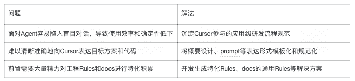
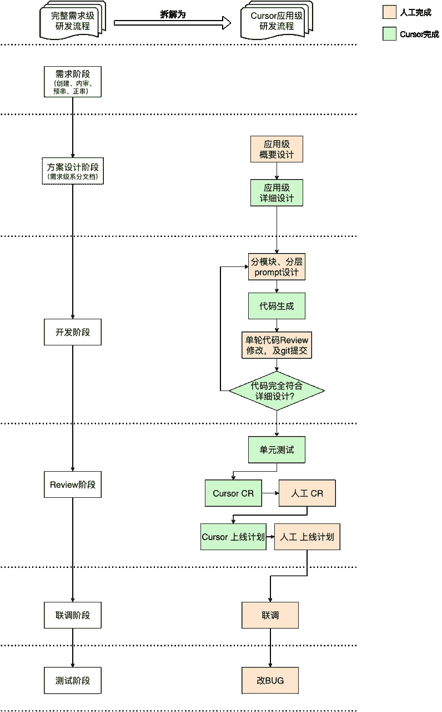
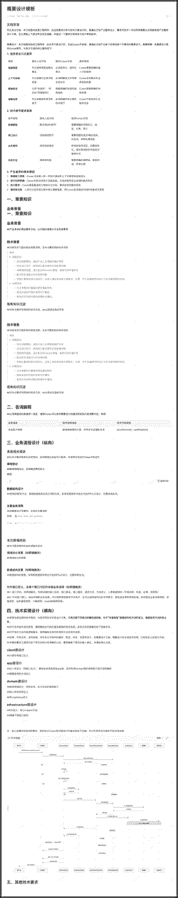
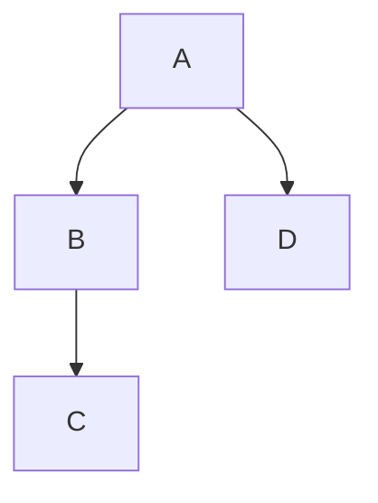

# AI 编程如何在团队中真正落地？

> 来源：[https://huchegames.feishu.cn/docx/ZYRldPmVjoSw5pxb0cicSlWunMB](https://huchegames.feishu.cn/docx/ZYRldPmVjoSw5pxb0cicSlWunMB)

> 🔗 原文链接： h[ttps://mp.weixin.q](https://mp.weixin.qq.com/s/uAsonGYWABQF7Hf4f76hrw)q.com/s/uAsonGYW...

> ⏰ 原创 屹翎 阿里云开发者2025年07月02日 08:31 浙江

> 如果你是技术负责人、团队推动者或希望在团队中引入 AI 编程工具的工程师，这篇文章将为你提供一条可借鉴、可落地、可优化的路径。


## 引言

上一篇《[如何让 AI 成为你的编程搭档？一次真实重构告诉你答案](https://huchegames.feishu.cn/wiki/BxEzweIjqiVRYHkNoDKc4E02nhg)》中提到，对于Cursor这样一个拥有跨时代AI代码能力，但是又需要从工程角度不断约束或拓展其易用性的工具，就更加考验使用者的经验和技巧。生产工具的升级必定引发生产流程的改进，以何种思路、方法、范式，去最大化Cursor带来的效率提升，并最小化其薄弱之处和引入的风险，是当前在团队中最需要思考的问题。

上篇以个人开发者的角度，介绍了在复杂重构类需求中全流程使用Cursor的过程，也明确了Cursor对于开发的效率提升是巨大的。作为高德信息业务中心大供给团队的Cursor落地接口人，如何能让Cursor参与的研发流程在团队中真正扎根，达到提效预期？本篇简要讲述了我们供给侧先锋队集体拆解问题和解决问题的路径。

## 问题拆解和解法概要

大而全的角度讲，团队推广中遇到的问题可以分为意愿问题和能力问题，所以一方面要提高大家使用Cursor的意愿，另一方面要提升大家驾驭Cursor的能力。意愿的角度，信息业务中心整体有较强的激励方式，大家也有足够的执行力。我们聚焦于能力提升方面，拆解了很多问题，以Top3举例：

+   不同类型的需求，不同的开发者，对于Cursor的使用方式都不同。尤其是方案设计阶段，容易陷入盲目Agent对话。如何沉淀出初学者开箱即用的使用流程。

+   在复杂的业务需求背景下，难以清晰地向Cursor阐述自己希望得到怎样的技术设计和代码。由于语言表达问题引起后期的不确定性被放大。

+   Cursor的使用前置步骤过于复杂，对于每个工程都要进行特化`Rules`和`docs`生成，才能提升Cursor的准确性。如何为大家降低初期复杂度，避免望而生畏。

针对上述问题，我们提出了团队内的解法。概要如下，后面逐个详细说明。



## 研发流程规范

### 总体流程

虽然Cursor的Agent模式非常便捷，但是如果只通过自然语言的对话堆叠，无法有序地组织整个需求开发过程的推进。面临不同类型需求的时候，对话轮次和生成代码结果的巨大不确定性，会将Cursor的效率提升对冲掉。实际上，在整个需求研发流程中，Cursor适合的使用场景和使用规范是有迹可循的，我们也亟需这样的规范化研发流程。

经过笔者在不同需求内的尝试，加上组内同学们几周的探索，提炼总结出下图研发流程。其中，左侧是传统需求级别的研发流程，是跨应用、跨岗位、跨团队的。但是我们知道，Cursor当前对跨应用的支持并不完善，更别说跨团队开发。所以右侧是经过拆解的单个应用级别研发流程，是加入Cursor提效后的最佳实践。说明，黄色代表需要人工完成的部分，绿色代表由Cursor完成的部分。下面对整个流程进行介绍。



### 需求阶段

团队内当前需求阶段分为几个步骤：需求创建、需求内审、需求预串、需求正串。

由于供给侧团队业务逻辑普遍比较复杂，技术全力保障业务发展。故在需求阶段不建议因为具体的技术实现，包括Cursor参与的因素，影响产品业务团队的需求设计。应用级研发流程中也不包含此阶段。

### 方案设计阶段

在信息工程团队的统一需求级研发流程中，方案设计阶段要求产出系分文档。而在我们拆解的应用级研发流程中，要求人工产出概要设计文档，并由Cursor转化为详细设计文档。讲清楚这三种文档的区别，也就讲清楚了整个方案设计阶段。

+   系分文档定义：在业务需求分析与技术方案设计时，需求的 技术一号位同学 需要从 全链路视角 产出 整体设计方案 ，定义清楚 上下游边界及交互链路 ，并通过一个整体文档 将各方设计串联 起 来。

+   概要设计定义：在技术方案设计时、交由Cursor开发前，此文档 由人类开发者撰写 ，产出 单个应用或单个子模块 的概要设计。 面向Cursor ，描述清楚应用内的技术实现方案，包括目标功能、目标改动点、关键链路、关键技术实现细节等。

+   详细设计定义：在概要设计产出后，Cursor实际生成代码前，此文档 由Cursor根据概要设计 生成 详细的技术实现方案。精确到具体的类、方法、数据结构等定义，由图或伪代码的形式清晰地表明 每一层的业务流程处理 。 经过人类开发者Review 通过后，达到Cursor可以直接由详细设计准确生成代码的程度。

从以上三个定义进一步解释：

+   系分文档是面向人类开发者的，是整体需求层面的。所以可以用抽象的描述，且不详细说明有共识的上下文的情况下，表达清楚整体技术链路即可。系分文档和概要设计、详细设计是不冲突的，即使有Cursor参与，也需要技术一号位同学来统筹全局。

+   概要设计文档是面向Cursor的，是单个应用层面的。不需要精细到伪代码的级别，但是要将关键的领域划分、数据结构设计、接口设计、业务逻辑等清晰表述出来。对于Cursor来说，概要设计可以理解为“半白盒”的方案。

+   详细设计文档是面向Cursor的，是单个应用层面的。所有Cursor生成代码所需的背景知识和方案细节，都需要在详细设计中体现，只是没有使用完整代码的形式。对于Cursor来说，详细设计可以理解为“完全白盒”的方案。

至此我们明确了方案设计阶段每个应用的研发流程，也知道了概要设计和详细设计的作用。但不同的需求如何撰写概要设计，放在下个问题讨论。

### 开发阶段

由组内同学的实践经验得出，在实际代码开发阶段，并不能一股脑地让Cursor根据详细设计生成所有代码。由于文档和代码量过大，Cursor无法处理这么多上下文，会造成生成的代码错乱。表现形式如，详细设计中不同接口的逻辑跳跃性地生成在同一个接口的方法代码中。

所以 整个代码编写环节应该拆分为多个步骤的循环。目标就是将任务颗粒度拆解到Cursor单次能完成得很好的程度。

#### 拆分标准

如何拆分需要根据需求的复杂度具体分析。如果需求本身较为简单，涉及的业务逻辑是比较浅显的增删改查，则颗粒度可以稍粗一些。对于复杂的需求，建议先按业务逻辑，再按技术分层进行拆分。

1. 首先按照业务逻辑拆分步骤，比如先写基本的数据库读写实现，再加数据校验，再加审核，再加状态机。这样更有利于方法的复用，也有利于Cursor注意力集中在一个具体功能点上。

2. 对于复杂的业务，需要分层架构去生成代码。推荐自底向上，从`DO`开始，到`domain`层的`model`、`converter`、`gateway`定义，再到具体`mapper`的SQL实现。然后`domainService`，`app`层，`client`层。当然，这只是常用的Java后端服务框架，其他技术栈同学可以生成自己的规范。

#### 单次循环内步骤

每次生成代码的循环，需要遵循以下步骤：

##### prompt设计

本模块的代码生成目标，需要使用清晰的`prompt`向Cursor交代清楚。可以手动@详细设计文档，并指出本模块在详细设计文档中涉及的位置。具体如何清晰地表达出自己的目标，在下个问题讨论。

##### 代码生成

使用`prompt`和Cursor交互后，Cursor会根据本轮提示词和详细设计、现有`Rules`，对代码进行生成。在生成过程中，可以关注使用到的`Rules`是否符合预期、轮次过多后及时手动确认继续执行等。

当然，这只是Agent模式下常用的使用方式，也可以使用`manual`模式手动修改一些文件等。

##### 单轮代码Review修改及git提交

Cursor生成代码后，要及时进行Review，并决定是否采纳。因为Cursor目前还没有区分对话轮次的采纳功能，所以需要每次生成后就立即Review，并结合`git`等工具，明确掌握Cursor代码的改动点。这也就 要求人类开发者对每个轮次生成的预期结果有清晰的认知 。

本环节至关重要 ，因为单轮次代码量小的时候，更容易发现Cursor代码的问题。如果都堆到最后统一Review，一定会导致准确性大打折扣，从而导致线上事故。

建议使用`Rules`，要求Cursor每个轮次生成代码之后，先自行Review，发现可能的语法及逻辑问题。人工Review也要细致跟进。

##### 判断是否达到整体预期

本环节既可以使用Cursor根据详细设计判断是否完成，也可以由人类开发者直接决定。依照效率准则进行。

### Review阶段

#### 单元测试

单测环节可以完全交给Cursor生成。但是要注意，要让Cursor首先根据人类Review过的详细设计生成单测CASE，再根据CASE生成单测代码。而不是直接根据Cursor写的业务代码生成单测代码，那就会出现“打哪指哪”的情况。

#### Code Review

1. 先由Cursor进行一轮CR，可以包含两个层面：

a. 语法语义层面，可以使用提炼后的Java开发规范等作为`Rules`，让Cursor对比`master`分支和当前分支的代码差异，进行CR。

b. 业务逻辑方面，可以让Cursor根据详细设计，对比当前代码实现，进行CR。

2. 人类开发者CR。不论Cursor如何智能，最终人类开发者才是线上安全的“第一责任人”。所以CR阶段一定要严格遵守规范，比如交叉CR等。

#### 上线计划

1. 可以先由Cursor进行一轮上线计划的整理。Cursor对比`master`分支和当前分支的代码差异，找出需要提起准备或配置的要点，罗列出来。以防人类开发者遗漏。

2. 由于上线是多个应用和系统配合的过程，Cursor当前在此方面帮助不大。所以最终的上线计划一定是人来确定的。

### 联调阶段

当前主要由人类参与实现，Cursor可以辅助定位问题。

### 测试阶段

当前主要由人类参与实现，Cursor可以辅助定位问题。

## 结构化语言表达

当Cursor使用进入深水区，不仅停留在最初的概念理解和简单交互阶段后，一个普遍性大问题浮出水面：要想提高Cursor生成代码的准确性，就要提高人类对Cursor指令的准确性。主旨要明确、逻辑要清楚、指令不能有歧义、上下文还需要交代到位。那么如何将人类脑子里纷繁复杂的意图，在本就天马行空的业务需求背景下，变成Cursor及背后的模型能听懂的自然语言？

遇到现实困难的时候，不妨回顾历史。现在我们已经可以和模型使用自然语言进行沟通，那计算机发展的初期，如何和硬件进行有效沟通呢？组成原理知识告诉我们，通过最底层的0-1电信号，上层不断地规范化封装，使用结构化的形式，直到我们现在使用的Java语言。可能在不久的将来，也会有成熟的自然语言规范去定义如何与模型交互。但现在为了快速在团队内铺开，需要做到最基本的点： 结构化、模板化。

在上述研发流程中，主要涉及到语言表达的有两个点：`prompt`和概要设计。

### prompt

对于`prompt`，最重要的是结构化。结构化的`prompt`会比纯自然语言更容易让模型进行意图理解。供给侧团队针对历史逻辑梳理、辅助绘图生成、根据概要设计生成详细设计、代码编写等各个环节，总结了多个结构化`prompt`的模板，不同研发阶段、不同业务场景、不同技术复杂度下，`prompt`详细程度可以不同，大家可以按需取用。

由于篇幅限制，这里给出一个示例：

```
# 目标
在创建元素、修改元素后，所有新增的元素信息都要通过统一的审核系统。其中包括两个步骤：提交审核和接收审核回流信息。我们现在要将审核系统接入现有装修元素相关的流程中。

# 业务规则
## 1. 提交审核规则
...

## 2. 审核回流规则
...

# 现有知识背景
1. 已经将审核系统的交互规则整理为《审核交互规则.md》放在.cursor/docs目录下。提交审核我们采用“2.1 HSF请求方式”进行。
2. 现有代码已经实现了创建元素、修改元素等流程。
3. 审核回流的处理框架流程可以参考别的工程的Consumer，《audit.java》放在.cursor/docs目录下。但是要对其进行重构精简。

# 核心要求
送审是所有模块通用的能力，请尽量可通用。对于不同模块区分的内容（主要是提审字段准备），采用策略模式进行，不同模块的子类重写父类方法。

# 核心任务
## 1. 仔细阅读上述知识背景文档，仔细阅读现有new-b-dolphin-*的代码实现。
## 2. 根据上述规则和现有new-b-dolphin-*的代码实现，将你对这部分的详细设计输出到文档。注意，至少要精确到类和方法的定义，所有图都使用mermaid格式。
## 3. 文档输出后，等待人类确认。确认该文档技术方案可行后，生成具体代码到对应文件。
```

当然，结构化只是一个好的`prompt`最基本的要求，还有很多可以提高的地方。

### 概要设计

在上述Cursor研发流程中，方案阶段决定了最终代码生成的准确性，方案阶段最重要的就是概要设计的撰写。概要设计如何清晰地表达，供给侧同学在经验总结后，给出了一套类似系分文档的模板：



上述模板的核心思路是，通过模板化的表达，严格约束对于目标的描述，从而帮助Cursor更加准确定位修改点和修改内容：

1.  将传统领域设计的统一语言新增一层“技术代码语言”，即实现 “业务语言 - 技术中文自然语言 - 技术代码语言” 的严格映射，增强目标准确性。

1.  从业务流程设计的角度，纵向规定业务代码走向。给出关键数据结构设计、具体接口文档、详细业务流程图或时序图等。

1.  从技术实现设计的角度，横向约束每个层次代码的输入和输出。结合纵向的业务流程，限定Cursor自主发挥的范围，符合目标预期。

1.  不论横向或纵向，都需要说明现状和目标修改点，便于Cursor定位。

## 应用级特化沉淀的通用解决方案

### 问题及解法

有了改进的研发流程、结构化的语言表达形式，Cursor对于业务的理解和支持准确度已经大幅提升。但是最终落在代码上，每一个应用都有独特的技术栈、技术框架及分包目录、代码风格、通用技术组件等。如果不给Cursor在应用级背景知识和上下文方面的输入，最终的代码结果会天马行空，如胡乱新建包路径、对已有的`Utils`方法全部重写、对现有的技术组件随意选用（eg: `Diamond` or `Switch`）等，后果是灾难性的。

所以每个应用，都要有一套自己特化的`Rules`和`Docs`，将所有可能影响到业务或技术的规范信息存储在内。但是人工构建这个体系的过程是冗长且痛苦的，不仅要手动梳理所有技术组件相关的内容，还要按照`Rules`的格式撰写并且试验。

### 解法的解法

为了解决这个问题，降低Cursor使用的初始难度，供给侧团队共同撰写出 一套针对Java应用通用的`Rules`或`prompt`，在该应用第一次使用Cursor时交由Cursor自主探索代码，并生成上述特化的`Rules`和`Docs` ，并且每一个都经过且正在持续验证迭代中。不同团队一定有自己的技术栈、技术要点、关键链路等，可以打造自己团队的通用方案。

主要思路：

1. 对于大部分代码规范类，使用`Rules`让Cursor按照一定的顺序对代码进行分段探索，在`Rules`中明确预期目标、输出形式、退出条件和正例反例。

2. 对于技术栈、上线计划等，可以穷举当前需要整理的内容备选项，让Cursor根据应用代码或对比`master`分支代码，进行逐个排查填充，从而形成符合当前应用的目标`Rules`。

## 通用Rules或prompt展示

由于篇幅限制，无法将上述`prompt`和`Rules`都在本文展示。故列出所有提纲和少数详情如下：

### 提纲

1. 各个粒度的文档生成与更新`prompt`、`Rules`

+   项目整体介绍文档（业务、技术）

+   单个接口业务逻辑整理

+   单点辅助画图

+   接口文档生成

+   文档实时更新规范

2. 引用的外部技术栈`Rules`：自主探索本项目中所有技术栈及版本

+   基础：JDK版本、springboot版本

+   数据库：MySQL（TDDL）、Lindorm

+   ORM、分页等：Mybatis、mybatis-plus、baomidou

+   缓存：Redis、Tair、本地缓存

+   通信服务（区分上下游）：HSF、HTTP（通用调用配置）

+   配置中心：`Diamond`、`Switch`

+   日志：Slf4j、日志格式

+   工具库：JSON用哪个（fastJSON、Gson）、lombok

+   其他不同项目可能用到的技术栈，如security、规则引擎...

3. 应用中已有的自定义代码框架 及 独特的代码风格规定和使用方式

+   统一异常处理：自定义业务异常类、`errorCode`、抛出和捕获方式等

+   统一日志打印注解，日志级别使用规范

+   统一分布式锁使用方式

+   统一`HSFConfig`配置

+   统一缓存读写使用方式

+   统一监控规范

+   现有自定义`util`类的功能总结，方便Cursor后续复用

4. 自主探索代码分包目录结构规范：代码结构应该怎么写，代码文件放到什么目录

+   现有流行代码框架的罗列及匹配：`cola`？`GBF`？

+   交由Cursor前，所有包名都手动新建完成

+   探索当前工程的所有包路径，及代码放置规则

5. CR、单测、上线计划整理规范

+   CR：代码语法规则与风格习惯、是否符合详细设计

+   单测：单测用例与代码生成

+   上线计划整理：穷举可能的上线准备，Cursor自动在变更代码中选取

### 详情举例

1. 代码分包目录结构规范，作者 @珵玉

代码分包目录结构规范


---

description: 
globs: 
alwaysApply: false
---

# 代码探索规则

## 前置信息收集

(1) 首先查阅探索结果文件 `.cursor/rules/project-structure.mdc`，优先阅读文件内容获取当前项目的整体路径结构，后续的分析基于该文件内容进行改写优化  
(2) 其次查询git提交忽略文件`.gitignore`，文件内部标注非代码路径，在后续探索中忽略这些路径的以及文件的探索  
(3) 结合前置收集到的信息，确定探索文件的范围，注意：不要遗漏路径，也不要省略路径的探索  

## 确定探索顺序

> 探索时需要参考前置信息收集的结果，对于忽略的路径、文件则无需探索。  
> `<example></example>` 为示例，根据实际情况进行分析  

### 1. 探索前先要分析项目中的模块依赖关系：

- 对于Java项目，可以先阅读项目的主POM配置 `pom.xml`，然后逐个去探索子POM配置  

#### (1) 先探索主POM文件内容，确认总共有哪些模块：

```xml
<modules>
    <module>A</module>
    <module>B</module>
    <module>C</module>
    <module>D</module>
</modules>
```

#### (2) 再逐个阅读分析模块的子POM文件，确认模块之间真实的依赖关系

```xml
<dependencies>
    <dependency>
      <groupId>xxxxx</groupId>
      <artifactId>A</artifactId>
    </dependency>
</dependencies>
```

#### (3) 整理出模块之间真实的依赖关系，一般是有向无环图（DAG），依赖模块的版本号不一致可以忽略。当整理完后需要再阅读各子 `pom`，确认依赖的正确和无遗漏



### 2. 按模块依赖顺序，自底向上探索；探索过程中按照广度优先遍历文件路径

```
ModuleA/
└── src/
    ├── api/
    │   ├── service_A/                  
    │   └── service_B/                  
    ├── enum/                   
    └── dto/    
```

`src/` 路径下，先遍历 `api/`、`enum/`、`dto/`，再遍历 `src/api/service_A/`、`src/api/service_B/`  

## 确定路径用途

### 1. 通过阅读路径下的若干文件来确认该目录是文件存放规则，路径功能包括但不限于

- 存放常量、枚举：路径下存放的代码主要是常量/枚举信息，文件命名一般以 `Constant.java`、`Enum.java` 等结尾  
- 存放服务接口：路径下存放定义的接口，文件一般都是 `Interface`  
- 存放服务实现：路径下存放接口的逻辑实现，文件命名一般以 `InterfaceImpl.java`、`ServiceImpl.java` 等结尾  
- 存放工具类：路径下存放项目中使用的工具，文件命名一般以 `Utils.java`、`Util.java` 等结尾  
- 存放配置、开关：路径下存放项目中使用的配置开关，路径一般为 `switches/`、`config/`、`diamond/` 等  
- 存放核心领域模型：一般在领域 `module` 下，`module` 命名一般包含 `core`、`domain` 等关键字；路径下存放核心业务模型，路径一般为 `domain/`、`model/`、`core/` 等  
- 存放核心领域服务：一般在领域 `module` 下，`module` 命名一般包含 `core`、`domain` 等关键字；路径下存放核心业务服务  
- 存放数据库仓储服务：路径一般包含 `mysql`、`repository`、`db` 等关键字；路径下的代码文件一般都是连接数据服务或数据库的交互逻辑  

### 2. 设计模式相关结构识别指引

在探索目录和文件时，需特别关注以下常见设计模式相关命名，若路径或文件名中包含这些关键词，应优先判断其是否为该模式的实现，并在结构输出和规范中予以标注：

- `handler`/`Handler`：处理链、事件分发、命令等（如 `handler`、`eventhandler`、`xxxHandler.java`）  
- `strategy`/`Strategy`：策略模式实现（如 `strategy`、`xxxStrategy.java`）  
- `wrapper`/`Wrapper`：装饰器/包装器模式（如 `wrapper`、`xxxWrapper.java`）  
- `factory`/`Factory`：工厂模式（如 `factory`、`xxxFactory.java`）  
- `adapter`/`Adapter`：适配器模式（如 `adapter`、`xxxAdapter.java`）  
- `proxy`/`Proxy`：代理模式（如 `proxy`、`xxxProxy.java`）  
- `builder`/`Builder`：建造者模式（如 `builder`、`xxxBuilder.java`）  
- `observer`/`Observer`：观察者模式（如 `observer`、`xxxObserver.java`）  
- `command`/`Command`：命令模式（如 `command`、`xxxCommand.java`）  
- `visitor`/`Visitor`：访问者模式（如 `visitor`、`xxxVisitor.java`）  
- `state`/`State`：状态模式（如 `state`、`xxxState.java`）  
- `template`/`Template`：模板方法模式（如 `template`、`xxxTemplate.java`）  

### 3. 结合模块下的文件信息，确认该模块的定义，包括但不限于

- 项目启动模块：一般模块命名包含关键字 `start`、`starter` 等  
- 对外接口模块：一般模块命名包含关键字 `client`、`gateway` 等，系统对外提供的RPC/HTTP/网关服务  
- 外部接口对接模块：一般模块命名包含关键字 `integration` 等，包含对接二三方服务  
- 基础设施模块：包含数据仓储、项目基础框架、工具类等  
- 领域模块：一般模块命名包含关键字 `core`、`domain` 等，包含系统稳定的核心领域模型和服务  
- 业务模块：一般模块命名包含关键字 `bussiness`、`application`、`biz`、`app` 等，包含业务逻辑，对外接口的实现逻辑  

### 4. 常见系统框架结构识别指引

在探索目录和文件时，需特别关注以下主流企业级架构的典型分层和命名：

#### 阿里COLA框架

- 典型分层：`client`（接口层）、`app`（应用层）、`domain`（领域层）、`infrastructure`（基础设施层）、`integration`（外部集成层）、`web`（表现层）  
- 目录命名示例：`client/dto/`、`app/service/`、`domain/model/`、`infrastructure/repository/`、`integration/`、`web/controller/`  
- 用途说明：各层职责分明，`DTO`、`Command`、`Query`、`DO`、`Repository`、`Service` 等应放在对应分层包下  

#### 高德GBF框架

- 典型分层：`platform`（Process流程层）、`node`（NodeService节点层）、`domain`（DomainService领域层）、`ability`（扩展点接口层）、`app`（行业/场景定制层）  
- 目录命名示例：`platform/`、`node/`、`domain/`、`ability/`、`app/food/`、`app/retail/`  
- 用途说明：`Process`、`NodeService`、`DomainService`、`Ability`、`Action` 等应放在对应分层包下  

如发现项目采用上述主流框架，应优先按其分层和命名规范输出结构和放置建议。

## 探索结果输出

1. 内容输出到文件中 `.cursor/rules/project-structure.mdc`，如果该文件存在则进行内容更新  
2. 只需要输出目录路径，不要输出具体代码文件；路径下没有文件可以进行合并，有文件的路径不能擅自合并。  

```
A/
└── src/
    └── main/
        └── java/
            └── B/
                ├── aaa.java
                ├── domainservice/
                │   └── bbb.xml
                └── domainmodel/
```

1. `A/src/main/java/B/` 可以合并输出  
2. 但是 `domainservice/`、`domainmodel/` 不能合并  
3. `aaa.java`、`bbb.xml` 是具体文件，不需要输出  

所以最终正确输出如下  

```
A/src/main/java/B/
    ├── domainservice/
    └── domainmodel/
```

3. 在洞察过程中发现的规范，输出到代码文件放置规范中。重要规则：不要自己乱写代码文件放置规范，所有规范都需要有依据  

### 4. 设计模式相关结构输出要求

- 输出结构时，若发现有上述设计模式相关的包或类，应在输出中加注释说明其用途（如 "# 策略模式实现"）。  
- 在规范部分，补充 "常见设计模式类的放置建议"，并举例说明。  

### 输出格式如下

> `<example></example>` 为示例，根据实际分析结果进行填写；填写时不需要用 `<example></example>` 包装  

``````mdc
---

description: `此规则包含了本项目的代码路径结构和规范，所有代码编写时必须按照该模块化结构进行放置`

globs: `*.java`,`*.xml`

alwaysApply: true

---

# 项目模块及依赖关系  


# 项目目录及使用规范

```
systemA/
├── systemA-start/         # 项目的启动模块
├── systemA-client/        # 系统对外暴露的RPC接口门面模块
│   └── src/main/java/systemA/client
│       ├── api/                   # 对外接口
│       └── dto/                   # 对外模型,请求,响应等
├── systemA-domain/        # 领域基础模块,作为项目的最基础的模块;所有二三方服务依赖在此引入
│   └── src/main/java/systemA/domain
│      ├── domainservice/     # 基础服务框架
│      ├── constant/          # 常量
│      ├── enum/              # 枚举
│      ├── exception/         # 异常
│      ├── gateway/           # 二三方服务的接入的防腐层;所有外部服务需要在此建立防腐层interface
│      ├── switch/            # 领域基础层的开关配置
│      ├── util/              # 系统基础工具
│      ├── model/             # 领域模型
│      ├── strategy/          # 策略模式实现 # 设计模式示例
│      ├── handler/           # 处理链/事件分发/命令模式实现 # 设计模式示例
│      ├── wrapper/           # 装饰器/包装器模式实现 # 设计模式示例
│      └── observer/          # 观察者模式实现 # 设计模式示例
└── systemA-application/   # 最上层业务应用层;
    └── src/main/java/systemA/application
       ├── client/         # 对应服务RPC服务实现
       ├── controller/     # 对外暴露的http服务
       ├── gateway/        # 注册在网关上的网关服务接口
       │  ├── request/         # 网关接口请求定义
       │  ├── response/         # 网关接口响应定义
       │  └── impl/            # 网关接口的实现
       ├── converter/           # 模型转换器,主要将领域或者db模型转换成对外DTO、VO模型
       ├── service/            # 业务服务接口
       │   ├── factory/        # 工厂模式实现 # 设计模式示例
       │   ├── adapter/        # 适配器模式实现 # 设计模式示例
       │   └── proxy/          # 代理模式实现 # 设计模式示例
       └── service/impl/       # 业务服务实现
```

# 代码文件放置规范

```
1、数据对象(DO)规范：数据对象(DO)必须放在XXX模块下的dataobject包中  
2、传输数据对象(DTO)规范：传输数据对象(DTO)必须放在XXX模块下的xxx包中  
3、视图数据对象(VO)规范：视图数据对象(VO)必须放在XXX模块下的xxx包中  
4、工具类(Util)规范：工具类必须放在XXX模块下的xxxx包中  
5、单测类(Test)规范：单测类型必须放在Test模块下的xxx包中  
6、策略模式(Strategy)规范：策略相关类应统一放在strategy包下，命名以Strategy结尾，如XxxStrategy.java  
7、处理链/命令模式(Handler/Command)规范：相关类应统一放在handler或command包下，命名以Handler或Command结尾  
8、装饰器/包装器模式(Wrapper)规范：相关类应统一放在wrapper包下，命名以Wrapper结尾  
9、工厂模式(Factory)规范：相关类应统一放在factory包下，命名以Factory结尾  
10、适配器模式(Adapter)规范：相关类应统一放在adapter包下，命名以Adapter结尾  
11、代理模式(Proxy)规范：相关类应统一放在proxy包下，命名以Proxy结尾  
12、建造者模式(Builder)规范：相关类应统一放在builder包下，命名以Builder结尾  
13、观察者模式(Observer)规范：相关类应统一放在observer包下，命名以Observer结尾  
14、访问者模式(Visitor)规范：相关类应统一放在visitor包下，命名以Visitor结尾  
15、状态模式(State)规范：相关类应统一放在state包下，命名以State结尾  
16、模板方法模式(Template)规范：相关类应统一放在template包下，命名以Template结尾  
....
```
``````

---

2. 单应用发布计划整理，作者 @有渐  

`release-plan-template-agent.mdc`  

---

description: 此规则用于生成标准化的需求上线计划文档。当需要创建新的上线计划、准备发布新功能或更新现有系统时应用此规则。规则确保上线计划包含完整的发布定义、发布计划、灰度策略、配置管理、监控方案及回滚预案等关键信息，有助于团队高效协作并降低上线风险。适用于各类需求的发布与上线准备工作。

globs:  

alwaysApply: false  

---

# 需求上线计划模板规则

## 关键规则

- 所有需求上线计划必须包含完整的发布定义、发布计划、预发布、灰度发布和正式发布五个主要部分  
- 发布定义必须明确需求责任人、发布执行人、需求分级和风险等级  
- 需求分级必须明确区分：A级（测试测）、B级、C级、D级（自测）  
- 发布计划必须详细说明上下游发布节奏，包括模块依赖关系和发布顺序  
- 发布计划必须以工程为单位进行规划（如 `amap-mp-shop` 整体工程），而非以子模块为单位（如 `shop-app`、`shop-infrastructure` 等）  
- 灰度发布部分必须说明灰度策略、灰度验证点和对线上功能的影响评估  
- 正式发布部分必须包含配置项清单、影响面分析、监控方案和回滚预案（三板斧）  


- 所有依赖的配置项（如`Diamond`配置、消息队列、网关等）必须详细列出并指定负责人

- 回滚预案必须针对不同阶段可能出现的问题制定详细的操作步骤

- 模板中必须包含版本管理信息，记录文档的变更历史

## 上线计划文档结构

上线计划文档必须按照以下结构组织：

```
# 需求名称上线计划
当前版本号：vX.X
# 一、发布定义
（需求负责人、发布执行人、需求分级、风险等级）
# 二、发布计划
（上下游发布节奏、内部工程发布顺序）
# 三、预发布
（预发状态、验证结果）
# 四、灰度发布
（灰度策略、灰度验证点）
# 五、正式发布
（发布节奏、配置项、影响面分析、监控方案、回滚预案）
# 六、上线流程
（具体上线步骤）
# 七、评审回看
（上线评审记录）
# 版本管理
（文档版本历史）
```

## 各章节详细规范

### 一、发布定义

#### 需求一号位
主要负责人，对整个需求负责

#### 发布执行人
负责执行发布的人员列表

#### 需求分级
标明需求的重要程度

- **A级**：完全测试测，需要最高级别的测试覆盖

- **B级**：部分测试测，部分自测

- **C级**：大部分自测，小部分测试测

- **D级**：自测，由开发人员自行测试

#### 风险等级
标明发布风险（高/中/低）

### 二、发布计划

#### 上下游发布节奏
必须使用表格形式列出所有相关系统/工程的发布时间、跟进人和发布内容

#### 模块间依赖
使用图表明确标示各工程间的依赖关系，区分强依赖和弱依赖

#### 工程发布顺序
必须以整体工程为单位（如`amap-mp-shop`、`amap-mp-shop-service`），而非以子模块为单位（`shop-app`、`shop-infrastructure`等）

### 三、预发布

- 明确标明预发状态（已预发/未预发）

- 如已预发，需说明预发验证结果

### 四、灰度发布

- 明确灰度发布时间

- 使用表格形式列出各工程的灰度情况，包括：

  - 是否有灰度环境

  - 当前进度

  - 发布后对线上功能的影响

  - 灰度上线后核心验证点

### 五、正式发布

#### 发布节奏
明确正式发布的批次和时间安排

#### 配置项
详细列出所有需要配置的项目，包括：

- 合并`origin/master`
- `Diamond`配置
- `Switch`配置
- 数据库建表及配置
- 消息队列（生产者/消费者）
- 网关`ACTION`配置：如果有新增`hsf`接口，则将其列到发布计划中，由开发人员决策是否需要发布网关`ACTION`
- `autoconfig`：如果代码有改动`antx.properties`文件
- `SchedulerX`
- 二方包：如果`pom.xml`文件有改动，则需要列举改动点，让用户确认是否需要更新二方包版本或发布二方包
- `Sentinel`：如果调整了`Sentinel`相关逻辑，则需要列举`Sentinel`配置项
- `Jingwei`
- `Tair/Redis`
- 其他中间件配置

#### 影响面梳理与验证方案
分析发布影响面，制定验证方案

#### 三板斧

##### 可灰度
明确说明是否需要灰度及灰度策略

##### 可监控
列出关键监控指标

##### 可回滚
详细说明判定需要回滚的依据及回滚操作步骤

### 六、上线流程

- 列出上线的具体流程或引用相关流程文档

### 七、评审回看

- 存放上线评审记录或会议视频链接

### 版本管理

- 使用表格记录文档的版本历史，包括版本号、修订类型、修订时间、修订人、修订内容和生效时间

## 配置项详细规范

### `Diamond`配置

使用表格列出所有`Diamond`配置，包括：

- `groupId`
- `dataId`
- 配置项确认人
- 配置值

注意：如果`dataId`相同，则合并表格单元格

### 消息队列配置

分别列出生产者和消费者配置：

- `Topic`
- `Group`（消费者）
- `Tag`
- 功能说明

### 网关配置

列出所有需要配置的网关`action`，包括：

- `action`名称
- 配置地址
- 功能说明

### autoconfig

如果代码有改动`antx.properties`文件，则需要配置`autoconfig`，包括

- 配置`key`
- 配置`value`

## 回滚预案规范

回滚预案必须包含：

- 判定需要回滚的明确依据

- 针对不同阶段（如代码上线阶段、业务灰度阶段）的回滚操作步骤

- 回滚后的验证方法和后续操作

## 示例

&lt;example&gt;

# 用户身份认证系统升级上线计划

当前版本号：v2.0

# 一、发布定义

### 需求一号位

张三

### 发布执行人

张三、李四、王五

### 需求分级

A级（测试测）

### 风险等级

中

# 二、发布计划

### 1、上下游发布节奏

模块间依赖:

实线箭头: 强依赖，必须按照顺序发布

虚线箭头: 逻辑上有依赖关系，但可并行发布

|   |  **发布时间**  |  **跟进人**  |  **发布内容**  |

| --- | --- | --- | --- |

|  认证服务工程  |  10.15（已完成）  |  张三  |  1、支持新的认证方式 2、优化认证流程  |

|  用户中心工程  |  10.16  |  李四  |  1、适配新的认证接口 2、增加用户安全等级  |

|  前端系统工程  |  10.17  |  王五  |  1、更新认证页面 2、增加安全等级展示  |

# 三、预发布

*   [x] 已预发，验证通过所有测试用例

# 四、灰度发布

*   [x] 10.18发布灰度

|   |  **是否有灰度环境**  |  **当前进度**  |  **发布后对线上功能的影响**  |  **灰度上线后核心验证点**  |

| --- | --- | --- | --- | --- |

|  认证服务工程  |  有  |  已灰度  |  开关控制，对线上无影响  |  1、新旧认证方式切换正常 2、性能指标达标  |

|  用户中心工程  |  有  |  已灰度  |  开关控制，对线上无影响  |  1、用户安全等级计算正确 2、与认证服务交互正常  |

|  前端系统工程  |  有  |  未灰度  |  新界面默认关闭，对线上无影响  |  1、新旧界面切换正常 2、功能操作流畅  |

# 五、正式发布

## 发布节奏

分两批发布：

1. 第一批：10.20 认证服务工程 + 用户中心工程

2. 第二批：10.21 前端系统工程

## 配置项

|   |  **是否已完成**  |  **负责人**  |  **deadLine**  |  **认证服务工程**  |  **用户中心工程**  |  **前端系统工程**  |

| --- | --- | --- | --- | --- | --- | --- |

|  合并master  |  *   [ ]        |  张三  |  10.19  |  是  |  是  |  否  |

|  diamond配置  |  *   [ ]        |  李四  |  10.19  |  是  |  是  |  是  |

|  数据库脚本  |  *   [ ]        |  王五  |  10.19  |  是  |  是  |  否  |

### `Diamond`配置

|  **`groupId`**  |  **`dataId`**  |  **配置项确认人**  |  **配置值**  |

| --- | --- | --- | --- |

|  `auth-service`  |  `auth.switch.config`  |  张三  |  { &quot;`newAuthEnabled`&quot;: false, &quot;`authTimeoutMs`&quot;: 3000 }  |

|  `user-center`  |  `security.level.config`  |  李四  |  { &quot;`securityCheckEnabled`&quot;: false, &quot;`defaultLevel`&quot;: 1 }  |

### 三板斧-可灰度

认证功能通过配置中心开关控制，可实现新旧功能的平滑切换：

* 配置开关关闭时，使用旧的认证流程

* 配置开关开启时，使用新的认证流程

* 可按用户分组灰度，先覆盖内部用户，再扩大到外部用户

### 三板斧-可监控

监控项：

* 认证请求量

* 认证成功率

* 认证响应时间

* 异常登录告警

* 用户安全等级变更统计

### 三板斧-可回滚

**判定需要回滚的依据:**

1. 认证成功率下降超过3%

2. 认证响应时间超过500ms

3. 出现批量用户无法登录问题

|  **阶段**  |  **回滚操作和后续操作步骤**  |

| --- | --- |

|  代码上线阶段  |  1、同步问题 2、单独回滚故障服务 3、确认回滚后影响消除  |

|  业务灰度阶段  |  1、将配置开关关闭，切回旧认证方式 2、排查问题 3、修复后重新灰度  |

# 六、上线流程

参考标准上线流程：[链接]

# 七、评审回看

[会议录制链接]

# 版本管理

|  **版本号**  |  **修订类型**  |  **修订时间**  |  **修订人**  |  **修订内容**  |  **生效时间**  |

| --- | --- | --- | --- | --- | --- |

|  V1.0  |  新增  |  2023-10-10  |  张三  |  首次发布  |  2023-10-10  |

|  V2.0  |  更新  |  2023-10-15  |  李四  |  增加前端系统发布计划  |  2023-10-15  |

&lt;/example&gt;

&lt;exampletype=&quot;invalid&quot;&gt;

# 系统升级上线计划

# 一、发布定义

需求分级：中级  // 错误：未使用标准分级（A/B/C/D）

负责人：张三

时间：下周发布

# 二、发布计划

依赖关系：service模块 -&gt; dao模块 -&gt; controller模块  // 错误：以子模块而非工程为单位进行规划

发布顺序：

1. 发布dao子模块  // 错误：应以整体工程为单位，而非子模块

2. 发布service子模块

3. 发布controller子模块

# 三、灰度说明

先上线后端，再上线前端  // 错误：未提供足够的灰度策略和验证点详情

# 回滚  // 错误：未按标准结构组织文档

如有问题就回滚  // 错误：没有具体的回滚依据和步骤

# 其他说明

文档撰写于2023年10月  // 错误：未使用标准的版本管理格式

&lt;/example&gt;

## 结语

如果说只要求大家使用Cursor是爬高楼，那通用的研发流程规范就像搭建好每一层之间的楼梯，而应用级特化沉淀的通用解决方案就像为初学者修筑了直通的电梯。这也就是供给侧先锋队的价值所在。

Cursor在团队中的落地还在持续进行中，期待不断解决问题，让每个同学和整个信息业务团队都在Cursor为代表的AI浪潮中获益。

后续还将抽时间进行相关的原理探究，有意思的点会及时分享出来，希望大家加强交流互动。

---

<https://huchegames.feishu.cn/sync/Hzv6dRSGJsmHgOb4eSHcN1BHntg>
