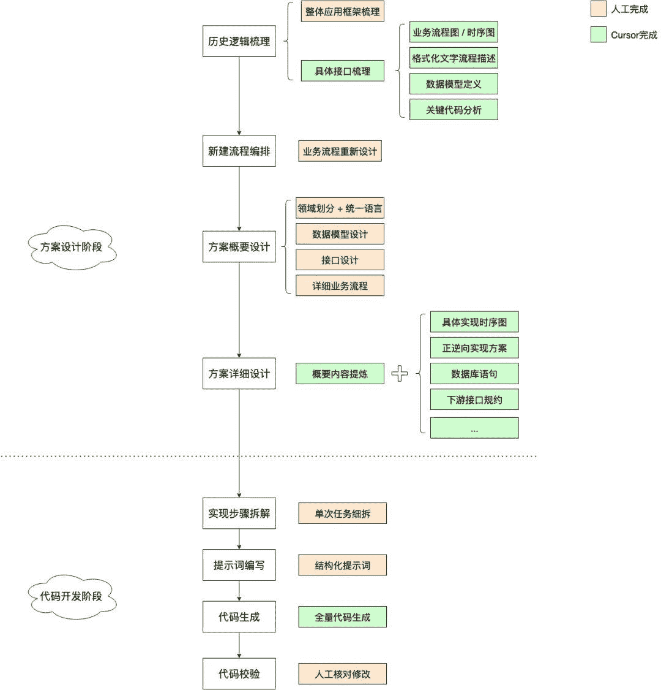
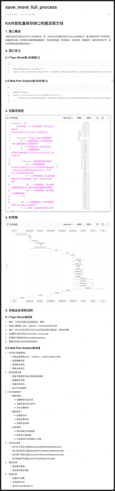
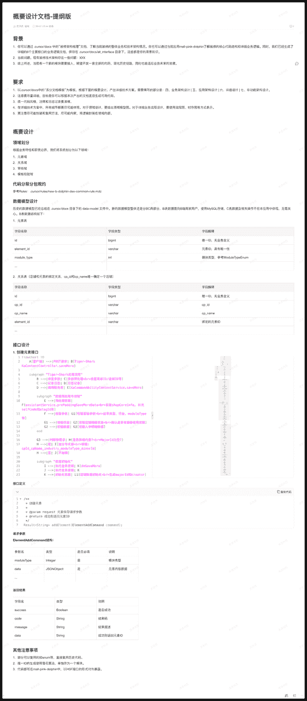
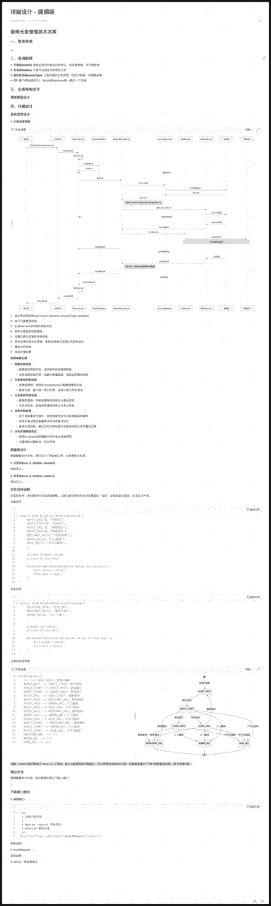
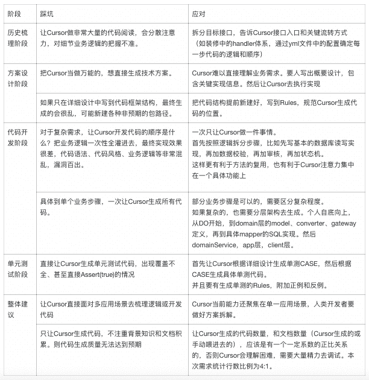

# 如何让 AI 成为你的编程搭档？一次真实重构告诉你答案

> 来源：[https://huchegames.feishu.cn/docx/DA05dSQoVojSpYxiXAbcpNBFnFb](https://huchegames.feishu.cn/docx/DA05dSQoVojSpYxiXAbcpNBFnFb)

> 🔗 原文链接： h[ttps://mp.weixin.q](https://mp.weixin.qq.com/s/ANbi9KOjbTdvdTCLC-ENIA)q.com/s/ANbi9KOj...

> ⏰ 原创 屹翎 阿里云开发者2025年07月01日 08:31  浙江


# 引言综述

效率提升一直是开发者的不懈追求。大语言模型被世人熟知以来，AI编程逐步进入人们的视野。从代码垂域模型到与IDE的工程应用结合，从GitHub Copilot到Cursor，AI对研发流程的渗透在不断深入，对于开发者也从浅尝辄止的新奇物变为了不可或缺的助手。Cursor就是在本次大模型浪潮中立于潮头的“AI原生化”编程工具。

## Cursor简介

Cursor 是一款面向开发者的智能代码编辑器。它基于强大的 VS Code，更深度集成了AI模型。开发者可以直接用自然语言让它帮你编写新代码、解释复杂逻辑、重构现有代码、查找 Bug。它理解项目上下文，像一个在 IDE 里随时待命的超级编程助手，旨在大幅提升开发效率和探索速度。

## Cursor的能力与局限

Cursor提供三种内置模式：Agent、Ask 和 Manual。Agent模式是默认模式，可以自主学习和探索代码库，能够进行跨文件的大范围修改和重构。Ask模式专注于代码理解和问题解答，不会对代码进行修改。Manual 模式是 Cursor 的精准编辑工具，只依赖用户提供的具体指令和上下文，不会自动探索代码库或运行命令。同时，Cursor已经支持自定义模式，允许我们为特定的工作流程创建更适合自己的模式。

上述这些模式反映了它与传统Copilot等代码提示工具的核心超越之处，如：

+   产品形态更原生。独立的代码编辑器而非插件，编辑区即对话界面。通过自然语言可以实现几乎所有需要的能力，如命令执行、编译运行等。

+   开发能力更强大。可以主动学习代码库，直接生成跨文件的完整逻辑，并拥有主动重构能力。从而实现“模块级”任务开发，而非仅有行级或单文件级。

+   参与周期更深度。不止在于代码开发阶段，更深入到前期方案设计、后期测试CR等阶段，都可以使用Cursor一站式解决或辅助解决。

但是，Cursor并不是“银弹”。它也有很多并不“得心应手”的地方，如：

+   Cursor依赖于底层模型的能力，大模型本身当前无法解决的问题在它身上都会体现。比如不论是学习代码和文档的读需求，还是单次产出代码的写能力，都是有限的。如果超出“记忆能力”限制，会引发极大的不稳定。

+   当前Cursor对于跨应用的支持并不好，无法解决跨应用更勿论跨团队分工的复杂需求。

+   Cursor在各个研发环节的支持能力不尽相同，且需要很多工程方面的限制来达到开发者的预期目标，杜绝天马行空。

## 系列内容概述

综上所述，一个“能力超强”但是“有棱有角”的工具，就更加考验使用者的经验和技巧。生产工具的升级必定引发生产流程的改进，以何种思路、方法、范式，去最大化Cursor带来的效率提升，并最小化其薄弱之处和引入风险，是当前在团队中最需要思考的问题。

本系列将从一个普通开发者的视角及一个团队推动者的视角，浅谈如何将Cursor真正落地于业务需求开发。

+   本篇作为第一篇是笔者个人在复杂重构类需求中全流程使用Cursor的过程，总结单点经验教训。

+   第二篇是在团队中推进Cursor覆盖提效的范式生成与落地经验。

+   后续可能涉及Cursor及Agent本身的原理性探究，帮助大家更好地使用。

对于结合业务功能要求的重构类需求，由于历史逻辑错综复杂、新功能迭代周期要求快速，一般很难高质量完成。本篇是笔者在明确业务需求后，结合当前团队的技术重构目标，并结合Cursor的长项评估，决定以此需求作为第一个全程使用Cursor的试验。最终效果非常好，在此分享使用路径及“踩坑填坑”经验。

# 需求背景

## 业务背景

1.  整体业务背景：高德商家平台经营成长业务，包含店铺装修相关功能。B端商家生产内容，如官方相册、品牌故事、特色推荐等模块，作为店铺装修的一部分，提供给C端用户消费。

1.  本期需求背景：需要新增一个“找路指引”模块，商家在B端上传图文视频等模态的内容，指导C端用户如何从附近地标到达店铺，“打通最后100米”。

## 技术背景

### **历史技术问题：**

a.数据模型设计过于复杂，且由于命名不规范等导致理解成本过高。

b.由于数据模型复杂，接口的出入参特别复杂，且存在多级嵌套情况，造成理解维护困难。

c.内部调用链路过于复杂，存在很多handler分支逻辑，难以梳理调用链路。且应用内历史模块和业务逻辑半数以上不再使用。

### **整体技术架构：**

a.由于本文主要为了说明Cursor使用，具体店铺装修域的技术架构并非本文重点，不在此详细介绍。读者可以简单理解为将装修内容划分为“内容元素”和“元素与店铺的绑定关系”两个领域实体，围绕这两个领域展开内容相关的增删改、审核、下游交互等一系列链路。

### **本期技术目标：**

a.由于新增业务模块，故本次同时对历史技术链路进行重构，后续逐步将历史业务模块迁移。

b.重构目标包括：

i. 简化数据模型，降低理解和维护成本；

ii. 优化接口设计，降低接口复杂度并解决多级嵌套问题；

iii. 清晰调用链路，减少复杂的handler逻辑，提高代码可维护性；

# 实现过程

下面按照实际做需求的顺序分享本次实现过程。篇幅限制，将挑选重点链路，体现与Cursor交互过程。本次实践主要体现在方案设计阶段和代码开发阶段，整体流程摘要如下：



## 历史逻辑梳理

由于是重构类需求，首先要将历史业务逻辑全部梳理清楚，剔除废弃的业务逻辑，重新规划组织。沉淀领域能力，并实现清晰的业务编排。

### 整体应用框架梳理

目标是让Cursor辅助梳理整体应用概况，实现对应用的全局性掌握。但是本应用由于之前做过人工的梳理，故本步骤跳过。如果需要，也可以使用Rules对Cursor进行要求和指导。

### 具体接口流程梳理

重构涉及到的接口都要进行全流程业务逻辑Review，本文挑选较为复杂的“保存元素并绑定关系”接口，进行历史逻辑梳理展示。

由于是跨应用接口，接口入口及部分业务编排在A应用，底层业务能力在B应用。我尝试过将两个应用放在同一个Cursor工作空间中同时操作，最终Cursor会详细给出A应用的业务流程，其中对B应用的调用仅用“B应用的处理流程”一句话带过。即使后续与Cursor对话调整也无法做到预期的颗粒度。故 对于多个应用需要分别梳理，然后让Cursor进行拼接 。

为了使Cursor的梳理颗粒度、关注点及输出方式等能够达到预期，我们使用Rules规范接口梳理过程：

### 历史接口逻辑梳理Rules

```
---
description: 此规则为分析软件接口提供全面指南，确保充分理解和文档化复杂接口的业务逻辑和技术实现。当开发人员需要理解现有接口、重构接口实现或创建技术文档时应用此规则。它帮助分析人员系统性地探索源代码，从入口到数据库操作全面跟踪调用链，并产出足够详细的流程描述以支持直接开发和重构。该规则适用于微服务、分布式系统和复杂业务场景，特别适合需要深入理解接口工作原理而无需反复查阅源码的情况。
globs: 
alwaysApply: false
---
# 接口逻辑分析与文档生成规则
## 关键规则
- 分析接口时必须先通过源码搜索工具明确定位入口点，从Controller或HSF入口处入手
- 必须完整追踪调用链路，跟踪从入口到持久层及外部系统调用的完整路径
- 必须识别并解释所有条件分支和判断逻辑，包括每个分支的触发条件
- 必须详细分析接口中的数据校验规则、转换逻辑和持久化操作
- 必须识别并解释并发控制机制，如分布式锁、事务等的使用场景和作用范围
- 必须分析所有业务规则实现，包括权益/权限检查和特殊业务场景处理
- 必须分析配置驱动的处理逻辑和动态加载的处理器链
- 必须分析异步处理环节，包括消息发送、事件发布和审核流程
- 必须提供按执行顺序的步骤式流程描述，每个步骤包含具体处理逻辑
- 必须使用mermaid语法创建详细流程图，展示主流程和所有重要分支
- 必须明确标识同步/异步操作，及其触发条件和处理路径
- 必须描述数据模型和关键业务实体，包括主要属性和业务含义
- 必须提供足够的细节，使开发人员能直接基于分析结果进行开发，无需再次查阅源码
## 源码探索方法
1. **接口入口确定**
   - 使用文件搜索和代码搜索工具定位接口入口
   - 优先识别Controller类中的目标方法，关注RequestMapping等注解
   - 确认HTTP请求类型、路径和接受的参数格式
   - 如果没有Controller中的目标方法，也可能是HSF调用，可以寻找相关的HsfService
2. **调用链路跟踪**
   - 从入口方法开始，逐层跟踪方法调用关系
   - 重点关注Service层的实现类和方法
   - 注意分析AOP切面和拦截器对接口的影响
   - 追踪到最底层的数据库操作和外部系统调用
3. **配置分析**
   - 检查application.yml/properties等配置文件
   - 特别关注与目标接口相关的配置项
   - 分析基于配置的条件处理和动态加载逻辑
4. **组件与中间件识别**
   - 识别接口涉及的所有服务和组件
   - 确定使用的中间件类型和用途
   - 分析组件之间的交互方式
## 输出组织
1. **文本流程描述**
   - 提供按执行顺序的步骤式描述
   - 每个步骤包含具体的处理逻辑和条件判断
   - 使用缩进表示逻辑层级关系
   - 明确标识同步/异步操作
2. **流程图**
   - 使用mermaid语法创建详细流程图
   - 清晰划分系统和组件边界
   - 整体使用一张图
   - 通过不同线型区分同步和异步流程
3. **数据模型**
   - 描述关键业务实体及其关系
   - 列出主要属性及其业务含义
   - 说明表间的关联关系
4. **关键代码分析**
   - 重点解释复杂算法和数据处理逻辑
   - 说明特定业务规则的实现方式
   - 分析性能优化手段
## 示例
&lt;example&gt;
用户: 请分析/api/orders/create接口的实现逻辑。
AI: 我将对/api/orders/create接口进行全面分析。首先我需要定位入口点并追踪完整调用链路。
[使用代码搜索工具定位入口点]
找到了入口点: OrderController.createOrder(@RequestBody OrderCreateRequest request)方法。
详细分析流程:
# /api/orders/create接口完整实现分析
## 1. 入口处理 - OrderController.createOrder
- 接收OrderCreateRequest对象，包含userId, items[], paymentMethod等字段
- 数据校验: 检查userId不为空，items不为空且至少有一项，paymentMethod在支持列表内
- 创建OrderContext对象，存储请求参数和处理状态
- 调用orderService.createOrder(OrderContext)处理业务逻辑
## 2. 业务处理 - OrderServiceImpl.createOrder
- 分布式锁控制: 加锁key=order:create:{userId}，防止同一用户并发下单
- 用户校验: 调用userService.validateUser(userId)验证用户状态和权限
- 商品处理:
  - 遍历items列表，调用productService.getProductDetails获取最新价格和库存
  - 检查库存是否充足，不足则抛出InsufficientStockException
  - 计算订单总价并与请求中价格比对，差异超过阈值抛出PriceChangedException
- 优惠处理:
  - 如存在优惠券，调用promotionService.applyPromotion计算折扣
  - 根据用户等级应用会员折扣
- 支付预处理:
  - 创建支付单，调用paymentService.preparePayment
  - 获取支付链接或支付参数
- 订单创建:
  - 生成订单号: 调用idGenerator.generateOrderId()
  - 创建OrderEntity，设置状态为CREATED
  - 调用orderRepository.save(orderEntity)保存订单
  - 创建OrderItemEntity列表并保存
- 锁定库存:
  - 调用inventoryService.lockStock(items)锁定库存
  - 设置库存锁定过期时间为30分钟
- 发送消息:
  - 通过MQ发送ORDER_CREATED事件
  - 事件包含订单基本信息，不包含敏感支付数据
- 返回结果:
  - 构建OrderCreateResponse，包含orderId和paymentInfo
  - 解锁分布式锁
  - 返回响应结果
## 3. 异步处理流程
- 库存锁定超时处理:
  - 定时任务每5分钟检查过期库存锁定
  - 对超过30分钟未支付的订单，释放库存锁定
  - 更新订单状态为CANCELLED
- 订单创建事件处理:
  - 物流系统订阅ORDER_CREATED事件准备配送信息
  - 数据分析系统订阅事件更新销售统计
  - 用户中心订阅事件更新用户行为画像
## 数据操作详情
- orders表:
  - 插入新记录: id, user_id, total_amount, status=&#x27;CREATED&#x27;, created_at, payment_method
- order_items表:
  - 批量插入: order_id, product_id, quantity, unit_price, subtotal
- inventory_locks表:
  - 批量插入: product_id, quantity, order_id, expire_at=now()+30min
## 异常处理
- 库存不足: 返回HTTP 400，错误码10001，提示具体缺货商品
- 价格变动: 返回HTTP 409，错误码10002，提示重新下单
- 用户无效: 返回HTTP 403，错误码10003
- 支付渠道异常: 返回HTTP 503，错误码20001，触发重试机制
- 数据库异常: 回滚事务，返回HTTP 500，记录详细错误日志
[这里还有详细的mermaid流程图和数据模型分析...]
&lt;/example&gt;
&lt;example type=&quot;invalid&quot;&gt;
用户: 分析用户登录接口
AI: 用户登录接口的分析:
登录接口负责验证用户凭证并返回访问令牌。入口是AuthController中的login方法，该方法:
1. 接收用户名和密码
2. 验证用户信息
3. 创建JWT令牌
4. 返回给用户
用户提交凭证后，系统会查询数据库验证身份，然后创建一个包含用户ID和角色的令牌。
这个分析存在以下问题:
- 没有完整跟踪调用链路
- 没有分析校验规则和处理逻辑
- 没有提供实际的方法名和参数
- 没有说明使用了什么组件和中间件
- 缺少具体的数据操作说明
- 没有分析异常处理路径
- 过于简略，无法用于开发
- 没有提供流程图
&lt;/example&gt;
```

分别在AB两个应用使用该Rules进行梳理，然后给Cursor指明拼接位点，Cursor进行逻辑拼接汇总，成果如下：



### 流程重新编排

此过程必须人工实现，Cursor无法感知哪些功能是正在使用的，及业务应该以何种角度去梳理整合。与Cursor关联较小，故细节不在本文章体现。

## 技术方案设计

### 前期准备

1.明确当前应用的开发规约，并形成Rules用于后续方案设计和代码开发。否则Cursor在开发时会胡乱创建包路径和文件，代码编写也毫无章法，极大增加Review和修改的复杂度和成本。针对本应用生成的Rules如下，其中包含应用框架规范、文件目录规则、命名规则、代码风格规约等，及具体的示例：

```

---
description:
globs: **/*.java
alwaysApply: false
---
# mall-pink-dolphin 微服务项目结构规范
## 关键规则
- **所有代码必须按照模块化架构放置在正确的位置**，详见下方模块职责说明
- **枚举和常量优先使用公共模块**:
  - 公共枚举必须放在 `new-b-dolphin-common` 模块的 `com.amap.mp.dolphin.common.enums` 包下
  - 公共常量必须放在 `new-b-dolphin-common` 模块的 `com.amap.mp.dolphin.common.constants` 包下
  - 仅当枚举或常量是模块特定的，才可放在对应模块中
- **接口定义必须先于实现**，使用接口和实现分离的方式
- **严格遵循分层架构，禁止跨层调用**，必须通过合适的接口调用
- **数据对象(DO)必须放在正确的位置**，详见下方DO规范说明
- **单元测试必须放在mall-pink-dolphin-start模块中**，确保测试环境的一致性
- 公用的方法，必须先写interface再写实现。每个interface有Base类实现，每个模块可以在Base类实现的基础上进行自己的override方式
## 模块职责
### 1. new-b-dolphin-app (业务服务层)
- 路径: `com.amap.mp.dolphin`
- 责任: 实现业务逻辑，业务编排，调用领域层
- 包含:
  - `service`: 核心业务服务接口和实现类
  - `dto`: 返回值传输对象，及数据结构转换类
  - `executor`: 入参传输对象，及数据结构转换类
### 2. new-b-dolphin-client (客户端层)
- 路径: `com.amap.mp.dolphin`
- 责任: 定义对外暴露的接口和处理外部请求
- 包含:
  - `consumer`: 消息队列消费者客户端实现
  - `controller`: Web控制器，处理HTTP请求
  - `hsf`: HSF服务接口定义和实现
### 3. new-b-dolphin-domain (领域层)
- 路径: `com.amap.mp.dolphin`
- 责任: 定义领域模型和领域逻辑
- 包含:
  - `model`: 领域模型，封装业务实体和规则
  - `enums`: 领域特定的枚举类型
  - `transfer`: 领域对象转换器
  - `domainservice`: 领域服务，封装特定领域的业务逻辑
### 4. new-b-dolphin-infrastructure (基础设施层)
- 路径: `com.amap.mp.dolphin`
- 责任: 实现数据访问、外部服务调用等基础设施
- 包含:
  - `mapper`: MyBatis数据库映射接口
  - `dataobject`: 数据对象(DO)，用于数据库访问
  - `gatewayimpl`: 网关接口实现，封装外部服务调用
  - `diamond`: Diamond配置中心相关实现
  - `config`: 配置类
  - `acl`: 防腐层，隔离外部系统变化
### 5. new-b-dolphin-common (公共层)
- 路径: `com.amap.mp.dolphin.common`
- 责任: 提供通用工具类、常量、枚举等
- 包含:
  - `utils`: 通用工具类
  - `constants`: 公共常量（**优先在此定义常量**）
  - `enums`: 公共枚举（**优先在此定义枚举**）
  - `exception`: 异常类
## 数据对象(DO)规范
### DO对象存放位置
**关键规则**: 数据对象(DO)必须放在new-b-dolphin-infrastructure模块的dataobject包中，严格遵循以下位置规范：
1. **数据访问对象**:
   - 位置: `new-b-dolphin-infrastructure/src/main/java/com/amap/mp/dolphin/dataobject/`
   - 命名规范: 使用业务实体名加DO后缀，如`OrderDO.java`
   - 使用场景: 用于数据库表映射的对象，通常与数据库表结构一一对应
### DO对象编写规范
1. **注解规范**:
   - 必须使用`@Data`或手动实现getter/setter方法
   - 推荐使用`@Builder`、`@NoArgsConstructor`、`@AllArgsConstructor`等Lombok注解减少样板代码
   - MyBatis映射对象必须添加`@TableName(&quot;表名&quot;)`注解
2. **属性规范**:
   - 必须注释说明每个字段的业务含义
   - 字段命名必须使用驼峰式，与数据库字段命名保持对应关系
   - 日期类型优先使用`java.util.Date`类型
3. **类注释规范**:
   - 必须包含类级别JavaDoc注释，说明该DO对象的业务用途
   - 注释格式必须包含&quot;数据对象&quot;说明和对应的数据表说明
### 使用DO对象的代码规范
1. **Mapper接口定义**:
   - Mapper接口必须指定对应的DO类型
   - 示例: `public interface OrderMapper extends BaseMapper&lt;OrderDO&gt;`
2. **DO对象转换**:
   - DO对象到领域对象的转换应在Repository实现类中进行
   - 禁止在Service层直接使用DO对象
   - 必须通过Repository接口间接访问DO对象
## 单元测试结构
- 所有单元测试必须在 `mall-pink-dolphin-start/src/test/java/com/amap/mp/dolohin/newbdolphin/` 目录下
- 测试类命名必须符合被测试类名+Test的格式，如`OrderServiceTest`
- 测试方法命名应清晰表明测试的功能和预期结果
## 开发新功能流程规范
1. **定义领域模型**: 在new-b-dolphin-domain中定义领域模型和服务
2. **实现数据访问**: 在new-b-dolphin-infrastructure中实现数据对象和数据访问
3. **实现业务逻辑**: 在new-b-dolphin-app中实现业务服务
4. **实现接口层**: 在new-b-dolphin-client中实现对外接口
5. **编写单元测试**: 在mall-pink-dolphin-start中编写单元测试
## 枚举和常量规范
**关键规则**: 尽可能使用公共枚举和常量，仅当枚举/常量是高度模块特定的才进行本地定义
### 枚举定义位置:
1. **第一优先级**: `new-b-dolphin-common.enums` 包 - 用于跨模块共享的枚举
2. **第二优先级**: `new-b-dolphin-domain.enums` 包 - 用于领域特定的枚举
3. **最后选择**: 模块内部特定包 - 仅用于模块内部使用的枚举
### 常量定义位置:
1. **第一优先级**: `new-b-dolphin-common.constants` 包 - 用于跨模块共享的常量
2. **第二优先级**: `new-b-dolphin-domain.constants` 包 - 用于领域特定的常量
3. **最后选择**: 模块内部特定包 - 仅用于模块内部使用的常量
## 示例
&lt;example&gt;
// 正确地定义枚举和常量
// 1. 公共枚举 - 定义在new-b-dolphin-common中
package com.amap.mp.dolphin.common.enums;
public enum OrderStatus {
    CREATED(&quot;已创建&quot;),
    PAID(&quot;已支付&quot;),
    DELIVERED(&quot;已发货&quot;),
    COMPLETED(&quot;已完成&quot;),
    CANCELLED(&quot;已取消&quot;);
    
    private final String desc;
    
    OrderStatus(String desc) {
        this.desc = desc;
    }
    
    public String getDesc() {
        return desc;
    }
}
// 2. 公共常量 - 定义在new-b-dolphin-common中
package com.amap.mp.dolphin.common.constants;
public class OrderConstants {
    public static final String ORDER_PREFIX = &quot;ORD&quot;;
    public static final int DEFAULT_PAGE_SIZE = 20;
    public static final long ORDER_EXPIRE_TIME = 30 * 60 * 1000L; // 30分钟
}
// 3. 正确的接口定义和实现
// 接口定义在new-b-dolphin-client
package com.amap.mp.dolphin.hsf;
public interface OrderService {
    ResultDTO&lt;OrderDTO&gt; createOrder(OrderCreateRequest request);
}
// 实现在new-b-dolphin-app
package com.amap.mp.dolphin.service.impl;
@Service
public class OrderServiceImpl implements OrderService {
    @Autowired
    private OrderDomainService orderDomainService;
    
    @Override
    public ResultDTO&lt;OrderDTO&gt; createOrder(OrderCreateRequest request) {
        try {
            OrderModel orderModel = orderDomainService.createOrder(request);
            return ResultDTO.success(orderConverter.toDTO(orderModel));
        } catch (Exception e) {
            return ResultDTO.error(&quot;创建订单失败&quot;);
        }
    }
}
// 4. 正确的DO对象定义
// 数据对象 - 定义在infrastructure.dataobject包中
package com.amap.mp.dolphin.dataobject;
import lombok.Data;
import java.util.Date;
import com.baomidou.mybatisplus.annotation.TableName;
/**
 * 订单数据对象
 * 对应表：t_order
 */
@Data
@TableName(&quot;t_order&quot;)
publicclassOrderDO {
    /**
     * 主键
     */
    private Long id;
    
    /**
     * 创建时间
     */
    private Date gmtCreate;
    
    /**
     * 订单编号
     */
    private String orderNo;
    
    /**
     * 订单状态
     */
    private Integer status;
    
    // 其他属性...
}
&lt;/example&gt;
&lt;example type=&quot;invalid&quot;&gt;
// 错误的代码结构示例
// 1. 错误：在错误的模块中定义枚举
package com.amap.mp.dolphin.service.enums;  // 错误：应该放在common.enums包下
publicenumPaymentType {  // 这是一个应该在公共模块的枚举
    ALIPAY, WECHAT, CREDIT_CARD, CASH;
}
// 2. 错误：跨层调用
package com.amap.mp.dolphin.service;
@Service
publicclassOrderServiceImplimplementsOrderService {
    @Autowired
    private OrderMapper orderMapper;  // 错误：直接调用基础设施层，应该通过repository接口
    
    @Override
    public OrderDTO createOrder(OrderCreateRequest request){
        OrderDO orderDO = new OrderDO();
        // 设置DO属性...
        orderMapper.insert(orderDO);  // 错误的直接调用
        return convert(orderDO);
    }
}
// 3. 错误：DO对象放在错误的位置
package com.amap.mp.dolphin.model;  // 错误：DO应该放在infrastructure.dataobject包中
import lombok.Data;
/**
 * 订单数据对象
 */
@Data
publicclassOrderDO {  // 错误：应该放在infrastructure.dataobject包中
    private Long id;
    private String orderNo;
    // 其他属性...
}
// 4. 错误：使用未经转换的DO对象返回给外部
package com.amap.mp.dolphin.controller;
@RestController
publicclassOrderController {
    @Autowired
    private OrderService orderService;
    
    @GetMapping(&quot;/orders/{id}&quot;)
    public OrderDO getOrder(@PathVariable Long id){  // 错误：直接返回DO对象
        return orderService.getOrderDO(id);  // 错误：应该转换为DTO再返回
    }
}
&lt;/example&gt; 
```

### 概要设计

人类开发者在开发代码之前，需要对需求文档进行理解转化，并对应当前应用已有的实现现状，明确需要新增和修改的部分，之后再进行具体代码开发。而Cursor在开发之前，并不一定能完全理解需求文档的意图，转化成预期的技术方案。这依赖于其一是需求的复杂程度，其二是当前应用的知识背景是否全面充足。

所以为了提高准确性，引入了概要设计的环节，由人类帮助Cursor完成上述步骤，并直接让Cursor根据人类的概要技术方案，产出详细的代码实现设计。这里将概要设计的重点部分展示如下：



### 详细设计

概要设计是人类编写的，精确到了接口、数据结构、业务流程层面。但对于让Cursor开发复杂类型需求还不够具体，故需要Cursor生成详细设计，精确到每一层的方法、出入参、伪代码层面，对抗Cursor的不确定性。本文摘录当时部分详细设计展示如下：



## 代码编写

在详细设计中，大部分代码实现已经基本定型。在代码编写阶段要引用详细设计文档，不断和Cursor对话交互，让Cursor生成代码并人工Review，以此往复。

### 实现步骤拆解

虽然已经有详细设计，但如何转化为真正的代码却不能心急。我曾尝试一次性让Cursor生成整个详细设计中的内容，由于文档和代码量过大，Cursor无法处理这么多上下文，造成生成的代码会错乱（详细设计中不同接口的逻辑跳跃性地生成在同一个接口代码中）。

所以我将整个代码编写环节拆分为多个步骤，拆分标准先按业务逻辑，再按技术分层。目标就是将任务颗粒度拆解到Cursor单次能完成得很好的程度。这里给出原则，具体代码不在文章中体现。

1.首先按照逻辑拆分步骤，比如先写基本的数据库读写实现，再加数据校验，再加审核，再加状态机。这样更有利于方法的复用，也有利于Cursor注意力集中在一个具体功能上。

2.对于复杂的业务，需要分层架构去生成代码。个人推荐自底向上，从DO开始，到domain层的model、converter、gateway定义，再到具体mapper的SQL实现。然后domainService，app层，client层。

### 提示词结构化

提示词的目的是让Cursor更清晰地理解单次对话的目的，最有效的方式就是将其结构化。对于不同复杂度的需求、不同的已有背景知识完整程度，提示词的精细程度都可以不同。在此我举两个例子说明：

#### **详细设计中已体现的代码生成**

```
# 目标
在创建元素和关系的时候，需要对元素做数据校验，对关系做数量校验。校验可以划分为一个单独的领域，每个模块有不同的校验规则。我们现在要实现校验领域的设计和代码。

# 业务规则
参考 @详细设计系分文档.md 中“6.1 数据校验”部分

# 核心任务
按照详细设计生成具体代码
```

#### **详细设计中未体现的代码生成**

```

# 目标
在创建元素、修改元素后，所有新增的元素信息都要通过统一的审核系统。其中包括两个步骤：提交审核和接收审核回流信息。我们现在要将审核系统接入现有装修元素相关的流程中。

# 业务规则
## 1. 提交审核规则
1.1 在创建元素、修改元素时，采用线程池异步提交审核
1.2 提交审核的方式需要匹配审核系统的交互规则
1.3 提交审核时，需要的字段准备如下：
```
eventCode，每个模块一个，采用枚举形式保存。到店指引是“STORE_GUIDE”
requestParam.channel是常量，“store_decoration”，存储在yml文件中
requestParam.uniqueBizId，采用elementId拼接当前时间戳
requestParam.bizId，采用元素ID
requestParam.baseinfo.uid，采用operator字段
requestParam.bizData，是具体的送审数据，采用map的格式。对于到店指引，就是元素data中的信息。

```
1.4 提交审核后，需要将元素状态更改为“待审核”，并更新元素表

## 2. 审核回流规则
2.1 审核回流信息通过metaQ接入，详细交互定义见审核交互规则。具体metaQ的接入方式，参考当前代码库的com.amap.mall.content.infrastructure.repository.metaq.update.comid.correct.PushDseListener。注意Consumer类、配置文件都要进行修改。同时新增一个HSF后门方法，直接调用Consumer的handle方法，可以提供给测试时期调用。
2.2 审核回流之后，要将审核结果同步到元素表。当审核PASS时，元素表状态改为审核通过。当审核REJECT时，元素表状态改为审核驳回。
同时要将审核结果信息保存到audit_info字段中。
2.3 整体处理就成可以参考《audit.java》

# 现有知识背景
1. 已经将审核系统的交互规则整理为《审核交互规则.md》放在.cursor/docs目录下。提交审核我们采用“2.1 HSF请求方式”进行。当前JDK版本为1.8
2. 现有代码已经实现了创建元素、修改元素等流程。
3. 审核回流的处理框架流程可以参考别的工程的Consumer，《audit.java》放在.cursor/docs目录下。但是要对其进行重构精简。

# 核心要求
送审是所有模块通用的能力，请尽量可通用。对于不同模块区分的内容（主要是提审字段准备），采用策略模式进行，不同模块的子类重写父类方法。

# 核心任务
## 1. 仔细阅读上述知识背景文档，仔细阅读现有new-b-dolphin-*的代码实现。
## 2. 根据上述规则和现有new-b-dolphin-*的代码实现，将你对这部分的详细设计输出到文档。注意，至少要精确到类和方法的定义，所有图都使用mermaid格式。
## 3. 文档输出后，等待人类确认。确认该文档技术方案可行后，生成具体代码到对应文件。
```

# 踩坑及应对方案

上述实现过程只是最终的实现，真实过程中经历了非常多踩坑的情况。将其整理下来，并提出我自己的解决方案：



# 提效总结

## 过程指标

+   行数统计（Cursor完成）

+   新增代码总行数: 10894 (80.54%)

+   新增文档总行数: 2632 (19.45%)

+   采纳率 & AI代码生成率

+   对话轮次的Accept比例几乎达到100%

+   由于有部分人工修改，具体代码行数的AI生成比例在95%以上

## 结果指标

### 排期对比

+   未考虑Cursor参与的需求排期：16人天，其中方案设计阶段4人天，开发12人天。

+   实际Cursor参与的需求用时：8人天，其中设计阶段4人天，开发4人天。

+   除此之外，用于项目初次搭建Cursor使用环境及Rules，2人天。但项目初次搭建的成本只需要一次，且后续范式形成后非常快捷，故不算入总消耗。

### 提效率结论

+   整体来看，本需求AI提效率为 8 / 16 = 50%

+   其中，方案设计阶段由于Cursor对方案的要求更为细致，抵消了部分Cursor编写方案文档的提效时间。但是生成方案后，由于本需求代码量巨大，且流程性重复代码较多，实际编码阶段的提效率非常高。

### 后续展望

+   本次是笔者首次对Cursor的全流程实践。在下一篇中，经过多次实践和团队沟通，形成了统一的开发范式，对最终的提效结果有非常大的帮助。

---

<https://huchegames.feishu.cn/sync/Hzv6dRSGJsmHgOb4eSHcN1BHntg>