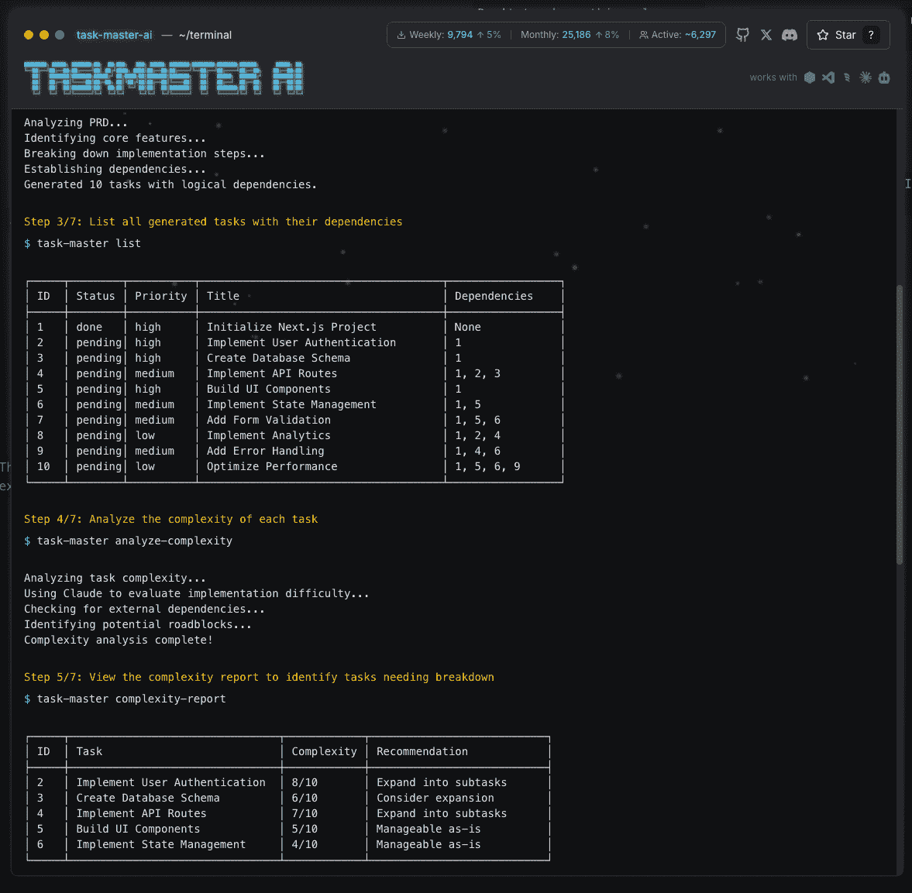

# 一个可集成到 Cursor、Lovable、Windsurf、Roo 等系统中的 AI 驱动的任务管理系统

> 来源：[https://huchegames.feishu.cn/docx/QjLbdD3fgomN6lxd2CGcAqHOnLd](https://huchegames.feishu.cn/docx/QjLbdD3fgomN6lxd2CGcAqHOnLd)

> 一个可集成到 Cursor、Lovable、Windsurf、Roo 等系统中的 AI 驱动的任务管理系统。

> [Gi](https://github.com/eyaltoledano/claude-task-master)tHub - eyaltoledano/claude-task-master: An AI-powered task-management system you can drop into Cur

用 AI 写代码时最痛苦的不是让它生成代码，而是让它理解整个项目架构和任务依赖关系。之前总是要手动解释每个任务，反复上下文...颇为折磨。

Task Master这个项目彻底解决了这个问题！它让 Claude 像一位经验丰富的项目经理一样思考，自动拆解 PRD（需求文档），生成任务列表，并追踪进度。

主要特性：

+   自动解析 PRD 并生成结构化任务体系，包含 epic 和子任务

+   管理任务间的依赖关系，确保开发顺序合理

+   直接在编辑器中通过自然语言沟通整个开发流程

+   让 AI 按照人类工程师的思维模式进行任务分析和执行

+   无缝整合进现有开发工作流，降低 AI 使用门槛

可通过编辑 MCP 配置，轻松接入到 Cursor 或 Windsurf 等开发编辑器，让它成为我们高效的开发伙伴。

