# AI 编程 Hackathon 分享：两个小时做的网站，如何拿到 5000 美金特等奖

> 来源：[https://huchegames.feishu.cn/docx/MA70dCj8ooiaEIxdjGPc1lM2nid](https://huchegames.feishu.cn/docx/MA70dCj8ooiaEIxdjGPc1lM2nid)

[周末（2025 年 06 月](https://mp.weixin.qq.com/s/fJ5h4OaFwyWrHmQW2abXRA) 29 日）参加哥飞老师组织的「年中分享&Hackathon」活动，作为一个不懂代码的产品经理，我的预期是去感受一下氛围，打打酱油的。没想到我 2 个小时做的网站，在 290 多人参赛，150+ 项目中，竟然获得了特等奖，拿到 5000 美金。真是受宠若惊，也简单和大家分享一下这个网站是怎样做出来的。

### 一、不只是分享，现场开搞

活动是 6 月 28 号下午开始的，主要是八位优秀的嘉宾分享实战经验。我听完的感受是，只有自己动手做，这些经验才能变成自己的，如果只是听，很快会忘记。

28 号晚上，Hackathon 正式开始。大家的目标是在 24 小时内做一个网站，由评委从各个维度打分，评出优胜者。

大家听完分享，都跃跃欲试，但我其实没什么思路。

第一时间想到的是，有个热点可以追，就是最近的充电宝事件。可以围绕充电宝做一个小程序，扫码识别当前充电宝有没有 3c 认证，是不是在召回的黑名单里。不过这个热点的问题在于，可能只是短期有用；而且这个产品只能面向国内市场，海外完全没用。所以这个想法直接放弃了。

所以老老实实从头研究关键词，做有需求、可持续的工具产品。

### 二、找需求

我最近买了 Flux Kontext A[PI，图片生成、视频生](https://tq5n93g77p.feishu.cn/docx/GaaHdaXSSoqrVuxU0C3cz5COn9F)成是热门赛道，从 labubu 动态壁纸网站积累了经验后，我稍微有点膨胀了，感觉可以挑战一下红海赛道。

拿着锤子找钉子，我开始研究图片生成领域有哪些细分的需求。

在 Google Trends 里搜「Flux kontext」，翻相关的网站，找了很多图片生成相关的关键词。最开始找到的词，要么是热度超高，竞争惨烈的，要么是搜索量很小的。

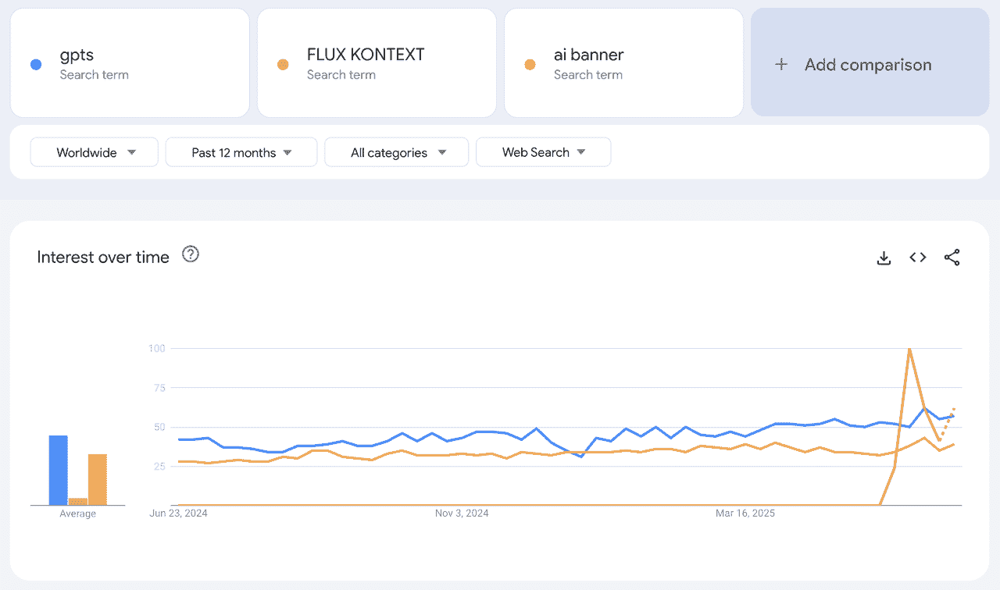

最后找到 AI Banner，热度基本和 gpts 持平，同时有上涨的趋势。

结合对 Banner 需求的了解，这是一个产品、运营、市场同学日常都需要用的工具，于是决定做 AI Banner 这个关键词。

第一步，先注册了域名 [aibanner.art](https://www.aibanner.art)，用这个后缀，主要受到 lovart.ai  的启发，还有就是，它便宜，只要十七块五毛钱。

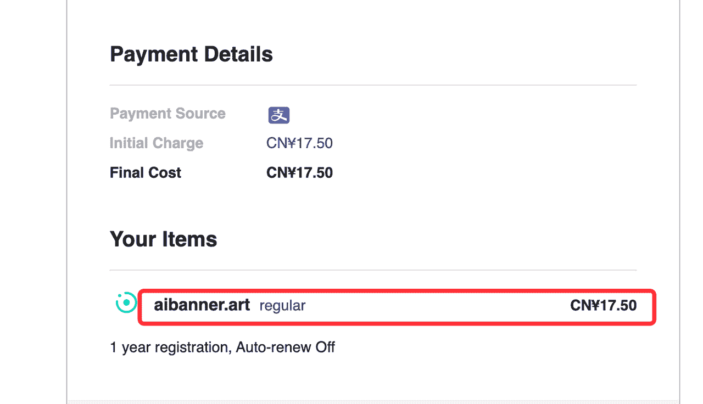

### 三、一波三折地做网站

接着，我注册了金主 [same.new](http://same.new) 的账号，领取了 Pro 会员，开始提需求，写网站了。

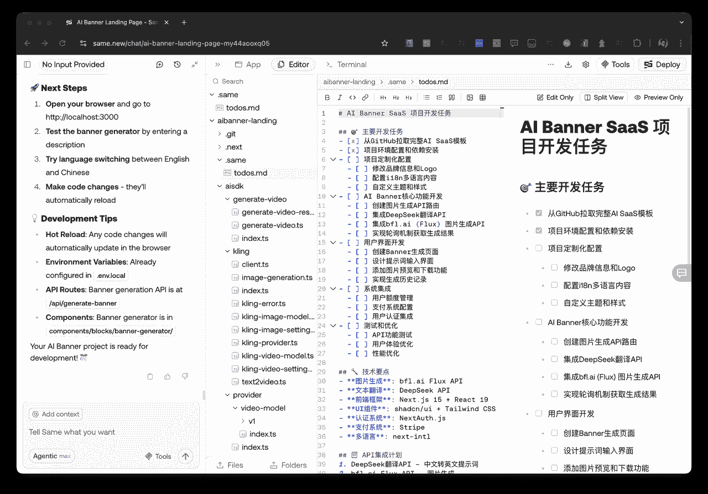

第一次用 same.new，不同于 Cursor 这种本地 IDE，它是纯云端的 IDE 产品，在线显示代码、预览和命令行。same.new 收到需求后，它调用 Agent 进行分析，然后写一份 todos.md  文档，再去咔咔一顿写代码。速度贼快，就感觉有 10 个程序员帮你做需求。感受就是，如果说 Cursor 是手动驾驶，same.new 就是自动驾驶，贼快，贼丝滑。

说时迟那时快，它几分钟就帮我把 AI Banner 核心功能写完了。而且运行起来几乎没什么大问题。有一些样式细节和文案问题，继续让它改了一波。

接着让它帮忙把代码提交到 github 上，然后去 vercel 部署。

部署的时候，发现有一堆报错，也就几十个吧。

继续让 same.new 去改 bug，发现根本改不过来。

也尝试用 Cursor 去改 bug，报错实在太多了，根本改不过来。

于是，第一次尝试以放弃告终。

折腾到晚上三点，先睡觉去了。打算明天再说。

醒来已经是 9 点多，吃完早餐继续做 AI Banner 网站。

因为不懂那些报错是怎么回事，AI 也修不过来。于是暂时放弃 same.new，回到 Cursor+shipany 的组合，轻车熟路。

用 Cursor 倒腾了半个多小时，AI Banner 第二版完成了！

这次部署没有报错，一切都很顺利。但是，打开网站傻眼了，一片惨白的网页上，显示了一个 500，还有一些 middleware error 之类看不懂的东西。把报错扔给 Cursor，来回改了 10 遍左右，仍然没有解决这个问题。

我的选择是，果断放弃第二版。问题不大，从零再来一遍。

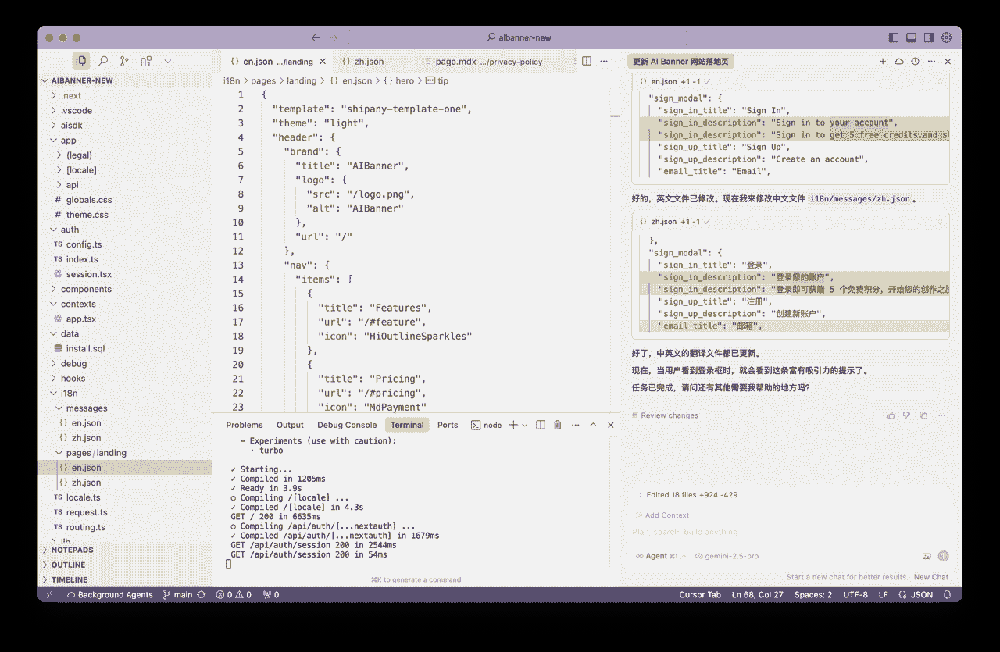

于是 AI Banner 网站第三版开始做。这次做得更快，我把第二版的核心功能复制过来，十分钟不到，先把粗糙的版本部署到 vercel。这次没有报错，没有 500，一切都很顺利。

接着继续完善网站的多语言文案、AI Banner 生成的功能细节、网站 Showcase 配图等等。

到下午三四点，AI Banner 网站基本打磨好了。

核心功能，AI 生成 Banner，效果还不错，生成速度飞快，输入或选择已有 Prompt，三五秒即可获得一张七八分水平的 Banner 图片。虽然效果比不上 Midjourney、ChatGPT，但胜在生成速度快、便宜。

Aibanner 网站成品：https://www.aibanner.ai

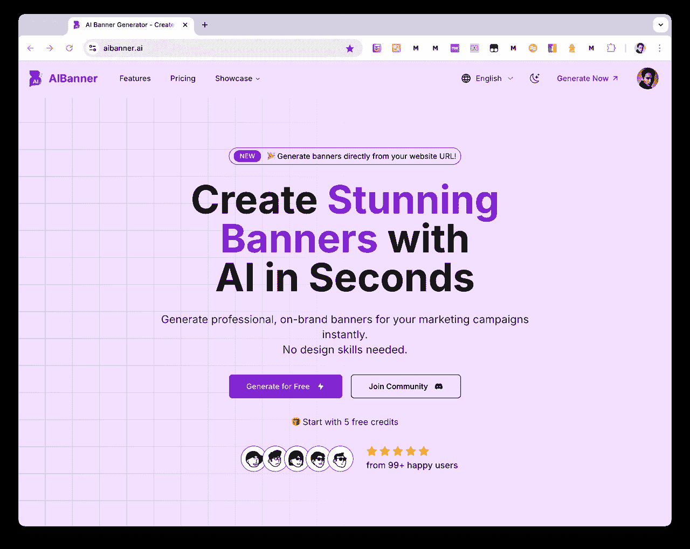

### 四、打磨核心细节

Hackathon 做项目，主打一个简单粗暴，但核心功能部分，可以简单，但需要比较完整、丝滑。分享一些这个过程中做得比较好的细节：

| 模块 | 描述 | 截图 |
| --- | --- | --- |
| 网站模板 | 托 Shipany 的福，整体基础功能、模块比较完善，我只需要专注于做我自己需要的功能部分，SEO 友好、多端适配、样式等等，我基本不用操心。（有朋友问为什么这么快可以做出来这么好看的网站，主要是 Shipany 这个模板好） | 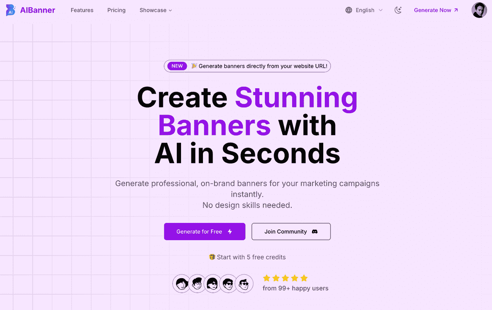 |
| AI Banner 核心功能 | 1.  **功能布局**：AI 生图用了经典的左右布局，左边输入 Prompt，调整参数，右边预览效果，最大化利用横向的屏幕空间，让用户操作的时候，基本不用滑动屏幕。布局也参考了良辰美老师的产品。 | 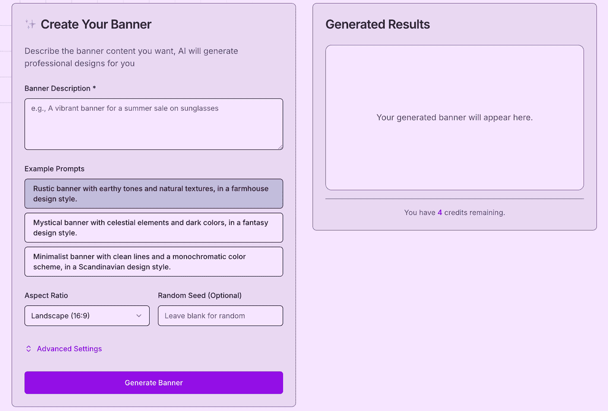 |
| Showcase | 生成了 9 张 Showcase 图片，让用户快速预览制作的 Banner 是怎样的效果。 | 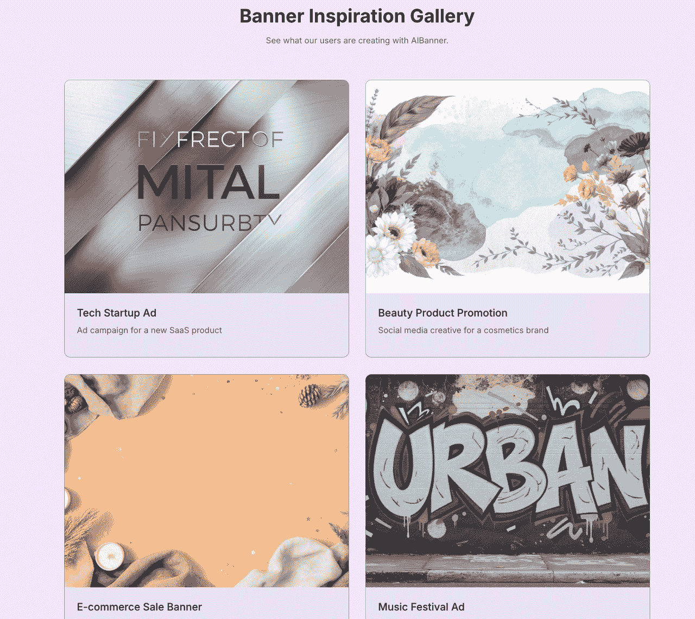 |
| 网站介绍 | 这里的配图，也专门使用对应的文字去生成配图，以达到图文相符的状态。 | 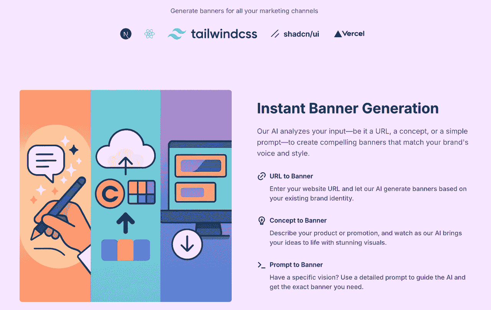 |
| 数据 | +   数据都是 AI 编的，有真实用户了，再换成真的。 | 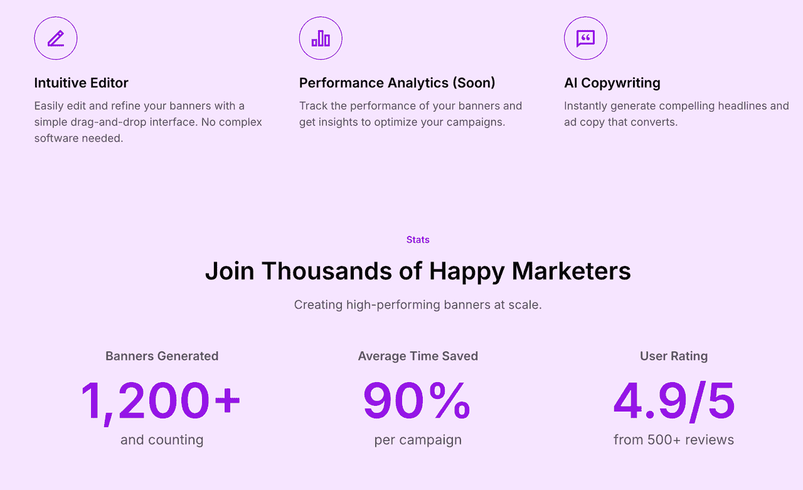 |
| Footer | 模板也都比较比较专业，改成自己需要的内容就 OK。 | 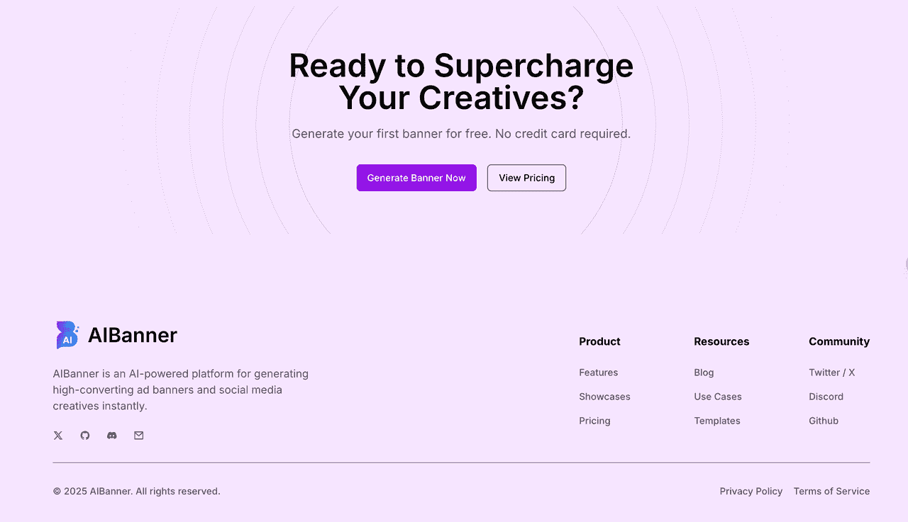 |

1.  Prompt 为空的时候，点击生成有 toast 提示；

1.  执行 Banner 生成的时候，有加载动效，让用户稍作等待；

1.  生成图片后，支持放大预览 Banner 图，也支持直接下载。

### 五、提交作品的小心思

做完网站，向主办方提交了作品，评委会从需求挖掘、完成情况、商业价值、后续计划这四个维度评分，多个评委取平均值。

下面我提交的项目说明

这里也有点小心思，我写了初版的项目介绍，然后用 ChatGPT O3 review，问它有哪些地方可以优化的。O3 给了一些建议，觉得不错的地方，就参考了 O3 的写法；O3 太夸张的地方，就用自己写的版本。

所以项目介绍也是有点点加分，毕竟评委们一下子看 150 多份项目说明，写得太短或太啰嗦，都不是很友好。

> **Dream Big**

> 队员：

> 176***9160 （**Be**n） [littlebena]队长

> 零。 基础信息

> 0.1 域名注册时间

> 回答：2025 年 06 月 29 日

> 0.2 Same Project URL

> 回答：https://same.new/chat/ai-banner-landing-page-my44aooxq05

>

> 一。 需求挖掘（30 分）

> 1.1 目标用户是谁？

> 请描述您的目标用户群体

> 回答：

> 【高频】电商运营、活动运营（618、双 11、黑五大促）；SaaS/B2B 市场部（落地页、活动、广告 AB 测试）

> 【中频】创业团队、一人公司、独立站长（高效生成素材，用于获客）

> 【低频】设计师灵感辅助、初稿

> 1.2 使用场景是什么？

> 请说明用户会在什么情况下使用您的产品

> 回答：很多场景下，经常需要一些 banner 图，让内容更丰富、吸引人，包括：

1.  促销、节日活动，商品介绍背景物料

1.  Social Ads( FB/IG/Twitter、Google ads)

1.  App/网页内 Banner

1.  市场调研问卷封面

1.  内部演示、live demo 视觉

> 1.3 您解决的痛点是什么？

> 请描述用户遇到的问题以及问题的紧迫性

> 回答：是真实存在的需求，已有的目标用户，经常需要在网上找合适的配图，或者自己用 canva 之类的工具制作，时间成本和门槛还是比较高；或者找设计同学做图，也需要协调工期，比较费时间。用 AI 生成 banner 图，对产品、市场、运营同学非常有用。

>

> 二。 实际完成（30 分）

> 2.1 产品部署情况

> 请提供可测试的链接或演示方式

> 回答：链接：https://www.aibanner.art/

> 2.2 功能完成情况

> 请介绍已实现的核心功能

> 回答：

> 核心功能：用户输入 Prompt 或点击 example Prompt，然后调用 Flux kontext 生成精美的 Banner 图片。可预览和下载图片。

> 2.3 用户体验设计

> 请描述产品的交互设计和用户操作体验

> 回答：基于 shipany 模板制作，设计友好，交互符合用户的直觉，生成图片时有加载状态和提示；有精美的 Showcase。

>

> 三。 商业潜力（30 分）

> 3.1 商业化思路

> 请说明您的商业模式和盈利方式

> 回答：商业化思路：用户可免费生成 1 张 banner 图，后续需要充值进行生成；也可以挂 adsence 广告

> 3.2 产品创新点

> 请介绍您的产品有哪些创新之处

> 回答：

> 创新点：使用 flux context 模型，生成速度快，价格便宜；同时内置了非常多优秀的 banner 相关的 Prompt，降低用户写 Prompt 的门槛。

> 3.3 推广策略

> 请描述您的市场推广和 SEO 策略

> 回答：

> 主关键词：AI banner，搜索量略低于 gpts，但搜索量是缓慢在增长的，同时竞争度不是很高，还是有机会排到首页的。

> 计划覆盖更多的长尾词，例如 Facebook AI banner，Twitter AI Banner 等等

>

> 四。 后续规划（10 分）

> 4.1 未来发展计划

> 请制定您的产品后续发展规划

> 回答：

> SEO 方面：增加外链和内链。内链增加案例库、灵感参考，行业 Banner 案例等等。

> 功能方面：

> 1.接入 stripe/paypal 付费；

> 2.支持上传参考图，风格选择，进一步降低用户使用的门槛；

> 3.支持用户直接在图上添加文字，添加元素。

> 五。 补充说明

> 还有什么想要补充的内容吗？

> 回答：网站上所有的配图，都是用 https://www.aibanner.art/ 生成的，先做现用，哈哈

### 六、感谢

所以，从挖掘需求，到 AI 编程落地，把产品做了三遍，最后优化项目介绍，最终获得了大家的青睐，获得特等奖。虽然最开始我的想法是去打个酱油，围观一下大家是怎样做网站的。

[最后，感谢主办方](http://same.new)哥飞老师，感谢金主 same.new，感谢各位评委老师，感谢一起参加 hackathon 的小伙伴们，感谢 CCTV、MTV...我会继续加油，立个小小的 flag，争取下次哥飞老师搞活动，我能略有成就，不只是参加 hackathon，还可以作为嘉宾给大家分享点小经验。

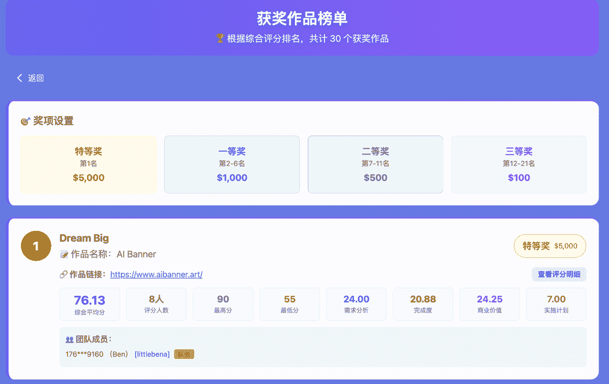

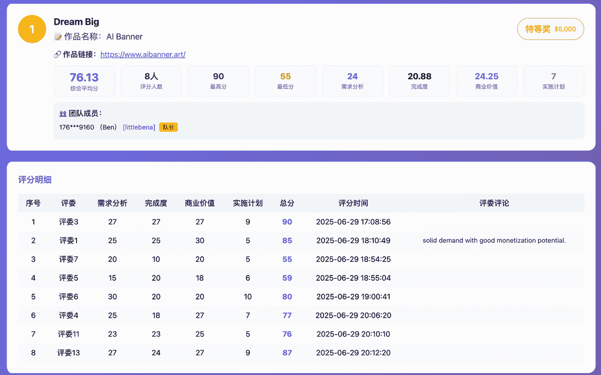

> 走过路过，看到这里的小伙伴，帮忙在 Product hunt 给 AI Banner 投个票吧，感谢~~帮助 AI banner 这个产品做大做强！

> https://www.producthunt.com/products/ai-banner-generator

ps.如果你也想使用 Shipany 制作精美的网站，可以使用我这个邀请码：https://shipany.ai/i/ben

<https://waytoagi.feishu.cn/sync/UHGidZRhBseFv4bVc3scT3Rpnyh>