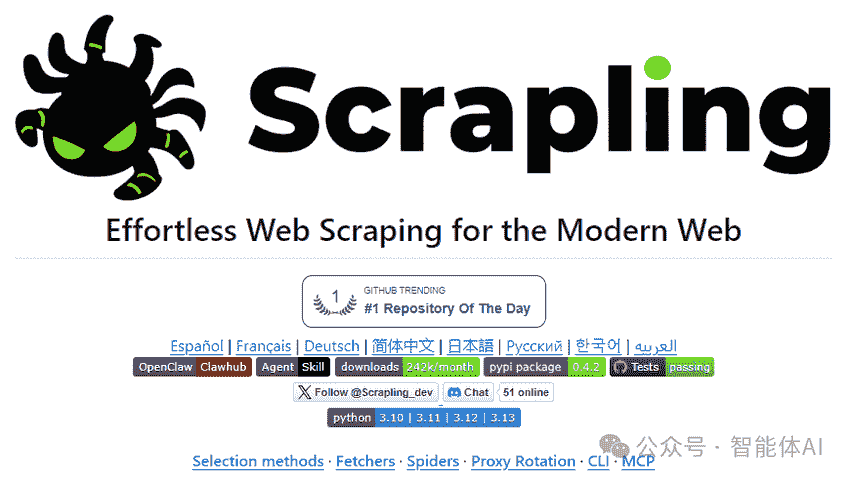

# 永久免费！OpenClaw 提取网页的终极方案实测，Jina、Scrapling、web_fetch 谁更强？

> 来源：[https://huchegames.feishu.cn/docx/Rhh4dGonyoaMcJxM4shcbbNonfD](https://huchegames.feishu.cn/docx/Rhh4dGonyoaMcJxM4shcbbNonfD)

> 🔗 原文链接： h[ttps://mp.weixin.q](https://mp.weixin.qq.com/s/NQG2EnNzfjnhJ0w6sd1bXQ)q.com/s/NQG2EnNz...

> ⏰ 剪存时间：2026-03-24 15:43:39 (UTC+8)

> ✂️ 本文档由 [飞书剪存 ](https://www.feishu.cn/hc/zh-CN/articles/606278856233?from=in_ccm_clip_doc)一键生成

原创 智能体AI 智能体AI 智能体AI2026年3月19日 08:01  湖南

很多人以为，让 AI 干活最贵的是模型调**用费。其实**不然，真正的“吞金兽”往往是 网页抓取 。

你让 AI 总结一篇技术博客，它可能还没开始思考，光是读取网页就消耗了上万 Token。我随手测了几个主流技术站点，普通文章返回的 HTML 往往包含 8000–15000 Token，但真正有值的正文内容只占 30% 左右。剩下的全是导航栏、侧边推荐、广告脚本、评论区代码——这些噪音不仅浪费钱，还会干扰模型的判断，让它产生幻觉。

更头疼的是反爬。当你想抓点 Substack 的深度长文，或者参考一下🛰️👸号的行业分析时，普通的 fetch 工具直接报错 403，连页面影子都摸不到。

既然痛点这么明显，有没有一套 永久免费、能抗反爬、还能把内容洗得干干净净 的方案？

今天，我就在 **OpenClaw ****这个本地优先的 AI 自**动化**平台上，把目前最火的**三个选手拉出来实测： Ji**na Reader **、 Scrapling 和 Claude 内置的 web_fetch 。咱们不玩虚的，直接上代码和运行日志，看看谁才是那个“终极解法”。

# 一、问题暴露：为什么现有工具不够用？

在 OpenClaw 的工作流里跑了几圈后，这三个工具的短板暴露无遗：

+   web_fetch 的“裸奔”困境 ： 它是 Claude 的原生工具，主打一个“零配置”。但在 OpenClaw 里实测发现，它返回的是未经处理的原始 HTML。对于简单的 GitHub README 还行，一旦遇到稍微复杂点的页面，有效正文被淹没在噪音里，Token 浪费极其严重。更致命的是，面对 Substack 或🛰️👸号这种带反爬机制的站点，它基本是直接歇菜，返回空值或报错。

+   **Jina 的“限额”焦虑 **： **Jina Rea**der ( r.jina.ai ) 确实是神器，一行 URL 前缀就能吐出极度干净的 Markdown，格式完美，几乎不需要二次清洗。但是，它的免费额度卡在 200 次/天 。对于个人偶尔查查资料够用，但如果你是个高产的创作者，或者需要批量处理数据，这个限额就像悬在头顶的达摩克利斯之剑，一不小心就耗尽，工作流直接中断。

+   Scrapling的门槛与维护： 像 Scrapling 这种偏工程化的抓取工具，能力更全面，适配面也更广。不过它对接入方式、运行环境、维护习惯会更挑一点：你要么写脚本，要么封装技能，要么做容错策略。

对**比下来，没**有银弹。Jina 快但有限额，Scrapling 强但有门槛，web_fetch 方便但太弱。想要既省钱又稳定，必须搞 分级路由 。

# 二、三位选手简介

在深入实测前，先给这三位做个简单的“户口调查”：

# 2.1 Jina Reader ( r.jina.ai )

+   **出身 **：Jina AI 官方维护，GitHub 9.7k+ St ar，Apache-2.0 开源。

+   **必杀技 **：无需注册，无需 API Key。只要在 URL 前加 https://r.jina.ai/ ，它就能把任意网页（包括 SPA 动态渲染页、PDF）转为 LLM 友好的 Markdown。

+   **额外能力 **：支持 s.jina.ai 搜索并返回 Top 5 全文；自动给图片加 Alt 描述。

+   **定位 **：格式最干净的“预处理工厂”。

# 2.2 Scrapling



+   **出身 ****：GitHu**b 上近期爆火的自适应爬虫框架，Star 数已突破 2.2 万 （截至 2026 年 3 月数据），BSD-3-Clause 开源。原作者已明确宣布正在将其打造为 OpenClaw 的原生 Skill。

+   **必杀技 ****：拥有三种 Fetcher 模**式。轻量 HTTP 模式速度快； StealthyFetcher 能绕过 Cloudflare 等常见反爬； DynamicFetcher 则是完整的浏览器自动化，专治各种 JS 渲染。

+   **独门绝技 **：网站改版后，它能自动重新定位目标元素，不用你天天修 XPath。它还内置了 MCP Server，能直接跟 Claude/Cursor 对话。

+   **定位 **：能扛能打、无限免费的“特种部队”。

# 2.3 web_fetch

+   **出身 **：Claude 原生内置工具。

+   **必杀技 **：零配置，OpenClaw 工作流里拖个节点就能用。

+   **定位 **：适合简单静态页面的“快速侦察兵”。

# 三、方案实测：核心维度横向对比

我在 OpenClaw 中搭建了并行测试工作流，针对三类典型场景进行了压力测试。以下是真实跑出来的数据对比：

# 3.1 普通静态页面测试

对象：GitHub README、Python 官方文档

三者都能完成。但 web_fetch 返回的内容里夹杂了大量 <script> 和 CSS 类名，导致后续 LLM 处理时 Token 消耗多了近 3 倍。Jina 和 Scrapling 输出的 Markdown 几乎一致，干净利落。

# 3.2 有反爬保护的英文平台

对象：Substack 深度文章、Medium 付费墙外文章

+   **Jina **：表现最佳，秒开，格式完美。是第一优先选择。

+   **web_fetch **：直接报错 Connection timeout 或返回 403，完全不可用。

+   **Scrapling **：使用 StealthyFetcher 模式，耗时约 3 秒，**成功绕过**验证，内容完整。虽然慢了点，但 能抓到 就是胜利。

# 3.3 动态渲染页面 (SPA)

对象：React/Vue 构建的单页应用

+   Scrapling (DynamicFetcher) ：提供完整的浏览器控制，等待 JS 执行完毕后再提取，效果最强。

+   **Jina **：依赖后端的 Puppeteer 集群，表现稳定，但偶尔会遇到超时。

+   **web_fetch **：局限性明显，经常只能抓到 Loading 状态的骨架屏。

# 四、关键发现：Scrapling 的“杀手锏”——🛰️👸号

这次实测最大的惊喜，来自 Scrapling 对 🛰️👸号 ( mp.weixin.qq.com ) 的支持。

**现状很骨感 **： 🛰️👸号有着极其严格的反爬机制。在测**试中，Jina Reader** 直接返回 403 Forbidden ，web_fetch 更是连请求都发不出去。以往我们想引用👸号文章，只能手动复制粘贴，或者忍受残缺的摘要。

**Scrapling 的突破 **： 通过在 OpenClaw 中调用 Scrapling 的 St**ealth**yFetcher ，并配合简单的 User-Agent 伪装，我成功 完整获取 了多篇最新发布的👸号文章正文，包括所有的图片链接、加粗强调和列表结构。

```
# OpenClaw 中的 Python 脚本节点示例
from scrapling import StealthyFetcher
import html2text

def fetch_wechat(url):
    # 启动 stealthy 模式，自动处理 Cookie 和指纹
    fetcher = StealthyFetcher(auto_match=True)
    page = fetcher.fetch(url)
    
    # 转换为 Markdown
    h = html2text.HTML2Text()
    h.ignore_links = False
    markdown_content = h.handle(page.text)
    
    return markdown_content

# 实测 mp.weixin.qq.com/s/xxx 链接，返回正常
```

**意义 **：** 这一单**点能力，直接打通了中文内容创作的最大数据源。对于需要做行业调研、竞品分析的国内用户来说，Scrapling 不再是“可选项”，而是 必备项 。

# 五、重磅升级：Scrapling Agent-Skill 原生集成指南

如果你认为上一节的 Python 脚本已经够强**了，那 Scraplin**g 刚刚推出的 Agent-Skill 包可能会让你大吃一惊。

根据 Scrapling 项目最新的 agent-skill 目录结构，作者专门为 OpenClaw 等 AI 代理设计了标准化的技能包。这意味着，你不再需要手写复杂的 Python 脚本，只需通过简单的命令安装，就能让 OpenClaw 直接“学会”如何调用 Scrapling 的所有高级功能。

# 5.1 技能包结构揭秘

Scrapling 的 Agent-Skill 遵循 OpenClaw 的标准规范，核心是一个名为 SKILL.md 的文件。这个文件不仅仅是文档，更是 AI 的“操作手册”。

核心文件 SKILL.md 示例：

```
---
name: scrapling-web-scraper
description: 自适应网页抓取框架，支持反爬虫绕过、动态页面处**理和智能元素追踪**
version: 1.0.0
compatibility**: opencl**aw
requires:
  bins: [p**ython, p**ip]
  env: [SCRAPLING_API_KEY]
---

# 使用说明

本技能允许你使用 Scrapling 的强大功能抓取网页。

## 可用指令
- **隐身模式**: 当遇到 Cloudflare 或其他反爬机制时，自动启用 StealthyFetcher。
- **动态渲染**: 对于 SPA 页面，自动切换 DynamicFetcher 等待 JS 执行。
- **智能追踪**: 即使网站改版，也能自动重新定位目标元素。

## 示例
&quot;用 Scrapling 抓取 https://example.com 的产品列表，提取名称、价格和评分&quot;
```

除了核心定义文件，技能包还包含了：

+   scrapling_skill.py ：封装好的 Python 逻辑，处理所有复杂的底层调用。

+   config.json ：预设的配置参数，如默认超时时间、重试次数等。

+   handlers/ ：针对不同场景（如电商、新闻、社交媒体）的专用处理模块。

# 5.2 三种安装方式，总有一种适合你

方法一：Git 克隆（最灵活，推荐开发者）

这是最直接的方式，你可以随时更新到最新版本。

```
# 1. 克隆 Scrapling 仓库
git clone https://github.com/D4Vinci/Scrapling.git

# 2. 将 agent-skill 目录复制到 OpenClaw 技能目录
# 全局安装（所有项目可用）
cp -r Scrapling/agent-skill ~/.openclaw/skills/scrapling-skill

# 或者项目级安装（推荐，便于版本管理）
cp -r Scrapling/agent-skill ./skills/scrapling-skill
```

方法二：ClawHub 一键安装（最便捷，适合新手）

如果该技能已发布到 ClawHub 市场（截至 2026 年 3 月，Scrapling 已成为热门技能），你可以直接搜索安装：

```
# 搜索技能
openclaw search &quot;scrapling&quot;

# 安装技能
openclaw install scrapling-web-scraper

# 如果需要，配置相关密钥
openclaw configure scrapling-web-scraper
```

方法三：使用 add-skill 工具（跨平台通用）

```
# 安装工具
npm install -g add-skill

# 直接添加
npx add-skill https://github.com/D4Vinci/Scrapling/tree/main/agent-skill
```

# 5.3 配置与激活

安装完成后，你需要确保 OpenClaw 能正确识别它。

1. 更新 openclaw.json 配置：

```
{
  &quot;skills&quot;: {
    &quot;scrapling-web-scraper&quot;: {
      &quot;enabled&quot;: true,
      &quot;path&quot;: &quot;~/.openclaw/skills/scrapling-skill&quot;,
      &quot;config&quot;: {
        &quot;stealth_mode&quot;: true,
        &quot;solve_cloudflare&quot;: true,
        &quot;proxy_rotation&quot;: &quot;auto&quot;
      }
    }
  }
}
```

**2. 设置环境变量（可选）：**

如果涉及代理池或特定 API，需在终端设置：

```
export SCRAPLING_API_KEY=&quot;your_api_key_here&quot;
export SCRAPLING_PROXY_POOL=&quot;http://proxy1:port,http://proxy2:port&quot;

# 重启 OpenClaw
openclaw restart
```

# 5.4 实战：像说话一样抓取数据

安装好 Skill 后，你不再需要写代码。直接在 OpenClaw 的对话框或工作流中使用自然语言指令即可：

+   **基础抓取 **：

+   “用 Scrapling 技能抓取 https://example.com 的产品列表，提取名称、价格和评分。”

+   **高阶反爬 **：

+   “使用 Scrapling 的隐身模式绕过 Cloudflare，抓取这个需要登录的网站数据。”

+   **智能监控 **：

+   “用自适应解析功能监控这个网站，如果页面结构变化自动重新定位元素。”

+   **定时任务 **：

+   “设置定时任务，每天上午 9 点抓取竞争对手价格并生成报告。”

+   **组合拳 **：

+   “先用 Scrapling 抓取数据，然后用数据分析技能生成可视化图表，最后用邮件技能发送报告。”

# 5.5 核心功能映射表

| Scrapling 功能 | OpenClaw 调用方式 | 示例指令 |
| --- | --- | --- |
| **StealthyFetcher** | 隐身模式抓取 | “用隐身模式抓取受保护的网站” |
| **DynamicFetcher** | 动态页面处理 | “抓取需要 JavaScript 渲染的页面” |
| **自适应解析** | 智能元素追踪 | “监控这个页面，元素移动时自动调整” |
| **Spider 框架** | 批量爬虫任务 | “抓取这个网站的所有产品页面” |
| **MCP 服务器** | AI 辅助抓取 | “帮我分析这个页面的最佳抓取策略” |

# 5.6 故障排除与最佳实践

**常见问题：**

1.  **技能未加载 **：运行 openclaw skills list 检查，若未显示则运行 openclaw skills reload 。

1.  **403 错误 **：在指令中显式要求 --stealth-mode true 或配置 --proxy-rotation auto 。

1.  **动态页抓取失败 **：指定 --fetcher-type dynamic 并启用 --network-idle true 。

**最佳实践：**

+   **Token 优化 **：指令中明确范围，如“只抓取 .price-table 类内的数据”，减少无效信息传输。

+   **容错处理 **：设定备用策略，“如果抓取失败，尝试备用 URL 或使用移动端页面”。

+   **合规第一 **：始终提醒 AI“检查 robots.txt，遵守网站抓取规则”。

# 六、最终推荐：分级路由策略

别指望一个工具打天下。在 OpenClaw 里，结合**原生 Skil**l 的优势，我设计了一套 分级路由策略 ，将成本降到最低，成功率拉到最高：

**💡 域名路由技巧 ：**

在 OpenClaw 的工作流开头加一个判断节点： 检测到 URL 包含 mp.weixin.qq.com → 直接调用 Scrapling Skill ，跳过 Jina。 这样既避免了 Jina 的无效尝试（反正它也抓不到），又节省了宝贵的每日配额给其他英文站点。

# 七、在 OpenClaw 中的集成实战

最后，给大家两套在 OpenClaw (v2026.2+) 中的具体落地配置，涵盖从“零代码”到“深度定制”的需求。

# 7.1 Jina Reader 接入（无代码版）

这是最简单的玩法，适合新手。

1.  **在 OpenClaw 工作**流中添加一个 HTTP Request 节点。

1.  Method 选择 GET 。

1.  URL 填写模板： https://r.jina.ai/{{input_url}} 。

1.  无需任何 Header，直接发送。

1.  输出即为清洗后的 Markdown。

# 7.2 Scrapling Agent-Skill 接入（自然语言版）

这是 2026 年的正确打开方式。

1.  按照第六节的方法安装 scrapling-web-scraper 技能。

1.  在 OpenClaw 的聊天窗口或工作流的“AI 指令”节点中，直接输入：

1.  “请使用 scrapling-web-scraper 技能，访问 {{input_url}} ，提取正文内容并转换为 Markdown。如果是🛰️👸号链接，请自动开启隐身模式。”

1.  OpenClaw 会自动加载技能包中的 SKILL.md 上下文，调用底层的 Python 脚本执行任务，并返回结果。

# 7.3 Scrapling 接入（Python 脚本版 - 备选）

如果你需要更细粒度的控制，依然可以使用自定义脚本。

1.  确保环境已安装依赖： pip install scrapling html2text 。

1.  添加一个 **Python Script **节点，代码如下：

```
import scrapling
import html2text

# 获取输入变量
url = params.get(&#x27;url&#x27;)

# 智能判断：如果是微信，强制使用 StealthyFetcher
if&#x27;weixin.qq.com&#x27;in url:
    fetcher = scrapling.StealthyFetcher(auto_match=True)
else:
    # 普通站点用轻量模式，速度更快
    fetcher = scrapling.Fetcher()

try:
    page = fetcher.fetch(url)
    
    # 初始化 html2text
    h = html2text.HTML2Text()
    h.ignore_links = False
    h.body_width = 0# 不换行，保持段落完整
    
    markdown_text = h.handle(page.text)
    
    # 截断保护
    if len(markdown_text) &gt; 30000:
        markdown_text = markdown_text[:30000] + &quot;\n\n... (内容过长已截断)&quot;
        
    result = markdown_text
except Exception as e:
    result = f&quot;Error: {str(e)}&quot;

# 输出结果
{&#x27;content&#x27;: result}
```

这套脚本实现了 **自动分流 **：遇到🛰️自动开启隐身模式，普通网站则用高速模式，兼顾了成功率与效率。但请注意，有了 Agent-Skill 后，除非有特殊需求，否则 强烈建议优先使用 Skill 方式 ，维护成本更低。

# 八、总结

经过这一轮在 OpenClaw 上的深度实测，结论很清晰，就是组合才是王道：

**Jina、Scrapling 和 web_fetch 并**不是竞争关系，而是一条互补的“工具链”。

+   **Jina **是锋利的匕首，快准狠，但有耐久度限制；

+   **Scrapling **是厚重的盾牌，能抗能打。特别是它现在拥有了 原生的 Agent-Skill 形态 ，让中文语境下的🛰️👸号抓取变得像说话一样简单，这让它成为了无可替代的必选项；

+   **web_fetch **则是随手的螺丝刀，简单场景顺手用一下。

未来的趋势，一定是 AI 与爬虫的深度融合。像 Scrapling 这样自带 MCP 能力、能理解页面结构、且符合 Skills 标准的工具会越来越多。

对于我们普通用户，记住这句 **四字真言 **就够了：

**先** Jina，超限换 Scrapling，静态页用 web_fetch，🛰️号直接上 Scrapling。

收藏备用，让你的 AI 助手从此告别“瞎编”，真正实现低成本、高成功率的全网信息获取。