# GameX·FIRE 2025巨量引擎小游戏生态大会直播文字实录

> 来源：[https://huchegames.feishu.cn/docx/VQrOdr7Quocm9dxfOQAcAR5Rnxh](https://huchegames.feishu.cn/docx/VQrOdr7Quocm9dxfOQAcAR5Rnxh)

> 🔗 原文链接： h[ttps://mp.weixin.q](https://mp.weixin.qq.com/s?__biz=MzA5NzQ3NDM3MA==&mid=2656293297&idx=1&sn=1a08694f5ea9414ca35b0545c995b0cc&scene=21#wechat_redirect)q.com/s?__biz=Mz...

> ⏰ 原创 曾嵘 曾嵘胡扯的地方2025年01月07日 18:33  湖北

本篇是2025 年 1 月 7 日在深圳召开的 GameX·FIRE 2025巨量引擎小游戏生态大会 的文字实录。

文字实录基于现场直播整理，我会加一些自己的评论。内容可能不完整、不准确，直播视频截图也不够清晰（但我保证已经是高清无码视频截图了），如果读者要吐槽，可以到胡扯游戏群里直接找卧推120KG，深蹲 150KG 的曾老师单挑。😄

内容包含 5 个巨量引擎的主题分享，以及 2 个嘉宾分享。

**越到后面，干货越多 **，曾老师准备去撸铁的人都没离开小板凳。所以请务必看完。

整理很累，很想请我喝咖啡的读者，欢迎滑到文章底部打赏。

两个嘉宾从立项、发行、IAA->IAP转换的角度，提出了自己的观点，内容非常干货，堪称金玉良言，值得一看。

## 巨量引擎分享 1：小游戏市场整体分析

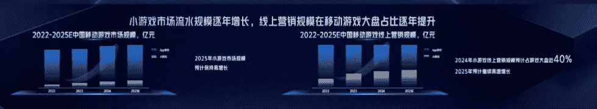

2024年小游戏线上营销规模预计占游戏大盘近40%。

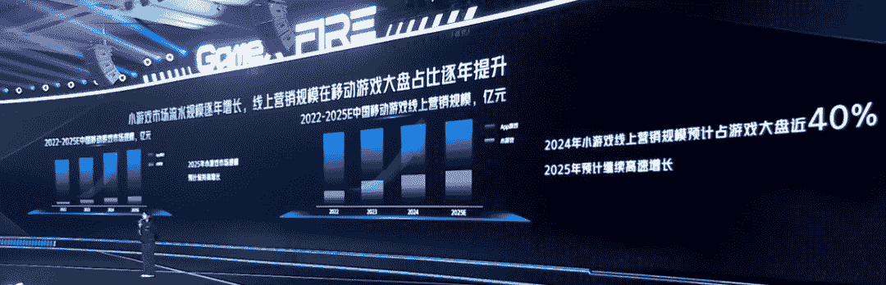

更多背景厂商尝试入局小游戏，24年腰部玩家占比在行业中大幅提升。

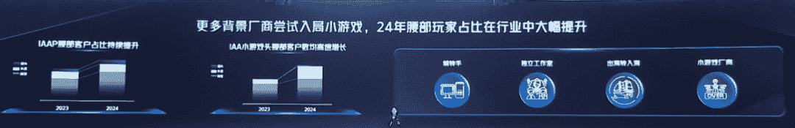

平台能够为不同背景的厂商提供相应的扶持激励。

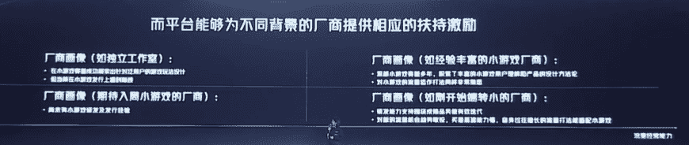

小游戏玩法变得更为丰富，IAAP小游戏玩法从中度向中重度过渡，游戏品质持续提升。

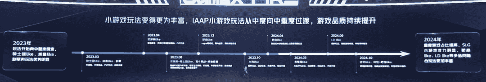

从人群覆盖看，小游戏进一步渗透手游用户，用户更加泛化。

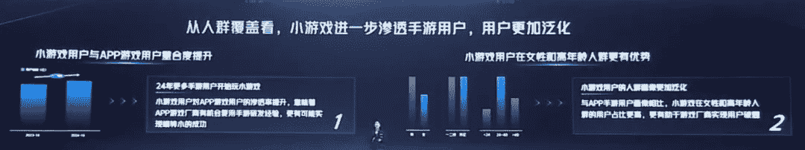

从转化看，付费和免费、App和小游戏的重合度小，双端用户转化的空间大。

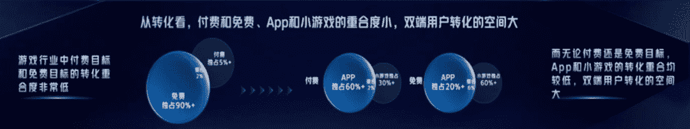

巨量视角下，IAA转化用户年龄和性别相对泛化，和IAAP转化人群差异明显。

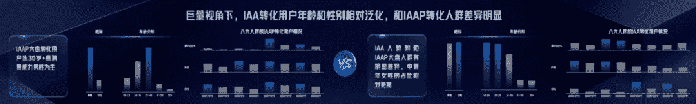

小游戏大盘维持增长势头，平台扶持小游戏健康发展。

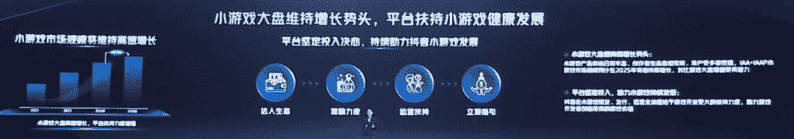

## 巨量引擎分享 2：玩法负责人分享

品牌符号整合开级小摇杆，抖音小游戏流水持续上涨，付费用户规模增速迅猛。

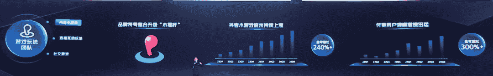

直播互动玩法流水突破历史峰值，创新玩法持续涌现，多款小游戏直播版测试上线。

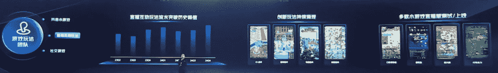

小火人 DAU 持续突破，游戏 IP 联动开放。

社交游戏达到千万量级规模，《小小生存队》自然流量获客150 万用户转化，ROI > 3。

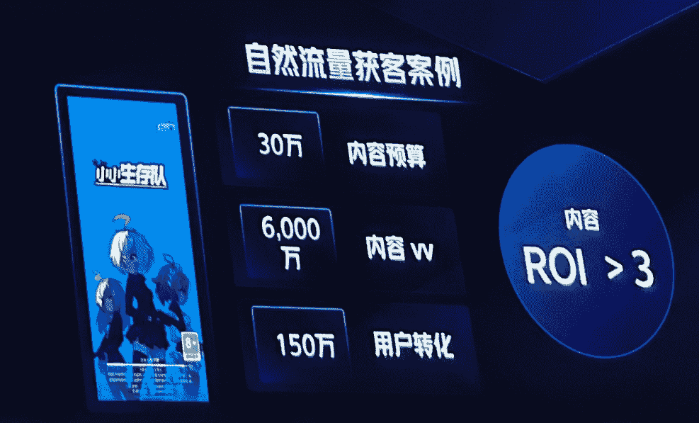

游戏直播生态增长迅猛。直播已经超越短视频。

这部分，曾老师在 抖音小游戏发行人计划，排行榜上的直播和短视频标签，可能是错的 一文中也提到过。

抖音小游戏用户生态洞察，大盘游戏兴趣人群提升，垂类人群品类机会增加。

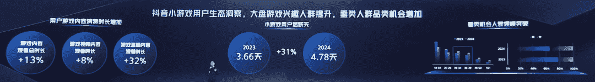

目前是垂类产品破圈的好机会，厂商可以全力跟进。

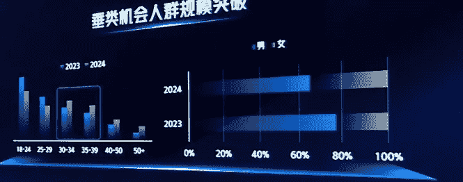

平台助力抖音全场景经营，流量天花板扩展。

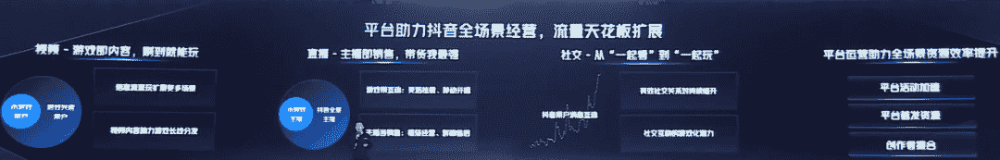

核心场景经营能力：feed流直玩小游戏能力全面升级。

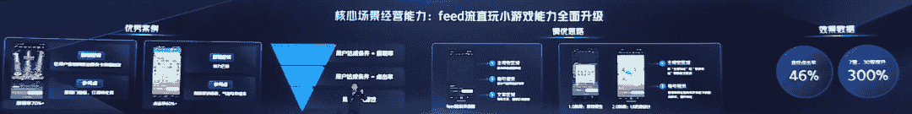

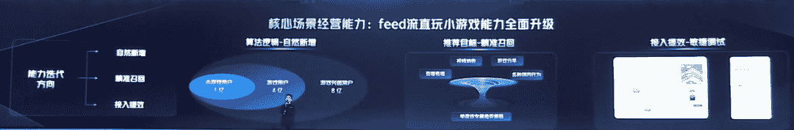

核心场景经营能力:发力小游戏直播，持续扩充主播带“货”工具库。

核心场景经营能力：捕捉社交流量机会，从「一起看」到「一起玩」。

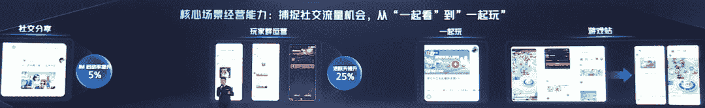

星图融合发行人计划，达人和流量供给新机会。

曾老师：引入了服务商模式，感觉，抖音要在达人这里加个中间层。

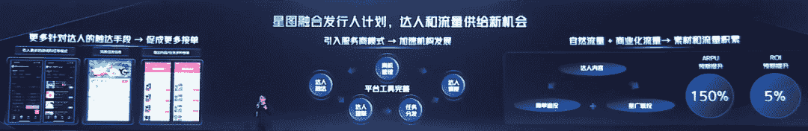

内容激励政策，激进扶持好内容。工会分成 15%。

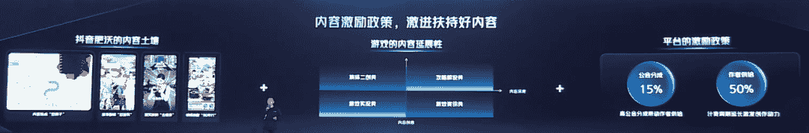

## 巨量引擎分享 3：在精细优化中全面升级

深转产品深化从付费ROI到每次付费。

每次付费和7日ROI核心差异。

7日ROI价值，后端提升+人群破圈 -> 给游戏带来新增量

需真实回传付费金额，浅层成本上涨属正常。

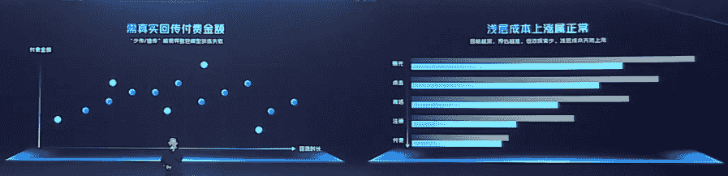

7日ROI产品演化路径，每次付费+7R下一步动作。优化目标：更高的7日ROI达成率。

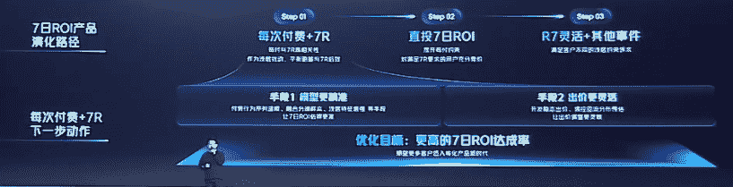

扩量期，稳投期，瓶颈期。

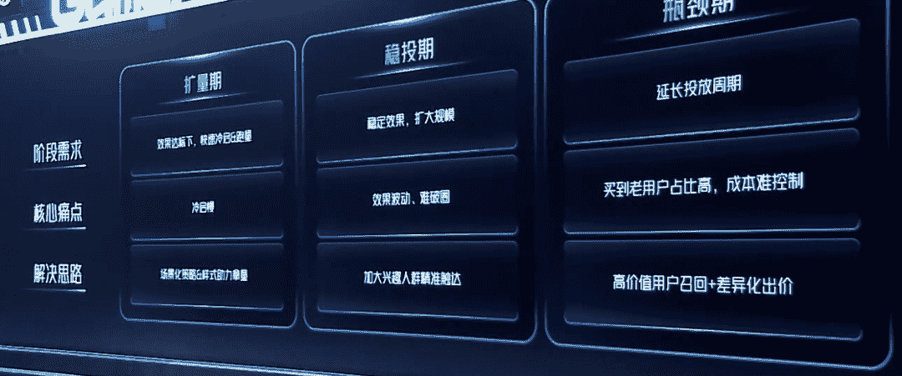

**扩量期， **场景化策略&样式，助力快速冲量。

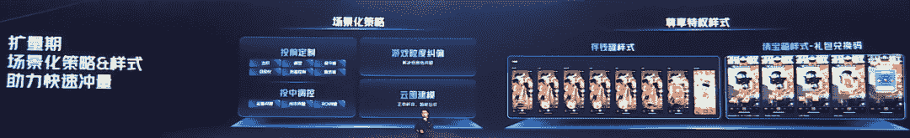

**稳投期， **人群破圈，加大游戏兴趣人群触达。

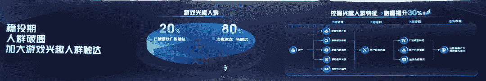

挖掘兴趣人群特征，跑量提升30%+。

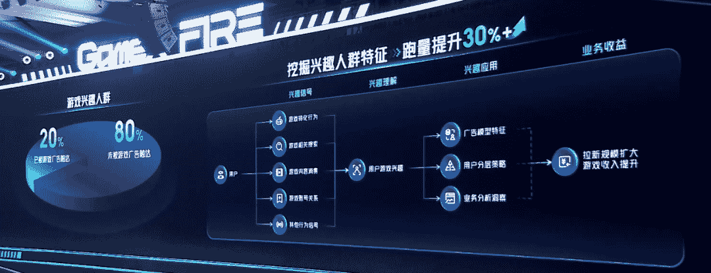

**稳投期， **多特征应用，游戏*用户诉求精准匹配。

+   闭环数据反哺非闭环 跑量+10%

+   标的&载体类型应用 跑量+3%

+   内容理解特征应用 跑量+7%

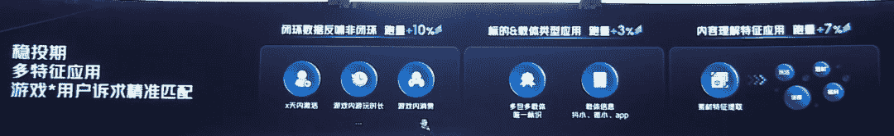

**瓶颈期， **新老用户差异化营销，召回高价值老用户。

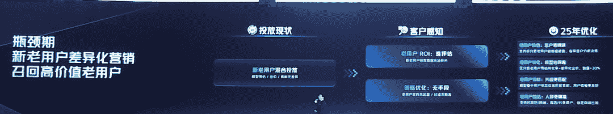

**老用户价值：客户看得清**

支持拆分新老用户做数据披露，指导客户分析决策。

**老用户转化：模型估得准**

区分新老用户预估转化率+差异化出价，跑量+30%。

**老用户素材：兴趣更匹配**

模型基于用户状态优选匹配素材，用户体验更友好。

**老用户触达：人群更精准**

支持对同包/跨端、激活/付费用户，做定向或过滤。

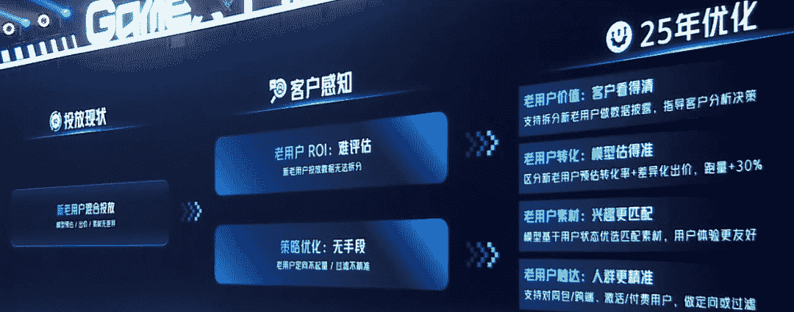

投放能力升级：抖小的特性和投放产品不完全契合

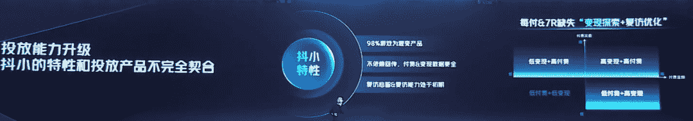

每付&7R缺失 **“变现探索+复访优化"**

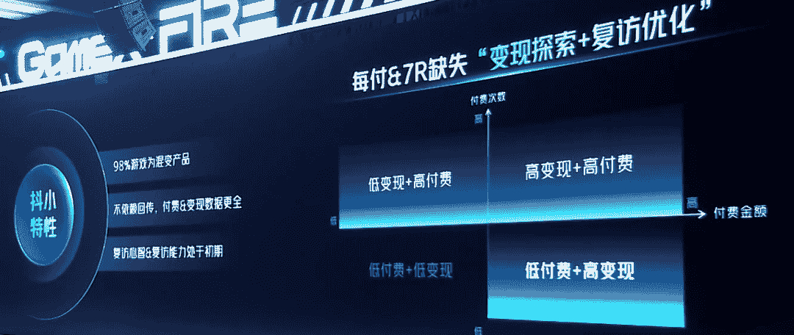

+   投放目标升级，贴合抖小考核目标。

+   ROI维度升级，贴合抖小变现模式。

+   新增自然协同，带动7倍率提升。

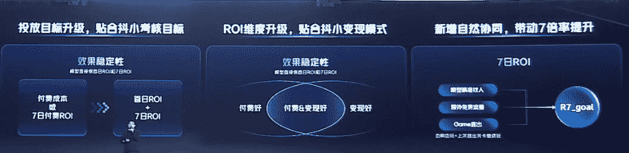

**曾老师： **这个升级成可以看 IAA+IAP 的综合 ROI，这个和前段时间腾讯广告那边的混变 ROI 投放是类似的。卷起来卷起来！

曾老师前段时间对腾讯广告发布的混变白皮书做过解读，里面一些细节可以混合参考： 综合变现率3倍提升！行业首份混变白皮书手把手教你商业化调优 。

投放能力升级首日ROI提升+7日ROI提升+人群破圈。

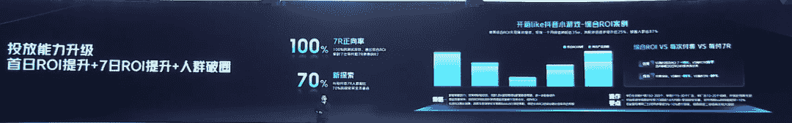

变现能力升级，扩供给+加样式+提效率。

丰富小游戏的变现能力。

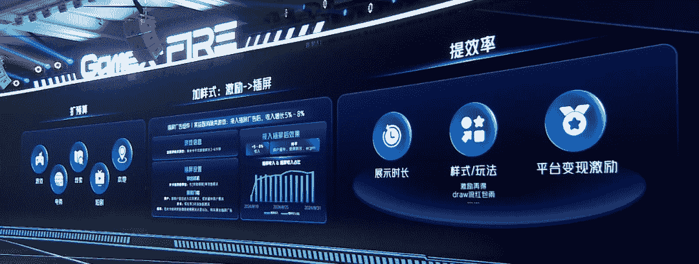

多流量，多版位扩展。打通基建，激进分发with游戏中心联动。

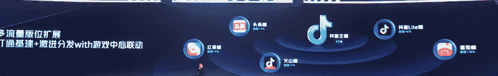

IAA 腰部和尾部客户，提供托管产品，贴合长线经营+效果有保障+素材成本低。

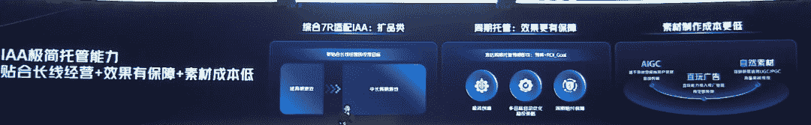

## **巨量引擎分享 4：达人数据**

客户持续入局，游戏供给更为丰富，规模稳步增长。

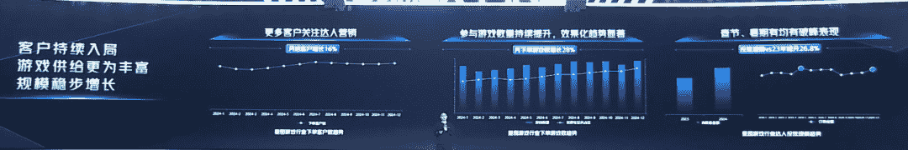

达人投放规模，提升 26.8%。

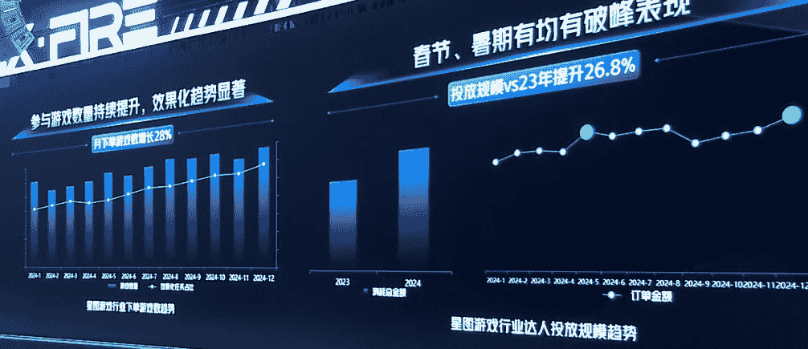

尾部达人有所波动中腰部达人崛起，直播场景优势初现。

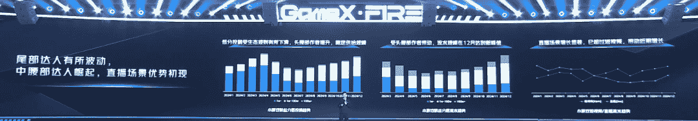

直播场景增长显著，已超过短视频，带动近期增长。

胡扯游戏群里也讨论过这个问题（点击访问）：

+   🛰️视频号互选平台 VS 星图游戏发行人

+   抖音小游戏发行人计划，排行榜上的直播和短视频标签，可能是错的

+

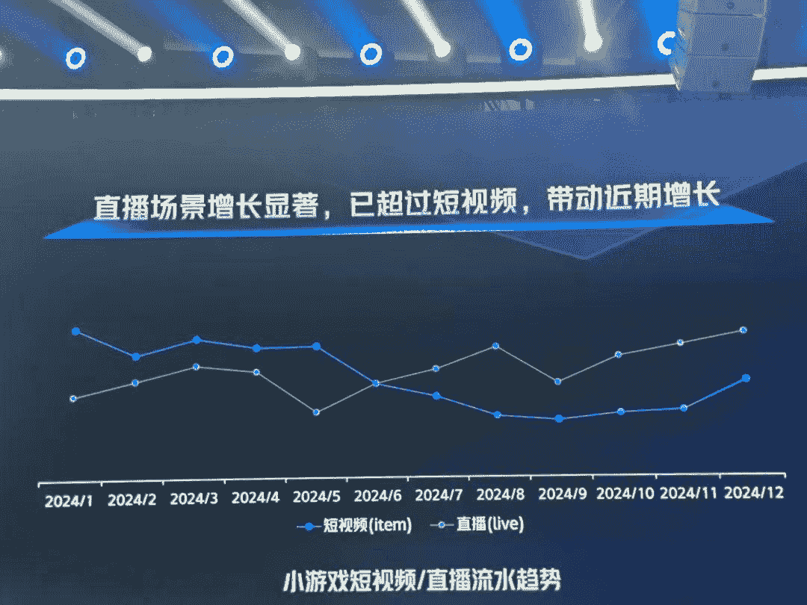

受头腰部作者带动，流水规模在12月达到新峰值。

**腰部达人的定义： **一万粉到十万粉。

2025 年会重点服务直播。

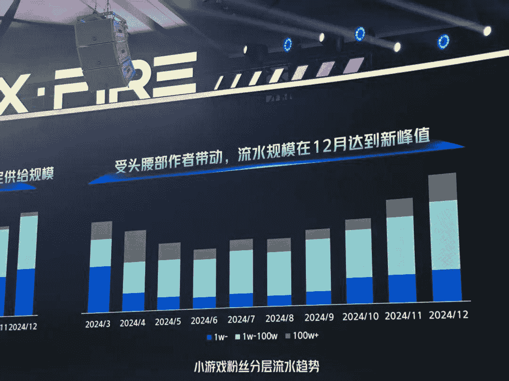

达人营销的价值：素材多样，高跑量能力，人群破圈。

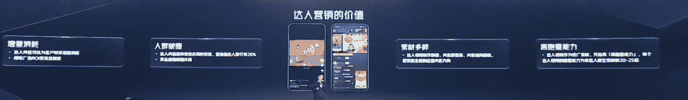

达人触达的和广告触达的人群，只有 20% 重合率。

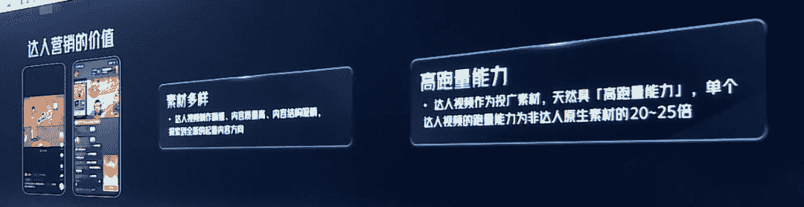

投中：达人供给，投后：放大价值。

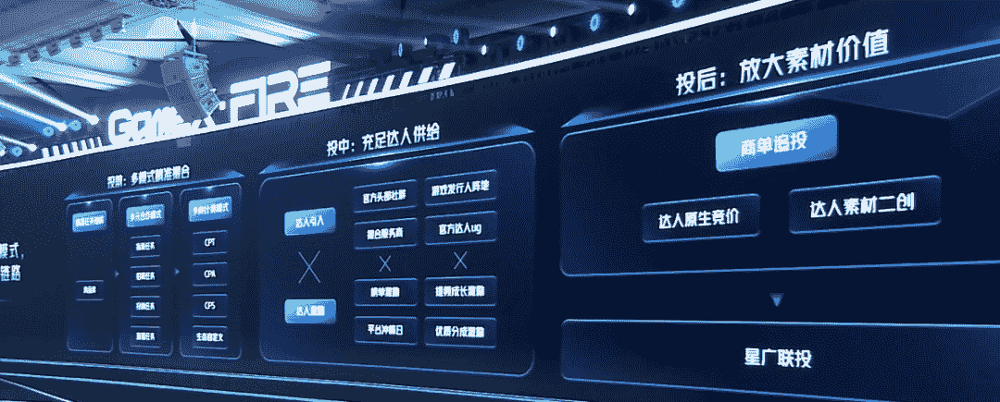

新增指派任务、直播任务，丰富达人选择。

曾老师：指派，相当于 **🛰️视频号的互选计划。**

CPD/CPA/CPS 都支持。

官方社群和机构体系，实现对头部作者的充分建联和覆盖。

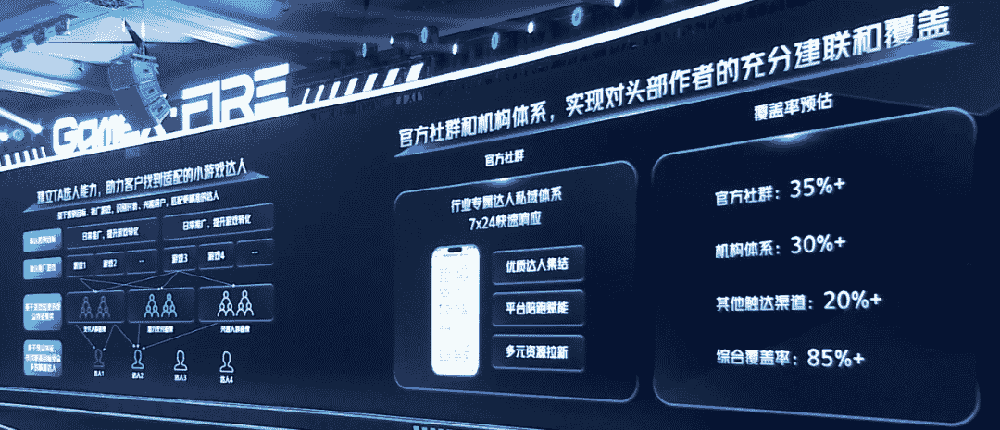

精准识别多渠道触达，基于达人的特点，找到游戏适合的达人。

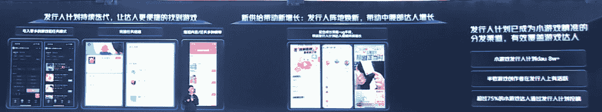

帮助中腰部达人的增长，增加内容/任务多种榜单，引入榜单帮助达人选择。

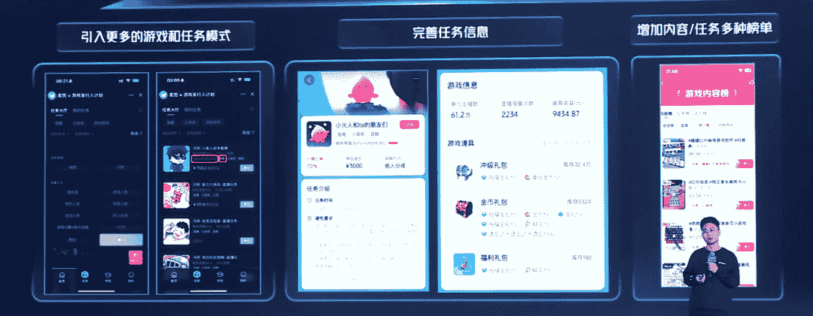

据合服务商在过去一年快速发展，月活跃达人数68万。

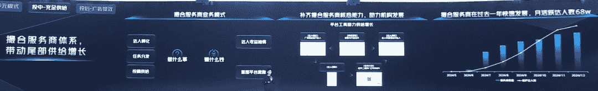

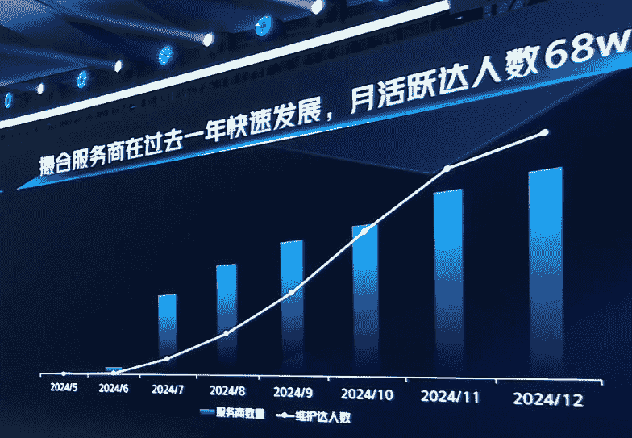

陪伴式答疑，服务商体系，任务分发。

生态策略优化，打劣扶优，提升内容质量。

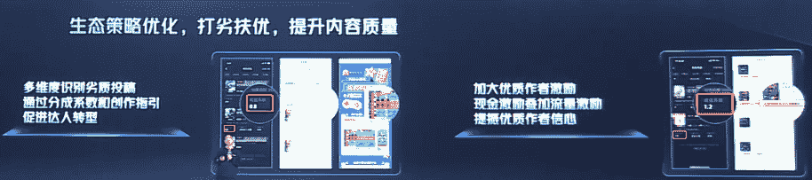

加大优质作者激励，现金激励叠加流量激励，提振优质作者信心。

利用达人提供的素材，扩展广告数量。

百万现金奖励，孵化 1000+高收入作者，1000+高流水小游戏。

## 巨量引擎分享 5：解锁长线经营的流量密码

巨量视角下，小游戏开发者生态日渐繁荣，开发者数量和产品数量日益丰富。

小游戏赛道有大的增长空间。

小游戏行业如何在巨量引擎持续保持高增速?

外部市场趋势:头部游戏品质提升，投放生命周期延长。

游戏产品质量的提升，IAP 付费率、留存率、倍率 均在提升，IAA，头部产品的 ROI 和终生倍率，均提升明显。

**曾老师敲黑板： **这张图请同学们存一下。

节假日在线高，购买成本低，节假日放量很重要。

2024年H2，头部小游戏产品展现出哪些新趋势?

小游戏的市场逐渐在回归产品本质。

创新赛道：塔防、SLG、二合三消

规模处于上开期，竞争虽更为激烈，但只要能做出差异化的题材厅法创意，更具备成为爆款的潜力。

稳定赛道：RPG、放置卡牌、模拟经营

竞争相对缓和，其赛道仍保有一定市场空间，基于已验证的成熟产品数值框架，可以在牌桌上占据一席之地。

产品体验越来越重要。

**行业趋向重度品类**

重度品类**的消耗占比持续提升，融**合like类消耗盘子逐步下降、机会玩法的红利正在消失通过更稳定的传统数值框架，结合 小游戏的轻度体验+社交生态优势 ，以 长线运营+高倍率增长 为产品思路，抵抗小游戏赛道激烈竞争的波动性。

IAA小游戏趋势解读：中长线爆款游戏带动品类格局变革。

+   头部 IAA：中长线产品成为主流。

+   立项思路转变：跟进变现目标及核心人群反推设计方案。

+

消除类是 Top1 品类。

步步为赢:注重产品各生命周期营销策略规划。

新游大推:影响不限于首发前7日，起步越稳走得越远。

小游戏做首发大推，和 App 不同。不追求首日高并发，而是在首周持续增量，重点是筛选最优组合，训练模型，保证长周期的跑量能力和消耗规模。

跑顺模型，避免玄学问题，所以小游戏首发要大推 7 天。

多端联合首发，曝光重合度 35%，转化重合度不到 2%，覆盖 68% 的行业外用户（就是没有被广告转化的用户），带来 20% 的新付费用户，50% 的流量扶持。

保持素材的推陈出新，游戏内增加结合主线玩法的副玩法，使用副玩法的广告素材投放，首日 ROI 提升 10%，素材消耗占比 23%。

休闲类转化最好，消除类是点击最高，2-3 周一个新副玩法推出，画风和玩法要和游戏本身紧密结合。

关键行为+变现ROI双转化产品组合，助力衰退期产品重焕活力。

版本更新期间，大推依然可以破圈，提前两到三周，逐步释放素材，吸引老用户。

2025年巨量引擎小游戏行业营销策略规划

广告模型底层策略全面升级，在内容&创意方面提供更多助力。

## **嘉宾分享1：波克城市嘉宾分享**

灵画师是如何立项的?

关注抖音的热度，思考市场方向。

做自己擅长的，有经验积累的事情。

休闲治愈。

反差、既视感、交互创新。

制作一批素材，验证：CTR、CVR、起量速度。

种田、收菜、抢菜，表现得非常优异。

+   侧边栏复访用户占比30%

+   侧边栏收入占比40%

+   付费次留提开20%

+   付费 7留提开60%

IP 联动营销。

## 嘉宾分享2：高手大闯关、守护世界发行：从 IAA 到 IAP

专注于小游戏发行，当前发行小游戏过百款，总计注册用户过3亿。

跟随小游戏行业发展，发行品类逐步进阶， 超休闲-找茬逆袭-中度休闲-混合变现。

发行过的品类。

**花园特攻队 **(高手大闯关)

注册500万用户，月流水过千万。

**守护世界**

注册400万用户，上线三个月，流水过千万。

超休闲首日回收 80%，中度首日 30-60%，IAP 首日 ROI 10%以内。

**IAA 发行运营**案例花园特攻队。这个思考大家可以看 「胡扯资源库」 里面 CP 自己的 PPT，那个讲得更细致哈。

胡扯游戏资源库（申请权限请注明群号和群昵称）

https://docs.qq.com/smartsheet/DVXZNTEpRYWhUalFq?tab=sc_NFTBLK

关键行为出价，充分探索离打点，打点 3000+ECPM ROI出价，稳定长线回收。素材内容化原生内容定期产出，武器、攻略直播切片，高光时刻混剪。

2000+ 抖音达人，从 0 到 1 培养。围绕主播的需求，优化关卡。

**IAA 到 IAP 的转型**

+   变现模型依赖大DAU

+   长线留存优化，边际收益偏低

+   市场同质化严重、跟进速度过快

+   游戏毛利率下滑、游戏制作成本上涨

守护世界：大盘年轻女性用户占比高，选择二合品类。

女性向产品留存逐步变好，二合产品，对长线回收要求高，侧边栏复访贡献 50% 留存。

字节算法精准，R7 出价组合，对首日和长线都有提升。

短剧中的角色，作为买量素材，4000 达人视频，形成 10000 素材。

这段现场嘉宾的话非常经典，我做了一些简化，方便背诵：

+   **浅尝辄止容易颗粒无收**

+   **产品需要深度，发行需要速度**

+   **研发和发行需要互相信任**

+   新的机会非常多，试错的成本非常高

+   **垂类深耕，机会更大**

---

<https://huchegames.feishu.cn/sync/S5lfdyaWpsdZcnbOjtMcgmUvngc>

<https://huchegames.feishu.cn/sync/OrihdFNVesPoTXbhZHEcKud4nfh>