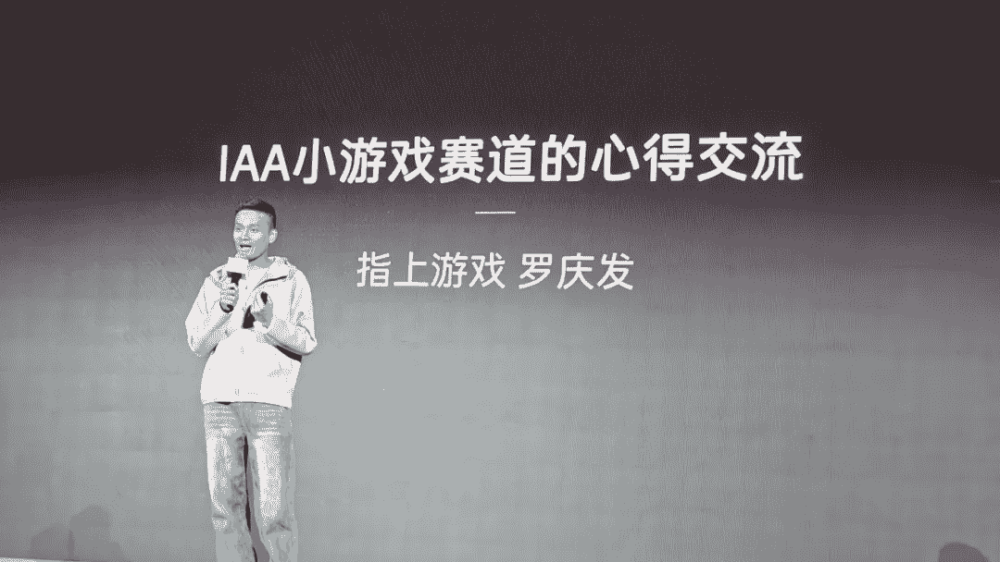
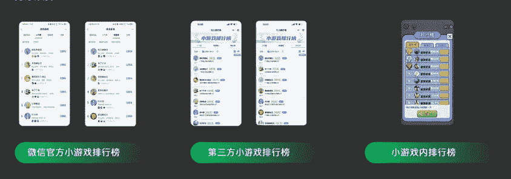
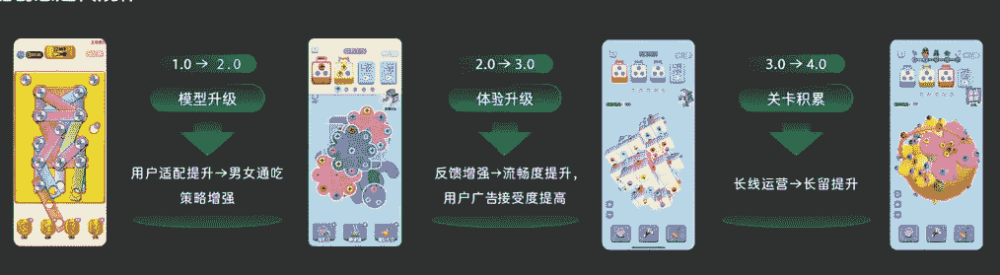
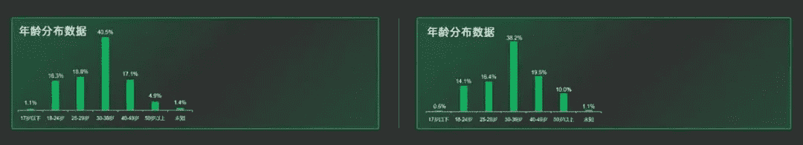
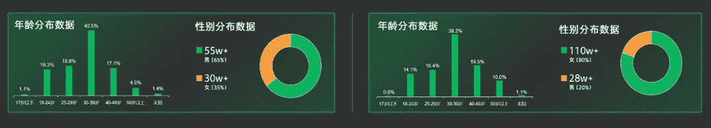
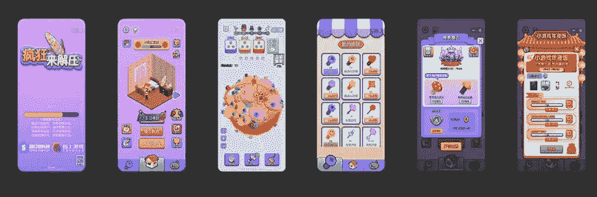
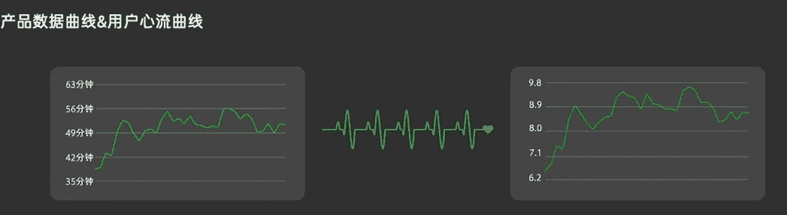
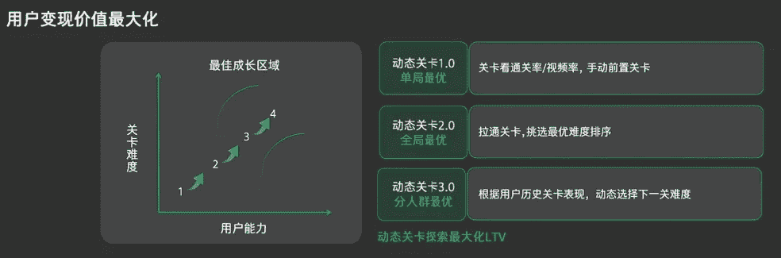
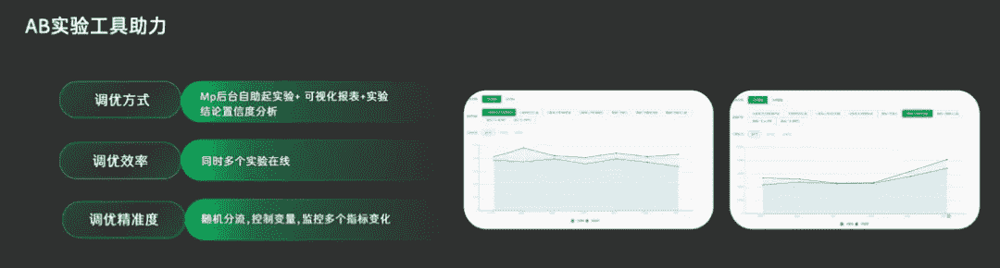
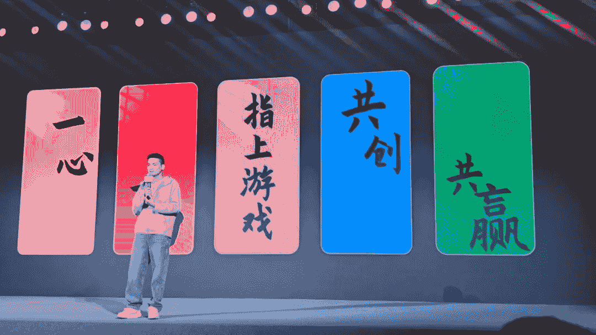

# 指上游戏罗庆发：深耕🛰️小游戏6年，如何做到每年都有爆款？

> 来源：[https://huchegames.feishu.cn/docx/VVotddcbeolx8hxAoihcp7Bhn4b](https://huchegames.feishu.cn/docx/VVotddcbeolx8hxAoihcp7Bhn4b)

> 🔗 原文链接： h[ttps://mp.weixin.q](https://mp.weixin.qq.com/s?__biz=MzIwOTc2MjY2MA==&mid=2247533261&idx=3&sn=43923467ef798d1bbc0e0720baa0f850&scene=21#wechat_redirect)q.com/s?__biz=Mz...

> ⏰ 原创 关注小游戏的 罗斯基2025年01月09日 23:36  广东

1月9日，2025🛰️公开课PRO小游戏专场在广州召开。多个爆款小游戏产品的负责人受邀参加，为开发者带来最新的产品经验分享。

活动上，指上游戏的负责人罗庆发带来了《IAA小游戏赛道的心得交流》分享。指上游戏在2018年入局🛰️小游戏，可以说经历了🛰️小游戏发展各个阶段，并陆续发行了《吃不到我呀》《玩个锤子》《疯狂来解压》等多个热门IAA小游戏。那么他们是如何洞察到每个阶段的热点？如何洞察用户、产品以及合作伙伴的呢？

**以下是分享内容整理：**

大家好，我是来自广州指上游戏的罗庆发，很荣幸受🛰️公开课的邀请，让我有机会站在这里与各位分享和交流一下

这是我创业的第12 年， 2018 年指上游戏进入🛰️小游戏赛道， 6 年多的时间里，我们一路披荆斩棘。借此我真心非常感谢腾讯和🛰️平台，感谢我创业路上所有的贵人。当然，还有来自广州的佛山、深圳、福州、上海、北京等等以及还有当下在线上以及现场的朋友们，包括创业路程中的至亲的家人以及指上所有的合作伙伴。

还有感谢指上团队的成员，真正做到了用心服务，坚定与指上共同成长，来成就了我今天能站在这个舞台的机会。

接下来给大家做一个简短的经验分享，我们如何去洞察这个生态，洞察这个用户，洞察这个产品以及洞察这个生态里面的合作伙伴。

关注多渠道小游戏榜单，深入了解游戏生态

首先给大家展示几张图，分别对应着不同的榜单。

🛰️的畅玩榜和人气榜，可以帮助我们进入生态和了解生态。通过榜单观察，可以快速补充生态知识，畅玩榜代表着是广告 IAA小游戏的热度排序（当日活跃度），而人气榜则是代表新增以及在线活跃的规模。特别是从流水到人气规模的双榜单第一的产品，一定是值得大家研究和探讨。

而为了回溯榜单数据，我们还可以通过一些第三方榜单来观察。

想要深入生态，一定要多关注榜单，从榜单中提炼什么品类，或者什么产品能够在榜单中持续且稳定。持久性和头部的榜单代表着研究价值。

了解平台，了解品类，如何了解产品？其实很多游戏都会做好友排行榜，了解一款产品真实的数据，就要去接触核心用户，好友列表当中越头部的玩家越是核心用户。要做好小游戏，除了看表面，一定要去深入到更深层次，才能够知道这个生态和这个品类以及这个产品用户的真实情况。

创意的迭代是有规律可循，要敬畏创意

在品类洞察方面，23年和 24 年的打螺丝玩法都是一个热门方向。

我们以3D 打螺丝产品的一个创意迭代来分析。

2023 年，指上游戏发行了一款《玩个锤子》和《玩了个锤子》的游戏，研发方是广州勇往。最早期的打螺丝玩法偏益智。在每一个螺丝拔掉的过程当中，金属块的晃动和掉落都会让人有解压感。

2023 年，我们大推了打螺丝产品之后，市面又涌现出新的创意融合2.0版本，2.0 的迭代更多是在模型的升级和解决更多的用户适配。但在这个过程中，人群画像开始转变。相比之前，无论是画面还是整个玩法都更硬，男性用户的占比较高。随着2.0、3.0、 4.0的迭代，这个玩法的美术风格也在变迁，更柔和的画面让男女比例发生了变化。

从 2.0 的 2D 版本到 3.0 的3D 化之后的反馈效果会变得更强，流畅度也提得更深。画面3D 的代表作是《最强螺丝王》，也是 3.0 和 4.0 产品在整个生态最 top 的代表作。

3.0 ~ 4.0 的时候，大家会发现变化只是在模型。因为 3.0 的时候《最强螺丝王》采用了乐高积木式来搭建模型和形状，然后真正迭代到 4.0 的时候，它的关卡内容变成了生活场景，还有现实生活当中的物件等等的一些实物模型结合。

在整个品类创意玩法迭代的变迁过程当中，大家会觉得难点是什么？是在于我怎么知道下一代产品是怎样的。

当然创意的获取，取决于大家对行业的热爱，以及对事物或者说领域的专注度。以往海外的创意团队比较领先，在 2.0 和 3.0 的打螺丝产品迭代中，我们找到了相对的原型去做参考。但并不是海外创意直接用就可以，单一的创意是不够的，好的创意需要有好的生态、好的本地化能力、好的发行来一起去促成产品迎合整个广告生态也好，整个游戏生态也好，一起去面向用户。而创意的迭代是有规律可循，去发现规律，寻找规律。但也敬畏创意，要敬畏产品。

一个玩法不代表着一套数值永远是最优解

这里有一组年龄分布数据图，是我们截取了某些产品里面的一些用户数据。可能从主观判断，大家会觉得两张图差异不大。

我们再结合某一天用户的在线活跃来进一步观察。两张图分别来看，右侧的男性占比超过了 60%，左边的女性占比超过了80%。

但这些数据都是来自同题材的打螺丝玩法的IAA小游戏。

这两张图的数据背后是想表达，年龄群一样，但性别比例不同的时候，商业化的价值点也是不同的。通常来说男性更高的占比产品，广告eCPM相对也会高。

对研发发行来说，同一个产品，想要覆盖两个画像的人群，即使是IAA这种针对泛用户群体的产品，也是很难做到。一个玩法不代表着一套数值就是最永远最 Top 的。发行与研发的核心在于服务触及的用户是哪些人群，我们如何给他们去调配游戏最佳的体验。

有时候会发现一个产品为什么会有两个不同的名字，其实我们也是在不断地去做验证，真正地去照顾到用户规模，又能够触及不同玩家群的实践。

IAA的休闲游戏，用户心流体验非常重要

接下来简要复盘《疯狂来解压》这款产品。

《疯狂来解压》这款产品在长线的迭代过程中，1.0、2.0、 3.0 最大的区别在于哪里呢？

这款游戏的特色是每一关都独立是一个游戏，极少能玩到一些重复的关卡，这种持续的投入和研发的成本相对要比其他的一些品类的产品会更高。比如现在迭代到 1 000 关，其实是等同于做了 1 000 个模型，而且不重样。

我们通过两组图来帮助大家去了解生态和产品。

如图左侧是用户时长，右侧是广告频次。这两组数据截取自我们在一些产品在调优过程。并且代表着这个生态里面 IAA top 头部的产品的一些数据。

对比规律，大家会发现时长的增长比与广告次数的增长是正比例。也代表着用户的时长越长，我们 IAA 的产品才有可能把广告次数拉得更高一些。

广告次数的增长一定是在时长的增长的前提下，那时长是什么？时长是用户对这个产品内容的认可，对这个题材和这个玩法的认可，本质上是一款好产品、好内容迎合用户。在时长保证下，一定能够调出用户最佳的游戏体验心流。对IAA的小游戏来说，用户心流体验非常重要。

举一个例子，有些玩家会抱怨广告有点多，如果我们给大家一个无广版的《疯狂来解压》，玩家的心流曲线会变成过山车式和平线式的区别。真正好的产品的生命周期越长，广告是很好的一个点。国内的IAA小游戏生态现阶段已经成长得非常好了，用户对看广告的接受度很高。

4 ~ 6 分钟一个广告是最佳比例

不过不同游戏的时长会随着不同品类变化。我们总结下来， 4 ~ 6 分钟可以理解成 5 分钟左右的一个游戏体验配一个广告点，效果最佳。

当然不是说在 4 分钟30 秒或 50 秒时候就一定出广告？只是在这个绝对值的比例数来看。在绝对值当中， 4 ~ 6 分钟配一个广告体验是符合用户的心流。具体广告放在第3分钟还是第7分钟或是第9分钟，是随着游戏和用户行为来调整的。

我们刚刚为什么要讲到广告频率，有节奏体验的内容很重要。如果在这节奏内容没有调整好之前，叠再多的关卡都是无用功，因为用户前面就已经流失了。

在一款产品上线的过程中，我们会更多针对关卡调优。

要结合用户画像去匹配推关卡的数值，我们做到了持续迭代，同一个包体，不同的用户进来，可能都要去做区别，甚至可以理解成一个产品推到一定规模之后，核心用户群也在变化。一款真正好的游戏服务于大人群的产品，它的数值其实跟 IP 也一样，不是一成不变的，内容也是需要持续去迭代。

当然所有的这些关卡的调优，其实最终追求的东西就是我们专业术语，厂商叫作 LTV 最大化，广告产品 LTV 的最大化其实取决于两大核心要素，一个是ARPU 值，一个是留存系数。

**善用平台能力，助力游戏提升数据**

🛰️小游戏生态的用户虽然还在高速增长，但其实整个平台的很多基建已经相对非常完善。这里面分享两张截图，是🛰️小游戏官方后台的 AB test 实验工具。

我们在做新品的时候，会跟研发做很多的测试验证， AB test 的测试很重要，我们最怕的是什么？有主观的经验判断，一定要基于对比测试验证。

指上游戏拒绝主观判断问题。我们希望内部从上到下，一定要与大家去体验探索、发现问题，用客观的事实去为主观判断去做校正。这一点当中，就是这两张图提到的 AB test 测试的重要性的一个问题。

像头部产品，我们的 AB test 测试的维度会更多，甚至只要有一个负向，我们可能都会慎之又慎。如果都是正向的情况下，我们可能才真正会去做到全量的去覆盖所有的用户，这背后是重视产品和产品背后所有的玩家。

**创业12年的一些感受和思考**

最后环节再跟大家分享在IAA赛道上的一些思索。其实很简单，以小博大。

创业 12 年，包括做🛰️、做小游戏下来的话也有 6 年多，我一直在想从一个草根，从一个没有背景的人在创业，在广州扎根，然后再有拥有七八十号人的团队，然后一起去奋斗。在这个历程当中，创业和跟做IAA 小游戏是很相似的。我一直在做一件事情，在做以小博大的这个事情。

但并不是说用小钱来赚大钱的意思。我对小理解，是从创业到现在包括做🛰️小游戏，深耕 6 年半，是真正做到了别人看到的小，但其实你自身是有持续积淀叠加的。

以《疯狂来解压》为例子，为什么对这个研发团队很有信心？然后我们一直合作，而且合作的成功率非常高。

可以有人觉得是运气太好了。这个团队其实原来是沉淀在海外，做了非常长的时间，甚至服务上亿的海外休闲游戏用户。虽然拿单产品看会感觉研发周期就有一两个月，或者是说小几十万也能到。但我们是看到团队背后十年在这个行业陆陆续续的沉淀，以及当下节点IAA小游戏的机会。不过小也与短周期有关，快速去验证并不违背比如一个两周或三周作为一个核心玩法做出一个 demo 来快速地去迭代验证这个小是没有问题的。

实际上短周期做完出来之后，一定要围绕着线上的用户去调产品，如何能把产品调到最好？不是单一用户，或者是单一发行给指导就能够做得到的，核心还是在于对品类，对玩法和对用户在游戏里面的心流体验能不能把控得更好。🛰️小游戏生态已经非常大了。有足够好的内容，足够好的玩法，玩家是一定能找得到的，如果找不到那就是我们发行的责任。

敬畏这个行业，也相信能够跟指上的团队，还有跟生态的合作伙伴能走得会更远。

**一心一力，共创共赢**

最后，与大家分享指上游戏的价值观，其实就八个字，一心一力，共创共赢。作为指上的创始人自上而下，我们把这个八字的理念深深地植根在我们团队上。我们一心是强调指上团队，真的是团结一致、专注努力做到专业用户至上的理念。一力是集中力量合作协同、执行力强，共创是创新驱动，共同参与。共赢就是共享成长和共享利益，长期利他主义的共赢，而非短期的一个利益的分配而已。指上一路披荆斩棘，一路柳暗花明，我们自始至终坚定自己的初心和本心，去做到一心一力，共创共赢。

大家会觉得指上既然是做专注做发行，是否一路在市场上都在找很多的产品？其实并没有，因为指上到当下都没有市场，也没有专门的商务。最大的市场商务基本就是我，还有我的好拍档两个人，其实我们真正在寻找的是刚才分享的理念和内容。

大家能够真正去做到共同为这个生态去创造更好的内容，而且也愿意有长期主义的理念去拥抱这个合作，去拥抱这个生态。

小游戏这六年、在腾讯广告的投放、 IAA的高速增长的过程当中，我们指上也很幸运，在合作伙伴的支持下，我们持续拿到了正向的结果。就是每一年基本都一些头部的一些爆款产品，我们提炼爆款产品背后的三个核心逻辑，大家又会发现，与刚才分享的又很相似。

第一，在成熟的生态市场下，我们如何去了解这个生态，以把握住品类的市场时机作为第一要素。

第二，做有竞争力的产品，真正对品类玩法有积淀、有认知、有理解的，且有耐心，打磨出来有竞争力的产品。

第三，寻找靠谱、有实力的合作伙伴。生态足够大，研发与发行也非常多。大家真正能够理念共通，共同的服务于用户，服务于生态。市场、时机、产品力和真正能够服务于用户相结合。

再次感谢在场所有朋友的聆听。祝愿大家 2025 年都有更大的突破，取得更好的佳绩，新年快乐。

---

<https://huchegames.feishu.cn/sync/S5lfdyaWpsdZcnbOjtMcgmUvngc>

<https://huchegames.feishu.cn/sync/OrihdFNVesPoTXbhZHEcKud4nfh>