# 上线3个月新增用户近4000万，爆款小游戏《时光杂货店》研发立项复盘

> 来源：[https://huchegames.feishu.cn/docx/LgazdxFiuobpfcxubM0cOEPMnve](https://huchegames.feishu.cn/docx/LgazdxFiuobpfcxubM0cOEPMnve)

> 🔗 原文链接： h[ttps://mp.weixin.q](https://mp.weixin.qq.com/s?__biz=MzIwOTc2MjY2MA==&mid=2247533261&idx=2&sn=5a261bd75f55c7d62a53edaa9eb4d3d1&scene=21#wechat_redirect)q.com/s?__biz=Mz...

> ⏰ 原创 关注小游戏的 罗斯基2025年01月09日 23:36  广东

1月9日，2025微信公开课PRO小游戏专场在广州召开。 多个爆款小游戏产品的负责人受邀参加，为开发者带来最新的产品经验分享。

活动上，《时光杂货店》的项目负责人廖佳带来了《从<时光杂货店>看“模拟+”赛道》分享。《时光杂货店》通过怀旧的题材+模拟经营的前期玩法，吸引了远超题材受众的用户群体。那么在产品立项之初，团队是如何思考的？是如何找到这个有趣的题材的？

**以下是分享内容整理：**

大家好，我是《时光杂货店》的项目负责人廖佳。今天主要分享产品在立项之初做的选择、项目发行前期做了什么以及我们对模拟经营赛道未来的看法。

先来介绍一下产品情况，《时光杂货店》的研发商是厦门延趣，总部在厦门，广州有分公司。此外还有《寻道大千》《叫我大掌柜》《无名之辈》等多款知名产品。

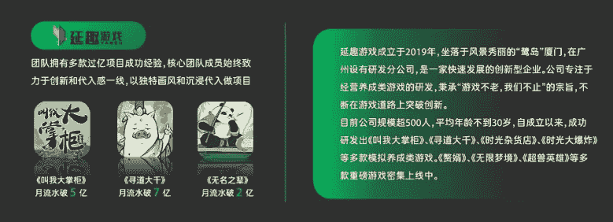

《时光杂货店》的发行是三七手游，它是三七互娱旗下运营模块的核心子公司，从事全球移动的发行业务，成立于 2013 年，累计发行了有大概 2, 000 多款手机游戏。这几年大家比较有印象的产品应该是《斗罗大陆：魂师对决》《小小蚁国》《凡人修仙传：人界篇》等等。未来还会有很多新的项目，也欢迎大家关注。

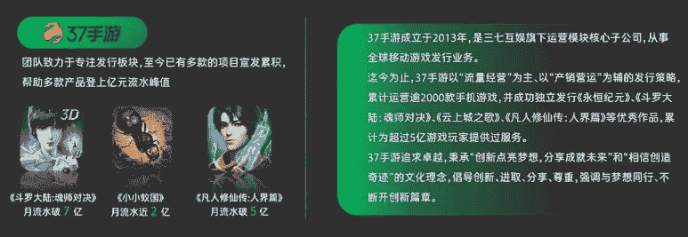

《时光杂货店》：怀旧题材模拟经营玩法的爆款产品

《时光杂货店》一款模拟经营类的游戏，题材取自国内八九十年代的背景，具有非常浓厚的人文气息和社会风情以及很强烈的时代的印记。游戏的背景故事是玩家将扮演一个穿越者回到 90 年代，从早餐摊开始经营自己的店铺，扩大规模，商业竞争，到最后发家致富的故事。故事里面提到两个词，一个叫开店经营，一个叫商战，这也是产品的核心玩法。

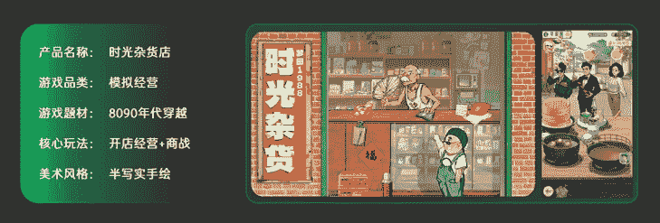

下图是游戏在微信后台的真实数据。游戏在今年9月 20 号左右上线的微信小游戏，截至目前有三个多月。产品在微信小游戏上已经有接近 4, 000 万的新增用户，这是后台的真实截图。流水曲线跟这条曲线也差不多，可能斜率会稍微高一点，这里就不给大家展示了。

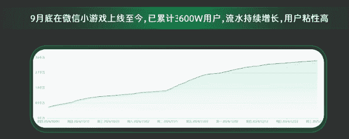

赛道选择：可观的大盘数据+突围的新品少

回到项目本身，为什么会选择这样的题材跟赛道？

首先说赛道。我们内部对模拟经营做过一次调研，图中是调研的数据，有内部也有外部的。这个数据是我们内部统计分析使用的统计方式，不算特别严谨，也不代表权威，仅供参考。

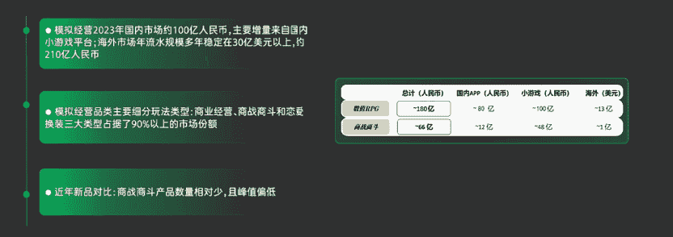

可以看到这里有三个结论。

第一个结论是模拟经营赛道在 2023 年的国内市场的盘子大概有 100 亿人民币。这个数据对比 2022 年有很大的增长，增长最大的来自小游戏、小程序。100 亿是什么概念呢？右边有一张图可以简单对比一下，大概是数值 RPG 游戏 2023 年总盘的一半多，体量不是特别大，但也不小。

第二个结论是模拟经营大品类下，细分的品类有商业经营、商战商斗、恋爱换装等等品类，这三个品类占据了大概 90% 以上的市场，那如果大家是想做大盘子的话，关注这三个品类就够了。

第三个结论是近些年商战品类产品的细分品类，新品特别少，而且峰值也不算特别高。以上信息用一句话来概括，就是模拟经营的盘子还算可以，商战品类的竞品特别少，机会很多。

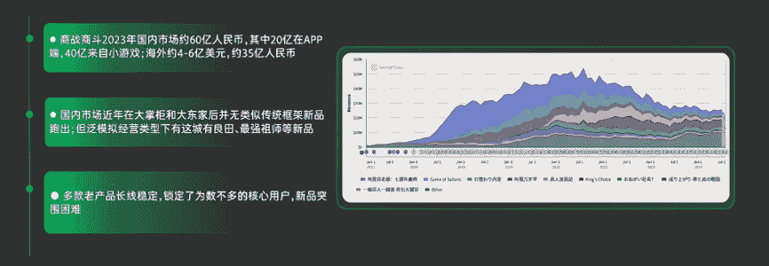

再往下看商战细分品类的市场模型，2023 年的国内的市场盘值我们估算了一下，大概是 60 个亿。其中小游戏占到了大概 6 ~ 7 成，也就是 40 个亿左右的盘子。

我们发现在大掌柜、大东家两款产品之后，很久一段时间没有跑出类似传统框架的新品。而且我们发现目前市面上的老产品，他们的长线数据都特别稳定，把为数不多的核心用户都锁在了一起，新品想要突破特别困难。

注意细节，不是没有新品，是没有跑成功的新品。很多游戏其实上线已经 6 、 7 年，收入依然很稳定。看图可以看得出来，后面的长线数据都是他们的收入数据，很稳定。而新品如果没有明显的体验升级，用户可能会在玩着玩着的过程又回到自己的老游戏。概括就是商战商斗这个细分品类，它盘子也还行，但是如果想入局一定要有体验创新，否则无法突围。

题材选择：情怀自带热度，潜在用户超出想象

要突围就要体验创新，重要的是体验还是创新？

大家都知道创新很难，眼光都局限在要做玩法创新。但是玩法创新只是其中的一种做法，我们说创新的本质是体验感上要有新的感受。它可以是玩法，它也可以是题材。我们为什么会选 80、90 的题材呢？它主要源于我们发现像王蓝莓、张同学这种主打 80、90 怀旧的博主和内容在短视频平台相当火爆。并在当时带起了一阵怀旧风和情怀风。

（当时统计的数据）

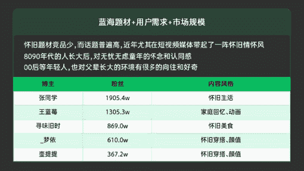

既然怀旧题材的用户多，热度特别高，而且群体也特别活跃。我们对这个群体进行简单的剖析之后，发现这种现象背后其实是一种情感认同，是 80～90年代出生的群体对无忧无虑童年的怀念和认同感。很好理解，当你看到一些老物件，看到一张老海报，会忍不住多看两眼。多看两眼这个行为，背后是大家觉得它很亲切，认为它有一种情怀在，它天然的会有热度。

再往下看，我们通过对这批用户进一步调研，发现 00 的群体很喜欢这个题材。我们研究发现，这是因为他们对自己父辈长大的环境有一定的向往和好奇，这时候我们有一个结论，我们确信 80、90 题材，它的直接用户群体和潜在用户群体都相当庞大，庞大到可能会超出我们的想象。

穿越首选赚钱？情怀题材天然契合经营玩法

基于以上关于题材和赛道的信息，综合敲定了立项思路。

我们认为模拟+商战就是我们要走的赛道。因为这也是研发的优势，研发最擅长做的就是这个方向。但问题就在于怎么解决创新体验的问题。刚刚提到， 80、90 题材打的是情怀，打的是大家有共鸣的情怀。

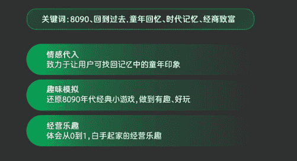

大家想象一下，如果穿越回8090年代，你们会干什么？每个人都会有一个思考，回去可以做很多事情，这是天然的话题和热度。我们认为题材和话题在一定程度上能给用户带来相对较高的情感认同以及新鲜感。一定程度上也解决了创新体验感受的问题。

基于刚刚的理解，我们就很快地敲定了关键词，第一个叫80、90，第二个叫回到过去、童年回忆、时代记忆。这里还有一个最重要的词，回去之后，想干吗？想买房、买彩票、买股票、想做生意，对吧？这所有的背后的行为其实就两个字，赚钱。所以这里最重要的关键词叫经商致富。

大家有没有发现 80、90 年这个题材跟做生意天然的就结合在一起？这是天然的优势，所以80、90题材加商战这个组合天然的就会有一种莫名的契合感。关键词定调之后，我们也确定了玩法思路，简单来说要做三个事情。

第一个要做到用户想象中的80、90年代的记忆中的样子。

第二个要做到好玩，要把小时候玩的东西做进去。

第三个要做到代入，希望玩家能体验从 0 到 1 白手起家的经营乐趣，能够有真正的代入感。

以上说的内容就是我们期望在题材和在玩法上都能给用户的新鲜感。

项目做完测试完之后，要分析用户画像。

粗略一看没什么特别的惊喜，模拟经营品类男女比例 6: 4，很正常的比例。年龄人群大概是 24 ~ 40 岁，基本上涵盖了大部分的8090年代出生的人。用户结构是很标准的金字塔结构，跟我们最开始的设想很像。基于这个用户人群，我们做了玩法上的迭代创新，这里提炼了一个新的关键词：沉浸感。这是一个老生常谈的词，我们认为这个特殊的题材的属性，用户很容易被情感代入，所以沉浸感就显得特别重要。

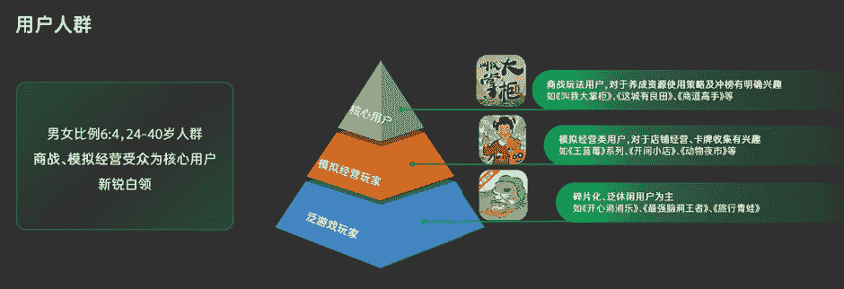

多维度打造游戏的真实感+沉浸感

我们是怎么做的？

第一个是在 80、90 年代的生活场景做了还原，但其实像还不够，还需要一种真实感。举个例子， 80、90年代有什么店铺？有早餐摊、书摊、小卖部、理发店等等，这些店面先给它一个个开起来，之后店面的装修风格、成色、细节等等都给它做完。做到这一步之后，它也只是像，还需要增加一些经营的真实感。

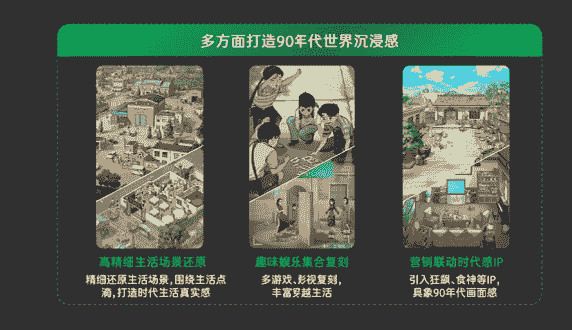

比如说早餐店怎么做真实感呢？油条要炸，顾客要排队，买卖的流程要符合真正经营的操作体验。还有一些细节，比如说顾客吃完之后再来一句吐槽，说东西怎么这么少之类的，把真实的感受做进去。再比如小卖部会有进货、上架、整理等等的操作，做这些东西就是希望把交互做得更深一点，把真实感受做得更像一点。同时我们又希望它简单一点，所以我们在入口那个店铺，也就早餐摊，主打点点点的轻松放置。其实这不冲突，我们想要做得又像，又想要做得轻松，是可以同时并行的，这是在生活场景还原上做的第一件事情。

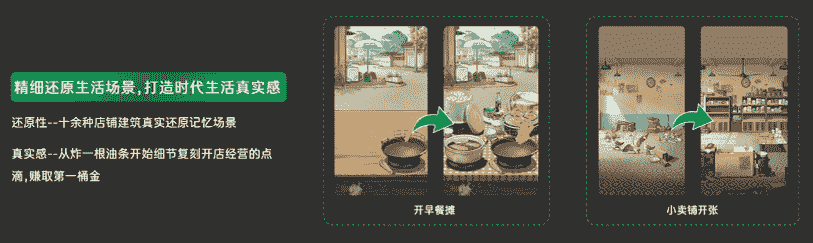

第二件事情是娱乐内容的复刻，我们希望把 80、90 年代的用户的记忆唤醒，所以需要有茫茫多的细节，需要不断地给用户惊喜。举个例子，童年的时候玩的趣味游戏，比如发条、青蛙、宠物鸡等等，电子游戏类的比如说扫雷、抢滩登录、雷霆等等，在游戏里面真的能游玩，而且关数还不少，甚至有一些难度还挺高。很多玩家反馈他玩得还挺上头，这说明我们踩到了用户的心理。还有比较十分经典的电视广告，比如说某大泡泡糖、某白金等等，大家可以在游戏里面拍广告、拍电影。

另外就是街角巷边的彩蛋，比如小时候看到的套圈圈等等。这些东西在游戏里面都做进去了，玩家在里面都可以看到，不同的人都可以看到自己记忆中的一些东西，重温情怀，这是我们做的第二件事情。为了拓圈，我们一定程度上辐射到了 00 年后的一些记忆，整体上并没有什么违和感。

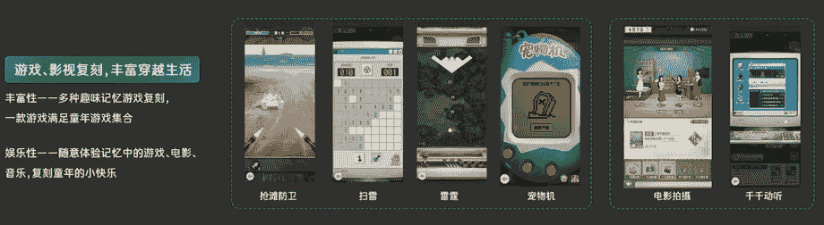

第三个事情，我们做了营销结合上的突破，为了加深用户对 90 年代的记忆感，引入了经典的或者大热的IP，比如狂飙、食神等等。在我们的角度来看，无论是人物形象还是背景世界观，某种程度上都跟 90 年代比较贴合，可以更好地帮助用户具象 90 年代的画面感。从目前的效果来看，这个决策还是比较有效的。

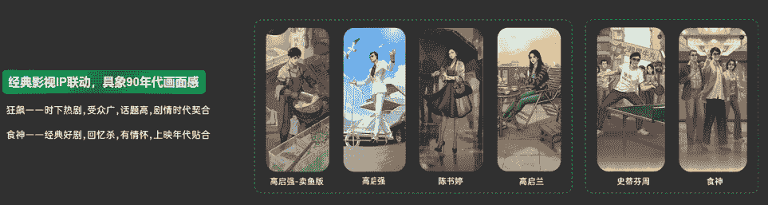

题材突破+玩法创新造就爆款产品

总结一下，《时光杂货店》走的是模拟经营+商战，这我们做了两个突围点：

第一是题材上的选择，我们发现怀旧题材，媒体热度高，话题度也高，80、90年代的回忆也更容易情感代入，市场规模也大。

第二是在玩法上也创做了创新，前期入口上主打放置体验，让用户能够更轻松地带入，玩法上还原和复刻 90 年代的生活，让用户能够足够的沉浸。

在营销结合上引入了契合世界观的IP，达成了所谓品效合一的理念，这是《时光杂货店》的前期主要的做法。当然除此之外还做了很多东西，比如在玩法框架上做了很多细节的创新，比如把传统框架的四维属性改成了一维，进一步降低了用户的门槛。

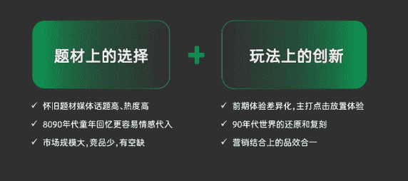

我们把概率性的内容、策略性的内容极致压缩，甚至有些直接砍掉，放大了收益性的心流，主要把用户的爽感做起来，这些是我们在玩法上做的东西。同时我们也做了很多研究，比如发现模拟经营其实也有生态逻辑，跟 SLG 一样，它能在前期确定相对较优的生态解。比如多少用户一个服，生态里面付费用户和非付费用户的占比是怎么样的？都有相对较优的解。

多端发行：微信小游戏存量用户是其他端的 3 倍多

接下来简单聊聊，我们在多端发行下做的数据的观察。

《时光杂货店》走的多端通服的策略，小游戏、iOS、安卓混在一起玩，所以我们可以很直观地对比不同渠道的数据。

我们发现有几个数据特点：

第一个是存量用户的比例，微信小游戏的存量用户是其他端的 3 倍之多。微信小游戏的体量真的很大，还有很多空间可以继续探索。

第二个是统计了用户重复率的数据。我们发现小游戏跟APP 的重复用户在小游戏上线初期大概只有5%。当然有一个前提条件，我们是在8月 1 号上线的APP，在9月底上线的小游戏，这个时候 APP 上已经有很多用户了，但是微信小游戏的重复率依然只有5%，而同期其他数据大概是 20% ~ 30% 左右。当然统计口径、统计周期以及游戏品类会影响数据结果。我们想说的是，微信小游戏的用户跟端包的用户还是有相对较大的区分隔离性的。微信小游戏能触达到更多 APP 触达不到的用户。

第三个数据是关于 PC 端的数据，或者叫 PC 端的优势。我们知道微信小游戏有很多优势，最大的优势就是轻量化和便捷性。微信小游戏天然的会有社交属性，它基于微信本身有强大的传播性，可以很轻松地分享、转发、裂变、邀请好友等等，这些都是微信本身的优势。但我们想说的是，我们发现微信小游戏跟 PC 端的互通才是最大的惊喜。

根据我们自己的统计，微信小游戏有 20% 的用户会在有条件的情况下去使用 PC 端去玩游戏，而使用 PC 端去玩游戏的用户粘性比其他的用户大概高 15% 以上。现在来看数据可能是30% 甚至更高。

感谢微信提供的多平台、多形态的快速适配的能力，我们也希望说微信以后可以在 PC 的版本上做更多的触及，让我们可以把优秀的内容推送给用户，这是我们基于多端发行的一些数据的观察。

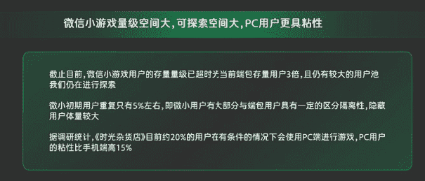

模拟经营做入口有先天优势，但需要后端玩法变现

最后聊几句对模拟加赛道的看法。首先我们认为模拟经营作为入口，具有轻度化的先天优势，上手门槛很低，而且相较于别的游戏品类。模拟经营在做代入感的时候，一般不需要海量的场景资源，它只需要用概念、用内容就够了，所以在成本、周期、难度上都非常具有优势。同时因为研发或者说叫代码的复杂程度、模拟经营的性能优化等等方面的东西，它都有比较大的空间。

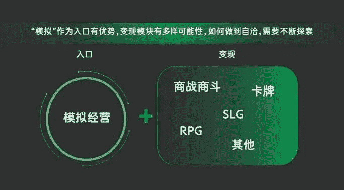

但是模拟经营的变现能力偏弱，它需要用其他的玩法、用其他的模块来填补。我们认为其实变现模块有各种各样的方式，像《时光杂货店》采取的是商战的中长线榜单玩法的循环。市面上可以看到很多别的各种各样的做法，比如用 SLG 的赛季生态、赛季社交生态，有用 RPG 的 GVG 的社交生态等等，存在各种各样的可能性，相信未来也会有更多的方式被挖掘出来。

最后我们想说的是，模拟经营的用户线下社群都非常活跃。我们发现一个现象，用户需要的其实是个舞台，用户在舞台里面需要比个高低。所以我们认为模拟经营玩法作为入口，提供的是话题以及场景，变现玩法作为中长线的内容，它提供的是用户的比拼的舞台以及深度。关键的问题就在于如何把入口和中长线的内容做到自洽，这就需要我们不断地去探索。以上就是我发言的全部内容，感谢大家。

---

<https://huchegames.feishu.cn/sync/S5lfdyaWpsdZcnbOjtMcgmUvngc>

<https://huchegames.feishu.cn/sync/OrihdFNVesPoTXbhZHEcKud4nfh>