# 爆款小游戏《向僵尸开炮》立项研发复盘，内容型产品如何做长线运营？

> 来源：[https://huchegames.feishu.cn/docx/I8goddXlyo2juzxZUADcORqOnyh](https://huchegames.feishu.cn/docx/I8goddXlyo2juzxZUADcORqOnyh)

> 🔗 原文链接： h[ttps://mp.weixin.q](https://mp.weixin.qq.com/s?__biz=MzIwOTc2MjY2MA==&mid=2247533261&idx=1&sn=82f00ab0861071cc5eb3b6a389a35b89&scene=21#wechat_redirect)q.com/s?__biz=Mz...

> ⏰原创 关注小游戏的 罗斯基2025年01月09日 23:36  广东

1月9日，2025微信公开课PRO小游戏专场在广州召开。 多个爆款小游戏产品的负责人受邀参加，为开发者带来最新的产品经验分享。

活动上，《向僵尸开炮》制作人廖明辉带来了《用优质内容“垄断”用户》分享。《向僵尸开炮》作为2024年的爆款小游戏之一，通过有趣的玩法融合及热门题材，受到了市场的认可。那么这款产品是如何诞生的？有哪些值得回味的故事呢？

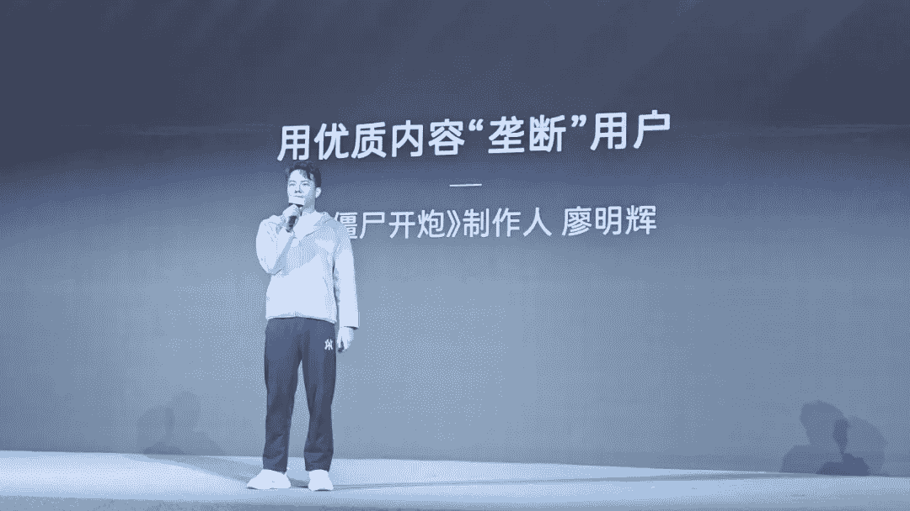

**以下是分享内容整理：**

大家好，我是《向僵尸开炮》制作人廖明辉，很高兴今天能在这里进行分享。

**策略塔防+肉鸽随机的爆款小游戏**

简单介绍一下产品，《向僵尸开炮》是一款上手门槛低，射击割草爽快感强，核心战斗融合了塔防策略和肉鸽随机性操作的小游戏。局外的系统大多数为流派构筑，且带有轻度的 RPG 养成。可以说休闲策略、随机、爽快感，贯穿整个产品的基调。

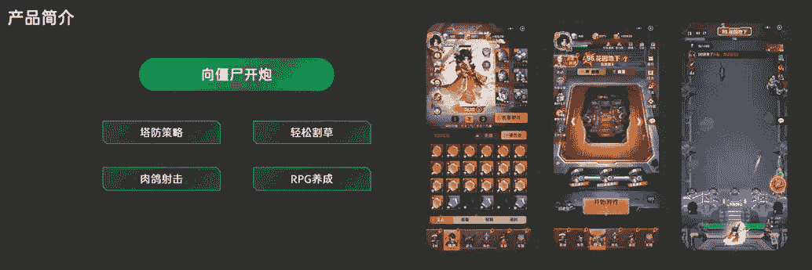

《向僵尸开炮》在2024年2月上线微信小游戏，3月开始爆发，至今依旧稳定在畅销榜的前三名。

很多人会问，《向僵尸开炮》有什么特殊之处？为什么很多东西都不符合常规的游戏主流，例如游戏前期偏单机的慢体验，还有系统的养成以及商业化，不是重数值类型且随机性非常强。游戏是如何在SLG、MMO、卡牌等重度游戏竞争中占据一席之地？

这里简单为大家，从项目的立项到爆发期以及长线运营做个复盘分享。

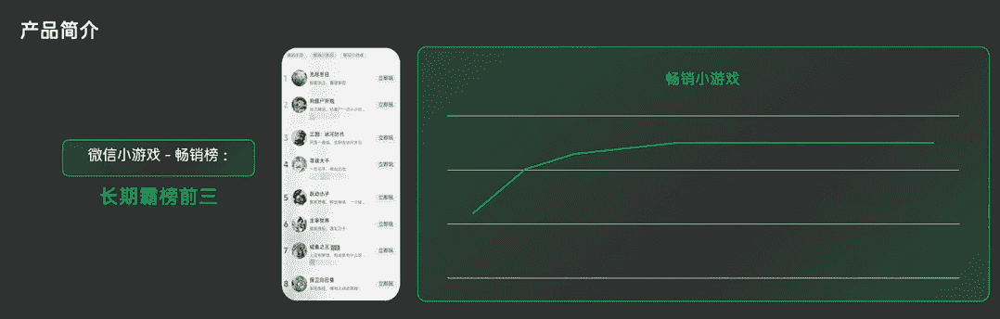

产品立项：充分利用团队优势进行玩法融合

《向僵尸开炮》在项目立项时，肉鸽割草品类已经有不少优秀的产品。我们当时在想，团队的优势在哪？以及我们的优势能在产品上放大多少？

我们从一开始就定下了项目的大方向，做一款能让玩家轻松地获得策略和爽快感以及惊喜感体验的游戏，所有的思考都是围绕着这个方向。初期用了不少笨的方法，就是对市面上的优秀的产品进行拆解分析，然后拉上小伙伴们一起讨论。

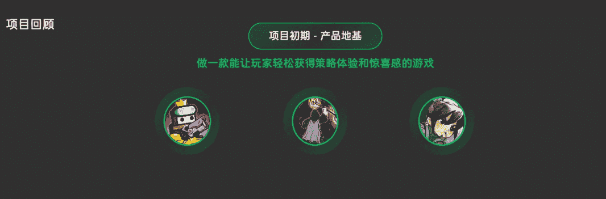

这里给大家分享一个非常典型的案例。

当时很流行玩法融合的概念，我们的团队是做 MMORPG 出身，因此在尝试做相关的玩法融合的时候，发现契合度非常高，而且能解决好几个问题。

比如融合 RPG 的轻成长，可以让玩家在游戏中运气不好的时候，维持成长跟通关的循环体验，降低肉鸽随机运气不好带来的挫败感。同时在维持策略深度的情况下，让不愿意或者说懒得动脑构筑的玩家，也可以通过持续的数值成长通关游戏。 还可以引入了像 MMO 和 RPG 常见的组队、团本、军团、帮派等等社交类的玩法，维持用户在游戏中的社交活跃度。

按照我们以往的经验，在商业化资源里面做一定的数值填充，主要是为了保护非大 R的付费体验，避免付费体验断层。我们还专门为枪械做了 2D 的独特的设计体验，有一点点的射击操纵和节奏感等等，这些都是之前的经验跟沉淀，很好地融入《向僵尸开炮》之中。

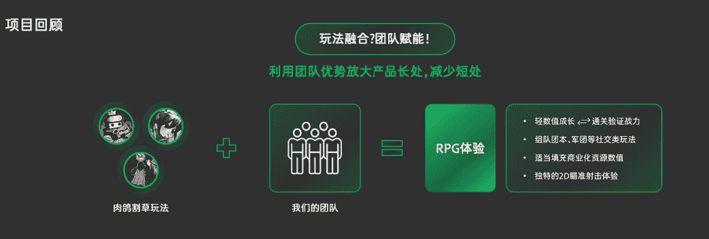

这里有两点经验：

1、在立项之初，要进行快速的讨论，快速地落地体验。这期间也否定过自己很多次，一旦偏离我们定下来的基调就会立马止住，避免偏离产品本身的基调；

2、在产品立项阶段不要认为自己做的是小游戏，就把对自己的要求以及对产品的要求标准降低。而是尽可能地完善产品，尽可能地保证产品落地的时候是我们团队的极限。

美术题材：寻找市场空白，果断切入

项目上线之后有不少人来问，为什么选择这个题材以及美术？其实非常简单。

我们当时在市场搜索了资料库，发现有三国的割草、武侠的割草等等，唯独没有僵尸割草，而且僵尸这个题材也非常深入人心，所以就定下来僵尸的题材。

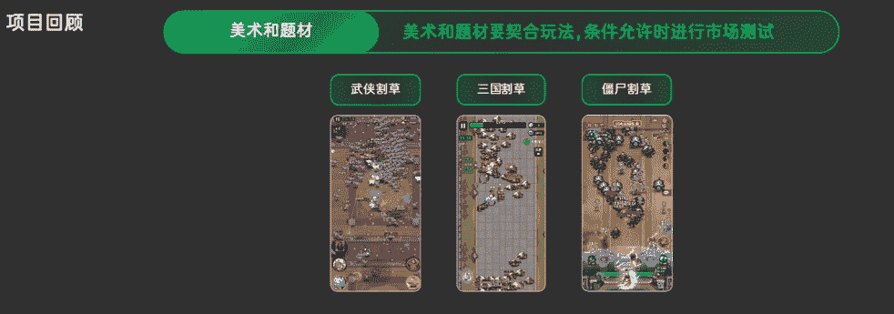

选定题材后，我们也测试了几个美术风格。现在游戏中的 Q版现代风格就是当时数据测试出来最好的。我们在初期买量测试的时候，发现产品用户的基本盘非常的复杂而且独特，包含各个不同品类的核心用户，像策略游戏、射击类游戏，还有泛娱乐玩家也很多，他们对游戏的要求也非常高，例如策略类的游戏会比较注重资源管理、战术深度等等策略深度的东西。射击类的玩家就会比较注重射击节奏、竞技热情等等相关的内容。

泛娱乐玩家更简单一点，他们会因一些比较有意思的画面、有趣味的玩法、易上手的操作被吸引。面对这么丰富且多元需求的潜在受众玩家，我们深入地对游戏进行全面系统的分析。

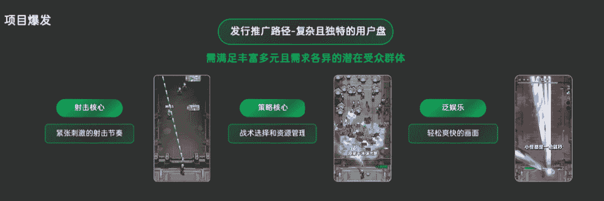

在创意融合的路径上，我们深入挖掘了游戏的几个模块，比如将射击与僵尸题材进行结合，既有射击操作的爽快感，还有僵尸的紧张刺激的惊悚氛围感，这个视频素材的体验就非常的独特，吸引了不少用户。

转型阶段：内容型产品如何做长线运营？

在项目爆发之后，产品也进入了非常重要的转型阶段。因为《向僵尸开炮》的成绩远远超出预期，作为一个比较年轻的团队，非常容易沉浸在成功的喜悦里面而忽略很多东西。所以在产品的转型前，我们先组织了一场稳定情绪的活动，叫大家来找茬。内容很简单，就是在产品里面找茬，让大家进行一个有正循环体验反馈的目标，抛除一些无关的情绪，专注于事物本身。

我们当时的做法也很简单，所有人对产品有任何问题都可以提出，不管是版本方向，还是系统功能、玩法，甚至是这个红点、这里的按钮点击的体验可以更好等等这些小问题都可以提，只要遵循的过程是：提出问题，用数据或者玩家反馈去论证问题，以及解决问题。

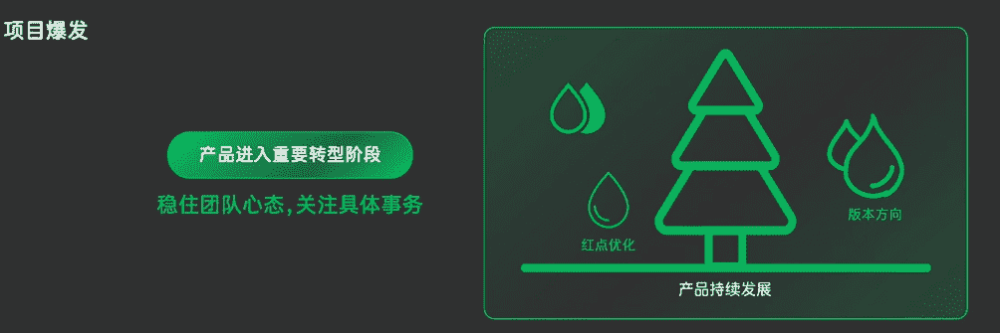

在这个推导的过程中，相比于产品，更应该关注的是团队。我们团队成长的速度非常快，而且还因为推导过程中需要很多平台类的工具，比如数据分析、玩家的管理，这些工具也在搭建和发展。整个流程下来，团队综合能力的成长速度非常显著。

也就是在这段时间里，我们尝试解决一个问题：市场普遍认为小游戏是因为体量小、核心玩法的原因等等，不存在长线的说法，生命周期很短，特别是《向僵尸开炮》这种偏单机的，玩法内容消耗完，玩家就会流失。当时我们也在着重思考怎么解决，该用什么方式承载产品后期的内容？

回顾过去生命周期超过10余年的产品后，我们做出了一个决定：要立一个大目标，做一个休闲策略手游平台垄断用户。那我们怎么做的呢？这里分享几个关键点给大家。

首先每当有新的内容产生的时候，我们都要问自己一句，回归初心了吗？保持初心了吗？还有没有忘记你们的玩家？现在游戏内的玩家才是基本盘，千万不要忽略和抛弃他们，不管你的内容有多新，不管后面做的东西有多大，现在游戏里的玩家才是核心用户。所以我们对产品再一次进行了剖析，包括产品本身，还有当时的市场状况。

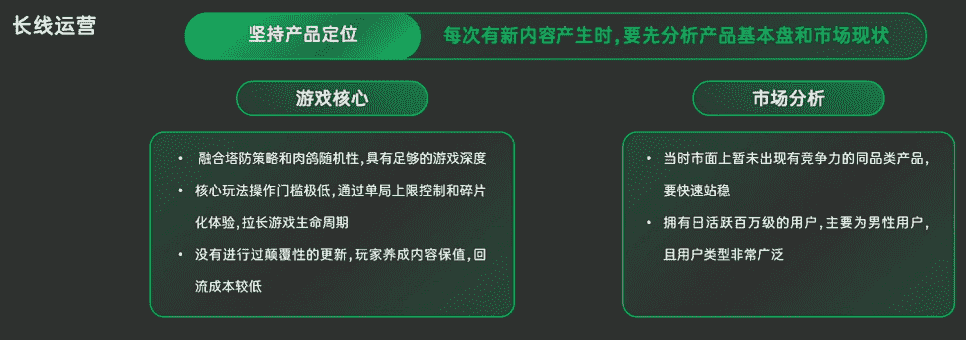

这里只列几个关键要素，第一个核心玩法，融合了塔防策略还有肉鸽割草，具有足够的游戏深度。而且通过控制单局的游戏上线、碎片化的体验拉长游戏的生命周期等等。尤其是游戏上线近半年，这期间的游戏版本迭代非常的克制，因为我们是跟着玩家的反馈还有数据进行迭代，没有颠覆的玩家的养成，没有逼玩家要从一个内容、玩法游戏变成数值、战力的游戏。这样玩家回流的成本很低，账号比较保值。

第二是当时的市场还没有强力的竞争对手出现，所以要快速地站稳，当时《向僵尸开炮》最高日活过百万，而且用户的属性非常广泛。进行简单的玩家调查发现，既有玩传奇的老玩家，也有玩塔防策略的、肉割草的新青年玩家等等。

引入赛季制，培养玩家的游戏习惯，拉长游戏的生命周期

做完分析之后，我们发现不同于数值成长驱动的产品，《向僵尸开炮》属于内容驱动探索型的产品。想要玩家不停地有内容探索，要不断输出新内容。但是往往这部分的内容偏后期，大部分玩家还探索不到就流失掉了，这个是我们不希望看到的。在观察到市面上流行赛季机制时，我们就在思考赛季机制有没有可能引入到《向僵尸开炮》？有没有可能给产品带来新的东西？于是我们尝试结合并发现非常合适，赛季制可以有效帮助产品达成几个主要目标（新体验、培养习惯、满足需求）。

以赛季的形式，在赛季玩法的框里面去寻找相同品类或者接近的玩法体验，做一个玩法的软结合。这部分的内容不会对玩家形成负担。每个赛季有新的玩法，这个赛季喜欢就来玩。可以帮助养成玩家的上线习惯，培养玩家的游戏习惯，拉长游戏的生命周期。

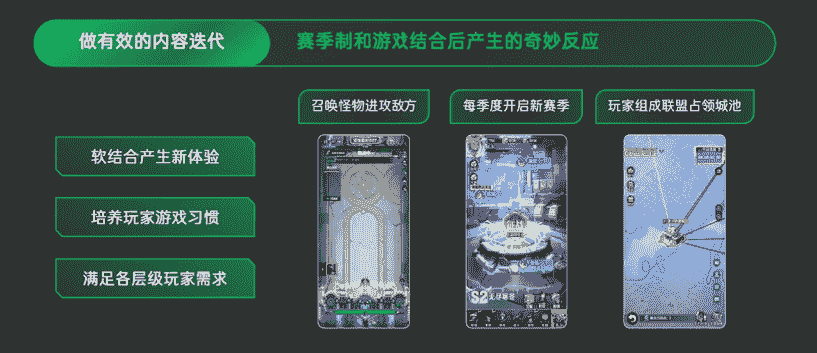

搭建用户管理工具，数据精细化运营

为了验证赛季完成后，内容是否符合玩家的体验，我们还搭建了一个周期性管理玩家数据的工具。目标很简单清晰，就是一定周期内玩家的新增+回流大于等于流失即可。保持玩家的活跃，进来的玩家有效留存。

有效留存是什么？是指新增和回流的玩家，他们因为版本内容而长期留存下来。作为一个内容型的产品，对版本的质量要求非常高，一旦回流的玩家发现版本不达预期，就可能会再次流失。另外我们会将所有的流失用户进行归类，现在处于大数据时代，玩家进入游戏后会被打上一个标签。可以通过像信息流、买量回流，或者自媒体的社交以及其他平台刷到游戏，发现对产品感兴趣而再次回来。

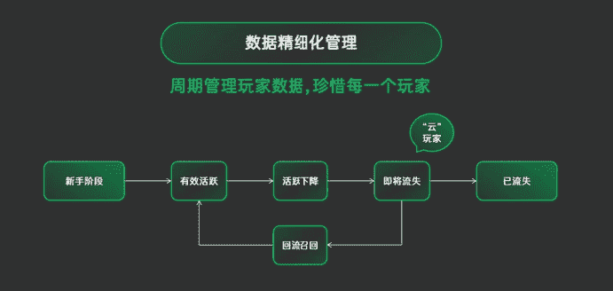

这部分用户我们称之为云用户，有可能再次回流，这个时候就要靠版本质量把它留住。同时长线运营过程中，市场素材也是在持续的迭代优化。比如最初的信息流买量广告，数据监测反馈发现玩家对某一类玩法比较感兴趣，但广告宣传中的玩法展示不够清晰，那么我们会重点聚焦于优化展示，把玩法的乐趣更直观地、更深入地展示给玩家。

建立游戏品牌文化，打造自己游戏壁垒

除了产品本身之外，我们也在进行游戏品牌文化 IP 的建设，从而提升品牌的知名度、影响力以及核心竞争力，打造一个独特的品牌IP。就像刚刚说的，我们希望打造一个休闲社交策略的游戏壁垒。首先做的是根据品牌文化，持续产出高质量内容的游戏版本、图文视频、宣传攻略等等，我们相信这些内容是具有长尾效应的。因为游戏也是内容的一种，高质量的内容往往具有长尾效应。有的时候你觉得做得很好、很有诚意的视频，这段时间不会爆火，但有可能半年之后或者三个月之后突然火起来了，跟上了市场的热度。所以高质量的内容具有长尾效应，是能跨越时间到达玩家面前。

我们建立了自己的官方自媒体矩阵，搭建维护多个自媒体的运营平台进行游戏推广和内容宣发，增加游戏的曝光度。我们也会和用户进行线上互动，维系用户关系、增加用户粘性。同时 IP 跨界合作联动，跟其他的品牌或者机构进行联动推广，扩大游戏的 IP 影响力。

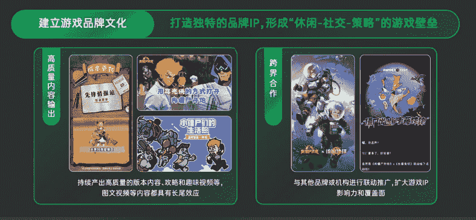

**一些感受和思考 **

回顾过去一年，《向僵尸开炮》在微信小游戏上线了将近 10 个多月，这里也有一些经验想跟大家分享一下，共同来探讨一下微信小游戏的市场机遇和挑战。

首先我们认为团队是关键，一支优秀的团队不仅仅能发现机会，而且可以把握住机会，把机会落地才叫抓住机会。怎么落个落地法呢？就是将团队的优势融入产品之中，而且我们发现在榜单上越来越多不同的游戏在进入，越来越多的开发者团队都在进入。

我觉得大家不用焦虑，每个团队都有自己独特的优势，有自己的资源壁垒，有自己擅长的、自己沉淀出来的东西，每个团队都是不一样的。重要的是这些优势能为产品在市场上放大多少，这才是需要去考虑的。只需要想怎么比别人做得更好，怎么样让产品在市场上面占据一席之地就好了。

其次，要持续关注平台的用户结构的变化，我们发现近一年微信小游戏平台用户的盘子是一直在放大。而且用户也有结构性变化，它会随着市场的波动、外部的政策的影响、环境的因素影响等，会有用户的结构性变化，这需要持续去关注。

最后，充分地利用平台的优势，基于平台优势放大产品。比如接入微信的游戏圈等等，这些是非常便捷的运营支撑。随着微信小游戏的平台的扩大，也引入了越来越多的技术支持跟底层的服务，像微信小游戏的社交链路短、唤起便捷等等优势都是可以利用起来的，为游戏产品进行放大。

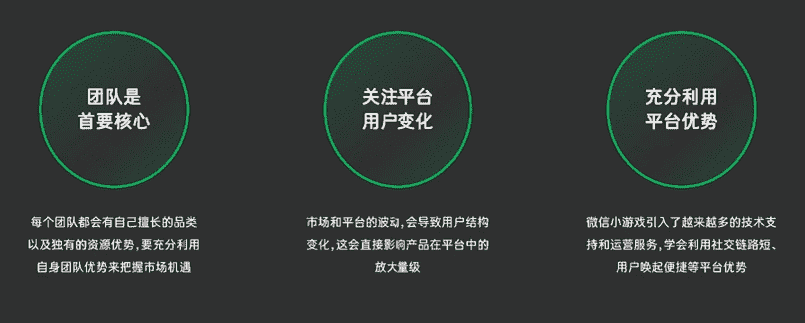

回顾整个历程，无论是从上线到爆发到长线运营，平台都给我们提供了非常多的帮助，感谢微信小平台这样新兴平台的崛起，我相信对于开发者以及所有的玩家来说都是一件非常幸福的事情。我的分享到此为止，感谢各位。

<https://huchegames.feishu.cn/sync/OrihdFNVesPoTXbhZHEcKud4nfh>