# 2025🛰️公开课PRO小游戏专场直播文字PPT实录

> 来源：[https://huchegames.feishu.cn/docx/FH41d4d1WoxDgkxjGqBc88yOnFb](https://huchegames.feishu.cn/docx/FH41d4d1WoxDgkxjGqBc88yOnFb)

> 🔗 原文链接： h[ttps://mp.weixin.q](https://mp.weixin.qq.com/s?__biz=MzA5NzQ3NDM3MA==&mid=2656293302&idx=1&sn=5eb5d55e228ec2ddafa3d47013f65391&scene=21#wechat_redirect)q.com/s?__biz=Mz...

> ⏰曾嵘胡扯的地方2025年01月09日 21:08  湖北

以下文章来源于胡扯游戏 ，作者曾嵘

[GameX·FIRE 2025巨量引擎小游戏生态大会直播文字实录](https://huchegames.feishu.cn/wiki/Ig8Qw6wHMiKqUjkcMGTcNphunnO)节前会议不断。1 月 7 日  在深圳召开后，🛰️公开课也来了。

本篇是2025 年 1 月 9 日在广交会展馆广交会堂召开的 2025🛰️公开课PRO小游戏专场 文字实录。

目录：

+   2024年小游戏生态概况

+   《向僵尸开炮》 用优质的内容垄断用户

+   指上游戏：IAA小游戏赛道的心得交流

+   从《时光杂货店》看「模拟+」赛道

+   《灵画师》立项调优及IP合作共赢

## **2024年小游戏生态概况**

小游戏 DAU 1 亿，MAU 5 亿。看过广告的人群，累计超过 7 亿。

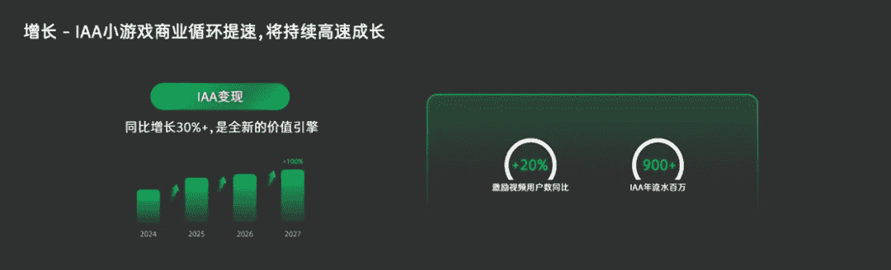

IAA玩法更易吸引用户，创新玩法变现效率更高。

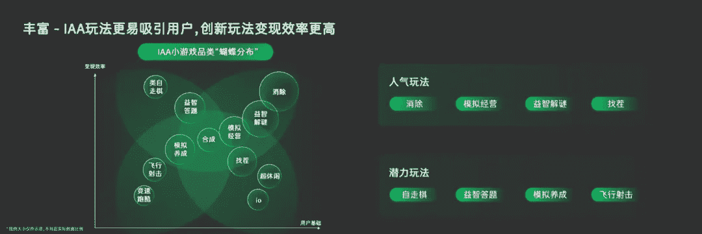

IAP小游戏基建性能提升，重度内容体验实现突破，更多玩法加速成长。

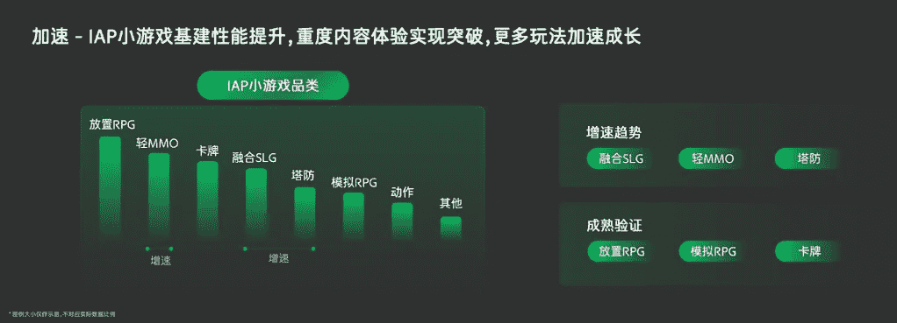

小游戏多场景接触用户既是特色，也蕴含新的机会。

PC 小游戏，人均时长是移动端的 3 倍，付费渗透率是移动端的 2 倍。

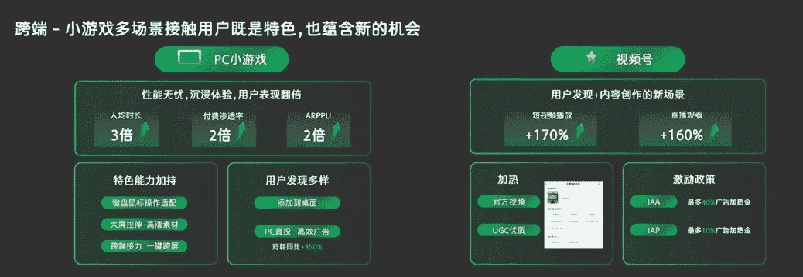

让小游戏变得无限可能。

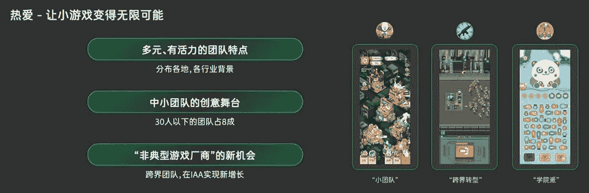

小游戏拥有 40 万开发者。

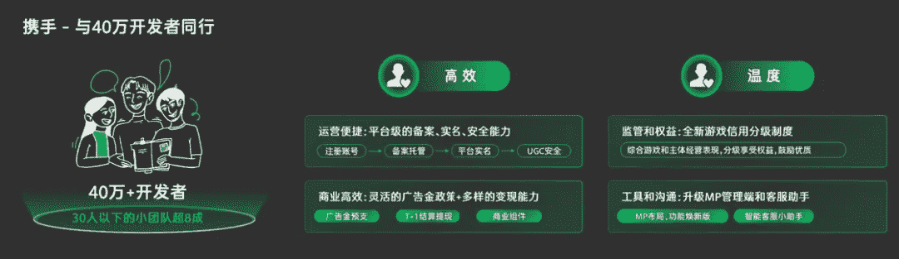

与 IP 方，腾讯云联动，包含更多机会。

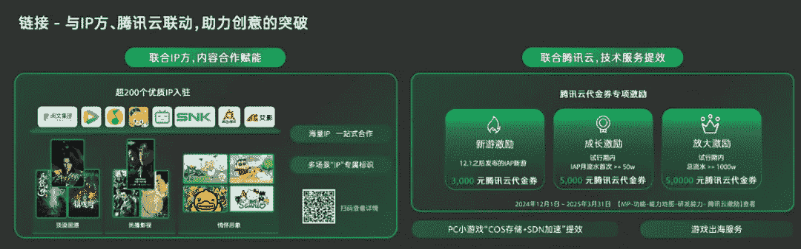

坚持技术投入，降低生产门槛。

+   存储空间进一步提升：200M-->1G

+   高性能模式：稳定性提升5%~20%

+   Unity快适配：分包能力3.0，支持ci。

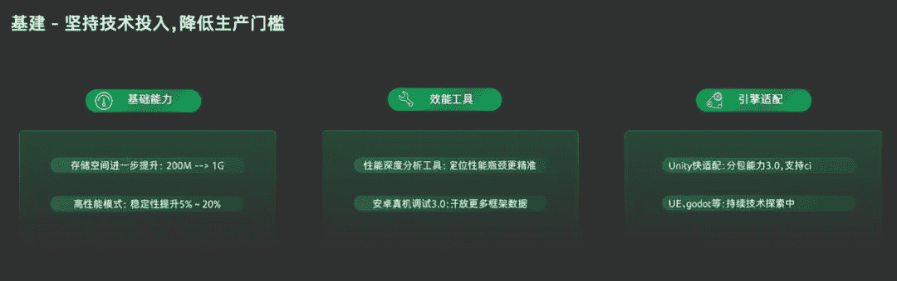

小游戏也是文化的传播者和公益力量贡献者。

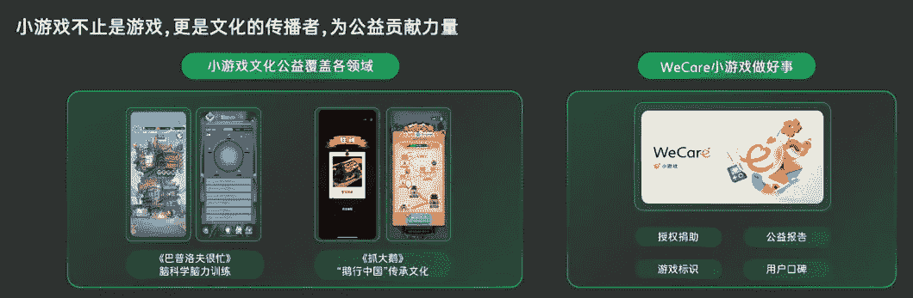

## 《向僵尸开炮》 用优质的内容垄断用户

核心战斗融合了塔防策略和肉鸽随机性。

休闲、策略、随机、爽感。

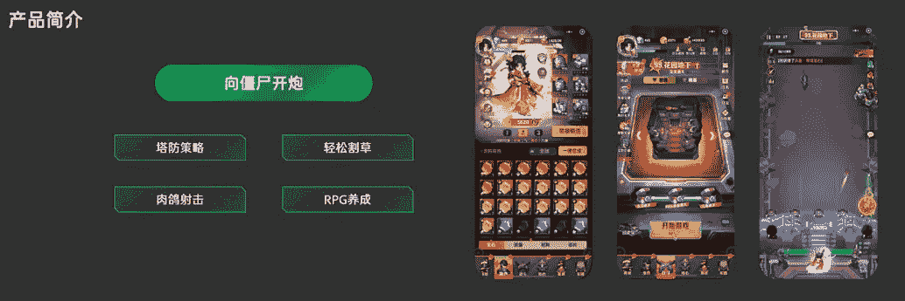

畅销小游戏，长期霸榜前三名。

产品地基：做一款能让玩家轻松获得策略体验和惊喜感的游戏。

玩法融合，团队赋能。

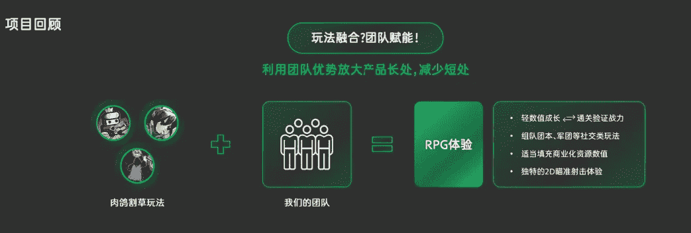

美术和题材要契合玩法，条件允许时进行市场测试。

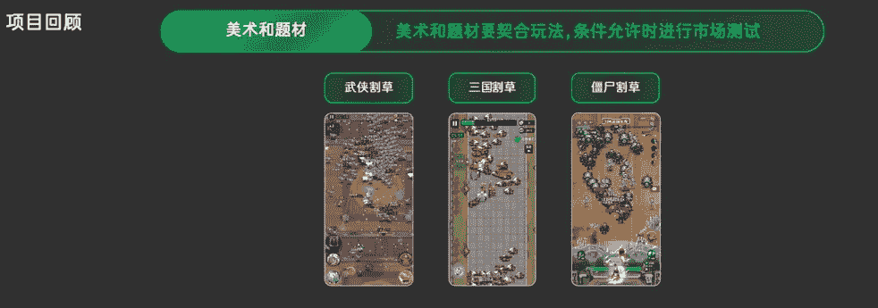

发行推广路径-复杂且独特的用户盘。需满足丰富多元且需求各异的潜在受众群体。

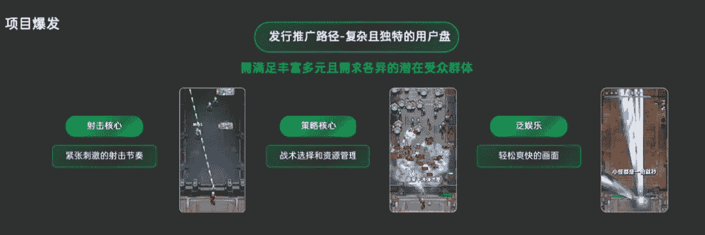

产品进入重要的转型阶段。

+   融合塔防策略和肉鸽随机性，具有足够的游戏深度

+   核心玩法操作门槛极低，通过单局上限控制和碎片化体验，拉长游戏生命周期

+   没有进行过颠復性的更新，玩家养成内容保值，回流成本较低

+   当时市面上暂未出现有竟争力的同品类产品，要快速站稳

+   拥有日活跃百万级的用户，主要为男性用户，且用户类型非常广泛

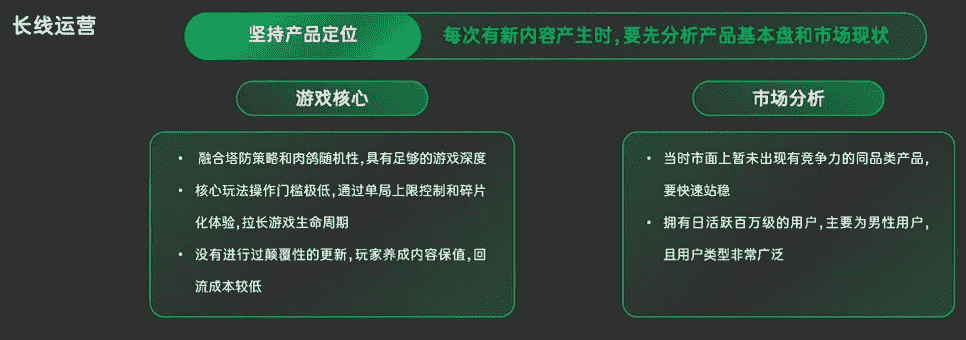

赛季制和游戏结合后产生的奇妙反应。

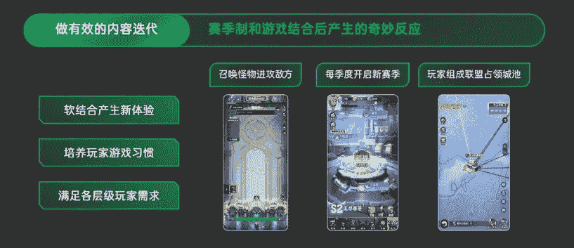

数据精细化管理。新增+回流，大于等于流失即可。

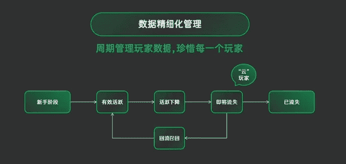

建立品牌文化，形成 IP。

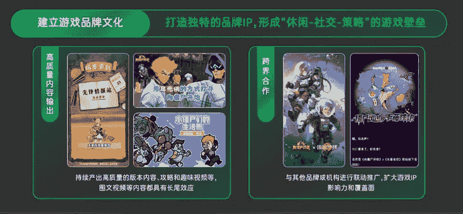

每个团队都会有自己擅长的品类以及独有的资源优势，要充分利用自身团队优势来把握市场机遇

市场和平台的波动，会导致用户结构变化，这会直接影响产品在平台中的放大量级。

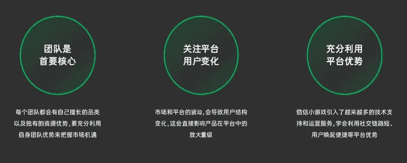

## 指上游戏：IAA小游戏赛道的心得交流

快速深入生态和洞察用户。

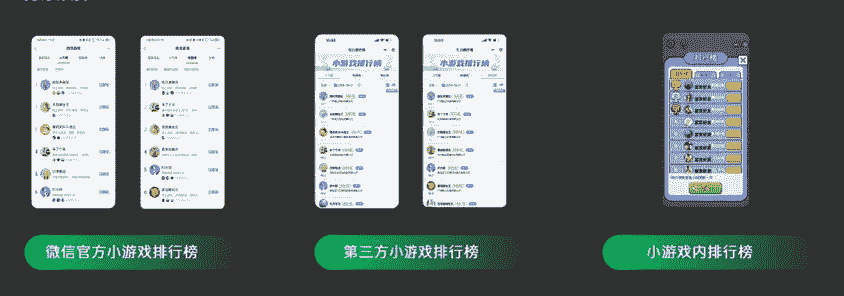

产品迭代规律，打螺丝的 1.0～4.0。

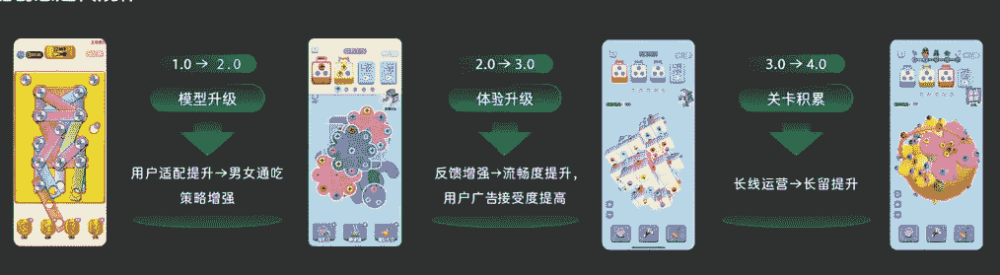

仅看年龄分布，区别不大。但看性别分布，就能看出产品的不同。

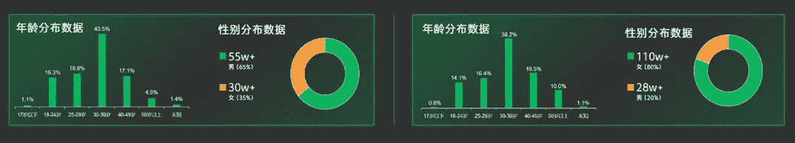

疯狂来解压的复盘。

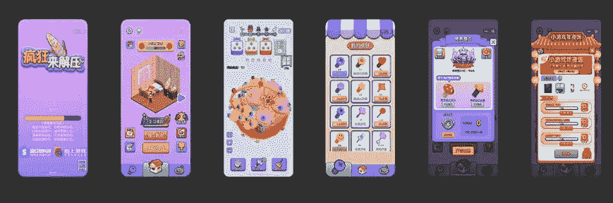

产品数据曲线&用户心流曲线：时长是用户对游戏的认可。

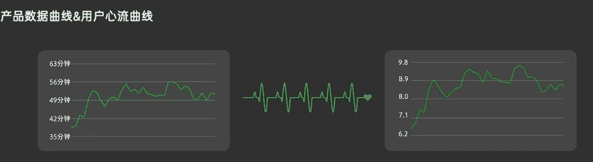

+   动态关卡 1.0：单局最优，手动前置

+   动态关卡 2.0：全局最优，拉通关卡，挑选最优难度排序

+   动态关卡 3.0：分群最优，根据用户历史关卡表现，动态选择下一个难度。

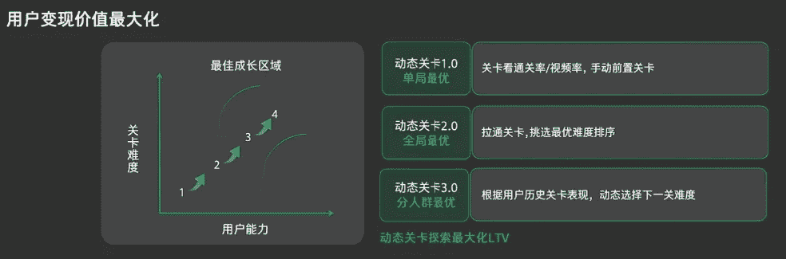

AB实验工具。

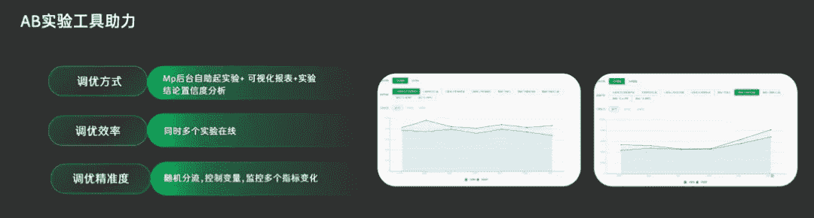

## 从《时光杂货店》看「模拟+」赛道

延趣游戏成立于2019年厦门，在广州设有研发分公司，是一家快速发展的创新型企业。公司专注于经营养成类游戏的研发，秉承“游戏不老，我们不止”的宗旨，不断在游戏道路上突破创新。

目前公司规模超500人，平均年龄不到30岁，自成立以来，成功研发出《叫我大掌柜》、《寻道大干》、《时光杂货店》、《时光大爆炸》等多款模拟养成类游戏。、《无限梦境》、《超兽英雄》等多款重磅游戏密集上线中。

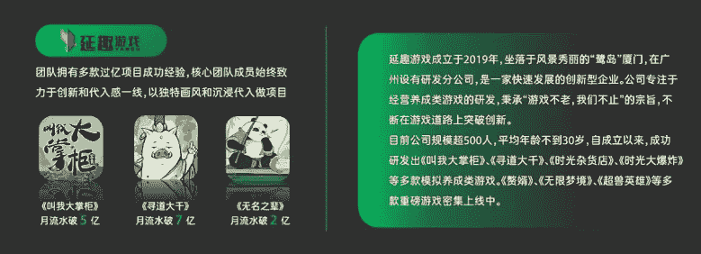

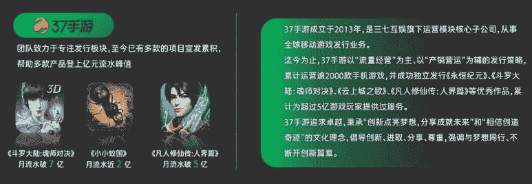

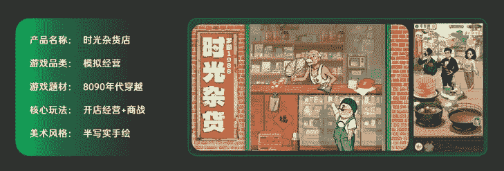

4000万的新增用户。

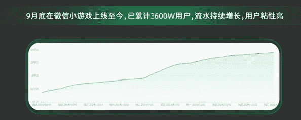

模拟经营2023年国内市场约100亿人民币，主要增量来自国内小游戏平台；海外市场年流水规模多年稳定在30亿美元以上，约 210亿人民币

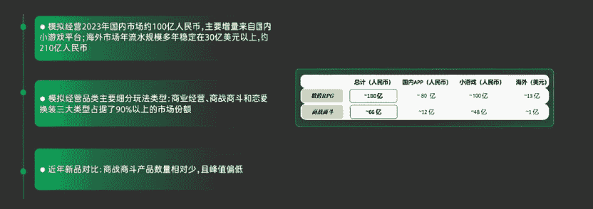

商战商斗2023年国内市场约60亿人民币，其中20亿在APP 端，40亿来自小游戏；海外约4-6亿美元，约35亿人民币。

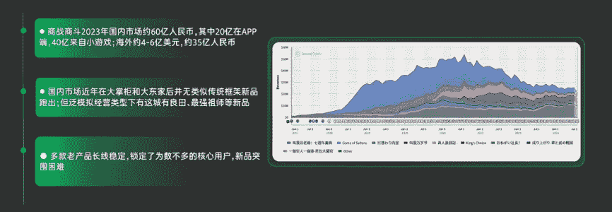

创新本质是体验感。可以是玩法，也可以是题材。

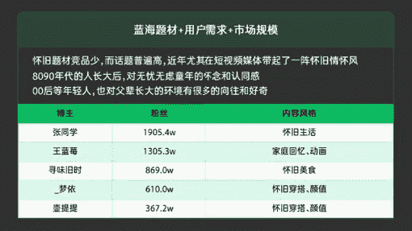

敲定立项思路。

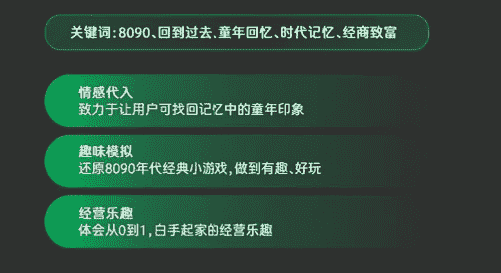

+   男女比例6:4

+   24-40岁人群

+   商战、模拟经营受众为核心用户

+   新锐白领

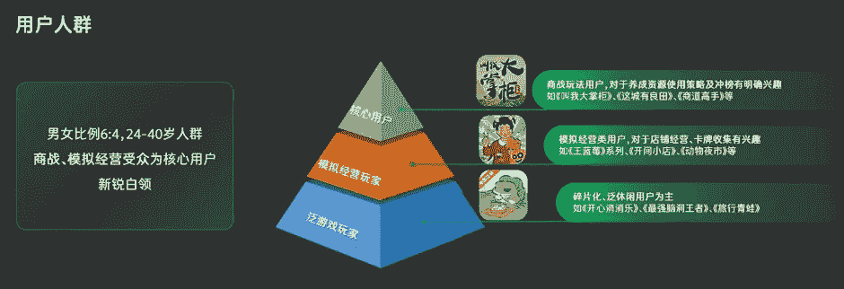

多方面打造 90 年代的世界沉浸感觉。

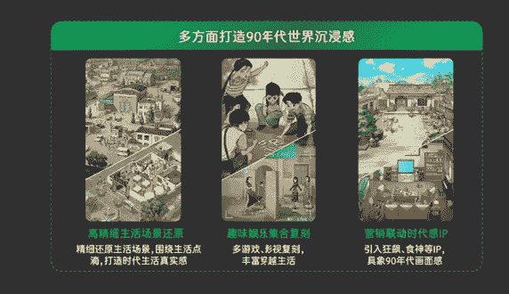

生活场景还原。

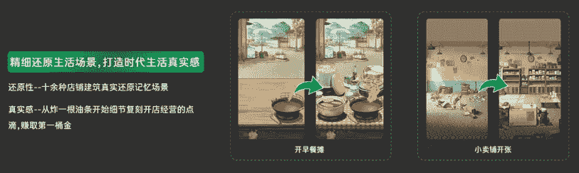

趣味娱乐复刻。

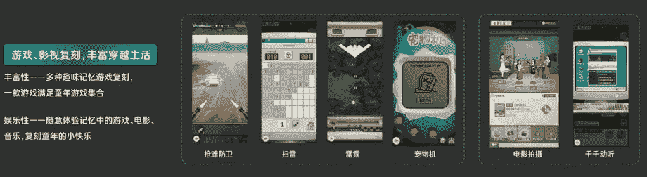

影视经典 IP 的联动。

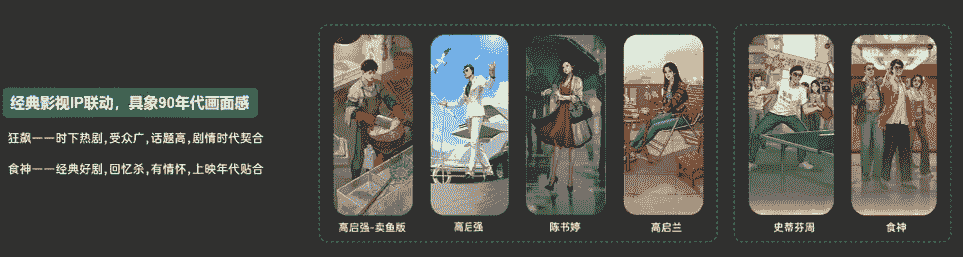

时光的突围点。

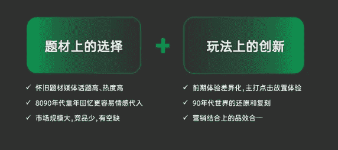

🛰️小游戏量级空间大，可探索空间大，PC用户更具粘性。

+   截止目前，🛰️小游戏用户的存量量级已超时头当前端包存量用户3倍，且仍有较大的用户池我们仍在进行探索。

+   微小初期用户重复只有5%左右，即徽小用户有大部分与端包用户具有一定的区分隔离性，隐藏用户体量较大。

+   据调研统计，《时光杂货店》目前约20%的用户在有条件的情况下会使用PC端进行游戏，PC用户的粘性比手机端高15%。

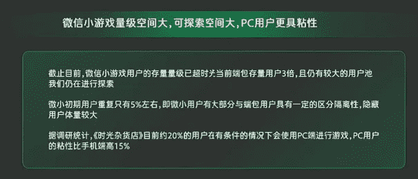

## 《灵画师》立项调优及IP合作共赢

所有产品日活三千万。

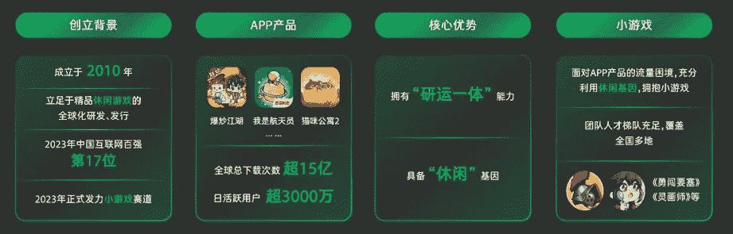

灵画师的需求挖掘。

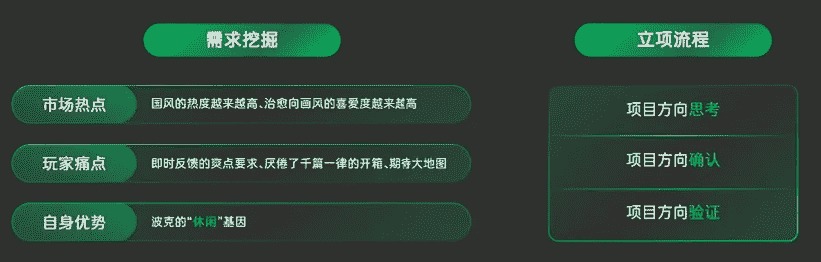

IP 合作需求。

修仙题材结合，破圈，与核心用户不重叠。

产品侧的活动流水，达到了成本的 4 倍。素材消耗达到了合作成本的 20 倍。买量成本降低了 25%。

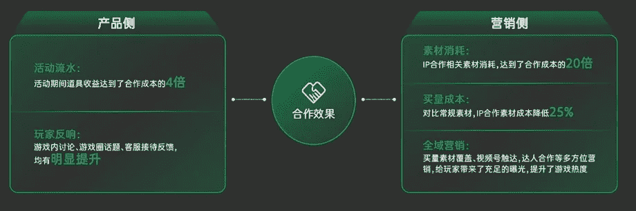

---

<https://huchegames.feishu.cn/sync/S5lfdyaWpsdZcnbOjtMcgmUvngc>

<https://huchegames.feishu.cn/sync/OrihdFNVesPoTXbhZHEcKud4nfh>

---