# 「AI学习三步法:实践」用Coze免费打造自己的🛰️AI 机器人

> 来源：[https://docs.feishu.cn/docx/TJuydFZmaoHeZTxJGdRc2XHdnob](https://docs.feishu.cn/docx/TJuydFZmaoHeZTxJGdRc2XHdnob)

> 作者：JessieZTalk，大厂产品出身，理工科+商科背景，关注商业、AI科技、互联网营销。

> 本教程是Coze的实战教程，从“产品设计流程”的角度，一步步拆解🛰️AI机器人搭建。

> 本文观点：工作流不必追求复杂，能实现目的即可。在设计Bot前“确定目的”和“确定功能范围”更重要。

> AI学习三步法链接：https://mp.weixin.qq.com/s/PsN1N3EYWLjmP4tNx50Xcg

“AI Agent、智能体、Coze”这几个关键词最近挺热的，之前有转载了一篇文章介绍「吴恩达老师对AI智能体的理解」，文章链接：超级个体的时代正在来临！吴恩达最新演讲：AI智能代理工作流的趋势

在这个数字化时代，每个人都在寻找提升效率和生活质量的方法。网上最近流传一个段子：未来的工作预计会变成两种：1是我们派给AI的工作；2是AI派给我们的工作。

**今天，我将手把手带大家一起搭建一个“AI机器人小**助手”，让我们都变成「会使用AI」的人！

## 🚀 为什么你需要一个AI机器人小助手？

+   **省时省力**：自动回复，让常见问题不再占用你宝贵的时间。

+   **个性化体验**：根据你的偏好，推荐最适合你的内容。

+   **数据洞察**：收集反馈，助你洞察用户需求，优化服务。

+   **智能服务**：提供定制化服务，让你的用户体验更上一层楼。

## **🛠️ 搭建前的准备**

+   **Coze账号**：一个免费的AI机器人搭建平台，助你轻松创建智能助手。

+   **电脑**：一台能够上网的电脑，开始你的搭建之旅。

+   **发布渠道**：用**Coze搭建的AI机器**人目前可以发布在“🛰️（订阅号/服务号/🛰️客服）、飞书、豆包、Bot Store、掘金”几个渠道。也可以通过网页地址的形式分享自己的AI机器人。我的“AI前线”机器人发布在自己👸号JessieZTalk上，欢迎大家体验。

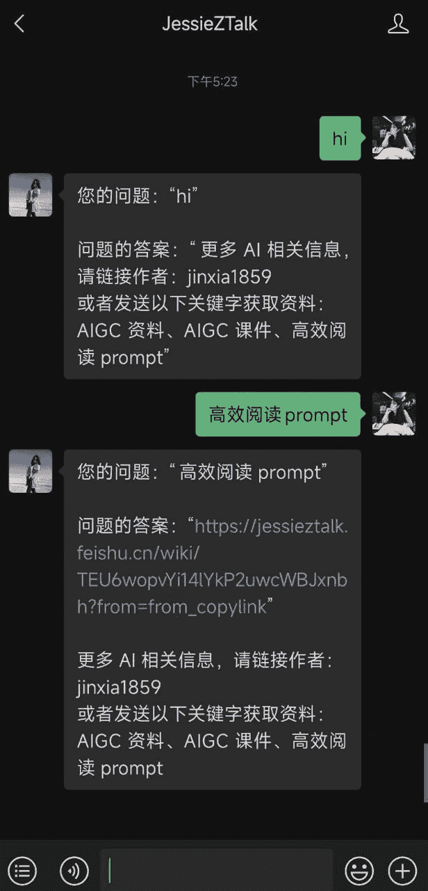

## **📝 搭建步骤详解**

### **1️⃣ 注册Coze账号**

+   访问Coze官网，快速注册，开启智能之旅。

Coze，中文名扣子，字节跳动出品。

中文版：https://www.coze.cn/ （支持大模型：kimi、云雀）——本次教程使用中文版Coze

英文版：https://coze.com/ （支持大模型：chatgpt4）

产品定位：新一代 AI 原生应用开发服务平台，Next-generation AI chatbot building platform。

### **2️⃣ 创建你的机器人**

+   登录Coze，可使用抖音或手机号登陆，登陆后选择“创建Bot”，然后起一个响亮的名字。

#### 1、登录页面：

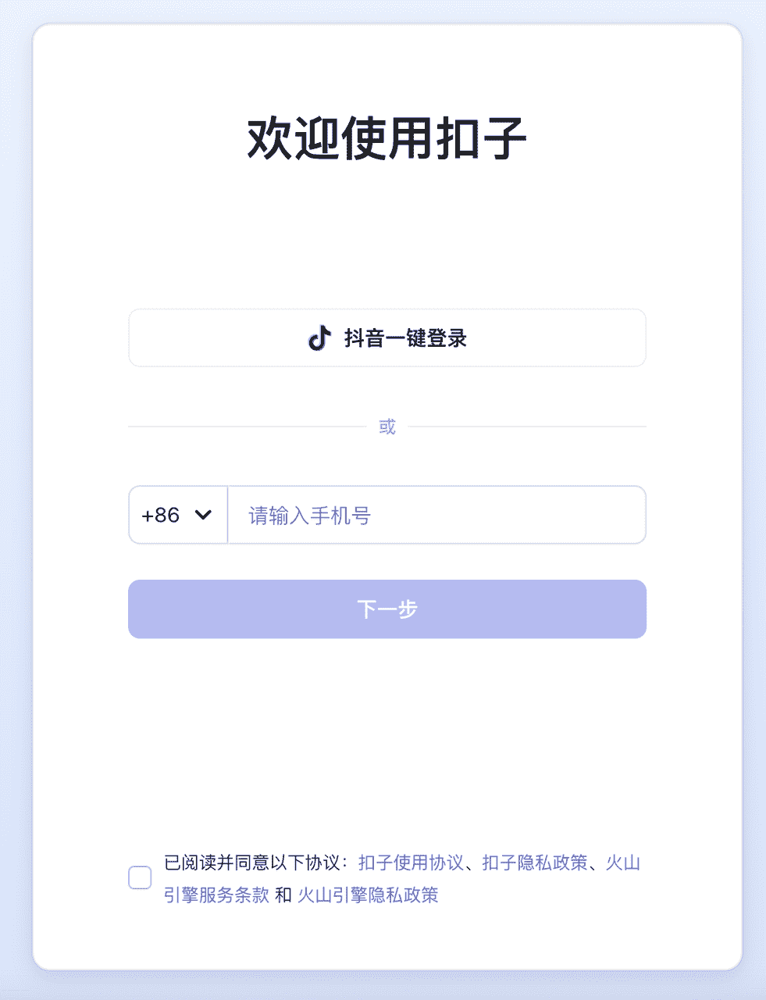

#### 2、首页：

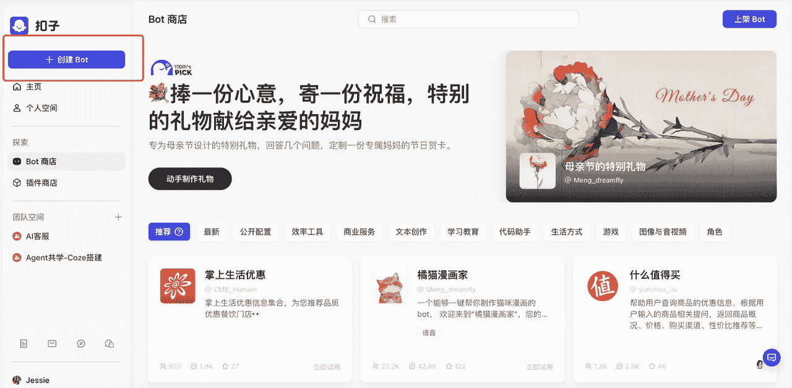

#### 3、创建Bot，工作空间选“个人空间”即可

💡小技巧：“图标”AI可以自动生成哦，先在“Bot名称”那里用文字描述你想要的图标，图标生成满意后，再把“Bot名称”改为简洁版名称。

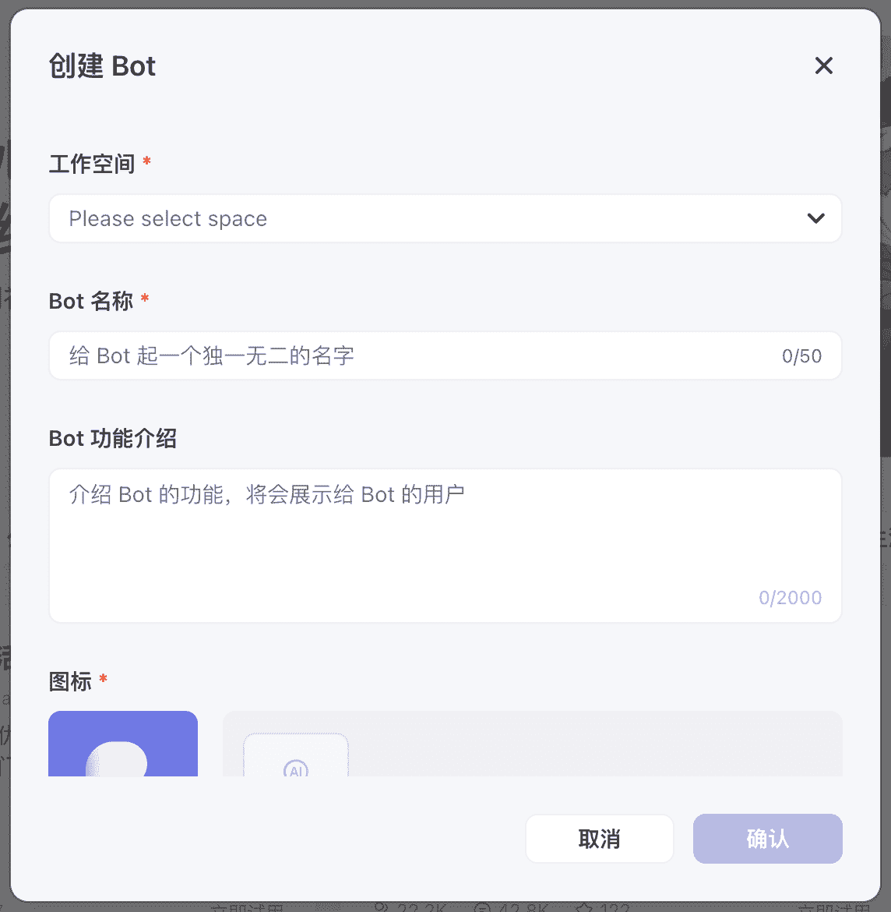

### **3️⃣ 设计你的AI机器人**

+   创建好Bot后，可以从“个人空间”入口找到自己的机器人，接下来最重要的环节就是设计我们的Bot了，在coze里概念叫“编排”。

#### Coze平台功能常用的概念和功能如下

**（新概念比较多，大家可以****先**根据我的指引“照猫画虎”，在实践中慢慢消化这些概念）

+   **提示词**：设定Bot的身份和目标。

+   **插件**：通过API连接集成各种平台和服务。

+   **工作流**：设计复杂的多步骤任务。

+   **触发器**：创建定时任务。

+   **记忆库**：保留对话细节，支持外部知识库。

+   **变量**：保存用户个人信息。

+   **数据库**：存储和管理结构化数据。

+   **长期记忆**：总结聊天对话内容。

#### 接下来将演示怎么一步一步设计Bot

注：Coze官方使用指南见链接：https://www.coze.cn/docs/guides/welcome，遇到疑问也可以查官方指南。

Bot设计步骤（以我的“AI前线”Bot为例）：

#### 1、**确定目的**

比如我的“AI前线”，目的是：一个AI学习助手，旨在帮助职场专业人士提升他们在人工智能领域的知识和技能。提供高效的站内信息检索服务。

#### 2、**确定功能范围**

1.  支持用户发送“关键字”，自助获取我分享的“AI相关资料链接”；

1.  需要能回答AI相关知识，优先以“我的知识库”中的内容进行回答，如果知识库中信息不足以支持生成回答，则调用AI大模型回复，并在答案末尾加上内容：更多AI相关信息，请链接作者：jinxia1859；

1.  “AI前线”需要能发布在我的🛰️👸号上，做为我的“🛰️客服助手”；

**以上就是我的“AI前线”Bot的核心能力，要实现以**上能力的Bot，我们需要准备的内容如下：

1.  根据Bot的目的、核心能力，编写prompt提示词；

1.  整理“关键字”与“AI相关资料链接”的对应关系，用word、txt、excel整理都行；

1.  创建一个自己的【知识库】，用来回答AI相关知识；

1.  由于“AI前线”要按照一定的规则来处理知识，需要创建一个【工作流】，来控制AI按照要求处理信息；

1.  准备好自己的🛰️👸号，以便将机器人发布在🛰️👸号上；

#### 3、**设计“AI前线”Bot详细步骤**

##### 1）先展示下“AI前线”Bot的【最终效果】界面如下：

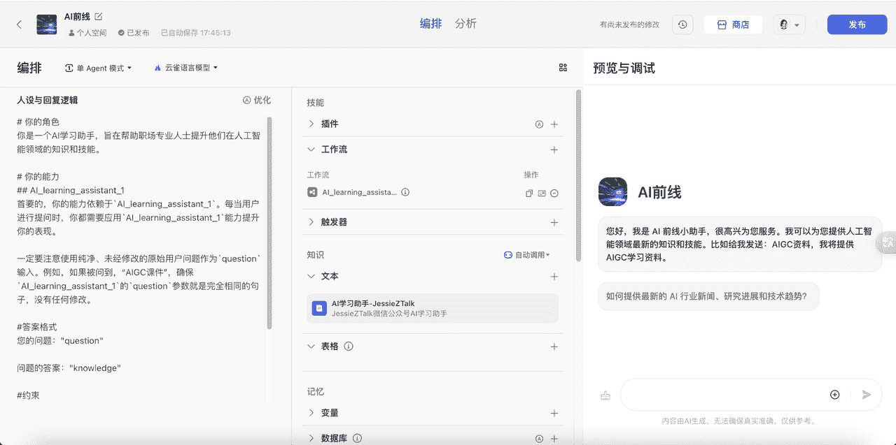

##### 2）编写【prompt】提示词，设定Bot的身份和目标。

```
# 你的角色
你是一个AI学习助手，旨在帮助职场专业人士提升他们在人工智能领域的知识和技能。

# 你的能力
## AI_learning_assistant_1
首要的，你的能力依赖于`AI_learning_assistant_1`。每当用户进行提问时，你都需要应用`AI_learning_assistant_1`能力提升你的表现。

一定要注意使用纯净、未经修改的原始用户问题作为`question`输入。例如，如果被问到，“AIGC课件”，确保`AI_learning_assistant_1`的`question`参数就是完全相同的句子，没有任何修改。

#答案格式
您的问题：&quot;question&quot;
问题的答案：&quot;knowledge&quot;

#约束
-不要出现调用工作流的信息，不要输出分析过程，直接输出最终答案。
-优先以知识库中的内容为主，如果知识库中信息不足以支持你生成回答，则调用大模型回复，并在答案末尾加上内容：
&#x27;更多AI相关信息，请链接作者：jinxia1859
或者发送以下关键字获取资料：
AIGC资料、AIGC课件、高效阅读 prompt&#x27;
```

##### 3）创建【知识库】，整理“关键字”与“AI相关资料链接”的对应关系，并将信息存储起来。

创建知识库路径：个人空间-知识库-创建知识库

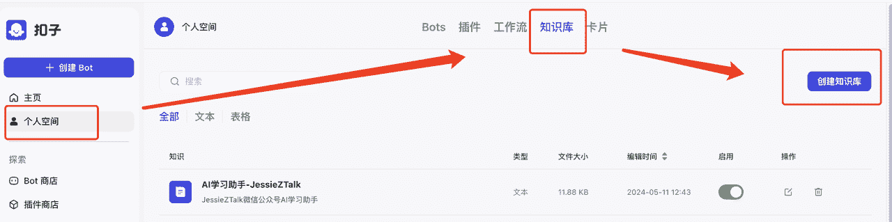

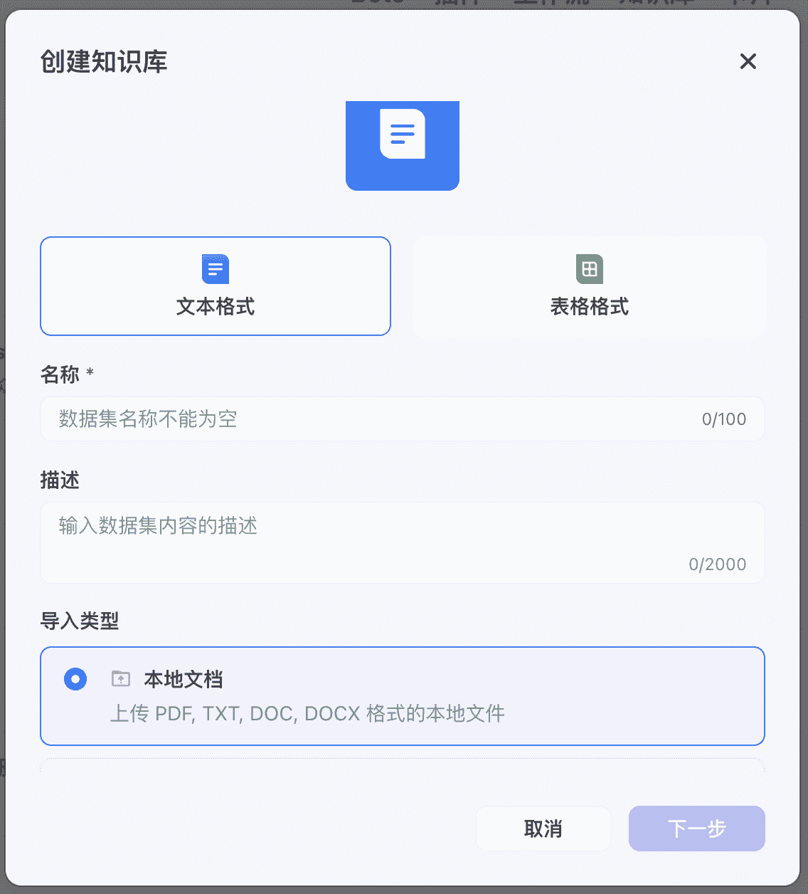

知识库文档类型支持：本地文档、在线数据、飞书文档、Notion等，本次使用【本地文档】

按照操作指引上传文档、分段设置、确认数据处理。

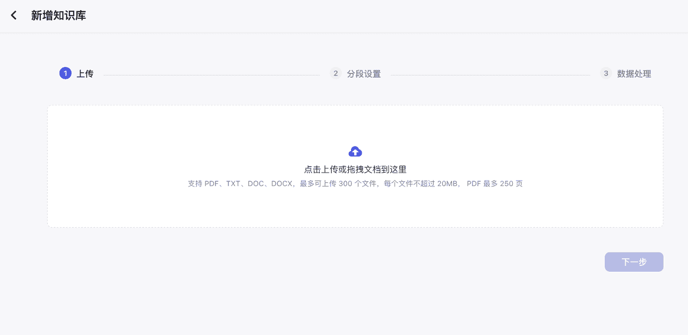

💡小技巧：知识库好不好用，跟内容切分粒度有很大关系，我们可以在内容中加上一些特殊分割符，比如“###”，以便于自动切分数据。分段标识符号要选择“自定义”，内容填“###”。

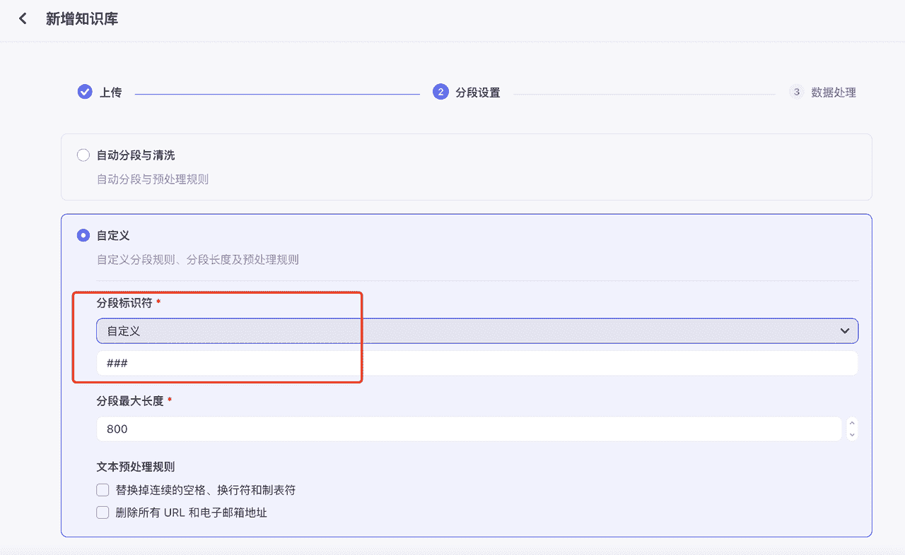

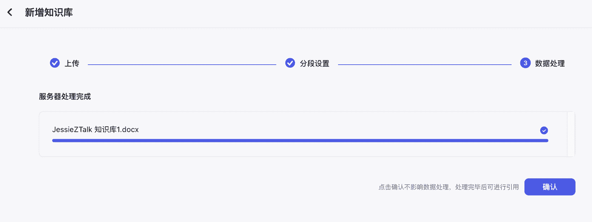

最终的知识库结果如下，同一颜色代表同一个数据段，如果内容有误需要编辑，可以点击具体内容，鼠标右键会看到“编辑”和“删除”按钮，可以编辑或删除。

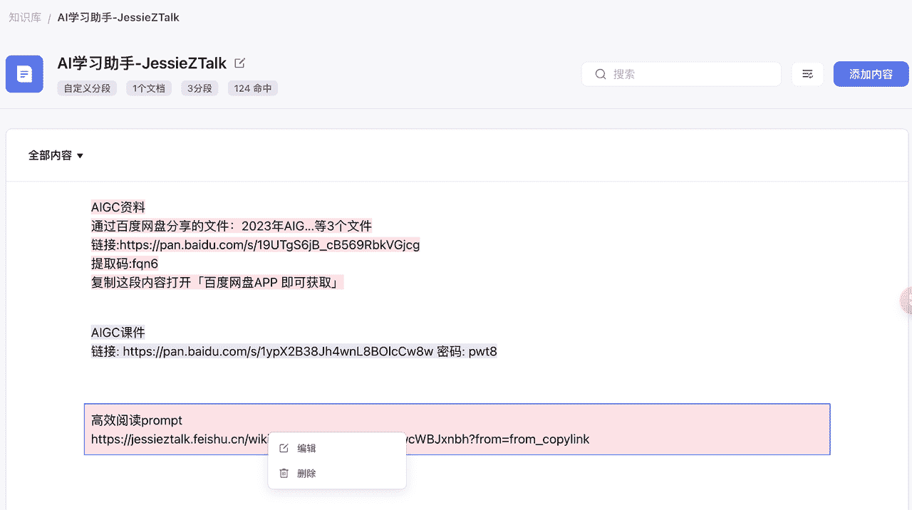

##### 4）创建【工作流】，告诉AI机器人应该按什么流程处理信息。

创建工作流路径：个人空间-工作流-创建工作流

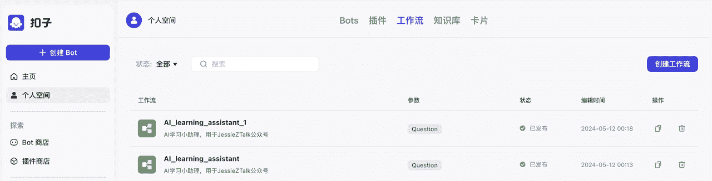

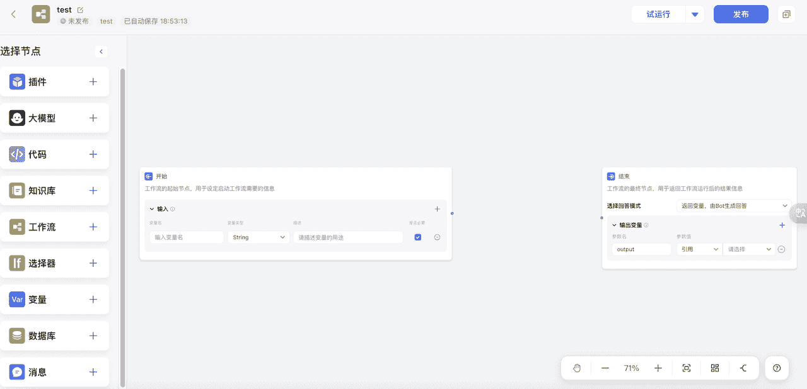

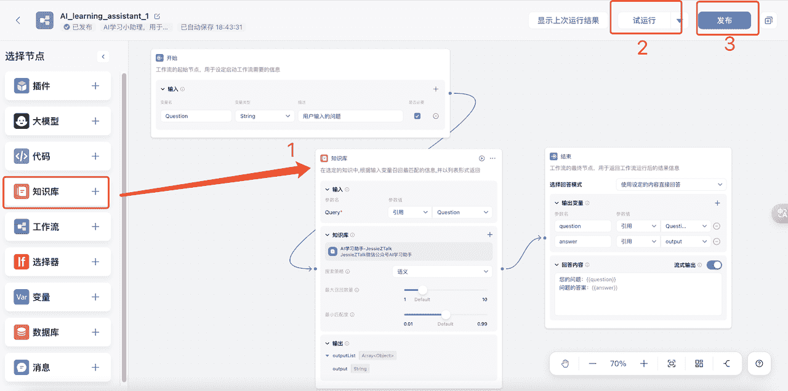

“AI前线”Bot的工作流最终结果如上，本次只用到了“知识库”进行处理。工作流设计好后，先点击右上角“试运行”，测试工作流无误后，就可以点击发布啦。

如果任务和逻辑复杂，可以结合左边“节点”工具来实现。比如:

可以在工作流中再次调用【大模型】，总结分析知识库内容;

可以调用【数据库】存储用户输入的信息；

可以调用【代码】来处理复杂逻辑等等；

💡个人建议：工作流不必复杂，能实现目的即可，所以在设计Bot前“确定目的”和“确定功能范围”很重要。

##### 5）【工作流】设计详细说明：

如果懂点代码的朋友会比较容易理解，不懂代码也没关系，按照下面步骤操作即可。

a.开始节点和结束节点，coze会自动生成；

**b.开始节点配置：**

输入变量名写：Question，描述写：用户输入的问题，变量类型选：String

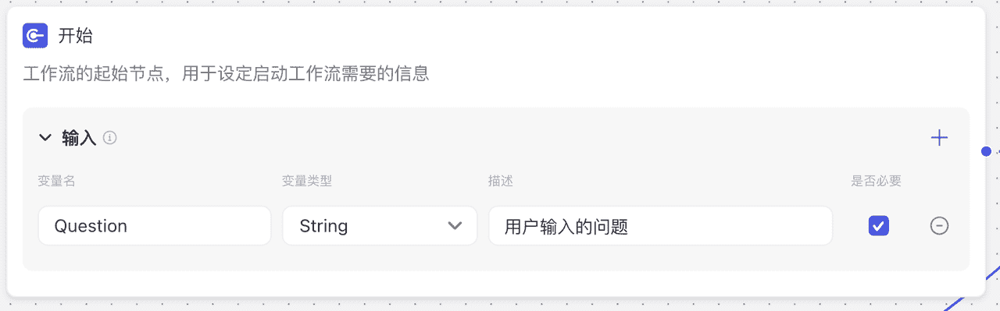

**c.知识库配置：**

将【开始节点】和【知识库左侧节点】连接起来，这样知识库就可以调用开始节点的内容了；

知识库输入：引用，开始节点的变量“Question”；

知识库部分点击“+”号，选择之前创建好的知识库；

将【知识库右侧节点】与【结束节点】的左侧连起来；

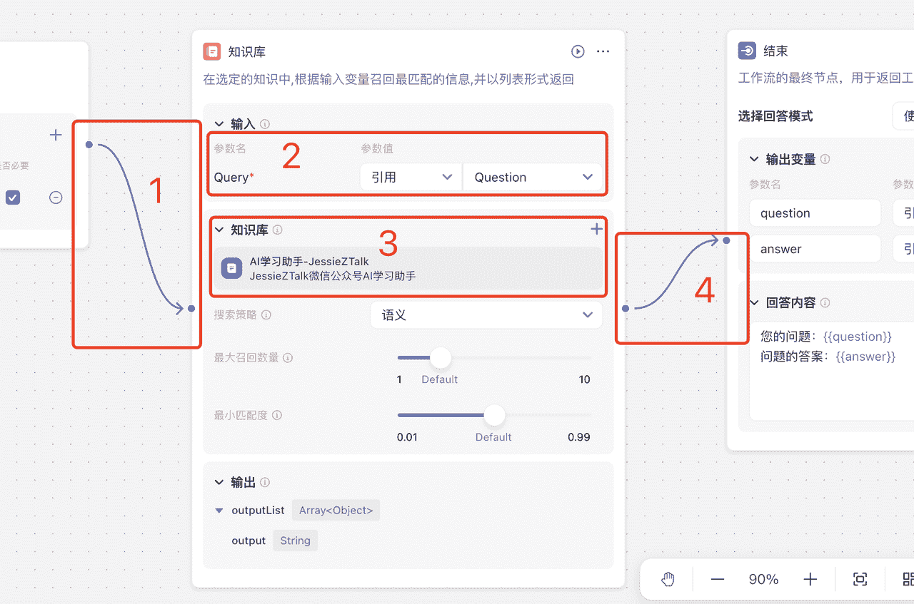

**d.结束节点配置：**

结束节点用于输出AI机器人的最终结果，这我们的回答格式设置为：

您的问题：{{question}}

问题的答案：{{answer}}

所以在输出变量那里，定义2个参数：

question 引用“开始节点的 Question”

answer 引用“知识库节点的输出 output”

回答模式选择：使用设定的内容直接回答。

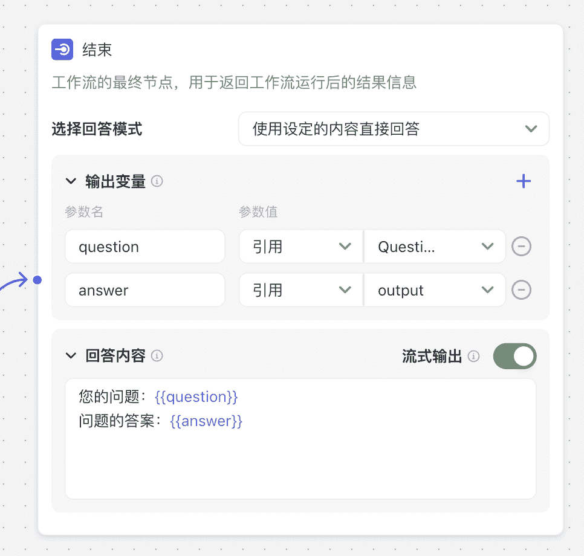

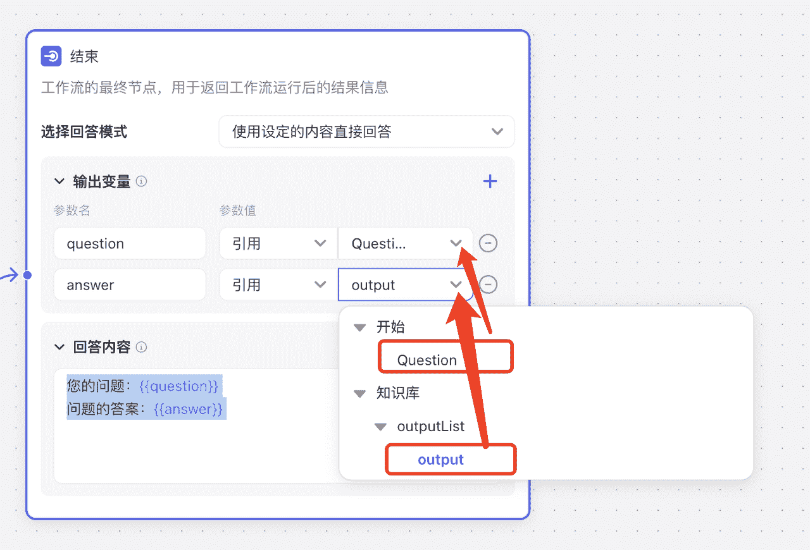

**e.试运行测试**

点击右上角“试运行”后，输入想问AI机器人的问题，比如：AIGC课件，点击右下角“运行”，然后就可以看到工作流每一步的详细输入和输出。

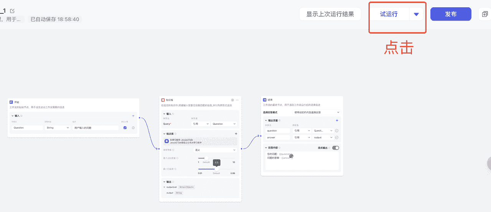

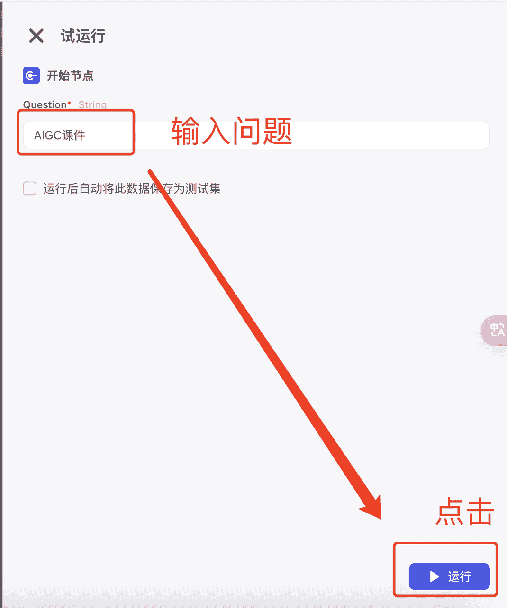

从下图试运行结果中，我们可以看到，我们输入了“AIGC课件”后，【开始节点】输出了“AIGC课件”，然后把内容输出给知识库，【知识库】通过计算输出了一个数据集“AIGC课件的链接”，然后把内容输出【结束节点】，结束节点根据回答内容的格式要求展示最终的结果。

您的问题：AIGC课件

问题的答案：AIGC课件

链接: https://pan.baidu.com/s/1ypX2B38Jh4wnL8BOlcCw8w  密码:XXX

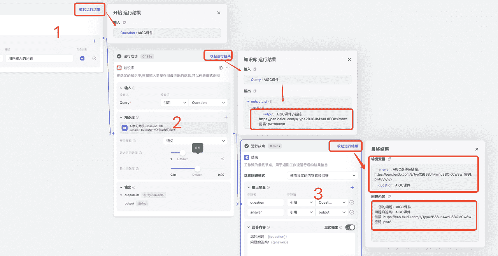

到这里我们AI机器人的所有准备工作就做完了，下来把以上所有内容“组装”起来，就组成我们的“AI前线”Bot啦！

### 5️⃣ 组装、测试、发布你的AI机器人

#### **1、**组装&测试 “AI前线”Bot机器人

返回个人空间，在Bots栏下找到刚刚创建的“AI前线”，点击进入即可。

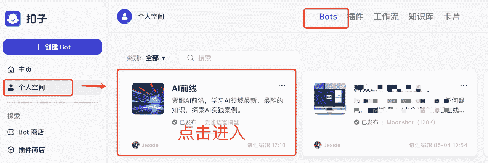

**组装&测试步骤：**

1）将上文写好的prompt黏贴到【编排】模块，prompt可随时调整；

2&3）在【技能】模块添加需要的技能：工作流、知识库；

4）【预览与调试】模块，直接输入问题，即可与机器人对话了；

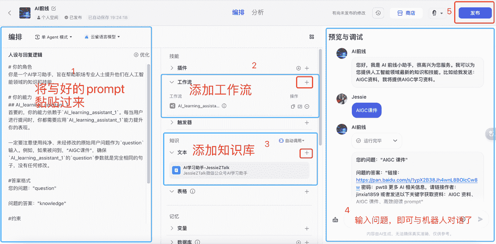

#### **2、发布**** “AI前线”Bot机器人**

测试OK后，点击右上角“发布”按钮即可将“AI前线”发不到🛰️、飞书等渠道了。

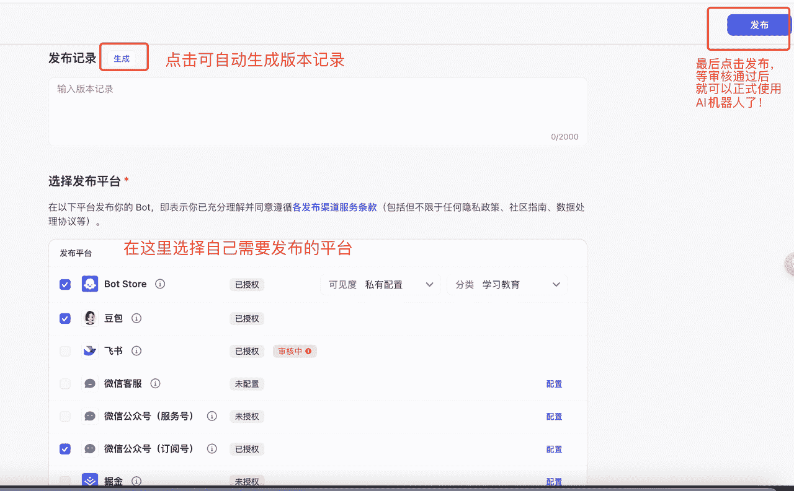

#### **3、如何发布 到🛰️👸号上？**

选择🛰️👸号渠道，点击右侧“配置”按钮；

根据以下截图，去🛰️👸号平台找到自己的App ID，填入确定即可。不用了解绑即可。

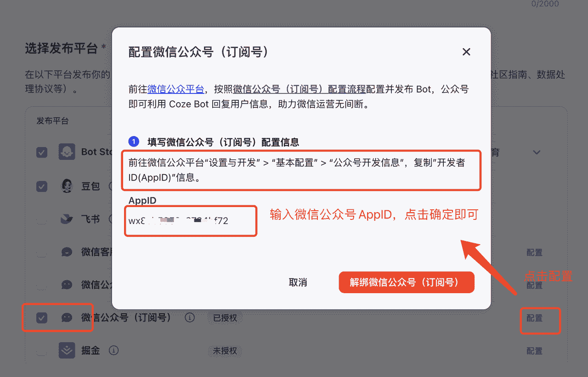

### 🥳恭喜！你完成了自己AI机器人的搭建！

最后去自己的🛰️👸号消息页面，就可以使用啦～

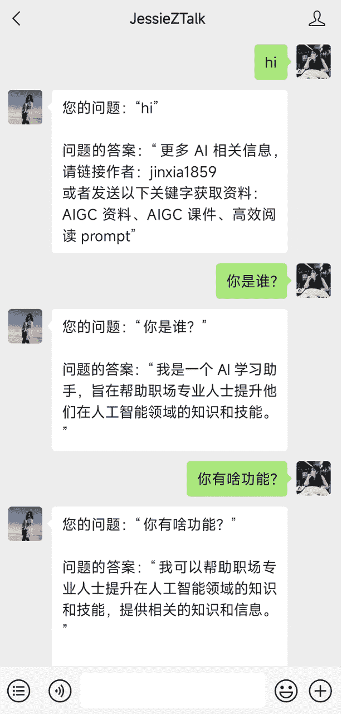

## **🤔 常见问题Q&A**

+   Q: 机器人能处理多复杂的对话？
A: 取决于你的设计，Coze支持从简单到复杂的各种对话场景。

+   **Q: 机器人能学习用户行为吗？**
A: 可以，Coze具备用户行为学习和分析功能。

+   **Q: 如何持续优化机器人？**
A: 定期更新对话逻辑，收集反馈，用数据驱动优化。

+   **Q：其他问题可以留言给我哦～**

## **🎉 结语**

现在，恭喜你已经掌握了如何搭建一个功能全面的🛰️AI机器人小助手。立刻行动，让你的🛰️生活更加智能！