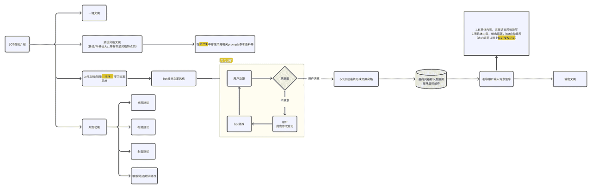

# 小红书文案Bot产品设计思路1.0

> 来源：[https://docs.feishu.cn/docx/RZJzdpiTRonGvFxi8mUcG6nFnng](https://docs.feishu.cn/docx/RZJzdpiTRonGvFxi8mUcG6nFnng)

# 一、前期讨论

## 1、时间节奏

6.19周三：拎主线

6.20周四、6.21周五：

6.22周六、6.23周日：搭建bot

6.24～6.26：调试优化bot，逐步上线v1.0、2.0版本

## 2、Bot 定位

AI的发展，开启了「超级个体」的时代！每个人都值得拥有一个私人定制的Bot！

1、Bot主打一个「私人定制」！通过知识库和变量为用户量身定制bot！

2、Bot的前端体验，一个字“爽”，两个字“好看”！

3、Bot前段体验一定要流畅、交互“可爱亲切”～

4、Bot输出内容速度一定要快，并且稳定！

5、过程即营销，边搭Bot边在社交媒体与用户互动，分享搭建过程，及时收集用户反馈～

+   内容包括：定位、目标用户、核心亮点、市场参考案例

1.  通用能力：具备懒人一键生成小红书文案能力

1.  细分领域能力：

> Bot要求用户输入风格[预设几个风格化/自己上传文档/上传链接]--用户上传--Bot要求文案话题及要求（可以引导用户输入）--用户输入--（多轮交互）--确定文案风格，输出文案--用户提出修改意见--Bot修改--最终确定--完成文案

1.  其他功能：

1 ）给出标题建议 并 给出n个具体标题

2）给出标签建议 并 给出n个具体标签

3）给出封面及配图建议 并 文生图给出参考图片

## 3、6.27号参赛版本目标

| **想法** | **目的** |
| --- | --- |
| 1.  主打实用性、商用性！ | 探索商业模式 |
| 1.  过程即营销：小红书跟用户互动 | 收集反馈持续迭代Bot功能 |
| 1.  用Bot解决 「知识库切片」的事情 | 搭载知识库，让Bot变的更聪明 |
| 1.  Bot稳定性，速度 | 探索技术能力边界，输出稳定可用的bot |
| 1.  技术原创性  | 自建工作流、处理复杂逻辑和交互 |
|  |  |
|  |  |

# 需求概述

## 流程说明

## 功能详情

DIY版本

> 思考1：**哪类用户****会使用一键生成？小白**用户、bot初次体验者，输出内容如何留住他们？

| **页面状态** | **原型图（截图）** | **功能设计** | **功能详情** | **备注** |
| --- | --- | --- | --- | --- |
| 初次打开 |  | 【**一键生成文案**】 | **【入口】2个触发点** | +   爬取各平台热点—拆分为关键词/或直接用热点句 |
|  |  | 【**上传文档/连接-模仿新风格**】 | **【入口】** | +   是否可以推荐相似风格标签？例如古风、现代诗 |
| 对话状态 |  | 【**附加功能**】 | **【文案助手角色】** | +   这里我在想，是否做到拆解小红书经典爆款封面，如备忘录文字排版，或者干净的底色+文字（不过这可能是另一个排版问题 |

+   语言风格

+   特色话语体系

+   特定自媒体博主

+   学术研究

+   娱乐营销号

+   薯队长

+   垂类赛道

+   200、500、1000···

+   如果满意，直接开启内容创作。

+   如果不满意，修改风格。

+   emoji+一句口语化标题（像跟朋友聊天的感觉，xhs运营同学建议之一）符合猎奇、搞笑、有梗、情绪化等特点

+   根据热点修改的标题

+   如：好朋友是疲惫生活的解药

+   如：我完全 而绝对地 主持者我

+   提炼文案中的金句

+   随机生成

+   调用文生图插件

+   结合文案关键词+扩写润色prompt-直接输出给用户

+   提示修改

# 会议记录

## 0623

代办：

1.  调提示词（有思路/有经验/花时间）

1.  完善知识库

1.  工作流

+   本周初步完成：写入变量-判断-输出（奥好xr）

+   合工作流（队长）

⚠️调提示词的基础，是先把工作流合起来。

讨论：workflowManager

讨论：小懒和大聪明来回切换，会不稳定，是否需要把小懒内嵌到大聪明里面

## 0622

讨论点：懒人一键，是怎么个懒人法？

+   帮我写一篇杭州周末去哪里玩？

+   根据链接帮我写一篇文案？

我感觉可以分出来这些：话题主题/随意灵感/文档链接/url链接/图片（含文案）

+   懒人：前段交互顺畅，吐出来的东西能用。

讨论点：专业工作流

+   三步：确认生成背景（人设、目的）——>生成文案（第一轮）——>检测人味儿（给出修改建议）——>确认

+   文案：「第一轮输出文案」+「检测是否像人-打分」=「再合成」

+   附加：输出文案撰写的依据

讨论点：知识库

+   确定知识库的变量：种草逻辑、分享教程

+   标题知识库

+   类型

+   内容知识库

+

+   标签知识库

+

+   Bot 彩蛋——新用户流量入口

+   资料包

+   二维码

+   待补充

⚠️需要注意：

prompt和工作流怎么结合？先把工作流搭建起来，再测提示词。并给知识库同学提需求。协作沟通。

知识库里面的信息，暂时先不要放那么多，这样可以让速度快一点

🔔难点是：

1.  知识库内容板块的提示词。文章用途影响文章结构

如：要不要跟热点？钩子怎么设置？

答：先看我们手上有什么知识库，后面再收集分类和整理。

1.  知识库先整理文档，再考虑切片，并且考虑切片字数限制。

1.  Know how

知识库和prompt，很重要。

## 0619

1.  **目标**：我们主打「私人定制」概念，未来可以当作“私人助手”来交付，迎合coze商业化趋势。

1.  **目标用户：**普通用户+人设风格

1.  **研究规则**：先发布：一键懒人工作流，跑起来。

1.  **框架设计**：

+   广：功能多（功能列表）

+   深：定制化功能，上传特定风格语料（重点）

+   1.0版：先搭建框架，「提示词工程+rag」解决。

+   2.0版：解决速度和稳定性

+   3.0版：交互优化

+   一轮一轮迭代，「主线+测试」共同推进bot迭代

1.  **系统设置**：

+   通用型：

+   小红书平台规则+生成好文案的规则

+   搜索优化、利他性、输出对人有用、能学到东西的提示词

+   功能特点是语言风格

+   IP人设/商业类：从15个人里面，提炼3-5个人设风格

**tips:**

1.  小红书链接转不了，因为需要登陆过程。小红书商业类广告的评论区自己营销+运营，引导评论。

1.  讨论难点：目标用户在哪里？

+   通用：效率高，涨知识？

+   定制：人格化-涨粉、起号？（投票胜出）

1.  首先要明确 【分类】的定义

+   是 个人用户/电商用户 这个层面的分类

+   还是 美妆/**母婴**/穿搭    这个层面的分类

+   品牌账号

+   素人账号

+   2岁宝妈人设

+   母婴达人博主

+   xxx多种人设