# 剪映数字人“个性化“—无限免费私模数字人

> 来源：[https://aiwarts101.feishu.cn/docx/DsYvd91nZoZ66sxh1XvcUCLUniw](https://aiwarts101.feishu.cn/docx/DsYvd91nZoZ66sxh1XvcUCLUniw)

> 大家好！我是卡尔，今天分享的是剪映口播数字人的私有化。

> PS: 视频版本已经在路上，大家敬请期待

---

Heygen的访问限制太强，正好剪映已经有了声音克隆和公模数字人两项能力，搭配facefusion的换脸技术，我们能轻松实现零成本的口播数字人

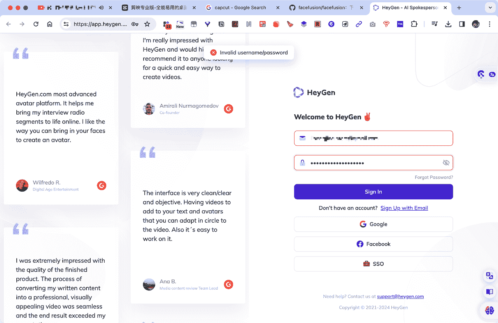

# **剪映做数字人的优势**

剪映作为字节跳动旗下的产品，在抖音平台上，被广泛应用于短视频的创作和编辑中。剪映海外版 CapCut 登顶过美国 App Store，在全球各国 App Store 和 Google Play 平台上的安装总量已超过2.5亿次，在美国市场内的安装总量接近950万次。

剪映的“魔力”是什么？我们不妨来盘点一下剪映已有的AI功能

这六大AI功能基本上解决了我们用数字人做视频的痛点，不**需要反复跳出剪映，在编辑器里就**能过完成 脚本生成→语音克隆→数字人口播 的环节。那下面就让我带大家手把手做一个数字人口播视频

+   剪映下载地址：https://www.capcut.cn/

+   capcut下载地址：https://www.capcut.com

# **制作流程**

首先我们打开剪映，然后添加一个文本到文字轨道，并修改好需要朗读的文字；

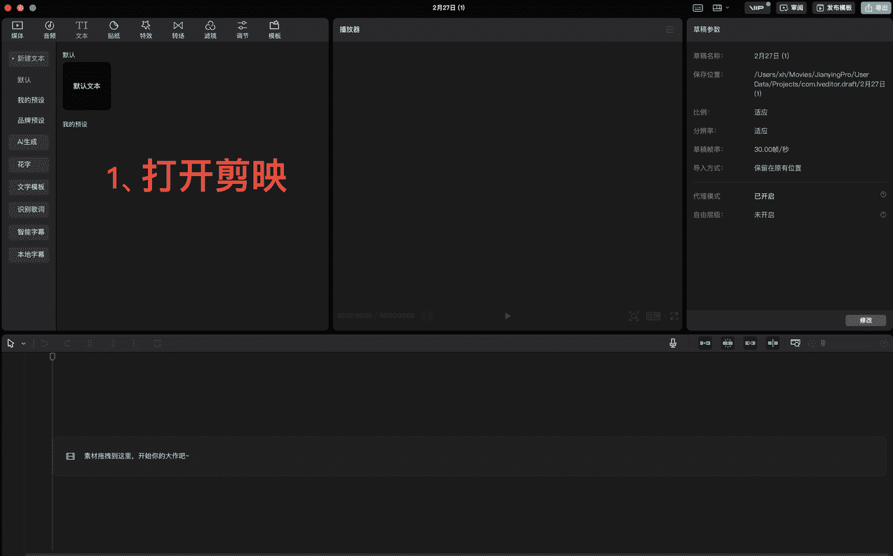

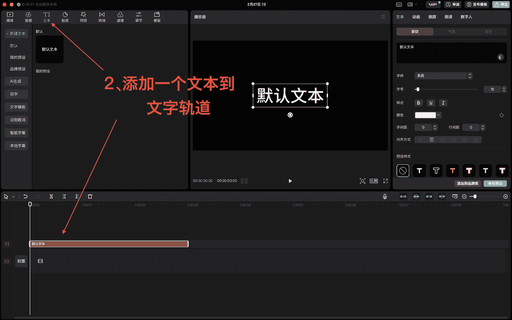

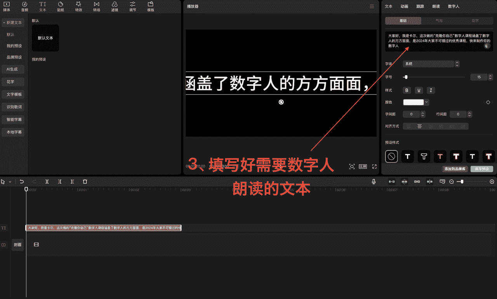

然后点击朗读，并进行声音克隆，剪映的声音克隆现在只用念一句话就可以完成克隆；

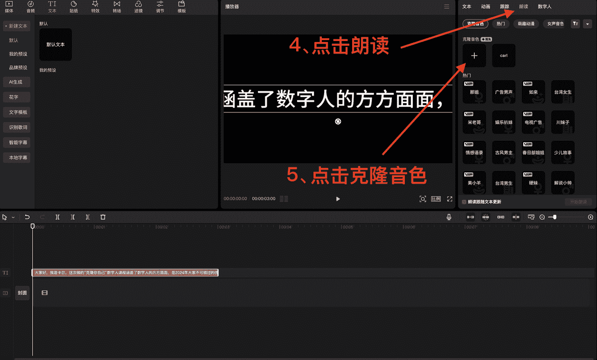

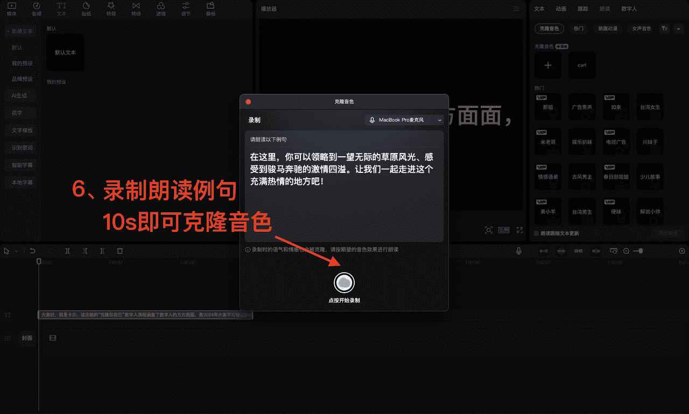

克隆完成后，选择喜欢的数字人形象，并把自己的克隆音色换上去；

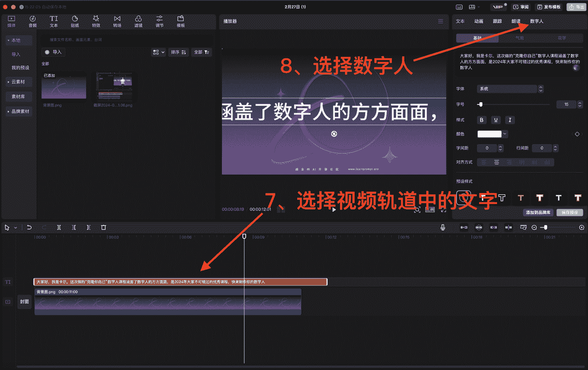

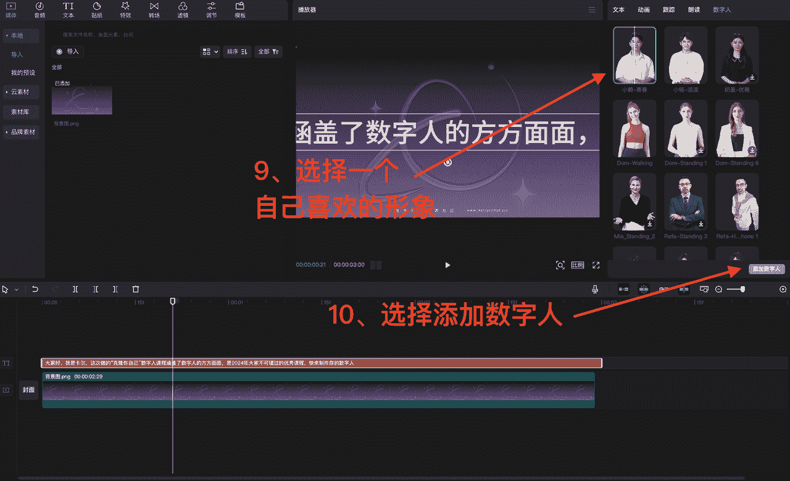

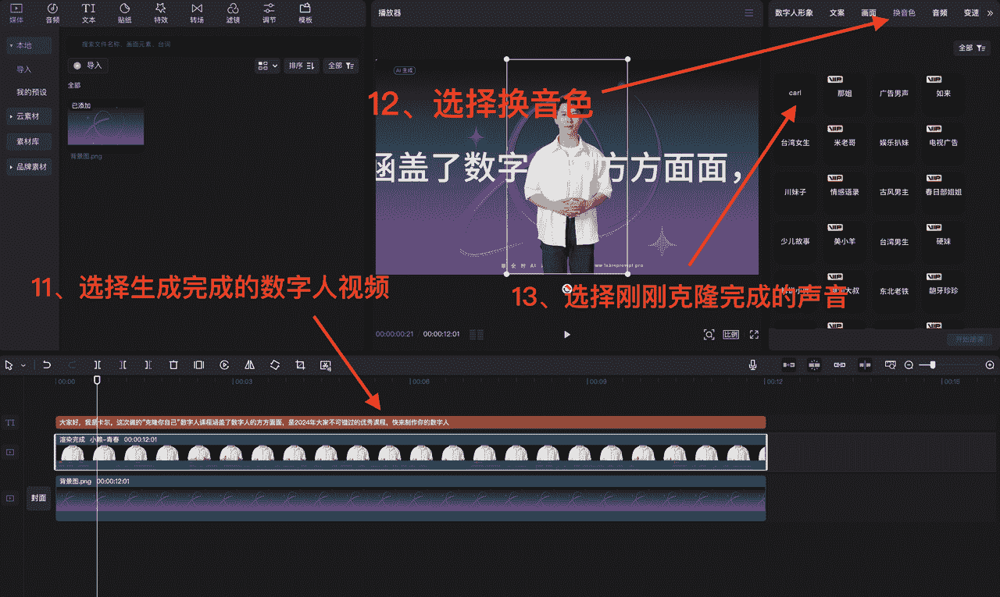

最后，一键智能生成字幕，再自行调整文字样式并校准叫完成了。

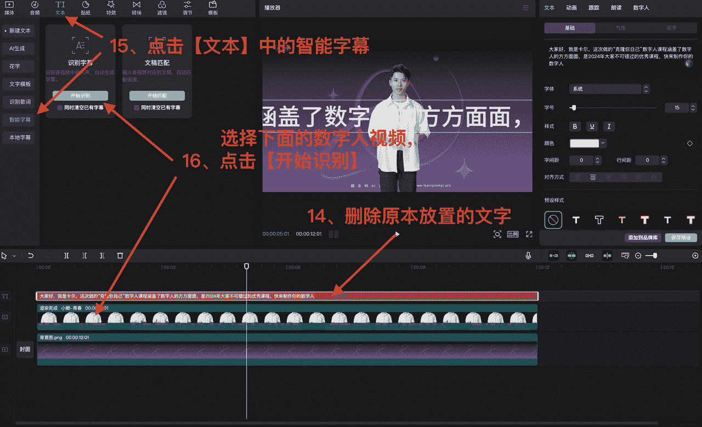

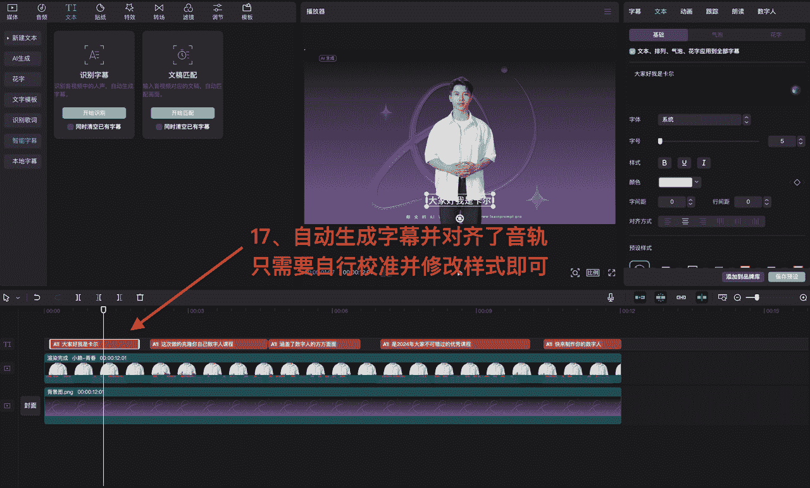

# 成果视频

<https://player.bilibili.com/player.html?bvid=1AK421b7Qt&spm_id_from=888.80997.embed_other.whitelist>

# **数字人“私有化”**

尽管剪映已经有很多公模数字人，但是从抖音上大火的数字人账号上看，私模数字人更受欢迎

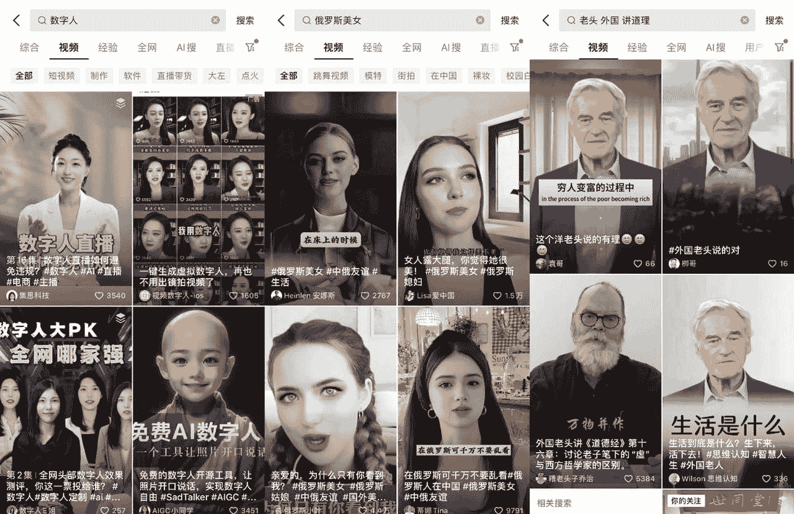

所以这里我将教大家用 AI 换脸软件 来完成最后一步。

[📍 ](https://www.learnprompt.pro/aiMarket)注意：需要谷歌账号（淘宝或者在我们账号解决平台“有号”就可以直接购买）

1.  第**一步打开谷歌浏览器，**点击链接https://github.com/facefusion/facefusion-colab并点击open colab就进到程序主要运行界面.在右上角点击“代码执行程序”选择“全部运行”就行，无需安装，无需付费。点击红框对应的URL就会打开操作界面

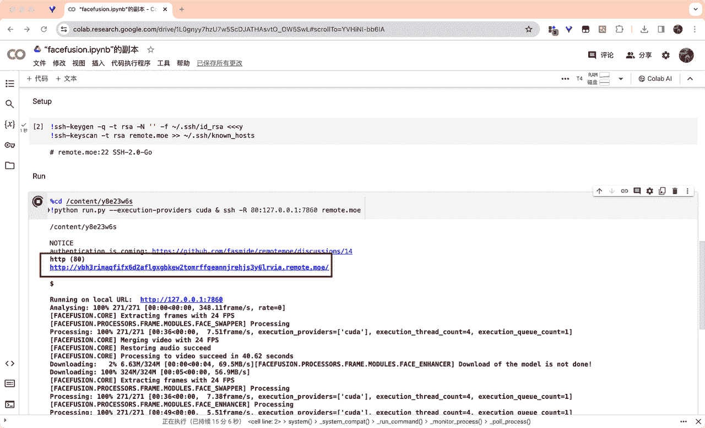

1.  第二步，点击“source”上传自己的照片和“target”上传之前的剪映数字人视频，保持默认参数，点击“START”就能生成！

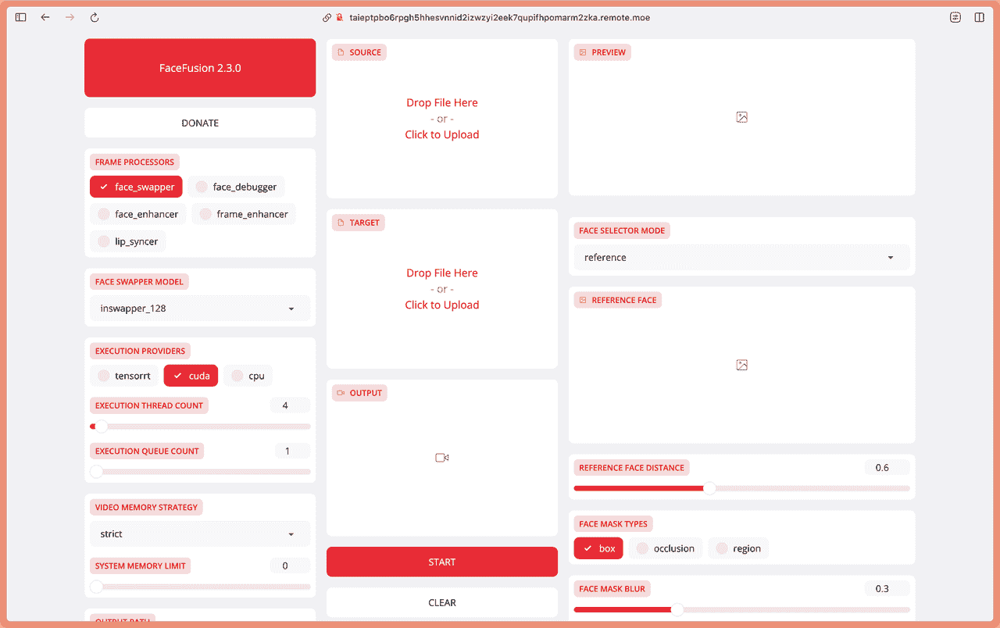

反复调试后给大家选出了最佳参数！

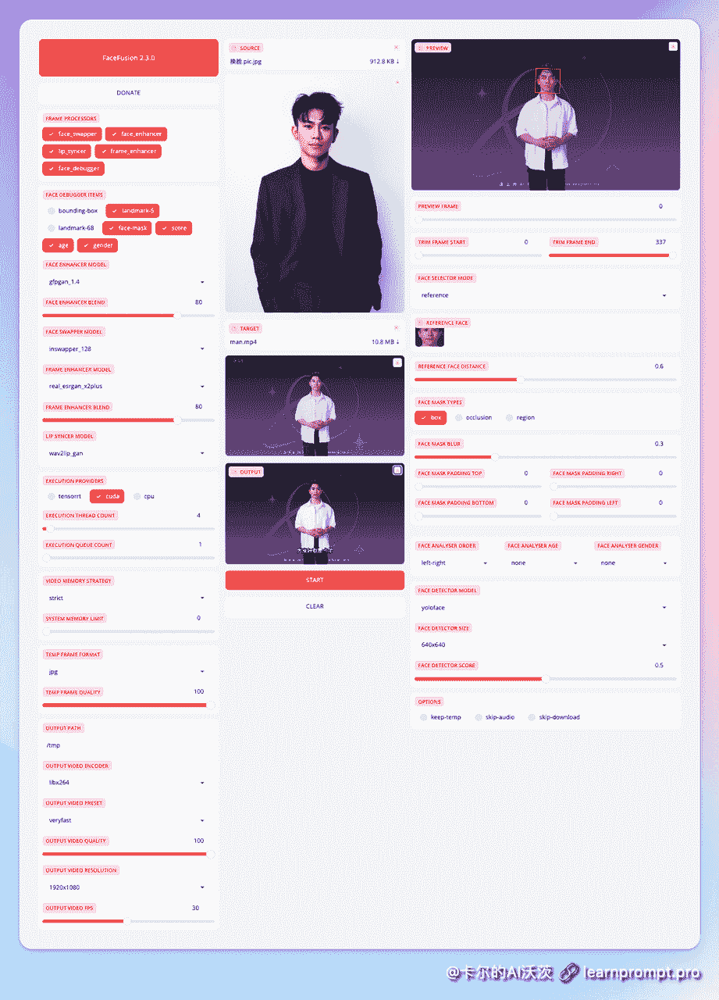

1.  第三步：等着自己专属的数字人视频出炉！

<https://player.bilibili.com/player.html?bvid=13C411s76Z&spm_id_from=888.80997.embed_other.whitelist>

> 有关数字人使用[实战课程：数字人课程](https://waytoagi.feishu.cn/wiki/JOWjwM0qfi2rYVkUIwychk9MnSh)的问题，欢迎在底部评论区留言，一起交流~ 同时如果对数字人课程感兴趣的话，欢迎查看 通往AGI之路 X AI沃茨的《克隆你自己》课程！

> 

> 📌 课程内容：

> 🎉 在线观看第一节：https://www.bilibili.com/video/BV1yw411E7Rt/?spm_id_from=333.999.0.0

> 🌍微信：aiwarts101