# 一分钟素材、零成本、零配置搭建GPT-SoVITS最强声音克隆

> 来源：[https://aiwarts101.feishu.cn/docx/SVyYdSbueotGYXxv7sgcmTDInXd](https://aiwarts101.feishu.cn/docx/SVyYdSbueotGYXxv7sgcmTDInXd)

> 大家好，我是晨辉|AI沃茨，一直致力于研究声音克隆的开源项目。今天给大家分享一下，目前最火的中文声音克隆项目GPT-SoVITS。

GPT-SoVITS，他是由RVC创始人RVC-Boss与AI声音转换技术专家Rcell共同开发的一款跨语言TTS克隆项目，这个项目被称为“最强大中文声音克隆项目”，被众多大佬和知名博主争相推荐，自上线以来，他在github上的Stars数已达到8.6K。

之前做声音克隆，要么通过autodl线上租用GPU，要么就需要本地有GPU环境，gpt-sovits需要的配置相对低一些，基本上6G显存以上就能满足了，但bert-vites2就要4090卡，不然很容易就爆显存了。整体看下来，训练一次的价格在30元-50元人民币的范围，而且需要大量繁琐的配置，出错率极高。

本人也是踩过无数的坑（泪崩）导致训练效果特别糟糕。后来gpt-sovit推出了colab版本，而且很多配置都已经默认设置好了，这样大大就简化了搭建的经济和时间成本，比之前要节省10倍时间。想体验的小伙伴，就跟着我一起操作吧，非常easy

## 效果：

先给大伙看看我克隆出来的效果吧，我克隆的是我最喜欢的易中天老师的声音，他声音的辨别度还是非常高的。

[原声.wav](https://internal-api-drive-stream.feishu.cn/space/api/box/stream/download/all/DCBSbSC7zo5Xc8xCENJcu2uInSh)

[克隆.wav](https://internal-api-drive-stream.feishu.cn/space/api/box/stream/download/all/W8w8bzOemoqBfrxr1g2cXOOQnRh)

[克隆2.wav](https://internal-api-drive-stream.feishu.cn/space/api/box/stream/download/all/Z9uPbWhRKoNOHbxLUIxcKwPMn0c)

## **功能：**

1.  **零样本文本到语音（TTS）：** 输入 5 秒的声音样本，即刻体验文本到语音转换。

1.  **少样本 TTS：** 仅需 1 分钟的训练数据即可微调模型，提升声音相似度和真实感。

1.  **跨语言支持：** 支持与训练数据集不同语言的推理，目前支持英语、日语和中文。

1.  **WebUI 工具：** 集成工具包括声音伴奏分离、自动训练集分割、中文自动语音识别(ASR)和文本标注，协助初学者创建训练数据集和 GPT/SoVITS 模型

项目地址：https://github.com/KevinWang676/Bark-Voice-Cloning

## 环境准备：

1.一台电脑；

2.一段1分钟音频；

这么简单？哈哈哈，就是这么简单，零成本，零配置。下面我跟我一起点点点吧！

## 操作步骤：

1.在浏览器中输入项目地址https://github.com/KevinWang676/Bark-Voice-Cloning，然后进入以下界面：

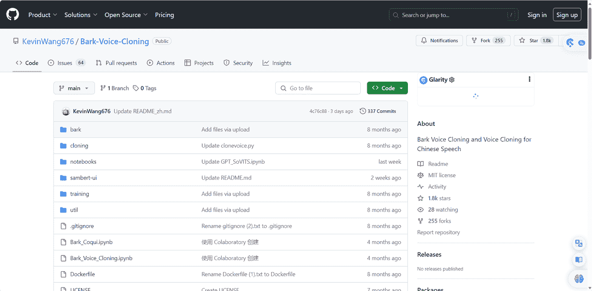

2.点击项目中的notboooks文件夹，并点击GPT_SoVITS，进入以下界面：

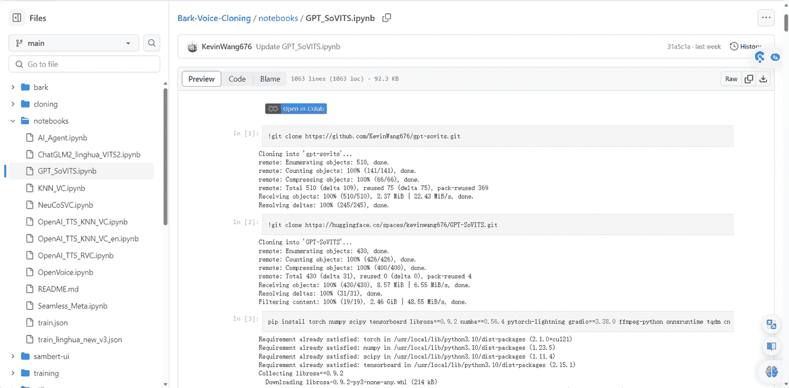

3.点击Open in Colab按钮：

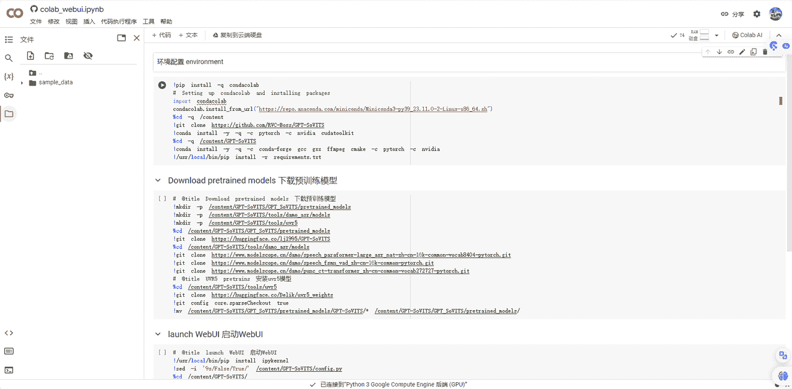

4.点击页面中的“代码执行程序”，并点击运行，“全部运行”，并等待运行：

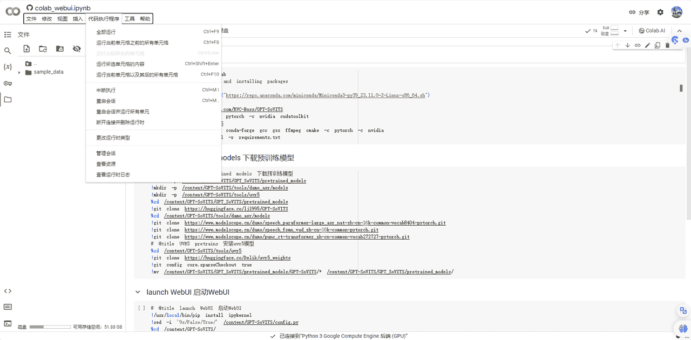

5.点击gpt-sovits目录（切记是第二个，小写的gpt-sovits），

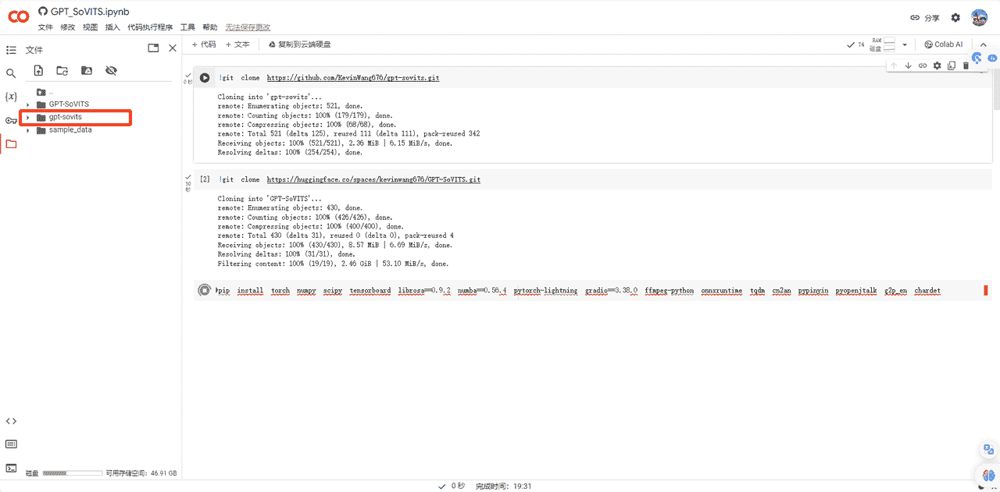

6.将音频素材上传到gpt-sovits目录中，并点击public URL

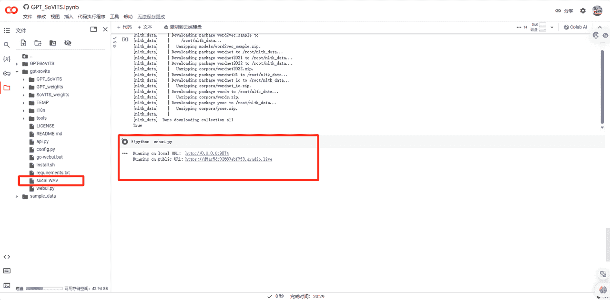

7.点击后打开以下界面：

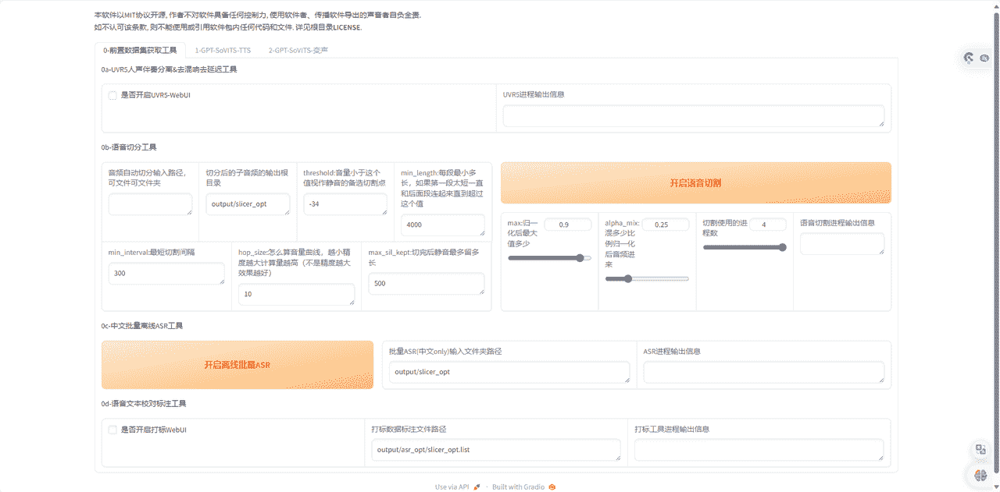

8.在“音频自动切分输入路径，可文件可文件夹”中输入刚上传的素材文件名（切记得是全名）

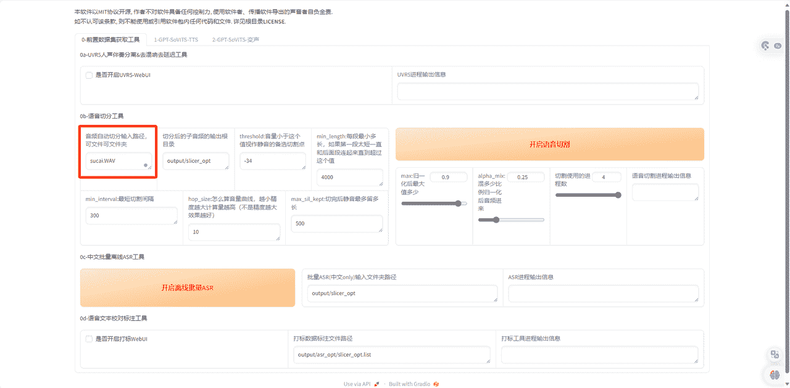

9，点击“开启语言切割”，等待出现切割结束的出现。然后再点击“开启离线批量ASR进程”，等待ASR进程输出信息出现“ASR任务完成”

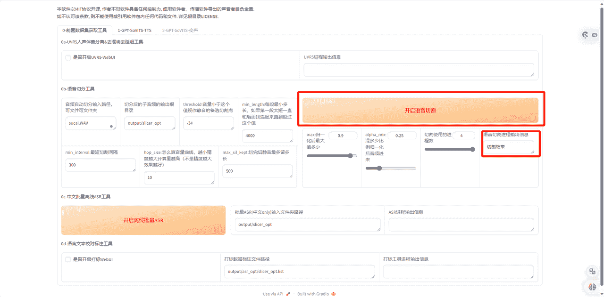

10.点击1-GPT-SoVITS-TTS，然后修改实验/模型名，点击最下面的“开启一键三连”

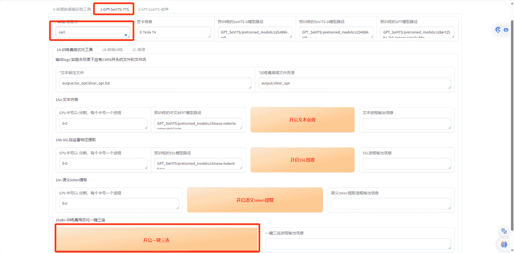

11.等待一键三连进程输出信息出现“一键三连进程结束”后，点击“1B-微调训练”按钮，出现如下界面

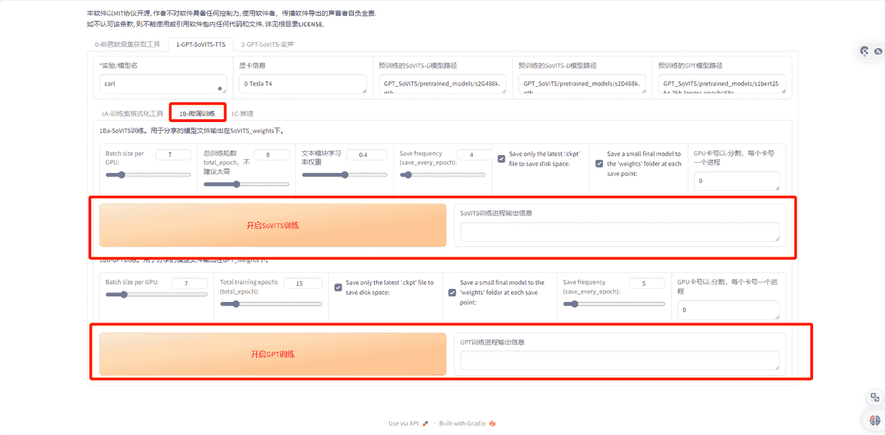

12.点击"开启SoVITS训练"，等待出现"SoVIT训练完成"

13.点击"开启GPT训练"，等待出现"GPT训练完成"

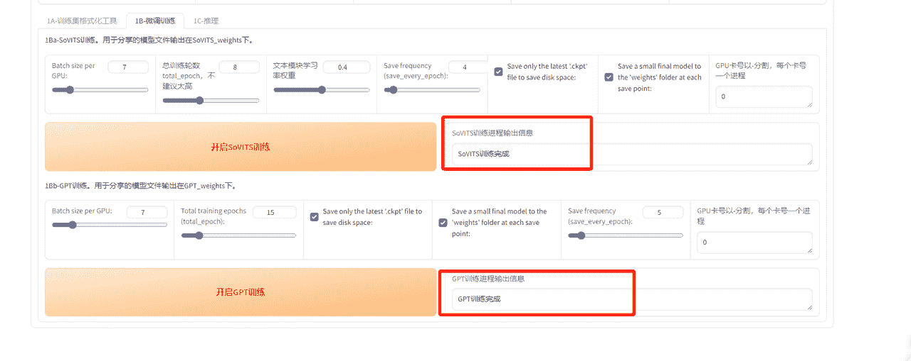

14.下面就可以点击"1C-T推理"进行推理啦， 点击"刷新模型路径"，然后分别选择GPT模型和SoVITS模型，最后勾选是否开启TTS推理WebUI。

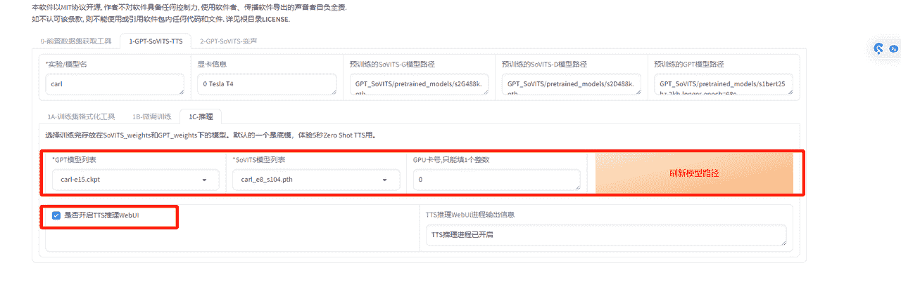

15.然后再回到之前的ipynb界面，点击下面红框的URL

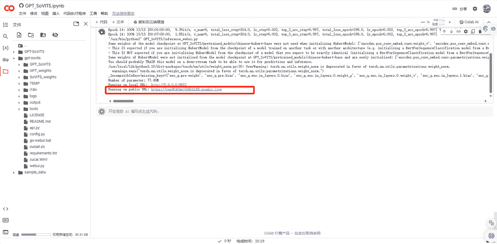

1.  上传一段5s左右的声音（可以从切割路径中下载），然后在”参考音频“的文本输入框中输入声音的文本内容，最后在需要合成的文本中数据你想要克隆的文本，点击"合成语音"，等待输出的语音就好啦。

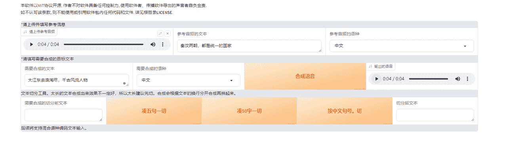

是不是很简单，基本只要点点点，就好啦！

到此就可以克隆出你想要克隆的声音啦，说实话，个人觉得gpt-sovits目前的效果是很炸裂的，音调的变化处理要比之前细腻很多，真实感更强了！

期待后面变声以及多人声音克隆的迭代！

如果你对声音克隆感兴趣的话，欢迎链接我。🛰️🌍：aiwarts101