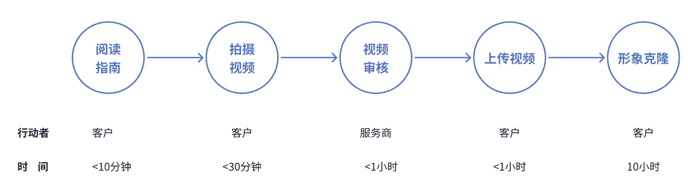
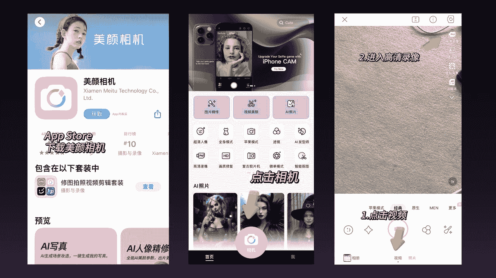
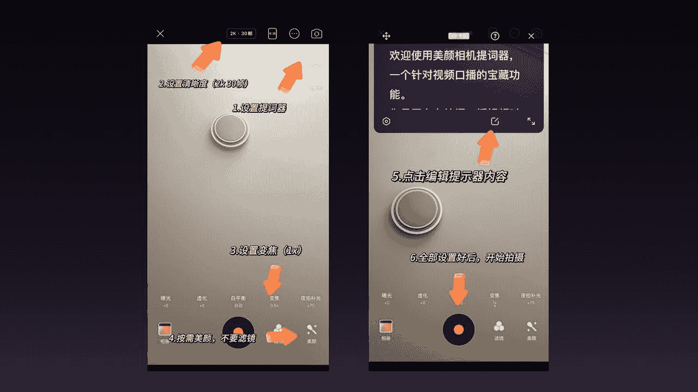

# 数字人样本视频拍摄指南 - AI沃茨

> 来源：[https://aiwarts101.feishu.cn/docx/Npbfd5sjnoyCb0xL1QpcdHmanuh](https://aiwarts101.feishu.cn/docx/Npbfd5sjnoyCb0xL1QpcdHmanuh)

> 本文档旨在帮助客户拍摄出更棒的样本视频，以便创造出最佳的A数字人。

>

> 更新时间：2024年01月13号

> 作者：卡尔的AI沃茨

# 整体流程

---

# 拍摄内容

时间长度为3~ 5分钟。

注葸：

1-动作捕捉期是视频的**第1分钟（不含前5秒）** ，所以这个时间段的动作最好要丰富和多样化一 些。

**2-为了兼容未来想表达内容，**建议多做一些通用型动作（此如双手握手、双手摊手，往前展开等） ，（不要做有特别指向性的动作（ 比如举3根手指之类的）

---

# 准备工作

| 手机/相机 | 像素越高越好，前置/后置镜头都可以 |
| --- | --- |
| 手机支架 | 固定手机，保持视频拍摄过程中手机不会晃动 |
| 相机App | 推荐使用美颜相机（app名字就是美颜相机），因为它带高清摄像、一键美颜、提词器功能，开通会员（12元）。 |
| 选择场景 | 需要选择光线好（拍摄画面没有阴影）、背景好、安静的地方（背景选你主题相关、或者你观众可能会喜欢的，如果不清楚哪样的场景好，那可以看看对标账号或者同行的。） |
| 魅力/帅气的你 | 保持较佳状态，着装、发型、妆容、精神状态等（为了确保摄影效果更加专业和清晰，请在拍摄前考虑移除配件和饰品。） |
| 脚本文案 | 提前准备相关文案，方便录像时眼睛盯着镜头 |

##  3.1 脚本自动生成

1.  借助国内GPT站点 https://aiwarts-mj-gpt.zeabur.app/#/chat
我们可以用下面的提示语输入并直接获得你录制所需要的文本

例子：

+   **生成一段关于数字人的平和风格朗读文本，字**数在900到1000字之间，适合轻松朗读

| 脚本范例 | 大家好！我是xxx，这是我的数字分身，在卡尔的协助下我录制了这段视频。今天我想和大家聊一聊数字人，那些以代码和算法为基础的虚拟存在。数字人是我们现代科技的产物，他们在我们的生活中扮演着越来越重要的角色。 |
| --- | --- |

[脚本.mp4](https://internal-api-drive-stream.feishu.cn/space/api/box/stream/download/all/YO7yb5rr7o78mRxwzolcfVkOnqF)

---

# 美颜相机设置

---

# 拍摄流程

1.  架设好手机支架

1.  开始视频拍摄（建议拍至少5遍）

1.  完成拍摄

1.  发送视频

温馨提示：

1.  为了保证更好的效果，建议至少拍摄5~10次，然后选择其中你认为最好的发给服务商。

1.  讲话内容可以自由发挥（讲你喜欢的），不做限制，想象你在和一位朋友开心的聊天。

1.  为了保证原版视频清晰度，建议用百度网盘发送。

[教程.mp4](https://internal-api-drive-stream.feishu.cn/space/api/box/stream/download/all/YUXQbkuJHohW5axafCtcHPjOnug)

---

# 开始拍摄

## 6.1 高质量样本视频的标准

**重要‼️**

| 背景/场景 | 选择光线好、背景好、安静的地方（选择与你内容主题相关联的场景，或者你观众可能会喜欢的，如果不清楚哪样的场景好，那可以看看对标账号或者同行的。） |
| --- | --- |
| 状态 | 整体轻松自然，想象在和你熟悉的朋友分享知识，在聊天 |
| 眼神 | 眼睛注意力请一直保持在手机屏幕上，想象手机就是你的朋友（手机其实就是观众视角，如果你看别的地方，观众会感受得到） |
| 表情 | 尽量保持微笑或放松的状态（你的观众会更喜欢），其次一段话讲完后，要停顿一下（1~2秒），并且闭上嘴巴 |
| 姿势 | +   建议选择坐姿和站姿： |
| 动作 | 保持活跃，每隔5~10秒，动动手，让你看的更加生动，但是要注意； |
| 声音 | 保持平时说话的速度和强调即可，不用太刻意，这样会导致克隆的声音也不像你 |

+   站姿画面建议在腰部以上，能录知道手部动作

+   坐姿可选择腰部以上或者全身

## 6.2 注意事项

1.  摄像时长： 至少录一个**3~5分钟**不间断的讲话视频。

1.  表情和动作：动作捕捉期是视频的**第1分钟（不含前5秒）**，所以这个时间段的动作最好要丰富和多样化一些。

1.  摄像内容：可以讲自己喜欢的内容，比如自我介绍，或者工作介绍，或者想用数字人做什么之类的。不需要完全照搬参考视频，手势可以多样化一些，比如双手握手、双手摊手，往前展。

1.  A忘记台词：如果忘词了，也没关系，继续讲下去，可以做自我介绍。

1.  开始：视频开始录制时，**前5秒保持静止**，然后再开始讲话。

## 6.3 优秀样本视频参考（期待你的参与）

视频上传后画质压缩

[样例1.mp4](https://internal-api-drive-stream.feishu.cn/space/api/box/stream/download/all/Ksx2bJafyoNCcOxZ1kPcxNh7nVc)