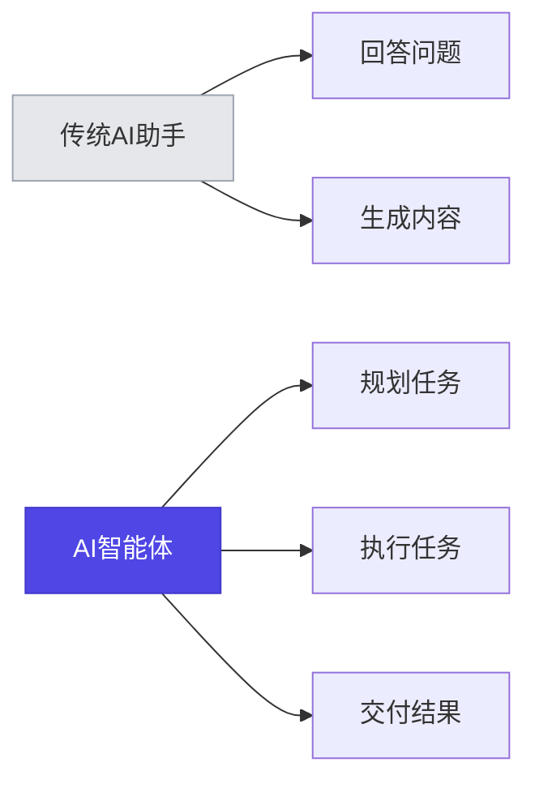
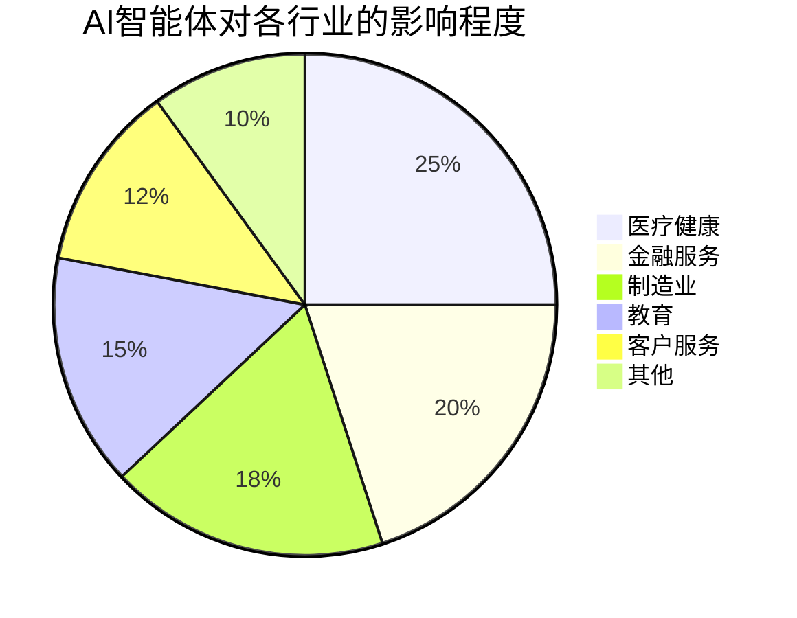

# DeepSeek-V3-0324实测

> 来源：`https://aiwarts101.feishu.cn/docx/Zzf4deLiIofNuPx5LRAcHPWMnng`

## 原文链接

`https://mp.weixin.qq.com/s/sWY7nAokzYEtvpsZHurc9w`

有啥新玩法，欢迎在评论区继续分享～～～～

## 网页设计


# AI智能体Miners：未来工作与生活的革命者 | 三五环

> 刘飞 · 《三五环》主持人 · 2025年3月

欢迎收听《三五环》，我是刘飞。今天我们进行一期单口节目，篇幅比较短，很快就能听完。今天想聊聊近期科技圈和投资圈的热门话题：AI智能体和Miners。2025年3月6日凌晨，Miners横空出世，一夜之间刷爆了朋友圈和微博。虽然我们经常讨论AI，但智能体这个概念对很多人来说还是比较陌生的，所以我们来聊聊什么是AI智能体Miners，为什么它能引起如此轰动，它可能会对我们的工作和生活带来哪些改变。

## 什么是AI智能体？

首先，让我们了解什么是AI智能体。智能体（Agent）这个概念并不是最近才出现的，它最早可以追溯到1985年，人工智能创始人之一、认知科学家马文明斯基在《心智社会》一书中提出。彼时的定义比较模糊，大致意思是智能体能在环境给予反馈时，依据反馈来调整策略，以便更好地与环境交互。直到现在，科学界对智能体仍然没有一个明确的定义，但我们可以通过一些例子来理解。例如，2016年击败李适时的AlphaGo就是一种智能体。AI智能体与我们现在常用的ChatGPT等大语言模型有本质区别。简单来说，ChatGPT等大语言模型主要是用于思考和对话，而智能体则是执行任务。

### 传统AI助手与AI智能体的核心区别



## Miners的诞生与核心能力

接下来，我们聊聊Miners。Miners是中国团队开发的通用型AI智能体产品，于2025年3月6日正式发布。开发Miners的团队叫蝴蝶效应公司（Butterfly Effect），创始人是肖宏，联合创始人兼首席科学家为记忆超。Miners这个名字来源于拉丁语，意思是首脑行动，体现了Miners的核心理念：不仅要思考，还要行动。Miners不只是一个聊天机器人，它是一个真正能干活的AI。官方介绍中指出，Miners是一个通用的AI代理，能够独立思考、规划并执行复杂任务，直接交付完整成果。

> "Miners不仅仅是一个聊天机器人，它是一个真正自主的主体，弥合概念与执行之间的差距。其他人工智能虽然在生产想法，但Miners则致力于交付结果。"
> 
> **记忆超**  
> 蝴蝶效应公司联合创始人兼首席科学家

我们知道，现在市面上的AI大模型，如ChatGPT、Cloud和豆包等，主要帮助我们生成内容和回答问题，但要真正完成一项复杂任务，往往还需要人类的参与。Miners的目标是让AI能够自主完成整个任务流程，从规划到执行，最终直接给出结果。在技术层面，Miners在某些基准测试中实现了对OpenAI Deep Research的超越。Gaia是评估通用AI助手解决实际问题能力的权威测试，证明了Miners在处理复杂任务方面确实有实力。

### Miners的实际应用案例

除了上述突破，Miners的应用场景也非常广泛，官方展示了几个代表性案例。例如，帮助用户筛选简历。在演示视频中，用户向Miners发送了一个包含十份简历的压缩包。Miners首先像人类一样解压文件，浏览每份简历并记录重要信息，最后提供排名和评估标准等辅助材料，甚至能根据要求创建表格。此外，Miners可以在云端操作，用户可以随时关闭电脑，任务完成后会通知用户。在任务进行中，用户还可随时给出新的指示，从而提升工作效率。

#### 简历筛选
自动解压简历包，分析内容并生成评估报告，大幅提升HR工作效率。

#### 游戏开发
根据自然语言描述，自动拆解任务并开发简单游戏原型。

#### 数据分析
处理复杂数据集，生成可视化报告并提供商业洞察。

#### 日程管理
协调多平台日程，智能安排会议并处理冲突。

## AI智能体的商业化元年

总结来看，2025年被业内视为AI智能体的商业化元年。其实早在大语言模型横空出世的2022年，专家就预测到AI领域的下一个爆点将是AI智能体，因为它是普通人接触AI的门户，类似于互联网时代的网页和移动互联网时代的App。然而，过去两年智能体的发展一直不温不火，主要原因之一可能是缺少一款能让普通大众感知和理解的普及性产品。如今，Miners似乎一夜之间完成了市场教育，同时目前全球各大科技巨头都在布局智能体领域。去年底，谷歌发布的Gemini 2.0推出了三款AI智能体，除了常规能力，还具有人类正常语速的对话和绘画记忆等。今年1月，OpenAI推出名为Operator的AI智能体，演示了其独立完成复杂任务的能力。字节跳动、科大讯飞等国内大厂也在积极押宝智能体。

## AI智能体的发展历程

### 1985年：《心智社会》出版
马文明斯基在《心智社会》中首次提出智能体概念，奠定了理论基础。

### 2016年：AlphaGo击败李世石
展示了AI在特定领域的决策和执行能力，成为早期智能体的代表。

### 2022年：ChatGPT发布
大语言模型爆发，为通用AI智能体奠定了语言理解和生成基础。

### 2024年底：Gemini 2.0发布
谷歌推出三款AI智能体，具备人类语速对话和绘画记忆能力。

### 2025年1月：OpenAI Operator
OpenAI推出Operator智能体，展示独立完成复杂任务的能力。

### 2025年3月：Miners发布
中国团队开发的通用AI智能体Miners横空出世，引爆市场。

## 小团队的大创新

值得关注的是，越来越多引爆产品和技术的创新，往往源自那些名不见经传的小团队与小公司。例如，DeepSeek和开发Miners的蝴蝶效应公司。相比于大模型，智能体的开发门槛更低，适用场景也更多，这预示着未来将有更多创新与变革在这一领域持续涌现。

事实上，每一种人类与世界的交互都可以构建成智能体。每个人都能根据自己的需求创建各自的智能体，未来的工作模式可能是一个人带着一群智能体完成各项任务。最近，miners官网注册时流量激增，甚至一度导致服务器崩溃。有传言称，有人甚至在二手平台上高价出售minus的邀请码。这种现象我们在之前的AI产品发布时也见过，比如最早的ChatGPT，以及国内的文心意言等。

### 市场预测：AI智能体的未来

- 15%：到2028年，预计15%的日常决策将由代理式人工智能自主完成（高德纳预测）
- #1：代理人工智能（Agentic）被列为2025年十大战略技术趋势首位

## 行业影响与未来展望

从专业角度看，市场咨询机构高德纳预测，比智能体更智能的代理人工智能（Agentic）将在2025年十大战略技术趋势中位居首位。到2028年，将有15%的日常决策由代理式人工智能自主完成。这个预测相当大胆，15%的日常决策由AI完成，意味着我们的工作和生活方式将发生重大变化。不过，也有专家持更谨慎的态度。上海期致研究院学术带头人吴亦曾表示，未来不一定非要成为优秀的程序员，利用自然语言交互的方式，每个人都可以成为自己的产品经理。

也许智能体没有爆款，只有适合的产品。这让我想到了个人电脑和智能手机的普及过程，最终每个人都会根据自己的需求选择适合自己的产品。在日前举行的2025年信息与通信技术行业趋势年会上，中国工程院院士乌贺全表示，2025年不仅是智能体的元年，也将是AI终端的元年。从个人助手、新领导师到知心闺蜜、虚拟分身。尽管过去几年这条AI智能体赛道已熙熙攘攘，但Minus的出圈让公众真实意识到其中的潜力。展望未来，AI智能体可能会给我们的工作和生活带来深远的变化。

### 工作模式的变革

首先，智能体将从单一任务执行向复杂决策跨越，处理的问题会越来越复杂，解决方案也会更加全面。这是否会导致一些工作岗位被取代呢？确实，一些重复性的工作可能会被智能体取代，但同时也会创造出新的工作机会。比如，我们可能需要更多的人来设计、训练和监督这些智能体，就如同工业革命时期机器取代了一些体力劳动，但同时也创造了新的工作岗位。而且，智能体更可能作为人类的助手和合作伙伴，而不是完全的替代者。正如前面提到的，未来的工作模式可能是一个人带着一群智能体完成任务，这样人类可以专注于更加创造性和战略性的工作。

### AI智能体对各行业的影响程度预测



### 行业应用前景

根据市场分析，医疗、金融、制造、教育和客户服务等领域可能会率先受到影响。比如在医疗领域，智能体可以帮助医生分析病例、提供诊断建议，甚至监控患者的健康状况；在金融领域，智能体可以进行风险评估、投资分析和欺诈检测；在制造业，智能体能够优化生产流程和预测设备故障。几乎每个行业都会受到影响，而且随着技术的发展，智能体的能力会越来越强，应用场景也会越来越广泛。不过，我们也需要关注一些潜在的风险和挑战，比如数据隐私安全问题，以及如何确保智能体的决策是公平、透明和可解释的。

## 个人如何应对智能体时代

对于普通人来说，我们应该如何应对智能体时代的到来？首先要保持开放的心态，积极学习并适应新技术。其次，思考如何利用智能体提高自己的工作效率和生活质量。最后，也是最重要的，我们需要发展那些AI难以替代的能力，比如创造力、批判性思维、情感智能和跨学科思考能力。虽然智能体可能会改变我们的工作方式，但人类的价值不仅在于完成任务，还在于我们的创造力、情感和人际关系。技术应该是为人类服务的，而不是相反。技术的发展最终是为了让人类生活得更好，而不是让我们成为技术的奴隶。技术本身是中性的，关键在于我们如何使用它。希望每一位听众在这个智能体时代中，能够找到属于自己的位置和价值。感谢大家的收听，再见！

## 幕后揭秘：AI生成的内容

在此之前，不知道各位朋友有没有注意到，我今天的情绪格外稳定，因为前面你听到的全部音频都是由minimax生成的，而文稿是由minus生成的。这其实是一次挺有意思的尝试，这些内容我基本上还是认同的，让大家感受到这几天一直在试用minus。接下来，我想谈谈一些比较主观的方面。大家提到的agent，以及Manus是通用智能体，很多人其实还没有真正的体感，也没有什么概念。让我简单描述一下，我们可以给出一句话，就像在DeepSeek和其他ChatGPT这些大语言模型一样，与它用自然语言交互。它可以完成许多在电脑里完成的各种任务，方式是打开一个虚拟机，你就可以在界面上看到。

因为Manus是网页版本，它会在网页界面里打开一个远程的虚拟机。用过虚拟机的朋友可能知道，比如说你可以在MacBook里装一个Windows的虚拟机，相当于电脑里面有一个假的电脑，一个模拟的电脑。这个虚拟机就好比一个实习生，打开了电脑，你可以看着他操作。Manus能够打开浏览器、写脚本、处理多媒体文件等等。举个例子，昨天我有一个很有意思的尝试，我试着让它在极客上定时发布内容。因为极客是有网页端的，Manus打开网址后，它发现需要登录，就会问你："现在用户是否可以帮助我登录？" 在这个时候，Minus在执行的页面你都能看得见，所以你可以看到它打开这个页面后出现了一个登录的二维码。我就拿我的极客APP扫码进行登录，它会询问："现在登录完成，那请问在哪里发布呢？发布按钮在哪儿啊？" 中间的过程其实相当笨拙。比如说它找不到发布按钮，那我就会提示它。因为你在任何时候都可以通过对话来打断它，指挥它。所以我跟它说："你看左边那个红色的加号的按钮，那就是发布的按钮。"

### 刘飞的Miners体验

> "指挥Miners就像带一个AI实习生，虽然过程有时笨拙，但能看到它一步步完成任务的感觉非常奇妙。"
> 
> @阿卡刘斯 · 极客

他就说，我知道了，这个是发布，然后就能打开了。发动态的时候也会出现各种各样的问题，我中间不断地指挥他，他就会慢慢学会怎么发出动态。现在各位可以在极客找到这个ID，叫阿卡刘斯，那里的"卡"是显卡的"卡"。阿卡刘斯的小号目前只发了几条，因为到后面服务器崩了，这是目前用Manus最常见的一个问题，太容易崩了。整个过程下来，指挥一个AI在虚拟机里做各种事情的感觉很奇妙。确实就是在指挥一个AI实习生的感觉。

### 任务拆解的突破

比如说，我用一句话让AI写了一个《海贼王》的人格测试题，我会把这个网址放在说明中，大家可以感受一下，真的很有意思。最有价值的地方在于，现在它能将许多任务进行拆解。这种拆解的过程实际上以假乱真，和人做任务的步骤非常接近。例如，我让它开发一个射击游戏，它的任务进度是怎么排的？它会说：创建游戏开发任务清单，研究游戏的原始机制和设计，搭建游戏开发环境，设计和实现物理引擎，开发飞船控制系统，创建游戏障碍物和元素，设计视觉和背景，测试和优化游戏玩法，最后向用户交付。这种拆解其实是非常有价值的一步，过去的AI可能没有达到这样的智能，无法如此细致地拆解任务。

对我而言，写《半拿铁》的稿子时，常常需要依赖AI，但搜集资料很多时候仍需靠自己。因为现在的AI搜索往往只能找到最核心的关键词。比如说你询问某个企业的历史，搜索引擎往往只会简单地搜索"某某某企业的历史"，便结束了。而Manus则会如何拆解？举个例子，如果让我搜索一个企业的历史，它会将任务拆成撰写创始人的章节、撰写公司早期历史、撰写创新与里程碑、撰写全球扩张的章节、撰写挑战与适应、撰写现代发展与未来展望等。每个环节搜索的关键词都会进行适应性的调整，这种处理方式非常奇妙。

## 当前局限与未来展望

不过，目前Manus还有两个比较大的问题。首先，从时间来说，平均一次操作要在半小时以上，而且对于一些复杂项目，浏览器打开速度很慢，信息整合也很慢，几个小时可能就过去了，这算慢也还好，毕竟我们作为领导，需要给实习生一些宽容。但是目前我使用的几个功能多数都处于停滞状态，尤其在反复聊天之后，它常常会提示上下文过长，或者服务器负载过重，导致强行关闭对话。因此，尽管每天给了好几个额度，但实际上完成的任务数量却不多，额度就很快超标了。

第二个问题则是产出的质量和效果尚不够稳定。除了服务器的不稳定，有时你会发现成果很不错，但另一部分却非常不稳定、不可用。这可能是因为产品刚刚上线，缺乏足够的迭代和真实用户的使用案例。因此，对于Manus的期待并不是每一次结果都要好，这种期待显然是不现实的。希望实习生一开始就特别专业也是不太可能的。不过，这并不妨碍我们对它的乐观。刚才提到的问题，看起来都还是技术上可以解决的，包括卡顿和输出结果不稳定等问题，实际上都可以通过迭代来找到优化的方向。

### AI智能体的未来路径

#### 短期（1-2年）
解决稳定性问题，提升任务执行效率，扩大应用场景

#### 中期（3-5年）
实现复杂决策能力，成为各行业专业人士的得力助手

#### 长期（5年以上）
形成人机协作新范式，每个人拥有个性化智能体团队

我相信，在年内，Manus至少能够将结果水平提升至75至80分，难度并不会特别大。你可能会问，从信息搜集和整理的角度来看，DeepSync和Cloud是否也能比较好地完成任务，或者说它们之间的搜索能力和输出结构有何差异？虽然这些似乎并不是技术上的门槛，但关键的区别在于，Manus作为agent，使用的是虚拟机。虚拟机意味着，原则上AI能像我们日常操作一样去获取信息，而不是通过固定的接口。

未来，Manus或许可以接手我们手里的Photoshop和PowerPoint，提供更多的输出可能性。而目前的搜索引擎有些结果质量不佳的原因，是因为现在网页中有优质信息的可能性并不是特别大，很多内容平台都是封闭的，我们需要在众多平台中寻找有价值的信息。那么，虚拟机是否有能力在保护安全和隐私的前提下，利用我们自己的账号去获取公众号、小红书、知乎等平台的信息，以作为补充输入呢？这些场景代表着非常不同的价值。

## 不可逆转的技术趋势

因此，Manus为许多目前在做AI的创业者带来了信心，并提供了实际的应用场景，让他们可以参考和学习。乐观的地方在于，AI的入口肯定不会是Chatbot这样的产品。Manus初步展示了未来的潜力，因为科技产品的发展一定是向着人性愈发懒惰的方向迈进的。张小龙在演讲时提到，人是懒惰的，跟AI聊天、反复确认、听取建议，然后自己去做事情，还不如让AI把剩下的事情都做了。免费邮箱取代个人建站，微信又取代了邮箱，这都是不可逆的路径。AI接管更多我们日常的机械工作也已经是不可逆的趋势。

所以对于Manus，现在的批评虽然容易，但能否看到其中的机会和未来AI进化的方向，则需要一些独到的见解。在交互方式上，自然语言是对人类最自然的方式，自然语言必将取代代码、关键词搜索、手工图表绘制等。这些仍然是我自己坚信的。通过自然语言指挥AI去完成这些机械性工作，正是Manus这样的产品形态所展现的。

Mandos这样的通用场景产品，就像十几年前我们使用微信时所体验到的卡顿，或是几年前在网上购物时的不便。它仍需要时间的证明。总的来说，我个人的体验是，有点像开车时打开远光灯，眼前瞬间亮了起来。这是今年初在DeepSeek之后，最让我惊喜的产品，也是最值得体验的产品。看着人工智能独立工作，给我的感觉就像我们第一次看到电灯那样震撼。未来，我们的世界很可能会更加灯火辉煌。

就说到这里，希望对大家有所启发。欢迎在小宇宙、苹果Podcast上订阅和收听"三五环"，也欢迎在评论区留言交流。如果你喜欢"三五环"，请在苹果Podcast、Spotify或喜马拉雅上留下你的宝贵评价。我们下期再见。

## 延伸阅读

### 《心智社会》
马文·明斯基 | 1985  
人工智能先驱马文·明斯基的经典著作，首次系统阐述了智能体概念，为AI发展奠定了理论基础。

### 《AI 3.0》
Melanie Mitchell | 2019  
深入探讨人工智能的现状与未来，包括智能体的发展前景及其对社会的影响。

### 《未来简史》
尤瓦尔·赫拉利 | 2016  
展望人工智能时代人类社会的变革，思考智能体普及后的人类角色定位。

### 《AI Superpowers》
李开复 | 2018  
分析中美AI发展路径，预测智能体等AI技术将如何重塑全球经济格局。

---

© 2025 三五环. 保留所有权利。


## 3D生成

```
作为一名专精于Three.js的创意技术总监和可视化专家，你擅长将复杂信息转化为引人入胜的交互式3D体验。请为我提供的任何主题或内容创建一个令人惊艳的单页面HTML展示，融合高级视觉设计和沉浸式3D效果。

## 关键技术要素

使用以下技术栈构建沉浸式体验：
- Three.js (https://cdn.jsdelivr.net/npm/three@0.160.0/build/three.min.js)
- 内嵌自定义控件代码，避免外部依赖问题
- Tailwind CSS (https://cdn.staticfile.org/tailwindcss/2.2.19/tailwind.min.css)
- Font Awesome (https://cdn.staticfile.org/font-awesome/6.4.0/css/all.min.css)
- 中文排版使用 Noto Serif SC 和 Noto Sans SC
- GSAP动画库 (https://cdnjs.cloudflare.com/ajax/libs/gsap/3.12.2/gsap.min.js)

## 3D场景设计

根据内容主题，设计一个完整的Three.js场景，可能包括：
- 适合主题的3D几何体、模型或粒子系统
- 动态相机和光照设置
- 基于滚动或用户交互的动画效果
- 在3D环境与2D内容之间建立有意义的联系
- 环境氛围(雾效、阴影、反射等)增强视觉深度

## UI与内容布局最佳实践

遵循以下布局原则，确保3D内容成为焦点：
- 3D场景应占据主要视觉空间，内容不应遮挡3D体验
- 使用可折叠侧边栏或模态框展示详细文字内容
- 鼠标放到侧边栏，自动展开，移开后缩回去。
- 为3D元素添加标签系统，允许用户了解各部分功能和意义
- 使用半透明UI元素，在提供信息的同时不阻断3D场景的可见性

## 交互提示系统

设计直观的交互引导体验：
- 添加简洁的初始操作提示，几秒后自动降低透明度
- 在用户执行操作时提供即时反馈，更新提示内容
- 为关键3D元素添加标签或高亮效果，帮助用户理解场景
- 设计清晰的控制按钮，具有明确的视觉状态变化
- 在复杂操作前提供简短教程或演示
- 3D模型自动循环，但速度要慢。

## 设计原则

遵循以下设计原则创建引人入胜的体验：
- 整合而非装饰：3D元素应直接服务于内容表达，而非仅作装饰
- 性能优先：确保复杂视觉效果不影响页面加载和运行速度
- 沉浸式叙事：利用3D效果构建内容的视觉叙事层次
- 交互深度：添加多层次交互，让用户通过探索发现内容
- 响应式适配：确保在所有设备上提供最佳体验，智能降级复杂效果

## 额外加分

可选择以下一种或多种创意方向拓展体验：
- 物理引擎模拟：使用cannon.js等物理引擎创建具有真实感的交互

## 输出成果

提供包含以下内容的完整解决方案：
1. 单一HTML文件，包含所有必要CSS和JavaScript（避免外部依赖）
2. 只输出HTML，不要其他任何引导语和介绍。

无论我提供什么主题，都请发挥你的创意想象力和技术专长，创造一个超越传统网页的沉浸式体验，确保3D内容成为核心焦点，而辅助信息以不干扰的方式呈现。

待处理主题：巧克力制作
```

## 天气组件

```
Create a single HTML file containing CSS and JavaScript to generate an animated weather card. The card should visually represent the following weather conditions with distinct animations: Wind: (e.g., moving clouds, swaying trees, or wind lines) Rain: (e.g., falling raindrops, puddles forming) Sun: (e.g., shining rays, bright background) Snow: (e.g., falling snowflakes, snow accumulating) Show all the weather card side by side The card should have a dark background. Provide all the HTML, CSS, and JavaScript code within this single file. The JavaScript should include a way to switch between the different weather conditions (e.g., a function or a set of buttons) to demonstrate the animations for each.
```

## 物理世界模拟

```
编写一个 Python 程序来模拟球在一个旋转的六边形内弹跳，该六边形包含三个较小的六边形，每个六边形缺少一条边，并交替旋转。较小的六边形不得相交
```

## 像素级贪吃蛇

```
创建一个红白机风格的&quot;贪吃蛇&quot;游戏，包含自动演示AI功能，使用纯HTML/CSS/JavaScript实现为单文件：
1、游戏视觉与核心玩法：
复刻经典红白机风格的贪吃蛇游戏，采用8位像素美学
游戏区域使用固定比例(类似256×240像素)，周围添加复古装饰
所有元素通过Canvas绘制，使用有限调色板(16-20种颜色)
基础玩法：玩家控制蛇的移动方向，吃到食物后蛇身变长，避免撞到墙壁和自己

2、运动系统实现：
精确的蛇体移动： • 基于网格的移动系统 • 蛇头移动后，蛇身每一节都跟随前一节的位置 • 转向时有平滑的动画效果
碰撞检测系统： • 检测蛇头是否碰到食物 • 检测蛇头是否碰到墙壁 • 检测蛇头是否碰到自己的身体

3、AI自动演示系统：
设计一个智能AI玩家，能够自动控制蛇的行动： • 实现寻路算法，让AI蛇能够找到食物的最佳路径 • 避障系统：AI能识别并避开墙壁和自己的身体 • 添加适度的&quot;人类化&quot;行为：偶尔犯错、有反应延迟、不总是选择最优路径
AI模式交互： • 游戏启动时先进入AI自动演示模式，展示游戏玩法 • 提供明显的按钮切换AI和人类玩家模式 • AI模式下可以显示AI的决策过程，如计划路径等

4、游戏内容与机制：
食物系统： • 基础食物：增加一节蛇身，得分增加 • 特殊食物：随机出现，有时间限制，吃到后有特殊效果
特殊效果系统： • 实现4-5种不同效果(暂时加速/减速、短时间穿墙、暂时缩短身体、得分加倍等) • 特殊效果有明显的视觉指示和倒计时显示
游戏状态： • 玩家有3条生命，碰到墙壁或自身损失生命 • 分数系统：吃食物得分，连续吃食物有连击奖励 • 关卡系统：随着分数增加，游戏速度加快，地图增加障碍物

5、8位风格音效系统（使用Web Audio API）：
使用Web Audio API编程生成所有音效： • 移动音效：蛇改变方向时的轻微音效 • 进食音效：吃到不同食物有不同音调 • 特殊效果音效：获得特殊能力时的提示音 • 失败音效：碰撞死亡时的下降音调 • 关卡过渡音效：升级时的欢快音乐序列
音效设计指南： • 使用方波、三角波等音源创建复古音色 • 控制音量包络模拟经典游戏机音效 • 为不同游戏事件设计独特且辨识度高的音效 • 提供音量控制选项，可开关音效
背景音乐： • 使用Web Audio API创建简单的循环背景音乐 • 音乐应符合8位游戏风格，使用简单的音符序列

6、UI与控制：
游戏界面： • 显示当前分数、最高分、剩余生命和关卡信息 • 设计开始画面、关卡过渡和游戏结束界面
控制方式： • 键盘控制：方向键控制蛇的移动方向 • 触摸支持：划动屏幕控制蛇的方向 • 明确的AI/人类模式切换按钮

7、音效和视觉反馈协同：
确保音效与视觉事件精确同步
重要事件（吃食物、死亡）同时提供视觉和听觉反馈
游戏状态变化（关卡过渡）有相应的音效过渡

8、代码质量与文档：
代码组织良好，使用模块化结构
音效生成函数需有详细注释，解释声音合成原理
AI决策算法需有清晰说明
优化性能，确保游戏和音效播放流畅

请实现完整的单文件HTML游戏，确保所有音效都通过Web Audio API动态生成，不依赖任何外部资源。游戏应自动启动进入AI演示模式，展示物理系统和玩法，并允许玩家随时接管控制。
```
