# NanoBanana 室内设计邪修大法

> 来源：[https://aiwarts101.feishu.cn/docx/Lr8EdlBa0oSzLhx9hHacsuY9nrd](https://aiwarts101.feishu.cn/docx/Lr8EdlBa0oSzLhx9hHacsuY9nrd)

因为全篇内容⽐较⻓且会实时更新，⼤家可以图⽚识别⽂字，复制下⾯的🔗到浏览器中打开查看最新

的合集资料⬇

https://aiwarts101.feishu.cn/wiki/Ri9pwGL2NiAXNNkpfPfcQMStndb?from=from_copylink

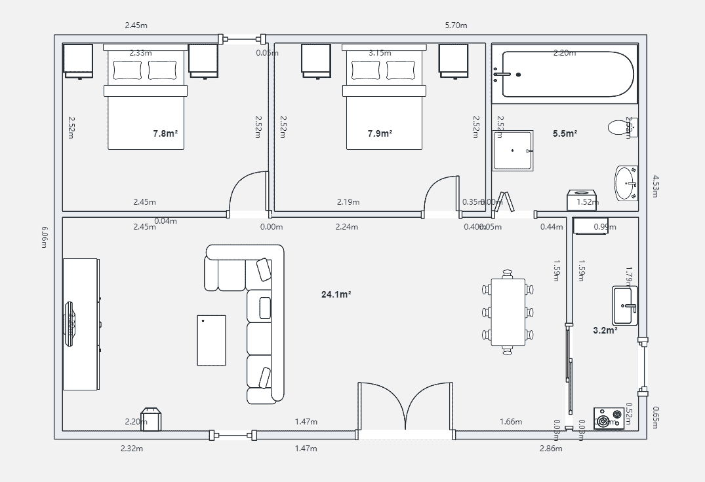

> Help me convert this residential floor plan into an isometric photorealistic 3D rendering of the house.

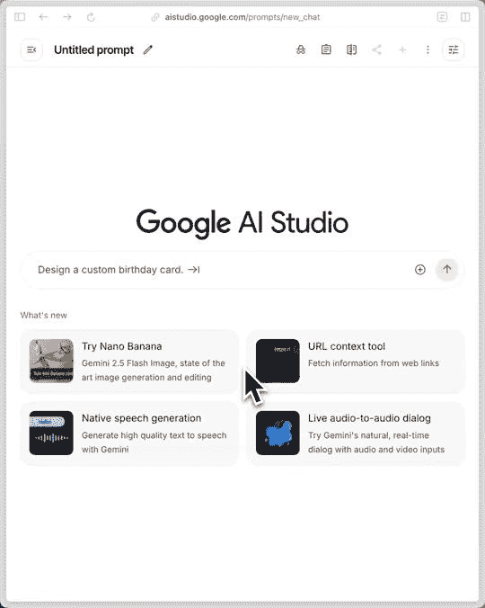

[操作1.mp4](https://internal-api-drive-stream.feishu.cn/space/api/box/stream/download/all/TRP8bN0FLoAYNGxiz6Xc3xIwn7c)

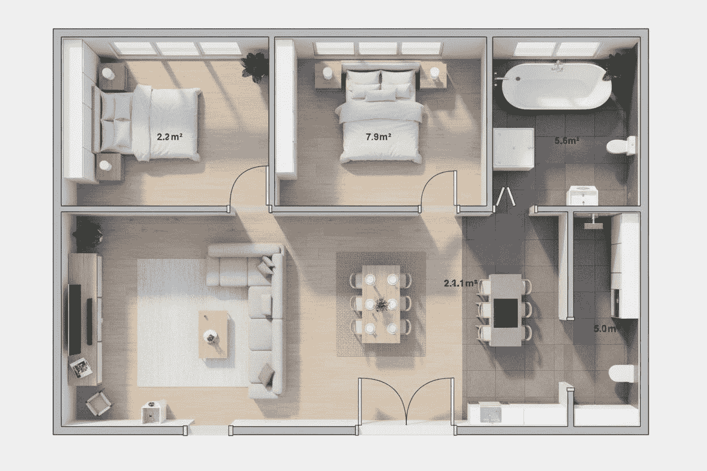

也别把继续输入这段真实视角咒语，直接就得到第一人称真实视角了

千万别在下面让nano bananan出一个真实视角

> Help me generate a realistic photo looking from the dining table towards the bathroom, which must comply with the house layout in the design plan, and appropriate decorations can be added.

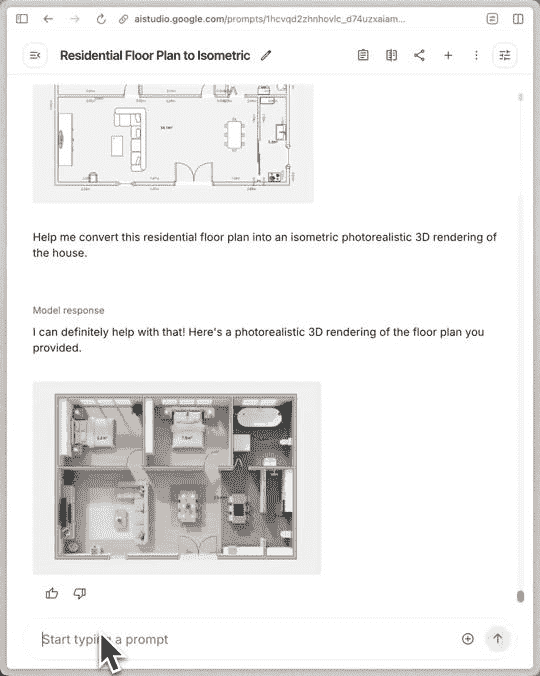

[操作2.mp4](https://internal-api-drive-stream.feishu.cn/space/api/box/stream/download/all/EgwBbqLduorCcxxDImzcRWGEnPe)

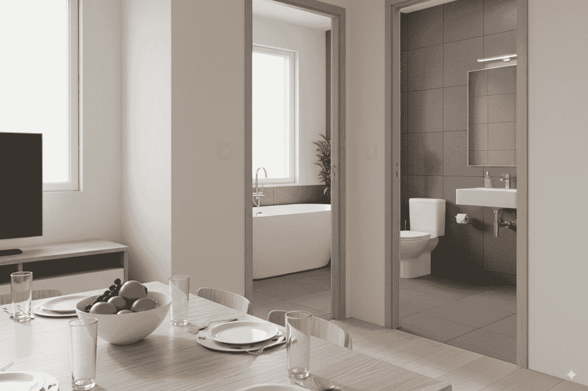

> Help me generate a realistic photo looking from the front door towards the living room, which must comply with the house layout in the design plan, and appropriate decorations can be added.

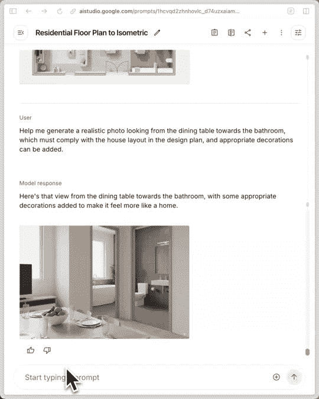

[操作3.mp4](https://internal-api-drive-stream.feishu.cn/space/api/box/stream/download/all/UlQib6gp7obgvZxPBjSclJ0Wn1f)

视觉角度随意修改，还能替换家装

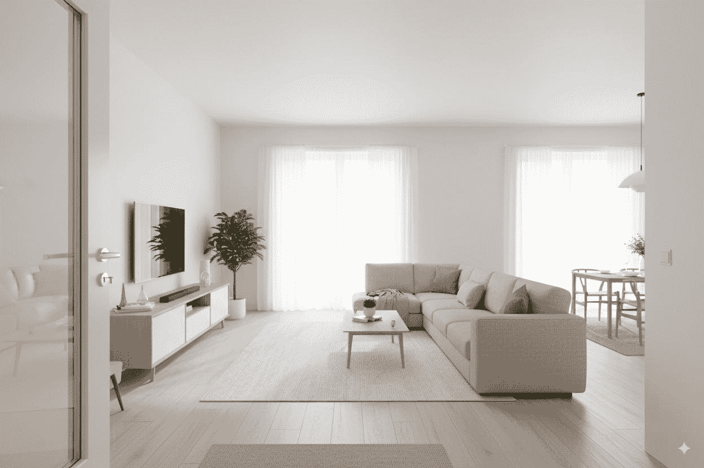

> Replace the sofa with the one shown in Figure 1.

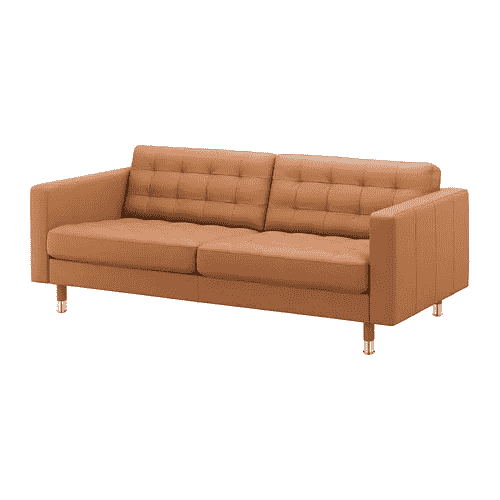

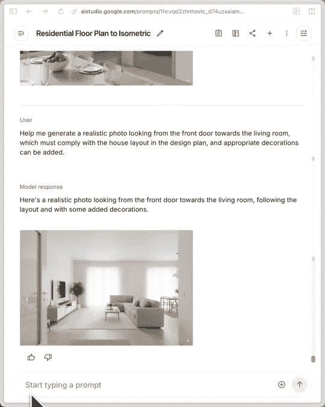

[操作5.mp4](https://internal-api-drive-stream.feishu.cn/space/api/box/stream/download/all/Lwubbi21toEVxtxQUXWcXzZJn5f)

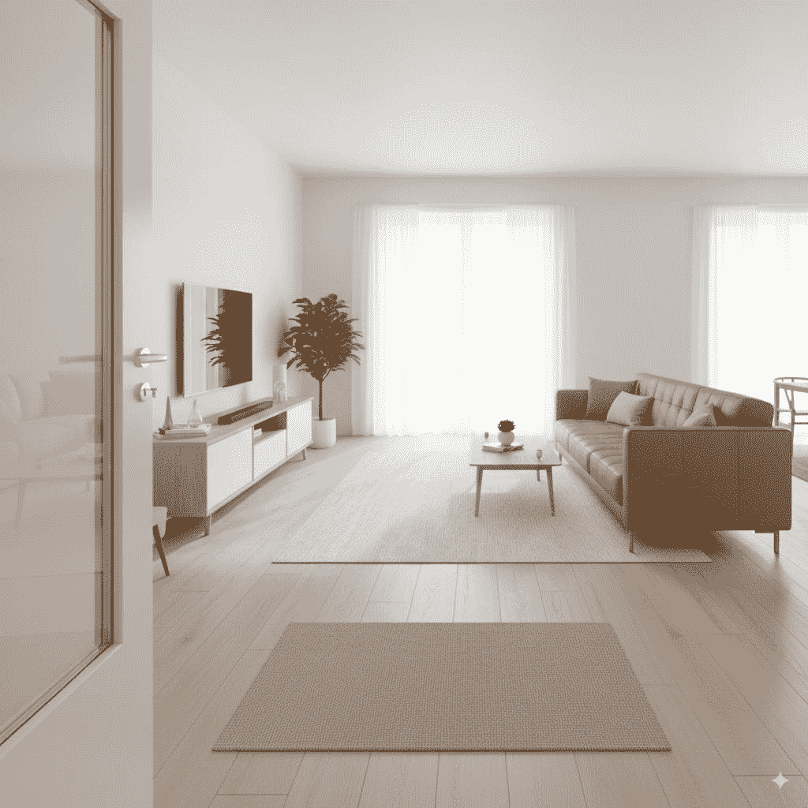

还给把3D图转成等比例的Nano Banan版拼图

> convert this photo into a architecture model. Behind the model, there should be a cardboard box with an image of the architecture from the photo on it. There should also be a computer, with the content on the computer screen showing the Blender modeling process of the figurine. In front of the cardboard box, place a cardstock and put the architecture model from the photo I provided on it. I hope the PVC material can be clearly presented. It would be even better if the background is indoors

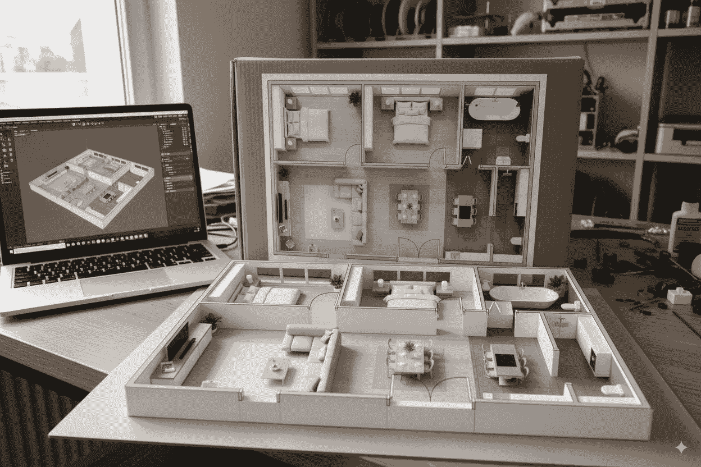

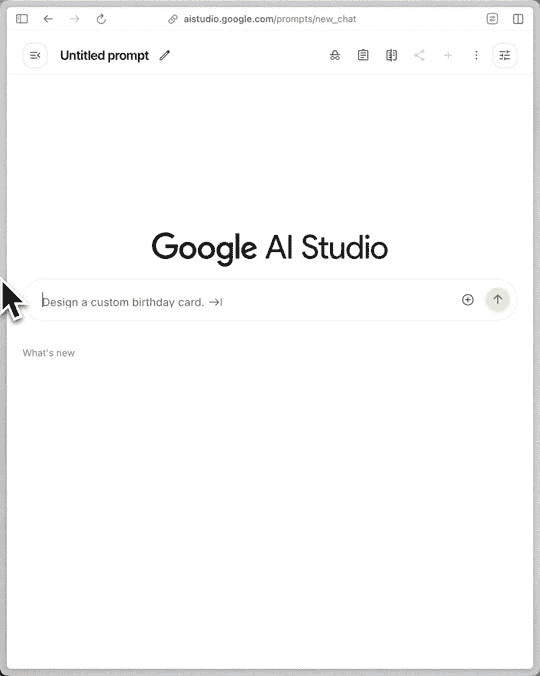

[操作7.mp4](https://internal-api-drive-stream.feishu.cn/space/api/box/stream/download/all/B3Kobn2Qxo2Gdzxi8HYcMGRynib)

> 转3D

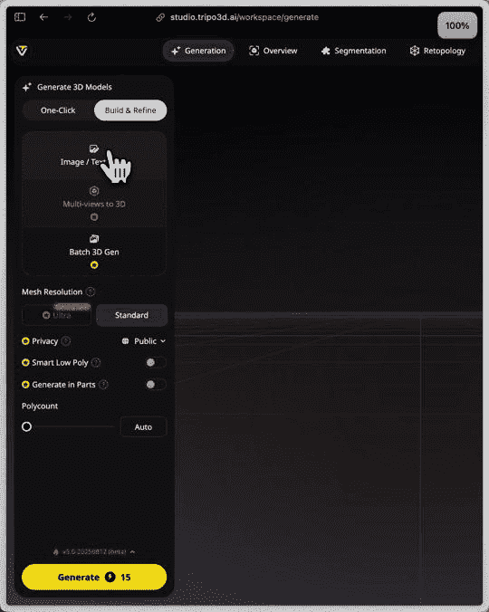

[操作8.mp4](https://internal-api-drive-stream.feishu.cn/space/api/box/stream/download/all/M0mNbb21uoedmCx0gFQcZN8Hn5g)

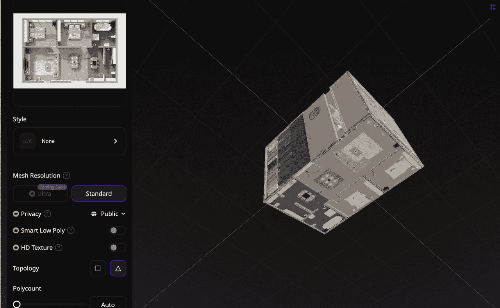

> convert this photo into a architecture model. Behind the model, there should be a cardboard box with an image of the architecture from the photo on it. There should also be a computer, with the content on the computer screen showing the Blender modeling process of the figurine. In front of the cardboard box, place a cardstock and put the architecture model from the photo I provided on it. I hope the PVC material can be clearly presented. It would be even better if the background is indoors

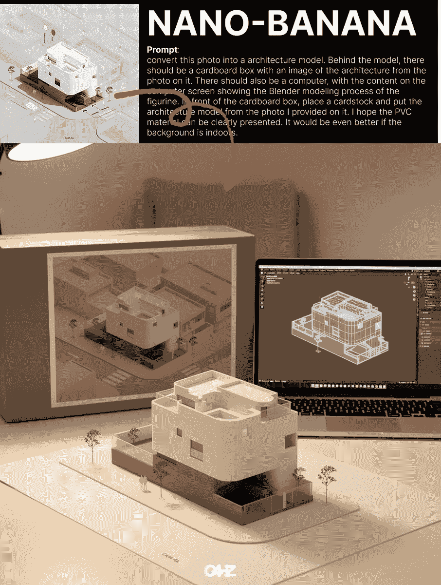

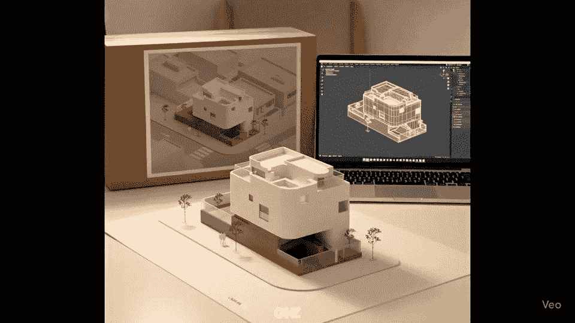

[@ZHO_ZHO_ZHO.mp4](https://internal-api-drive-stream.feishu.cn/space/api/box/stream/download/all/HRA2bvb6uoehvDxzMchcf5v3nYc)

> 第一个提示语

> Help me convert this residential floor plan into an isometric photorealistic 3D rendering of the house.

>

> 第二个提示语

> Help me generate a realistic photo looking from the dining table towards the bathroom, which must comply with the house layout in the design plan, and appropriate decorations can be added.

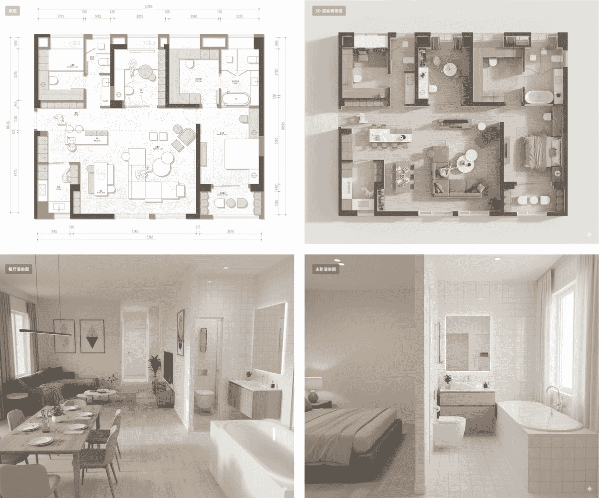

还可以换家具

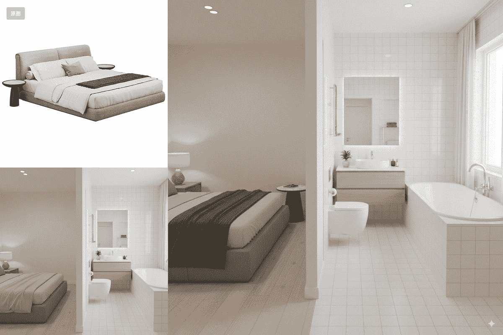