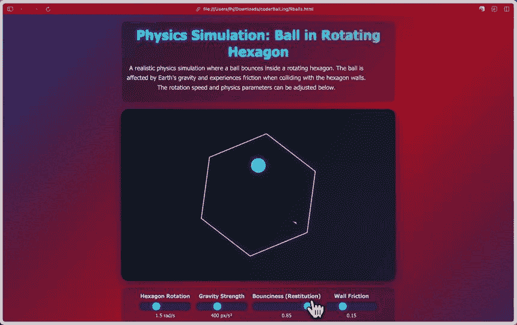
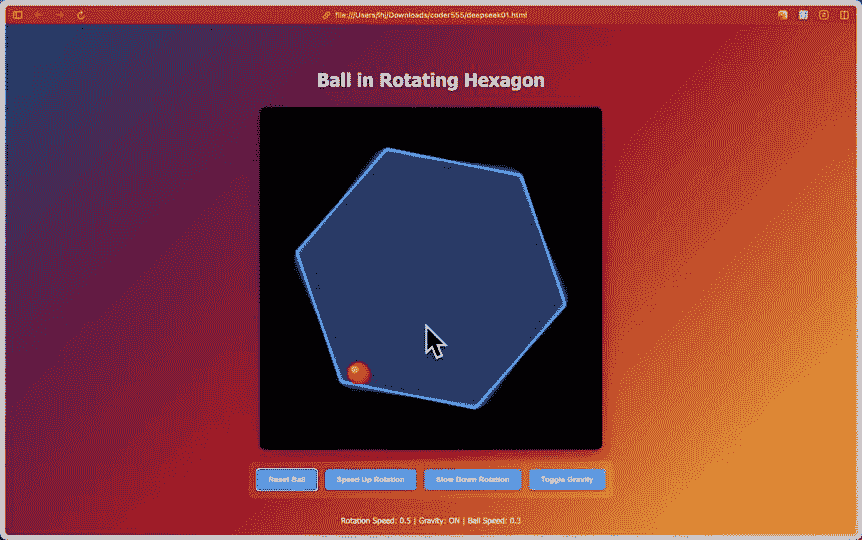
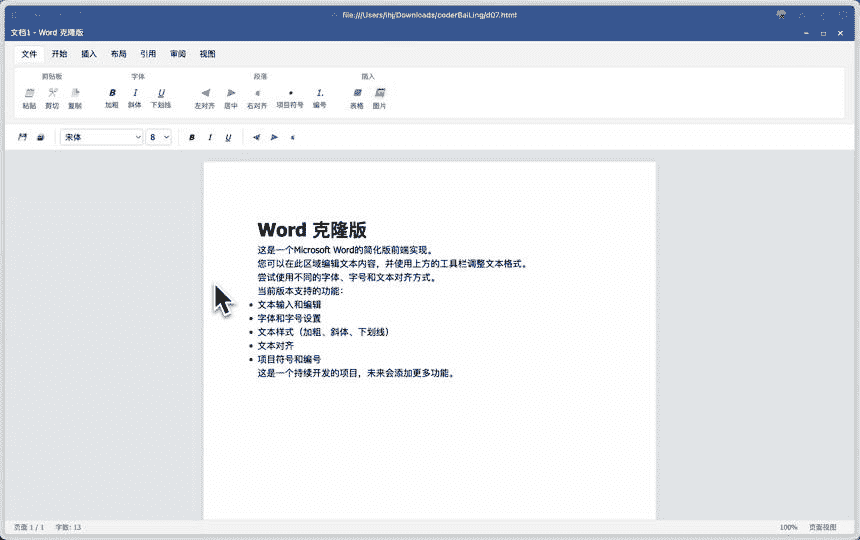
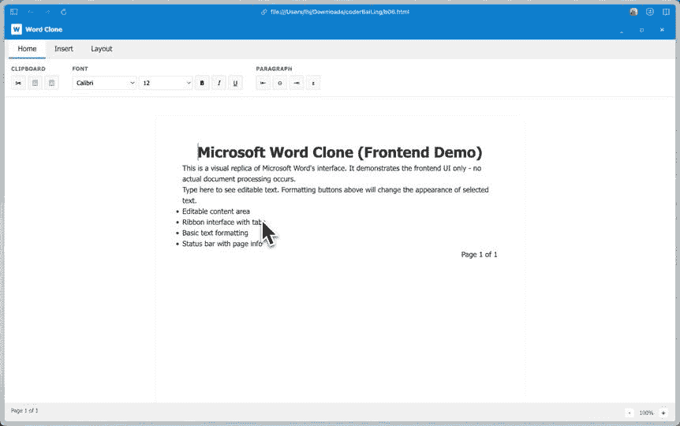
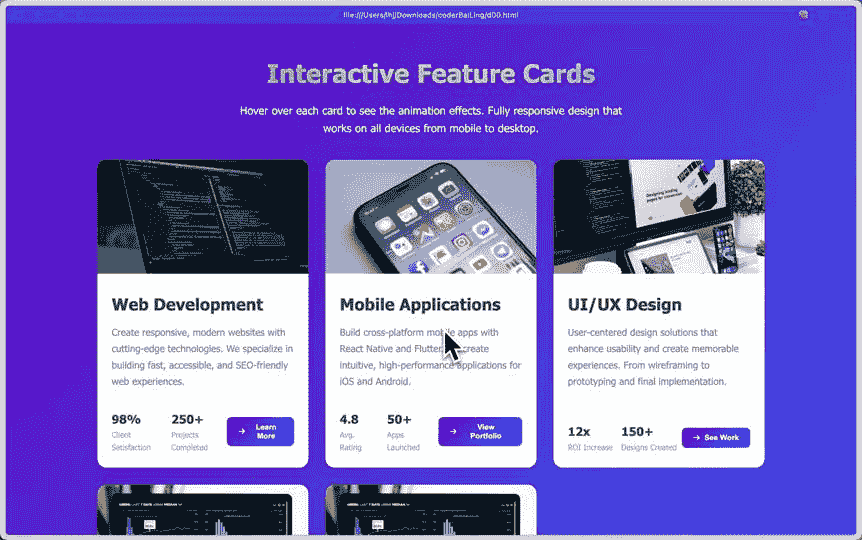
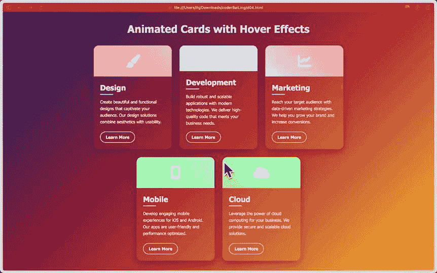
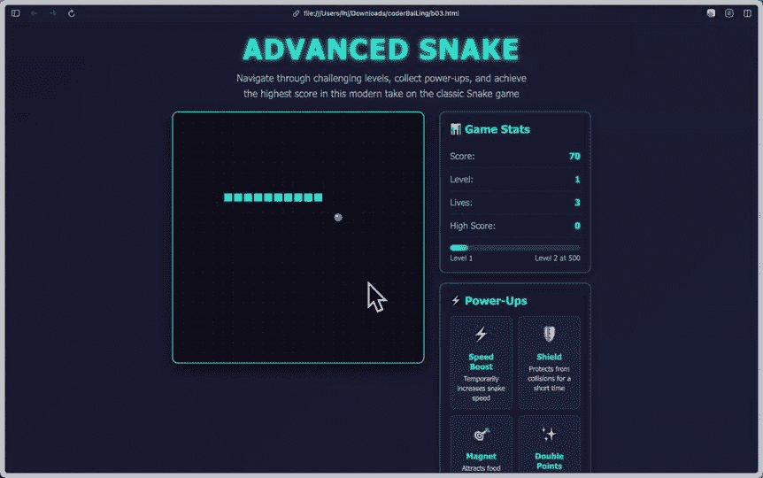
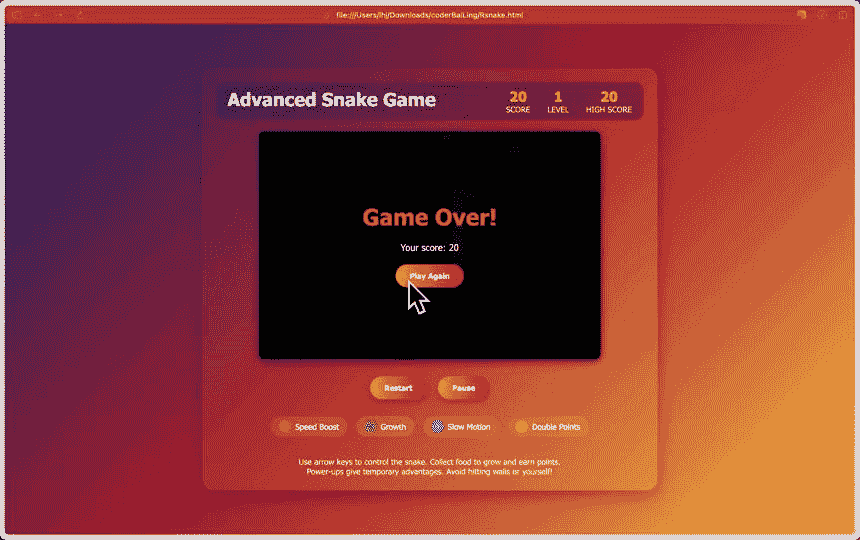

# DeepSeek V3.2 thinking vs 蚂蚁万亿新思考模型Ring-1T

> 来源：[https://aiwarts101.feishu.cn/docx/SnrBdNvaVozavsx0iC1cYw3Hnfo](https://aiwarts101.feishu.cn/docx/SnrBdNvaVozavsx0iC1cYw3Hnfo)

原文：

Ring-1T使用地址 ling.tbox.cn

> 用 HTML、CSS 和 JavaScript 实现这样一个效果：一个小球被困在一个旋转的六边形内部。小球受到地球重力的作用，并与六边形内壁产生摩擦。小球的弹跳需要看起来逼真自然。

**Ring-1T：**

[ball022.mp4](https://internal-api-drive-stream.feishu.cn/space/api/box/stream/download/all/PBr3b1JJjo09iZxCQGccnNDXnze)

**DeepSeek V3.2：**

[d01.mp4](https://internal-api-drive-stream.feishu.cn/space/api/box/stream/download/all/Qx4UbSPE4oXgkAxtP8GcojB8n19)

> 帮我做一个 Microsoft Word 的克隆版本，但只需要前端部分。

**Ring-1T：**

[word01.mp4](https://internal-api-drive-stream.feishu.cn/space/api/box/stream/download/all/PAkdbikR5oP18lxVlIjcZ7PxnVc)

**DeepSeek V3.2：**

[word02.mp4](https://internal-api-drive-stream.feishu.cn/space/api/box/stream/download/all/QUSKbAY2Go2I1vxHN36cDomDnxe)

> Create animated cards in HTML, JS, and CSS with hover effects, transitions, and responsive design. Include 3-5 cards with different content.

**Ring-1T：**

[card01.mp4](https://internal-api-drive-stream.feishu.cn/space/api/box/stream/download/all/Q99tbxoxXoMDZzxi8PjcEMnbnFe)

**DeepSeek V3.2：**

[card02.mp4](https://internal-api-drive-stream.feishu.cn/space/api/box/stream/download/all/EJUUbE2HgoSgRUxoNXrc8kOznKG)

> Build a complex Snake game in JavaScript with power-ups, multiple levels, and score tracking UI.

**Ring-1T：**

[蛇01.mp4](https://internal-api-drive-stream.feishu.cn/space/api/box/stream/download/all/LB8Ob6p9CoZvVVxWkiycxhWknMc)

**DeepSeek V3.2：**

[snake00.mp4](https://internal-api-drive-stream.feishu.cn/space/api/box/stream/download/all/K3TBbCzbIoahgkxljBscRcUtnyf)

---

还有我收集的大模型恶梦测试系列，欢迎大家补充恶梦case

[大模型测试](https://aiwarts101.feishu.cn/base/WtWSbtQ3aaMJ8AsxOo1ch5xknSf?from=from_copylink)