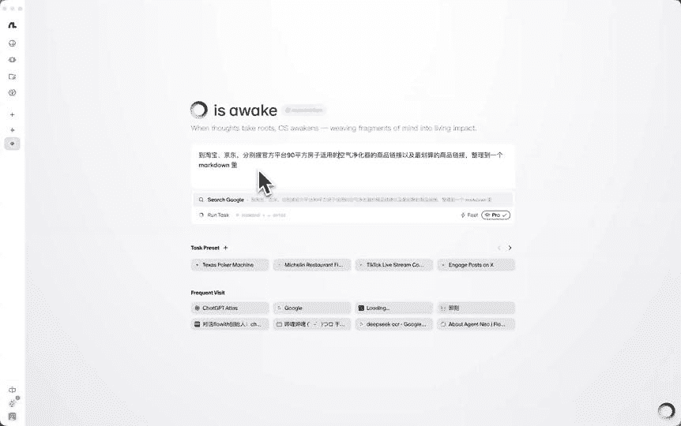
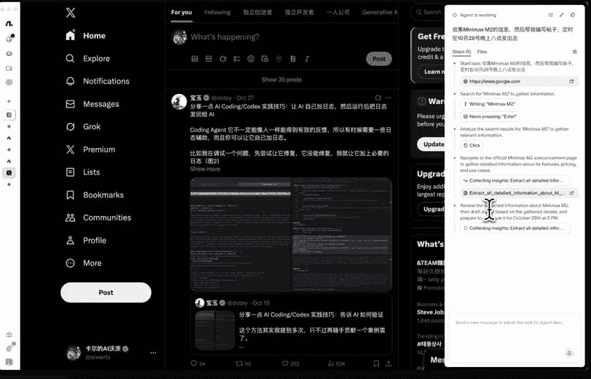
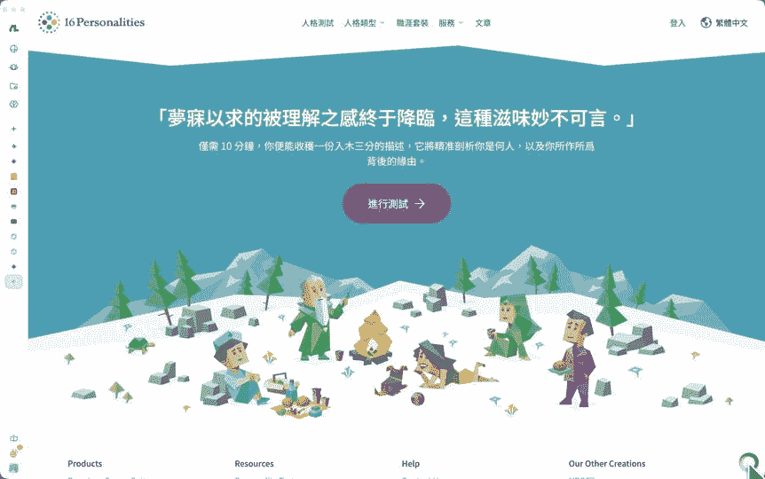

# Flowith OS使用cases

> 来源：[https://aiwarts101.feishu.cn/docx/NIJAdhVlSoOOb5xB7CGc16DNnHy](https://aiwarts101.feishu.cn/docx/NIJAdhVlSoOOb5xB7CGc16DNnHy)

原文：

https://mp.weixin.qq.com/s/dthJahPemFbzn58zO2CT7Q

大家玩的开心😄

使用地址：

🔗 flowith.com

邀请码：

> 施工中

分享出来给别人用了会有1000积分，大家可以往评论区里面丢

> 总结一下这个网页，然后根据你总记的信息，去X找到大家对这个东西的想法和使用意见

[FlowithOSBeta01.mp4](https://internal-api-drive-stream.feishu.cn/space/api/box/stream/download/all/CUmwbHIN1oO1YVx5v9QcwQgqnFg)

> 总结这个视频，并找出Tim有什么提效的AI图片工作流

[FlowithOSBeta02.mp4](https://internal-api-drive-stream.feishu.cn/space/api/box/stream/download/all/B9i8bJBhZoLuUBxItzJce8eRnIe)

> 监控nof1.ai的六个模型的盈利情况，读取completed trades和modelchat生成分析报告，编辑成邮件发送给我自己

[FlowithOSBeta03打码邮箱.mp4](https://internal-api-drive-stream.feishu.cn/space/api/box/stream/download/all/A5wcbbHYJo1abxxNGz0cCyHonE1)

> 以瑞克和莫蒂里瑞克的思路随机去b站看视频、刷视频、评论，模拟人摆烂的1小时

[FlowithOSBeta04.mp4](https://internal-api-drive-stream.feishu.cn/space/api/box/stream/download/all/PwnPbhKEoote87x1DZ5c95REnlb)

> 帮我看这条推文下有哪些有价值的回复，汇总整理给我；如果回复的推文被折叠，请点开查看详情

[FlowithOSBeta08.mp4](https://internal-api-drive-stream.feishu.cn/space/api/box/stream/download/all/Dn6ebzoiToHn4gxTWdrcaaLznBd)

> group my tabs by topic，and then close all duplicate tabs

[FlowithOSBeta09.mp4](https://internal-api-drive-stream.feishu.cn/space/api/box/stream/download/all/SmqVbgnK8oIWZJxdMJJc1UGknRg)

> 基于以下方案，到淘宝、京东，分别搜官方平台的商品链接以及最划算的商品链接，整理到一个 markdown 里

[FlowithOSBeta06.mp4](https://internal-api-drive-stream.feishu.cn/space/api/box/stream/download/all/CTq6bx8pBozcaSxiUfGco8Xrneg)

我也尝试了一下教flowith os完成定时发帖子的操作，

简单来说，skill可以设置成这样，

> 1.点击左下角的<post>按钮

> 2.在输入框中输入你刚写好的内容

> 3.在输入框下方找到<Schedule>

> 4.在<Date>和<Time>中的下拉框选择日期

> 5.选择日期后点击右上角的<Confirm>

> 6.点击右下角的<Post>按钮完成发布

[10月28日 (2).mov](https://internal-api-drive-stream.feishu.cn/space/api/box/stream/download/all/ECBWbyVvFoWKYZxobnhcTAVLnzh)

## 更多cases

> 用gemini生成一张四宫格卡通图，讲述一个深刻的道理，不要焦虑不要内耗

[FlowithOSBeta05.mp4](https://internal-api-drive-stream.feishu.cn/space/api/box/stream/download/all/PpAzbQsxuoi8Lex6ILpcepr5ndf)

> 根据你对自己的理解，完成16人格测试

[FlowithOSBeta07.mp4](https://internal-api-drive-stream.feishu.cn/space/api/box/stream/download/all/R2PMb5kzpoglrIx1wzLcWbJRnUd)