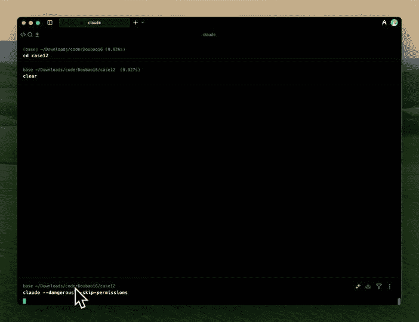
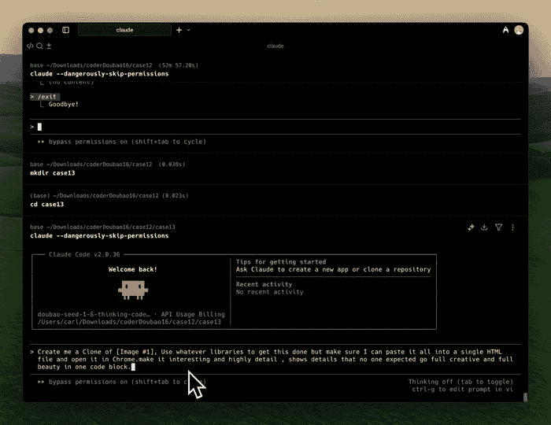
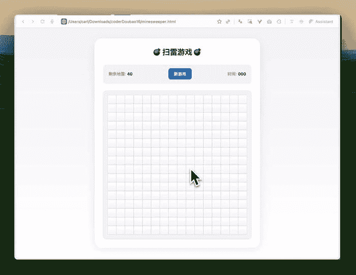
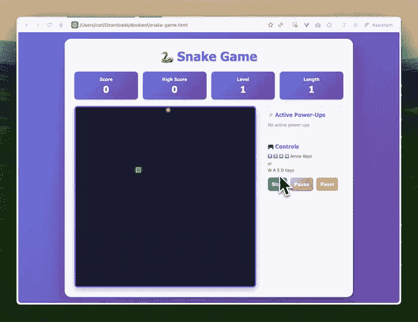
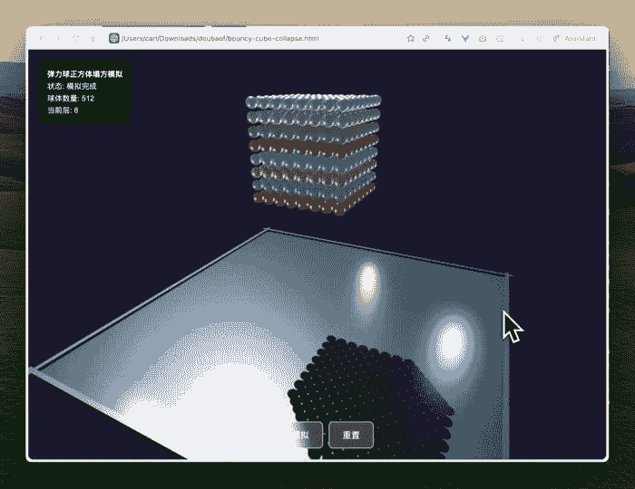
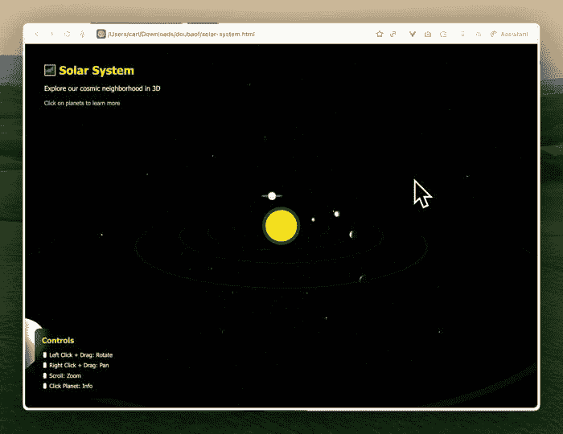

# 字节豆包seed code新模型cases

> 来源：[https://aiwarts101.feishu.cn/docx/XdmRd1l3FoVafjxfBE9cteyYnwc](https://aiwarts101.feishu.cn/docx/XdmRd1l3FoVafjxfBE9cteyYnwc)

原文https://mp.weixin.qq.com/s/uBXFC4TEhweat4DFL9GduQ

打开左侧目录有惊喜哦

> 生成一个双十一咖啡大促的网页，网页使用绿黑色配色, 参考 Spotify 官网风格。

> Use whatever libraries to get this done but make sure I can paste it all into a single HTML file and open it in Chrome.make it interesting and highly detail , shows details that no one expected go full creative and full beauty in one code block.

[doubao11.mp4](https://internal-api-drive-stream.feishu.cn/space/api/box/stream/download/all/FPm5bD9vvop7XixPRxGcQXvEnGh)

> 生成一个双十一咖啡大促的网页，网页使用绿黑色配色, 参考 Spotify 官网风格。

[doubao2.mp4](https://internal-api-drive-stream.feishu.cn/space/api/box/stream/download/all/LoDhbZVYCo4wZLxodmRcNKtYnpg)

> Create me a Clone of [Image #1]

[doubao22.mp4](https://internal-api-drive-stream.feishu.cn/space/api/box/stream/download/all/RBAVbhKetoRp74xuptfcaQIlnNc)

[doubao33.mp4](https://internal-api-drive-stream.feishu.cn/space/api/box/stream/download/all/QBxibYzsGo8yedx7CimcVE4xnid)

plan mode模式下，

[planmode.mp4](https://internal-api-drive-stream.feishu.cn/space/api/box/stream/download/all/O5zhboCS9oum4mxWhZycTaohnSg)

> 编写一个经典的扫雷游戏要求：禁止使用任何改变应用结构或组件化范式的 JavaScript 框架/库（例如：React, Vue, Angular）。可以cdn引用第三方库以满足题目要求，如Three.js，p5js。最终产物必须是纯粹的 HTML、CSS 和 JS 文件。如果需要创建多个文件（HTML/CSS/JS），请确保所有文件引用均使用相对路径。所有文件需要保存在当前目录下

[saolei2.mp4](https://internal-api-drive-stream.feishu.cn/space/api/box/stream/download/all/IRD6b7JvioHPlyx9X4tcKMQdnmt)

> Build a complex Snake game in JavaScript with power-ups, multiple levels, and score tracking UI.

[sanke.mp4](https://internal-api-drive-stream.feishu.cn/space/api/box/stream/download/all/HdQyb7Z6EoRGymxBmSJcrPomnye)

> Generate full HTML file of a clone of Geometry Dash, but if it was made in the 2000s, add music to levels (make the music using JS varied music that reflect levels) same physics as Geometry Dash game we want a full playable game. All in one HTML file, minimum 1k lines

【视频】

> 3D模拟，一个由弹力球组成的正方体漂浮在半空中，从正方体最下一层慢慢塌方，注意是，一层一层塌方，小球落在桌子上弹起来，直到静止，模拟整个塌方过程，整个过程符合物理规律，效果要酷炫，整个环境要尽量逼近真实，在单个HTML中实现

[cube.mp4](https://internal-api-drive-stream.feishu.cn/space/api/box/stream/download/all/LvRgbQjEJoqsUpxeckXcguvlnHb)

> Create a visually stunning, interactive 3D simulation of our Solar System elegantly encapsulated within a single HTML file. Highlight realistic orbital motions, dynamic lighting effects, accurate planetary textures, and smooth camera controls to deliver an immersive experience.

[doubaoyuzhou.mp4](https://internal-api-drive-stream.feishu.cn/space/api/box/stream/download/all/ZU8cba2P9ophiixqzzicW0RKnHc)

>