# Gemini3Pro测试cases

> 来源：[https://aiwarts101.feishu.cn/docx/FSdIdP9ijou5GrxTgfJc5jREnto](https://aiwarts101.feishu.cn/docx/FSdIdP9ijou5GrxTgfJc5jREnto)

**原文：**

**模型card**

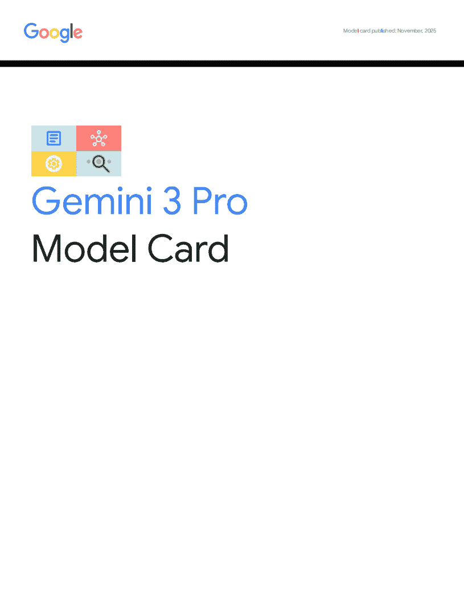

[Gemini-3-Pro-Model-Card.pdf](https://internal-api-drive-stream.feishu.cn/space/api/box/stream/download/all/Xahdb2Mm9ogC2oxMw7pcHJJ8ngf)

> Create a 3D billiards game in a single HTML file.

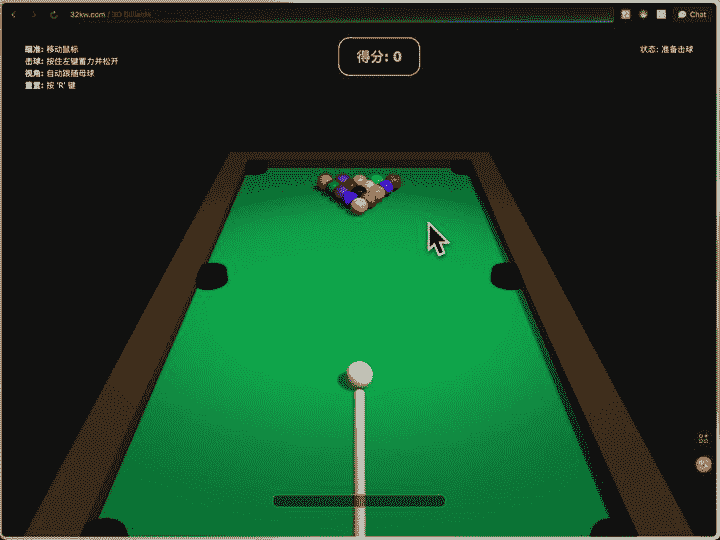

[gemini3.mp4](https://internal-api-drive-stream.feishu.cn/space/api/box/stream/download/all/JKXebVC9BoZHbTx3zozcEGtPnyd)

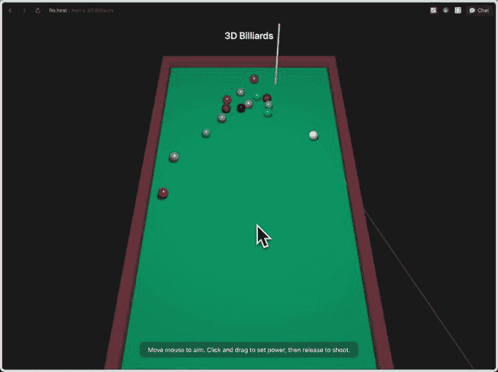

[gemini25.mp4](https://internal-api-drive-stream.feishu.cn/space/api/box/stream/download/all/PMtibWEUuonBpYxMY2ncQe0snJe)

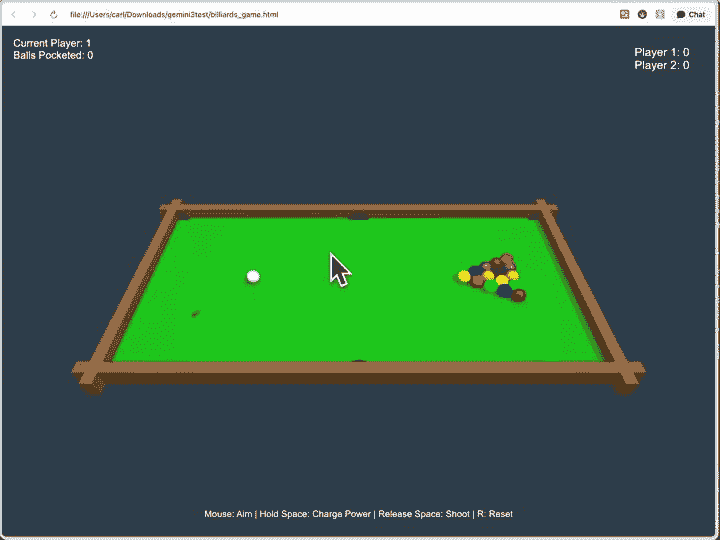

[claude.mp4](https://internal-api-drive-stream.feishu.cn/space/api/box/stream/download/all/WY4Qbokw7ofArjx4HfxcmgMznfb)

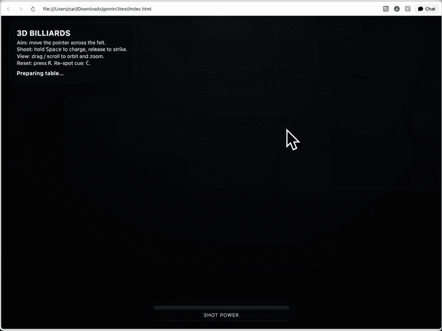

[gpt5.mp4](https://internal-api-drive-stream.feishu.cn/space/api/box/stream/download/all/AEGKbKXmdovA3Uxiivfcqey1njh)

> 复刻这个页面，要有XXXX的效果

这个XXXX的效果很关键，先看看一键复刻某书，

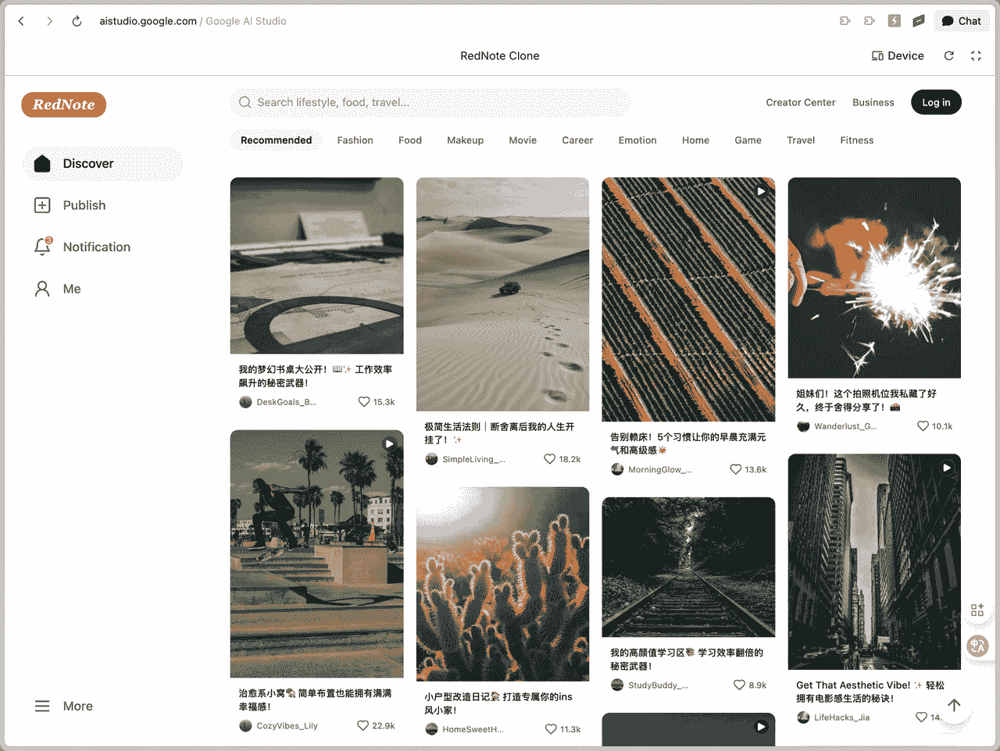

这时候追加描述一下你想要的效果，比方说这里可以补充，

帖子要有向下滑动，点开互动的效果。

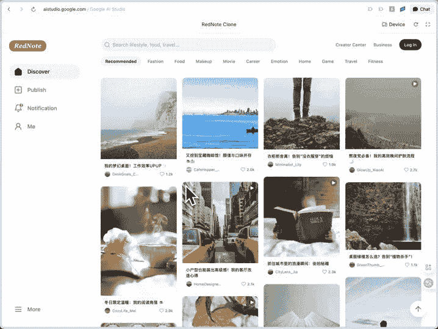

[rednote深度复刻.mp4](https://internal-api-drive-stream.feishu.cn/space/api/box/stream/download/all/PQuQbramYoq8Fdxmlx3ckBC2n9e)

> 提示语来自**@饼干哥哥**

> Design a CapCut（你没看错提示语真就那么短）

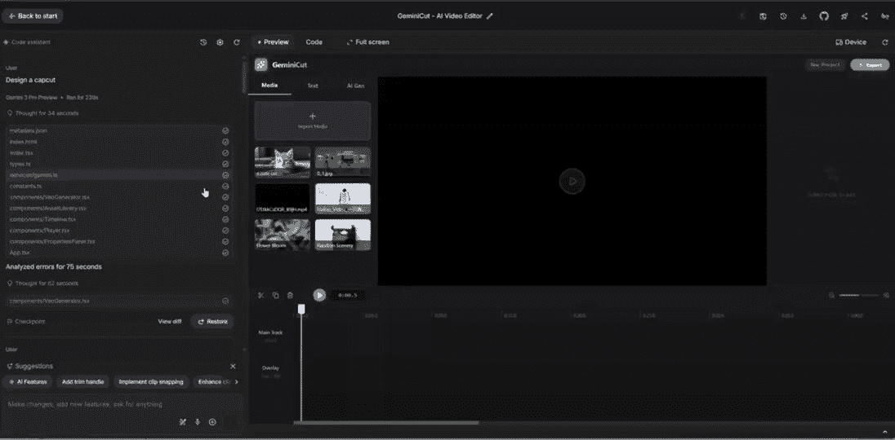

[11月19日(1).mov](https://internal-api-drive-stream.feishu.cn/space/api/box/stream/download/all/U862bTztPoSVILxIyAZcAHIWnlb)

> 生成一个设计应用，我可以用鼠标画草图，然后调用NanoBanana将草图转成设计海报

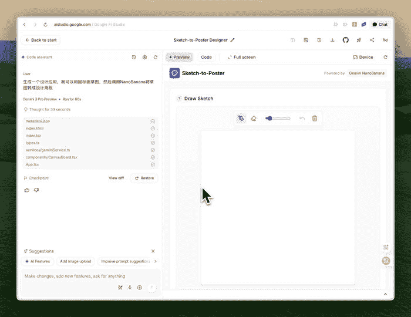

[草图转海报.mp4](https://internal-api-drive-stream.feishu.cn/space/api/box/stream/download/all/RoDXbNsndoune7xmI8OccctGnbf)

> 提示语来自[@ZHO_ZHO_ZHO](https://x.com/ZHO_ZHO_ZHO)

> 为我设计一个极简主义风格的，工业设计应用，使用最新的 模型和 Nano Banana，来帮助用户做设计，要有画布模式和节点式工作流模式 两种模式

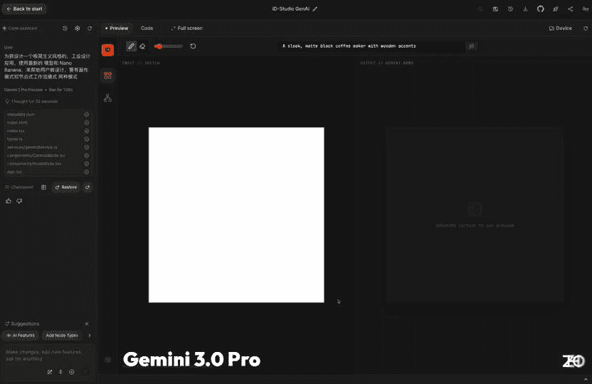

[ZHO_ZHO_ZHO-1990831573764088241-01.mp4](https://internal-api-drive-stream.feishu.cn/space/api/box/stream/download/all/XoKIbPZpIoP50ixGIELclX9Gnzf)

> 给我展示RNA聚合酶是怎么工作的，并对比原核和真核细胞的区别。

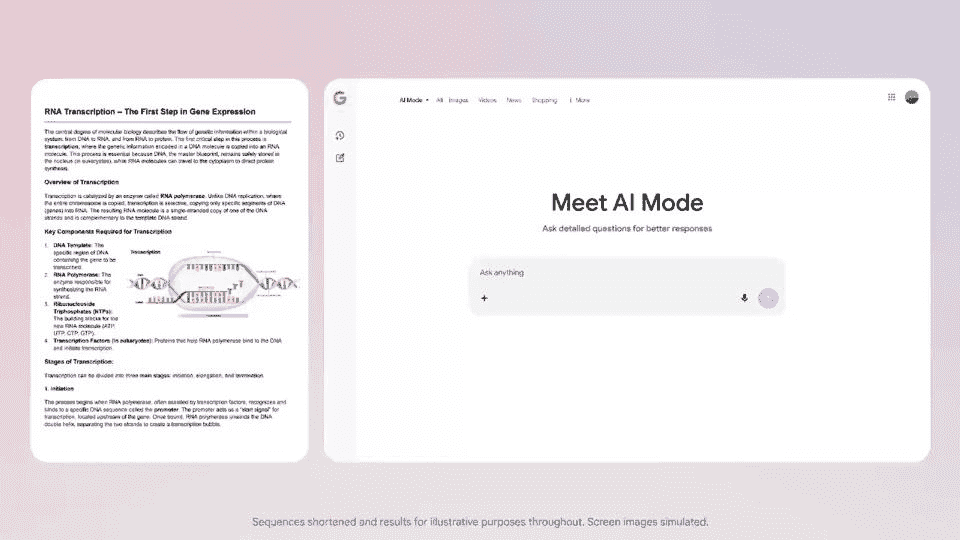

[11月19日.mov](https://internal-api-drive-stream.feishu.cn/space/api/box/stream/download/all/BOGobXcZJopr5LxvwN5ct0jznJd)

> 复现这个页面，需要有颜色变化和形态变化，从星形到圆形到方形的动画效果

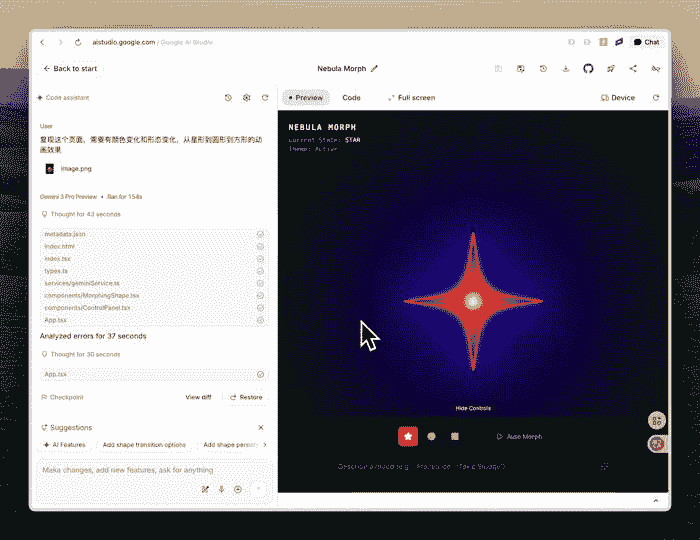

[p动效.mp4](https://internal-api-drive-stream.feishu.cn/space/api/box/stream/download/all/ZSSRbQ5l9oQ9vSxuJmscQisAnyc)

> 提示语来自**@Sunkim**

> 制作一个学习写字笔划的 AI 学习工具网站；当用户输入一个字时，你就在田字格上模拟手写字，一笔一划写出来，同时搭配读音拼音。

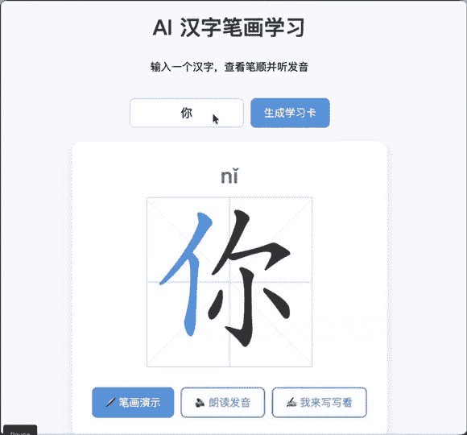

[aiaiai.mp4](https://internal-api-drive-stream.feishu.cn/space/api/box/stream/download/all/TL6HbHg44o6tMjxjCxjcByP0nOh)

> 请你扮演一位擅长创意交互的前端开发专家。我要做一个类似 Apple 产品页风格的“Scrollytelling（滚动叙事）”网页 Demo。

>

> 技术栈要求：

> 使用 HTML、CSS 和 GSAP (GreenSock) 配合 ScrollTrigger 插件。

>

> 交互逻辑：

> 页面高度要设置得很长（如 5000px），建立一个全屏固定的视口（Pinned Container）。用户的滚动动作不移动页面，而是作为进度条（Scrub: 1）直接控制整个动画的时间轴播放。

>

> 视觉与动画流程（请按顺序实现以下 Timeline）：

> 开场： 屏幕中心只有简洁的文字 Slogan，随着滚动，文字放大并渐隐消失。

> UI 演示： 随后，模拟“手机通知弹窗”和“邮件列表卡片”从不同方向平滑飞入屏幕中心。

> 堆叠特效： 继续滚动，这些分散的卡片要通过 3D 变换，自动吸附堆叠在一起（Stacking Effect）。

> 高潮： 出现一个“Unsubscribe All”的按钮，当滚动经过它时，堆叠的所有卡片瞬间向四周炸开/飞走（Explosion Effect）。

> 结尾： 露出最后的 Logo。

>

> 风格要求：

> 极简主义、圆角卡片设计、阴影柔和、动画曲线要非常有弹性（Elastic/Spring）。请直接给我可运行的完整代码文件

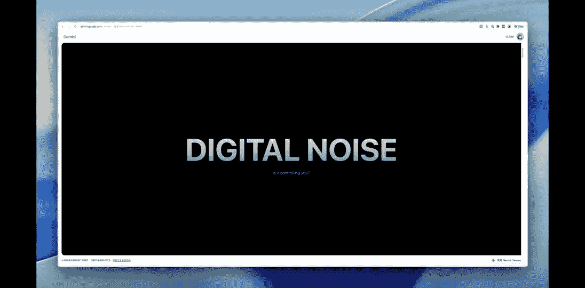

[11月19日(2).mov](https://internal-api-drive-stream.feishu.cn/space/api/box/stream/download/all/UTvHblaGBonFFgxAlw8cM277nEe)

> 提示语来自**@ezshine**

> 帮我用SVG绘制一个八缸发动机的物理结构动画

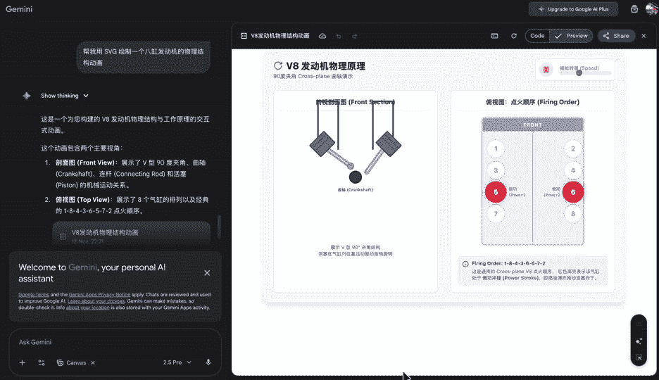

[ezshine-1990808024479642004-01.mp4](https://internal-api-drive-stream.feishu.cn/space/api/box/stream/download/all/Shx5bsyhgoRCPFxTGJrc6MmxnPf)

> 设计并创建一个类似Mac OS的网页操作系统，具备从文本编辑器、文件管理器到绘图工具和视频编辑器等全部功能，以及所有Mac OS预装的重要软件。可以使用任何库来实现，但确保所有代码能整合到单个HTML文件中，并能在Chrome浏览器中直接打开。要求设计充满创意与美感，展现令人惊艳的细节，在单个代码块中呈现极致精巧的构思。

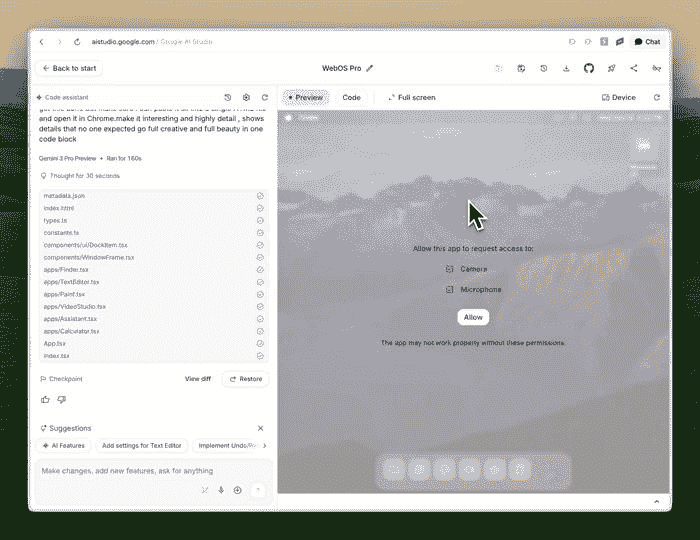

[mac3.mp4](https://internal-api-drive-stream.feishu.cn/space/api/box/stream/download/all/TooSbRyk4oZjwMxiljDcIzW1nce)

> 提示语来自[@ClankerT800](https://x.com/ClankerT800)

> 创建一个3D魔方模拟，包含“打乱”和“解决”按钮，两个按钮都会播放流畅的动画。

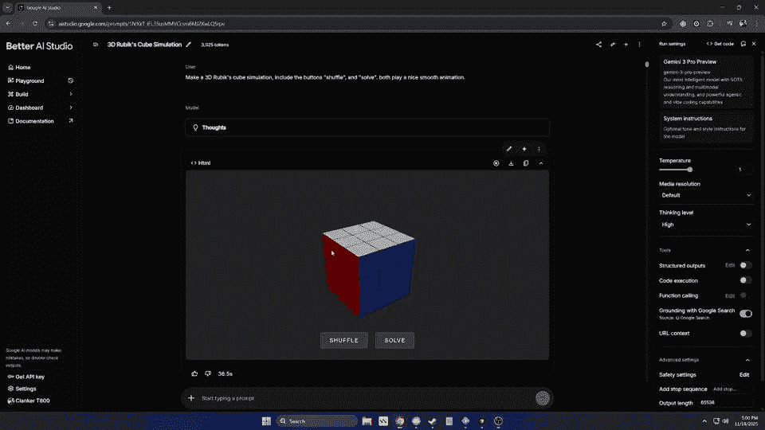

[ClankerT800-1990813214137892930-01.mp4](https://internal-api-drive-stream.feishu.cn/space/api/box/stream/download/all/QaotbFt1votwWcxvktKcButgnZd)

> 创建一个 3D HTML 山脉场景，包含悬崖、河流和昼夜光照变化。支持拖动和缩放、动画过渡、真实感渐变色，并可切换等高线显示

[shanmai.mp4](https://internal-api-drive-stream.feishu.cn/space/api/box/stream/download/all/ECLEbgwqhoebaJxeNhZc3jBYn0b)

> 设计并创建一款类似任天堂GameBoy Switch的模拟器，具备以下经典游戏的完整功能：

> 《俄罗斯方块》（GB, 1989）——内置现象级游戏，永恒的益智循环。

> 《宝可梦 红/蓝/黄》（GB, 1996–98）——定义掌机RPG的狂潮之作。

> 《塞尔达传说：织梦岛/DX》（GB ’93 / GBC ’98）——便携式塞尔达杰作。

> 《超级马里奥乐园2：6枚金币》（GB, 1992）——宏大而创新的马里奥，引入反派瓦力欧。

> 《宝可梦 金/银/水晶》（GBC, 1999–2000）——城都+关都地区、昼夜系统、划时代革新。

> 技术要求：

1.  所有按钮均支持触控操作，并可通过键盘对应按键触发

1.  可使用任意库实现，但需确保所有代码可整合为单一HTML文件并在Chrome中运行

1.  注入极致创意与视觉美学，展现令人惊艳的细节设计

> 请将完整实现置于单一代码块中。

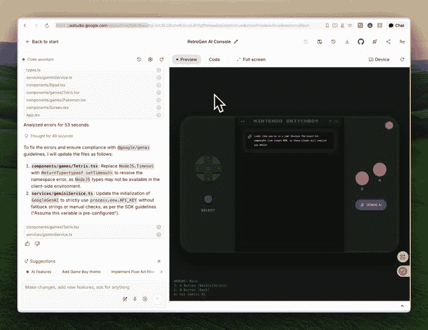

[gameboy_gemini3.mp4](https://internal-api-drive-stream.feishu.cn/space/api/box/stream/download/all/Kr7BbEKCnoSPAWxdk92cu4renvg)

> 打造一款无限延伸、可互动的80年代《Outrun》风格驾驶体验。

> 用户操作

> 转向：使用左右方向键（方向键或WASD键）控制车辆在道路上行驶。  加速：涡轮增压按钮可提升速度并扩展视野。

> 系统功能：循环切换配色方案（迈阿密/赛博/金色）、故障/CRT显示切换、摄像机视角切换。

>

> 摄像机行为

> 跟随模式：摄像机必须严格保持与车辆X轴居中（无横向漂移/延迟），以避免晕动症并维持街机手感。

> 环绕模式：可选自由观察模式。

> 场景内容

> 低多边形跑车，转向时车身会倾斜。

> 无限延伸的复古网格道路，带有“湿滑路面”反射效果。

> 程序化生成的棕榈树、山脉以及带有“百叶窗”条纹效果的大太阳。

> 技术实现：单HTML文件、着色器材质、后期处理（泛光/扫描线效果）。

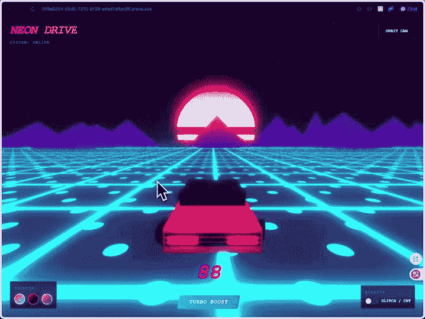

[小车车.mp4](https://internal-api-drive-stream.feishu.cn/space/api/box/stream/download/all/EQnwbiU7yop5v5x55T0cNuq1nle)

> 帮我详细分析这个视频的每个分镜，做成提示语表格，确保我可以让nano香蕉复刻，同时给这个视频配上合适的bgm

[可口可乐广告.mp4](https://internal-api-drive-stream.feishu.cn/space/api/box/stream/download/all/HkmcbZtUTozl20xaTRvcdF40nOe)