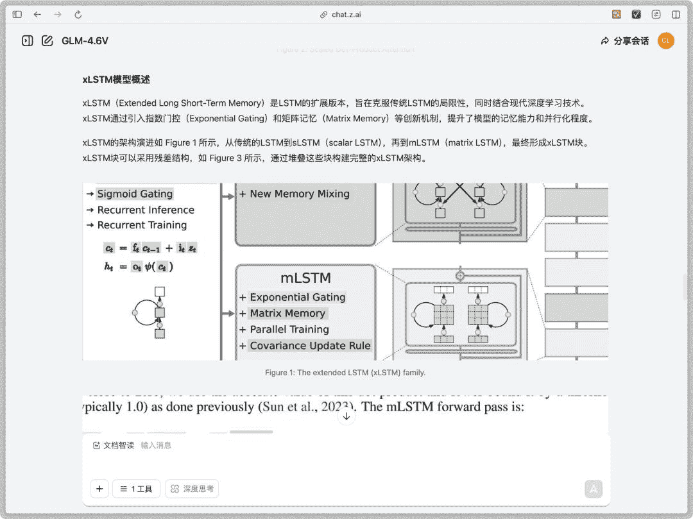
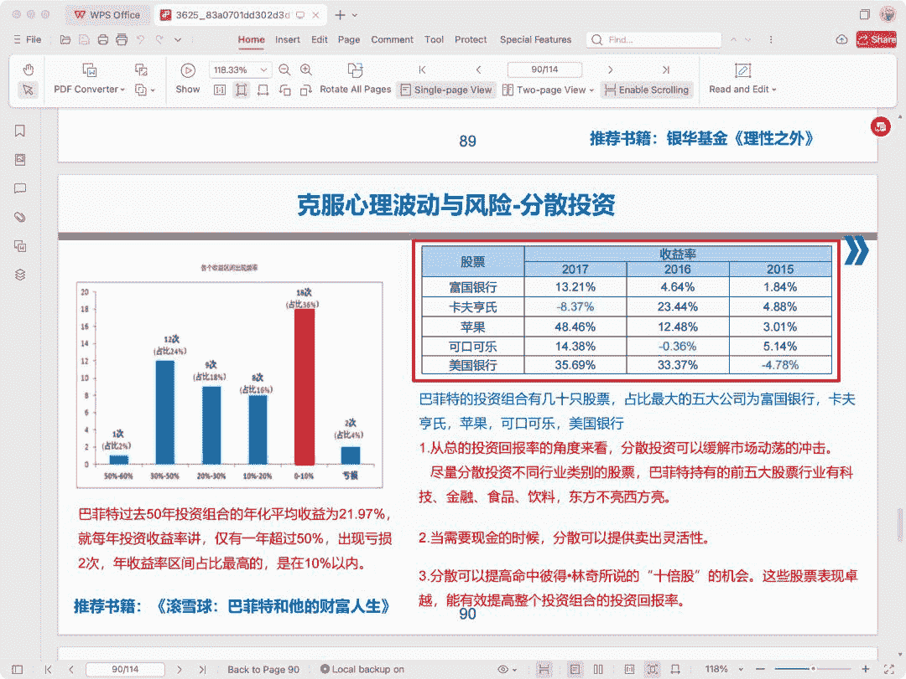

# 智谱4.6V实测

> 来源：[https://aiwarts101.feishu.cn/docx/MSKMdJONnoAFxsxjWR6cZMMJnod](https://aiwarts101.feishu.cn/docx/MSKMdJONnoAFxsxjWR6cZMMJnod)

原文 https://mp.weixin.qq.com/s/Dr2CTRupoIjS0lE4qVn1rw

---

复刻小红书完整对话记录

https://chat.z.ai/s/e4fb8718-ba80-4516-8889-459e7de35ab6

---

多模态格式识别

> 识别图中的表格，并以HTML格式输出，识别图中的印章，不同字段分开，并以JSON格式输出，识别图中的文字，并以Markdown格式输出。

https://chat.z.ai/s/bf559b9f-6dcd-4566-997e-7bc26f42a5d3

---

图文报告

https://chat.z.ai/s/94bb63b8-ab4d-4e5f-9e7e-d530a93c2d9f

---

长文档对比

https://chat.z.ai/s/16df1661-c42a-43a3-b895-6c700ed1941d

---

长ppt定位

https://chat.z.ai/s/41f0b615-1b9c-4db2-b9c2-f0f317bc51ac

---

视频理解

https://chat.z.ai/s/f6f180dc-fffc-492f-a101-7b37982b4227