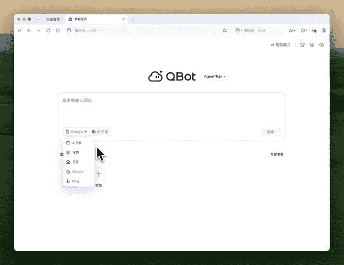
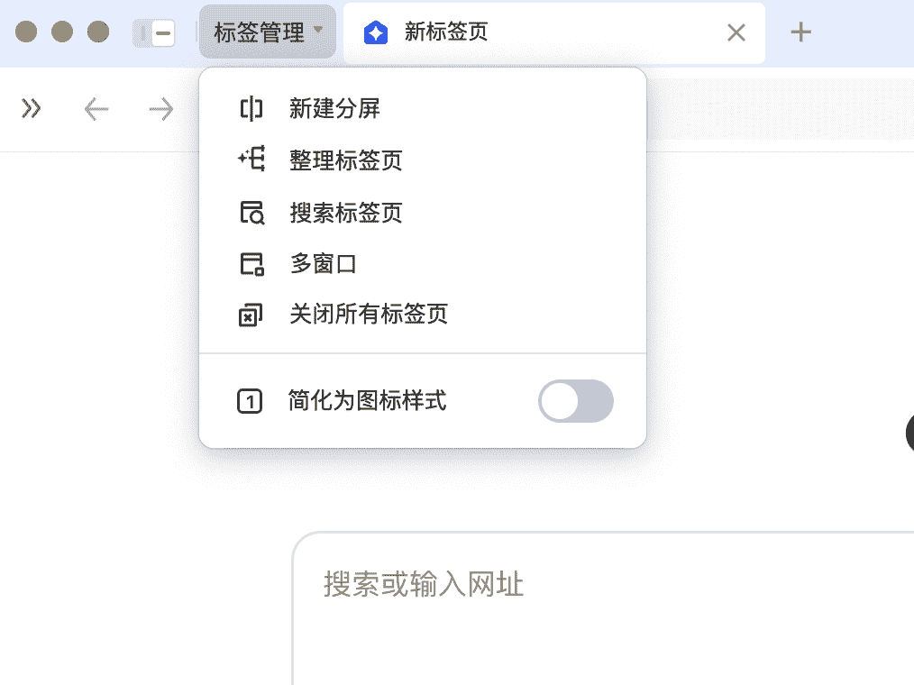
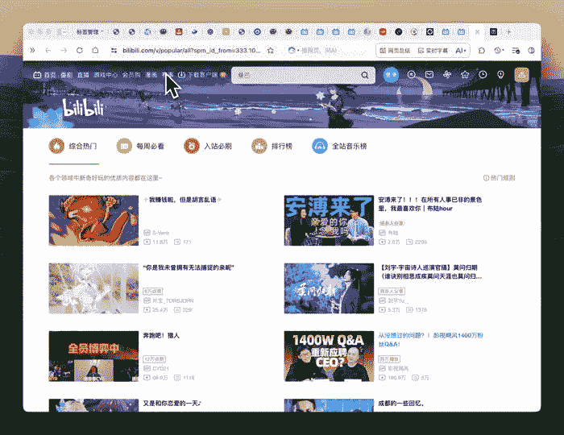
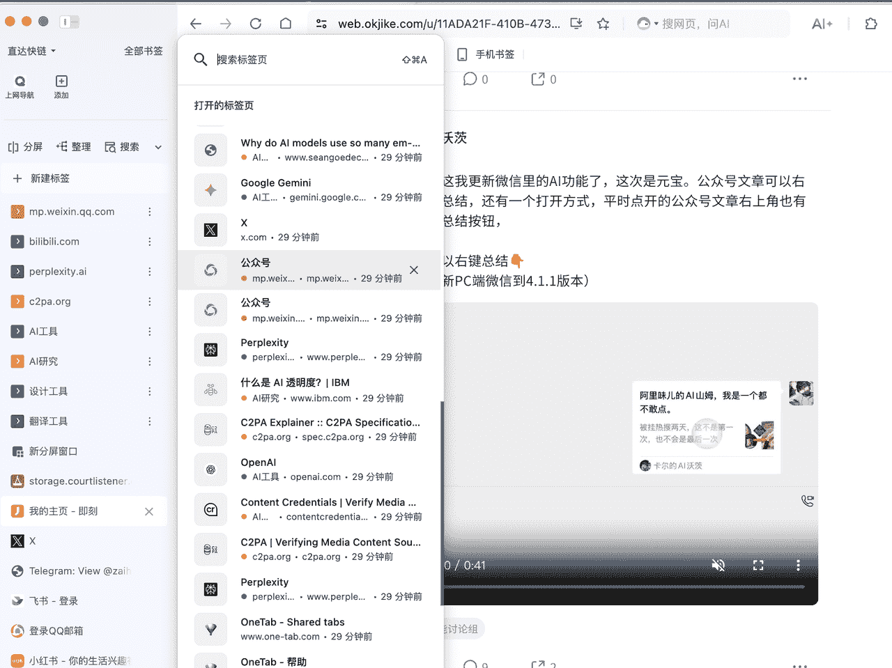
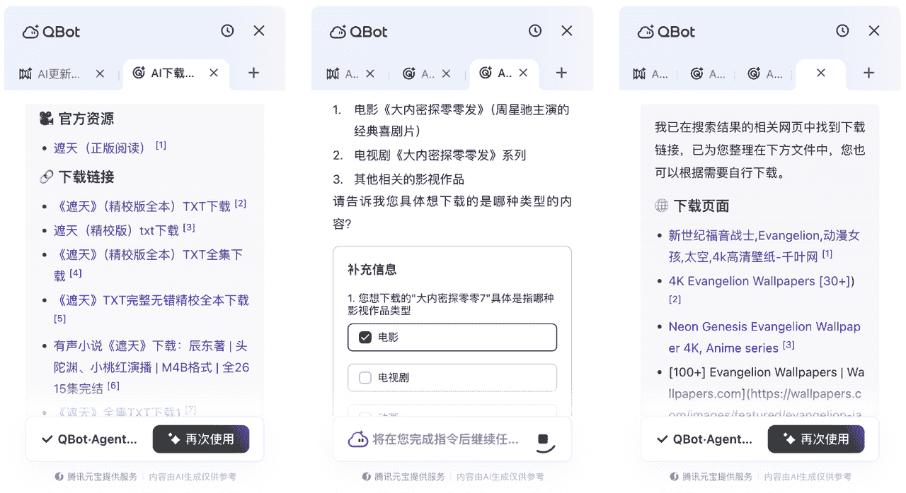
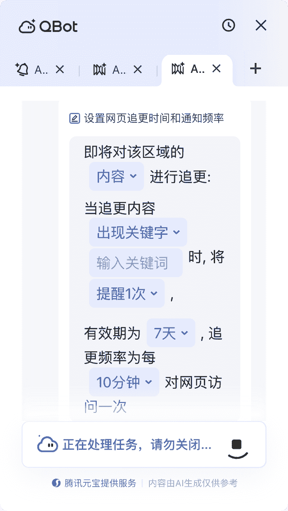
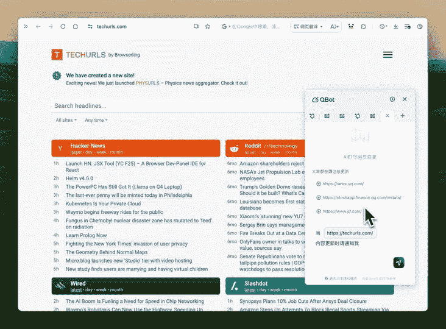
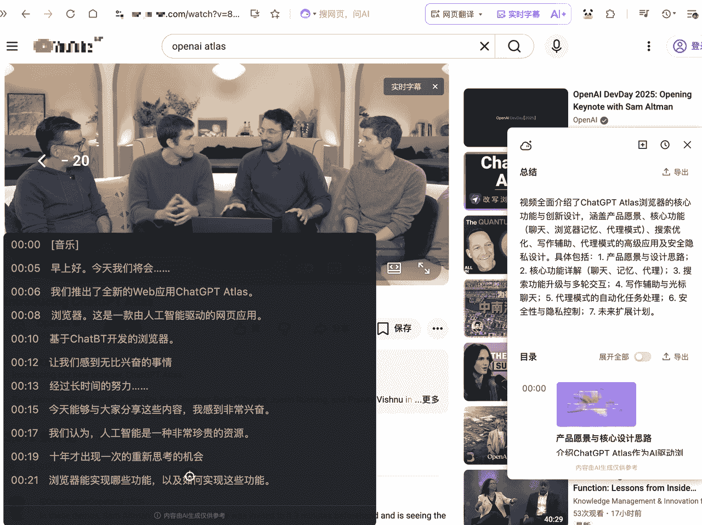
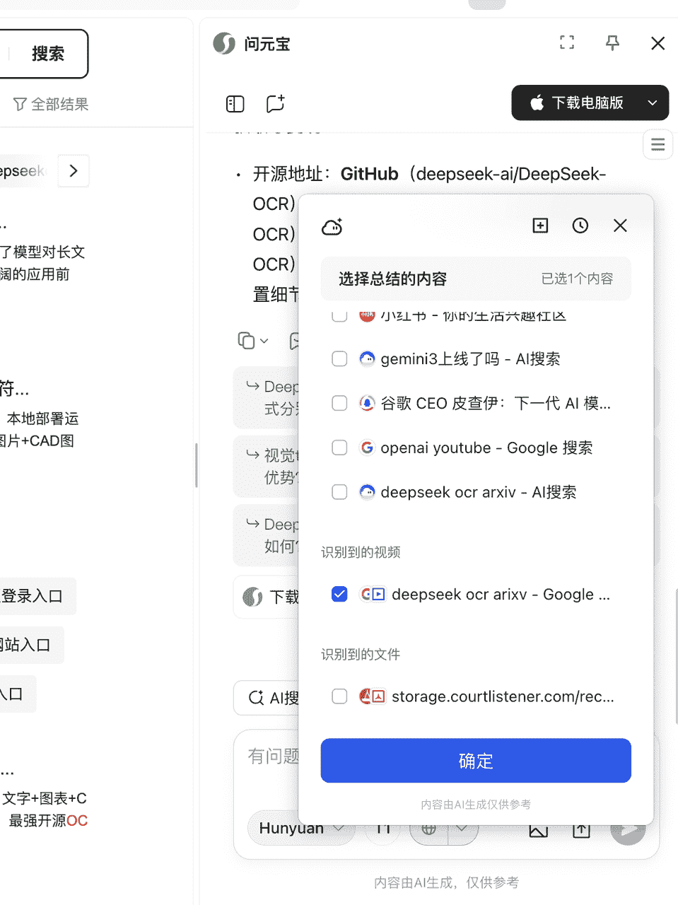
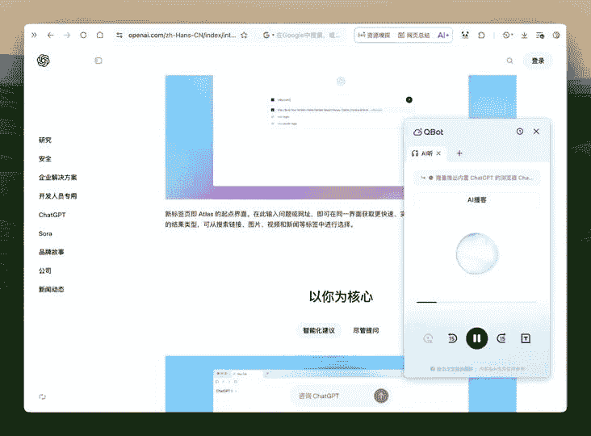

# 🐧 AI浏览器玩法

> 来源：[https://aiwarts101.feishu.cn/docx/GMNQdPTkIo2Cz4xarivchIwqnph](https://aiwarts101.feishu.cn/docx/GMNQdPTkIo2Cz4xarivchIwqnph)

新版的🐧浏览器有三个AI入口，

1，3是普通和AI搜索，2，4就是一大堆Agent助理，5是我们熟悉的元宝，自带DeepSeek R1和Hunyuan T1。

搜索的速度很快，左侧是Chrome同款的AI总结模块和我们熟悉的传统搜索，还可以直接切换成👸号搜索，许愿之后可以加上视频号，右侧是熟悉的元宝AI搜索，继续许愿元宝可以上线信息源过滤的功能。

[qq1.mp4](https://internal-api-drive-stream.feishu.cn/space/api/box/stream/download/all/EOshbg9ypoLKWqxtkaacqdxDn1e)

**新版🐧浏览器，还有我**之前吐槽OpenAI Atlas没有的标签页分屏、整理和搜索功能。

它的整理标签页里，还划分了内容和域名两种方式。整理好后会自动分组取名，分组可以选择展开或者折叠。

[qq2.mp4](https://internal-api-drive-stream.feishu.cn/space/api/box/stream/download/all/PYeIblzijoPyUnxnIJsceQKKn4c)

还有，浏览器可以切换侧边栏和顶端栏两种格式。分组后，你再去搜索标签页，它还会给打上对应的颜色标签。

功能有很多，我按照应用的对象来分类，

功能很多（17种），但我最想聊的，是那三个在别的AI浏览器里不常见的下载，订阅和更新助理。

这才是它真正的杀招。

我先是问它，帮我下载遮天小说txt以及有声书mp3版。

这个真的比我找电影还难。当年高中时，要是能拷几本到MP3里，一次够听好几个月了。

它整合出来的资源里，我检查了10个，有7个是可以直接下载的。

下载电影的时候，有些资源名字有歧义，它会做一个问卷给你勾选。电影类的成功率是5/10，比我自己没有固定信息源的前提下瞎找，算高了。4K壁纸的成功率也能到6/10。

而订阅和更新助理是两个跟时间相关的任务，

订阅是针对某个事件的。比方说我拿不准跳票了一个月的Gemini 3什么时候更新，我可以订阅这个主题，让它每天推送全网的信息。

而更新助理，是针对某个网页的某一个“区域”的。

这就更离谱了。

我可以锁定一些信息聚合网站里某个特定的模块，一出现“Gemini”的字样，就提醒我。

追更的频率最长可以到90天，每10分钟提醒一次。

更新助理这个功能值得单出一个操作视频，

[qq3.mp4](https://internal-api-drive-stream.feishu.cn/space/api/box/stream/download/all/Crwcb8ovtoz2n1xrFa9cMNBUnug)

第二类我会给视频类，

自带的实时双语字幕和视频总结，

20分钟的视频会被划分成了7个关键帧和对应的文本总结，可惜的是导出成PDF的时候没有带图。

第三类是网页类，也是很多AI浏览器的基本功了，

大部分会选择在侧边栏或者右下角加一个AI入口，避免在对话的过程中会挡住部分页面。

🐧浏览器用的是小窗形式，会遮挡一部分粉，但好处是它会自动区分文件，网页和视频，还支持多开同时运行，不过目前不支持跨网页多网页的总结，这是我第四个愿望。

他们今天凌晨2点的时候还发了一个新版，

加上了AI双人播客的功能，我听着至少是不尬的，观点也没有因为播客形式被过度稀释的。

[qq4.mp4](https://internal-api-drive-stream.feishu.cn/space/api/box/stream/download/all/HiRsby3eponLy0xfkSRc87VDnMc)