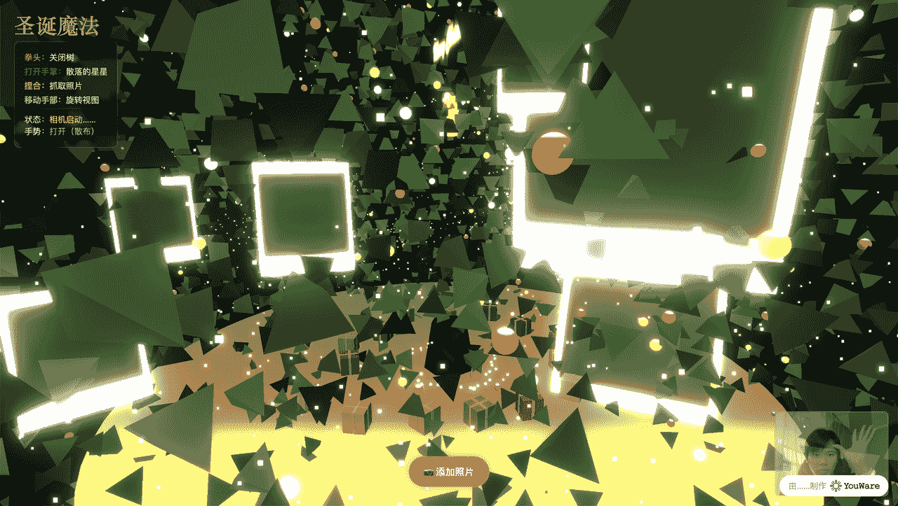
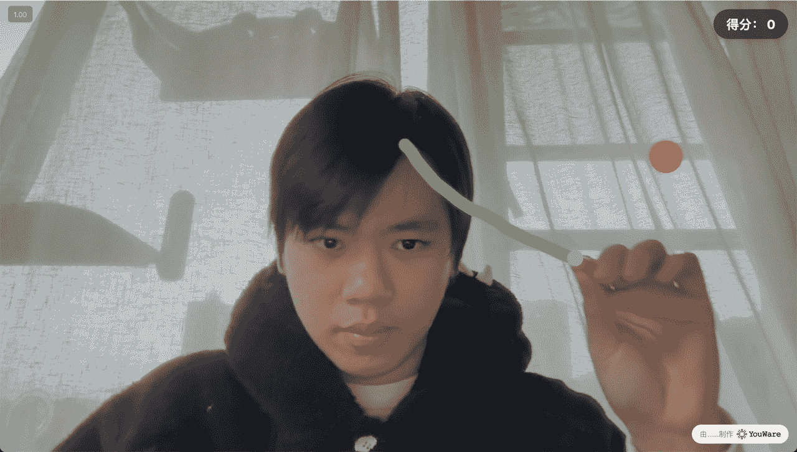
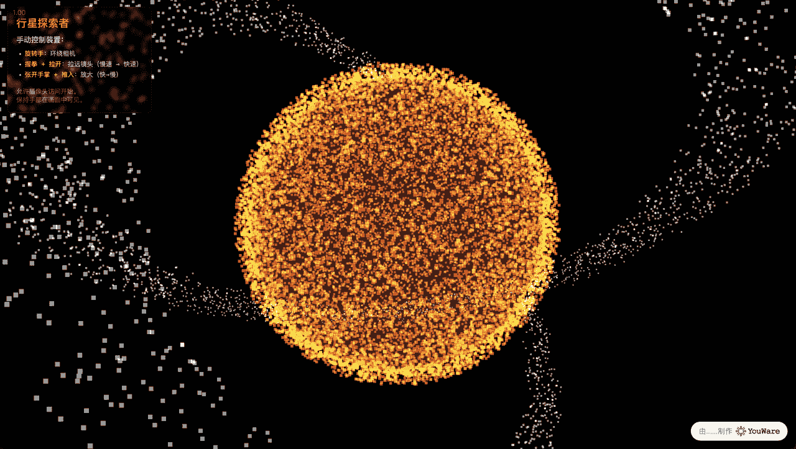
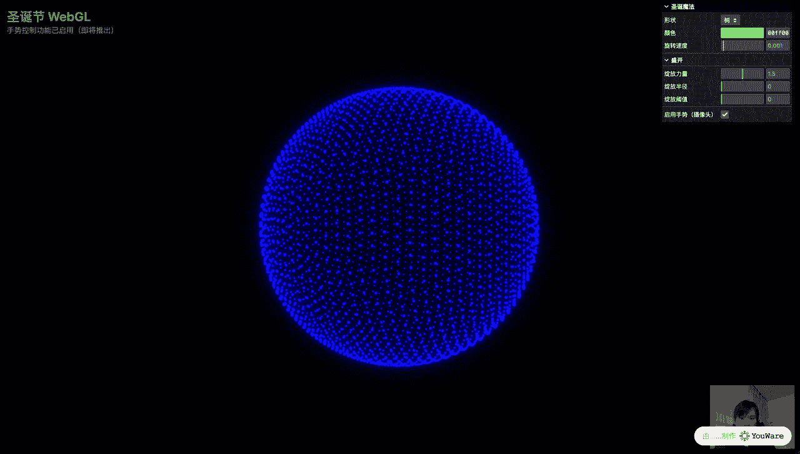
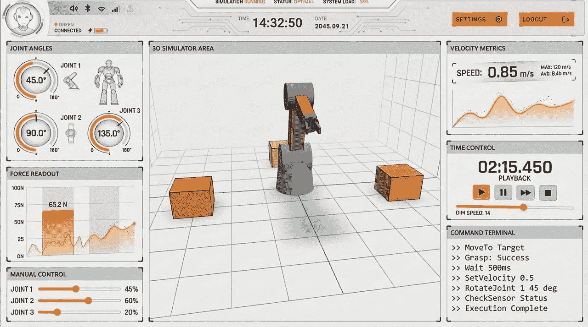
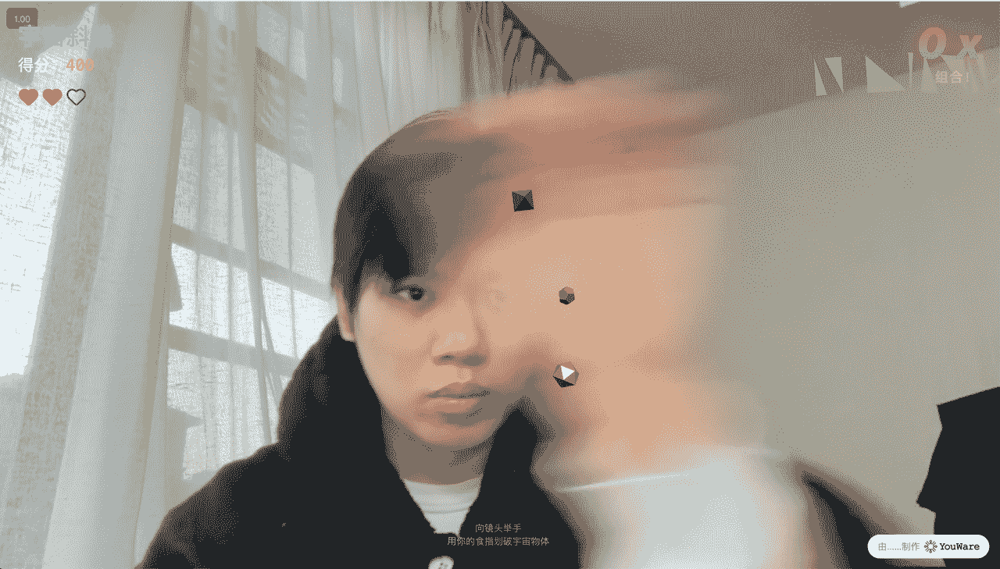

# GLM4.7手势互动提示语

> 来源：[https://aiwarts101.feishu.cn/docx/Ppw4dKi59ovGqMxUs1zcB62Rn0d](https://aiwarts101.feishu.cn/docx/Ppw4dKi59ovGqMxUs1zcB62Rn0d)

## 手势圣诞树



> #角色设定：

> 你是一位精通THREE.JS、WEBGL和视觉设计前端开发。

> ##任务目标

> 编写一个包含HTML、CSS和JAVASCRIPT的单文件应用。该应用需要结合THREE.JS 和MEDIAPIPE HANDS 来创建一个基于手势控制的3D粒子+照片云构成的圣诞树。

>

> ##要求

> 1、＜整体内容：>

> -主色系；哑光绿＋金属金+圣诞红色；

> -有电影感的辉光与光晕效果，整体金碧辉煌有高级感

> -圣诞树由 若干球、正方体、糖果棍和照片云等元素构成，照片通过上传获取。

>

> 2、<交互逻辑和状态：>

> 1、圣诞树状态

> -合拢态（初始状态）：所有元素收拢、聚合为一个圣诞树圆锥体。

> -散开态：所有元素在空间中无序漂浮、散落

> -照片放大态：在背景保持散开态的同时，放大单张照片

>

> 3、＜手势动作：>

> -握拳表示回到合拢态

+   打开五指表示进入到散开态

> -手旋转表示在散开态的状态下，对画面进行旋转，根据手的移动调整相机角度

> -抓的动作表示抓住一张照片，进入照片放大态

>

> 4、<交互要求：＞

> 需要根据手势，在几个状态之间平滑切换，带有过渡动画。

> ##包括但不限于使用以下技术栈 THREE.JS、WEBGL、INSTANCED MESH、

> SHADERS / GLSL、 MEDIAPIPE HANDS

## 手势贪吃蛇



> 做一个手势贪吃蛇游戏。用浏览器实现手部轨迹绘制。用 getUserMedia 打开摄像头，MediaPipe Hands 识别手部关键点，选定一个点（如食指尖）每帧记录坐标，在canvas上连线绘制。本地静态服务运行，HTML+JS实现。

## 手势爆炸星球



> create a webapp using wanilla js, html, css, modern threejs, mediapipe. 如果 medispipe 来自CDN，要用常规的<script>方式引入变量

> 用 Wanilla JS、html、css、modern threejs、mediapipe 创建网页应用。如果 medispipe 来自 CDN，要用常规的<script>方式引入变量

>

> 画面中是由大量球形小的粒子构成的一个绚烂的橙色的星球，星球球面应该是显现出来（可能在球面聚集了更多的粒子）。周围环绕着白色的粒子，构成星球的两层环绕型环。粒子要很大很亮。

>

> 摄像头的中心一直对着星球的中心，可以通过用户的手势控制摄像头，用户旋转手的时候，摄像头会随之旋转，就像星球在同步的顺时针或逆时针旋转；当握拳并拉远摄像头的时候，相机会较快远离星球，速度先慢后快，而当5指张开并靠近摄像头的时候，摄像头会快速靠近星球，速度先快后慢（摄像头距离星球的中心有个最小距离）。

## 粒子互动带面板



> 角色设定：你是一位世界顶级的创意开发专家和图形工程师（Creative Technologist）。精通使用React，Three.js，WebGL，和Tailwind CSS，你深刻理解光影、物理模拟、着色器（Shaders） 和电影级的后处理特效。

>

> 任务目标：构建一个的高保真的交互式 WebGL 网页应用，视觉风格需呈现圣诞节日，可以切换成麋鹿，礼物，圣诞树，铃铛等粒子效果

>

> 技术栈约束（Tech Stack）

> 框架：React 19 （Hooks 风格）.

> 样式：Tailwind CSS（通过 CDN 引入）.

> 3D 引擎：Three.js（标准库+Addons:OrbitControls, EffectComposer，UnrealBloomPass 等）.

>

> GUI控制面板：使用 Lil-GUI 显示关键参数（如粒子颜色、自传速度、光照强度、粒子数量等），以便实时调整视觉效果

>

> 交互逻辑 （Interaction）：场景必须对用户做出反应，加上摄影头视觉识别，与手势进行互动

## 机器人演示动画



## 水果忍者



```
# Cosmic Slash Mode - Design Document

## 1. Vision &amp; User Experience

### Goal

Create a high-energy, arcade-style &quot;beat saber&quot; meets &quot;fruit ninja&quot; experience in a cosmic setting. Users slice through incoming cosmic objects (crystals, meteors, stars) using their hands as lightsabers, building combos and defeating bosses in a visually stunning 3D environment.

### User Experience Flow

1.  **Entry**: User switches to Cosmic Slash mode. The environment transitions to a deep space scene with a procedural starfield and neon lighting.
2.  **Gameplay Loop**:
    - Cosmic objects (crystals, meteors, etc.) spawn in the distance and fly toward the screen.
    - User moves hands to create glowing, energy-ribbon trails.
    - Slicing objects triggers explosions, sound effects, and floating score popups.
    - Consecutive hits build a &quot;Combo&quot; multiplier, increasing score.
3.  **Progression**:
    - As score increases, the game levels up (speed and spawn rate increase).
    - **Boss Encounters**: Periodically, a massive &quot;Boss&quot; object appears. The user must slash it repeatedly to defeat it before it passes.
    - **Power-ups**: Special &quot;POW&quot; mechanics allow for screen-clearing attacks (e.g., two-hand laser beam).
4.  **Feedback**:
    - Visuals: Bloom, screen shake, particle explosions, dynamic lighting.
    - UI: HUD shows Score, Combo, Level, and Boss Health.

---

## 2. Technical Architecture

### 2.1 System Overview

The architecture follows a controller-based pattern, orchestrating Three.js rendering, physics, and game logic.

```mermaid
graph TD
    App[App.ts] --&gt; Controller[CosmicSlashController]

    subgraph &quot;Core Systems&quot;
        Controller --&gt; Env[CosmicEnvironment]
        Controller --&gt; Pool[ObjectPoolManager]
        Controller --&gt; Collision[CollisionDetector]
        Controller --&gt; Asset[CosmicAssetLibrary]
    end

    subgraph &quot;Input &amp; Visuals&quot;
        Controller --&gt; HandTracker[&quot;HandTracker (Shared)&quot;]
        Controller --&gt; Trail[HandTrailRenderer]
        Controller --&gt; Effects[Visual Effects]
    end

    subgraph &quot;Game Logic&quot;
        Controller --&gt; Score[ScoreManager]
        Controller --&gt; Boss[BossOverlay]
        Controller --&gt; Pow[PowManager]
    end
```

### 2.2 Component Responsibilities

#### CosmicSlashController

**Purpose**: The central brain of the mode.
**Responsibilities**:

- Manages the Three.js scene, camera, and renderer.
- Runs the main game loop (update &amp; render).
- Coordinates object spawning via `ObjectPoolManager`.
- Feeds hand data to `HandTrailRenderer` and `CollisionDetector`.
- Manages game state (Playing, Paused, Boss Fight).

#### HandTrailRenderer

**Purpose**: Renders high-fidelity, lightsaber-like trails.
**Key Tech**:

- **Custom Shaders**: `ribbonVertexShader` and `ribbonFragmentShader` for a glowing core + aura effect.
- **Smoothing**: Uses `OneEuroFilter` to reduce jitter and latency from hand tracking.
- **Sparkles**: GPU-accelerated particle system for trail embellishments.
- **Logic**: Tracks hands by position continuity (nearest-neighbor) rather than unreliable &quot;Left/Right&quot; labels.

#### CollisionDetector

**Purpose**: Handles interaction between hands and objects.
**Key Tech**:

- **Screen-Space Detection**: Projects 3D object positions to 2D screen coordinates for reliable hit testing against hand trails.
- **Optimization**: Uses a cooldown system to prevent double-hits on the same frame.
- **Depth Check**: Ensures objects are only sliceable when they are close to the &quot;screen plane&quot;.

#### ObjectPoolManager

**Purpose**: High-performance object management.
**Key Tech**:

- Pre-allocates `CosmicObject` instances to avoid Garbage Collection spikes.
- Manages lifecycle: `Pooled` -&gt; `Active` -&gt; `Sliced`/`Missed` -&gt; `Pooled`.
- Supports multiple object types (Crystal, Meteor, Star, etc.) with different visual properties.

---

## 3. Core Mechanics

### 3.1 Slicing &amp; Physics

- **Detection**: Raycasting is too expensive/complex for this arcade feel. Instead, we project the 3D object&#x27;s center to 2D screen space.
- **Hit Test**: If a hand trail segment intersects the object&#x27;s 2D bounding circle _and_ the object is within a specific Z-depth range, a hit is registered.
- **Velocity**: Slicing requires a minimum hand velocity to register, preventing accidental &quot;touches&quot;.

### 3.2 Boss Battles

- **Trigger**: Occurs after a set number of levels or score threshold.
- **Phases**:
  1.  **Warning**: `BossWarningOverlay` flashes, music changes.
  2.  **Active**: Boss object (massive scale) moves slowly across the screen.
  3.  **Combat**: User must slash the boss multiple times (HP system) to deplete its health bar (`BossHud`).
  4.  **Resolution**: Boss explodes (massive particle effect) or escapes (damage penalty).

### 3.3 Power-ups (POW)

- **Mechanic**: A &quot;POW&quot; meter fills up during gameplay.
- **Activation**: Specific gestures (e.g., holding hands together) trigger the `PowManager`.
- **Effect**: `PowLaserEffect` fires a continuous beam or clears all enemies on screen.

### 3.4 Scoring &amp; Combos

- **Base Score**: Points per object type.
- **Combo System**: Consecutive hits within a time window (`comboWindowMs`) increase the multiplier. Missing an object resets the combo.
- **Visuals**: `FloatingScoreEffect` spawns 3D text at the impact site.

---

## 4. Rendering &amp; Visuals

### 4.1 Three.js Configuration

- **Tone Mapping**: `ACESFilmicToneMapping` for cinematic contrast and saturation.
- **Color Space**: `SRGBColorSpace` for accurate color reproduction.
- **Post-Processing**: `UnrealBloomPass` (via `PostProcessingManager`) for the signature neon glow.

### 4.2 Cosmic Environment

- **Background**: A procedural starfield generated on a HTML5 Canvas and mapped to a sphere (`CosmicEnvironment.ts`).
- **Lighting**: Dynamic setup with Ambient, Point, and Rim lights to accentuate object materials.

### 4.3 Visual Effects (VFX)

- **SliceEffect**: Generates a planar mesh at the slice angle to simulate the object being cut in half.
- **ScreenFlashEffect**: Full-screen flash on impact or level up.
- **Particles**: GPU-based particle systems for explosions and trail sparkles.

---

## 5. Performance Considerations

- **Object Pooling**: Essential for maintaining 60 FPS with frequent object spawning/despawning.
- **Geometry Instancing**: Used where possible for identical particles.
- **Shader Optimization**: Custom shaders are optimized to minimize expensive operations in the fragment shader.
- **Adaptive Performance**: The controller monitors FPS and can dynamically adjust visual quality (e.g., particle counts, bloom intensity) if performance drops.
```

## 图片粒子转换

使用点阵云实现两张图片动态切换的动画粒子效果