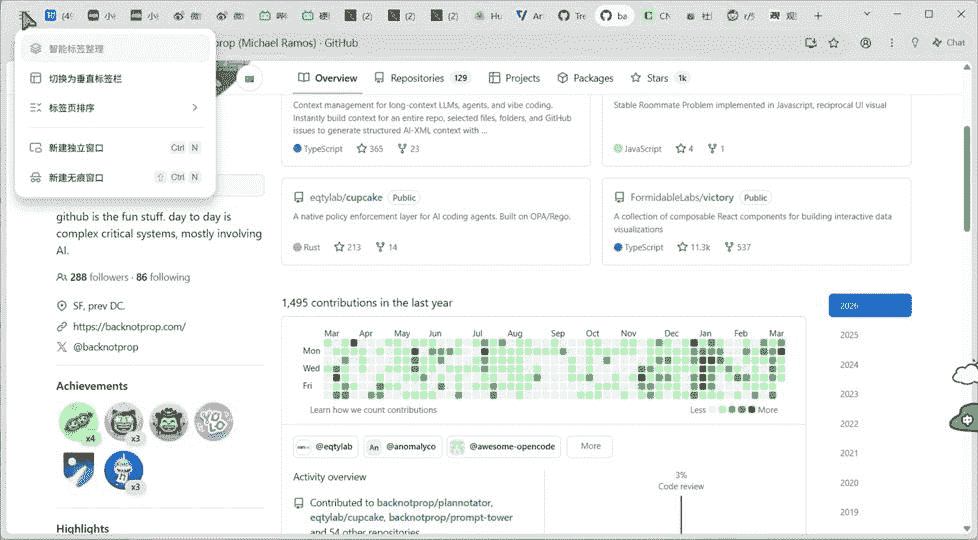
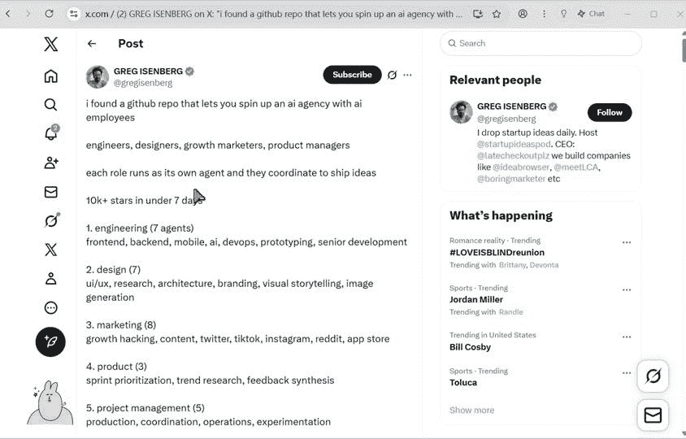
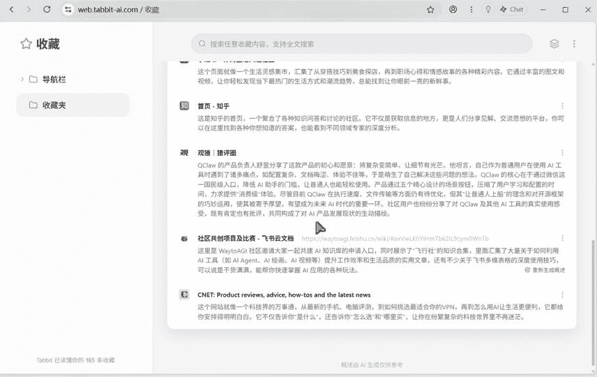
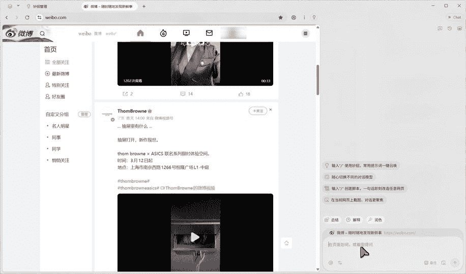
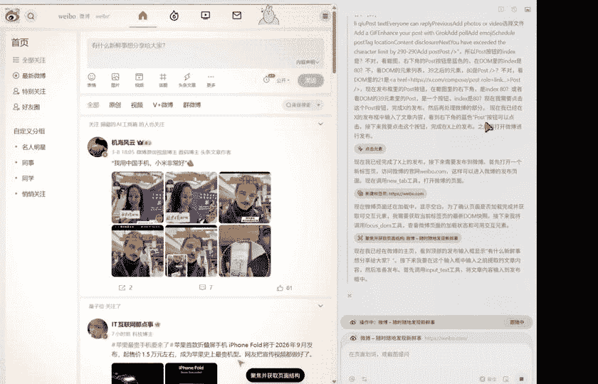

# 浏览器界的OpenClaw，Tabbit实测

> 来源：[https://aiwarts101.feishu.cn/docx/JRlydPdR2odIe7xVhcbcTdX3nI6](https://aiwarts101.feishu.cn/docx/JRlydPdR2odIe7xVhcbcTdX3nI6)

下载地址：

**🔗 国内 t****abbit-ai.com**

**🔗 国际 t**abbitbrowser.com

两个版本使用模型不一样

> 国内版支持模型：

> GLM-5

> DeepSeek-V3.2

> Doubao-Seed-1.8

> Kimi-K2.5

> Qwen3.5-Plus

> Kimi-K2.5

> Qwen3.5-Plus

> LongCat-Flash-Chat

> MiniMax-M2.5

> 国际版支持模型：

> GPT-5.4

> GPT-5.2-Chat

> GPT-5.1-Chat

> Gemini-3.1-Pro

> Gemini-3-Flash

> Gemini-2.5-Flash

> Claude-Sonnet-4.6

> Claude-Haiku-4.5

> GLM-5

> DeepSeek-V3.2

> GLM-5

> DeepSeek-V3.2

> MiniMax-M2.5

> Kimi-K2.5

> Qwen3.5-Plus

> Doubao-Seed-1.8

## 提示语&视频：

>

[标签页-case-新.mp4](https://internal-api-drive-stream.feishu.cn/space/api/box/stream/download/all/AhEfbBDBMohy8FxfITYcH9G8nRe)

> 分屏协作

[分屏-新-case.mp4](https://internal-api-drive-stream.feishu.cn/space/api/box/stream/download/all/UPbcb0O0voPFOkxubQ0cRT9pnPe)

> 收藏夹整理

[收藏夹-case-新.mp4](https://internal-api-drive-stream.feishu.cn/space/api/box/stream/download/all/VSTWbo3nAowlfSxbvkncmvt5nIb)

> 分析一下我的小红书内容和点赞，给一些建议

[小红书分析-新.mp4](https://internal-api-drive-stream.feishu.cn/space/api/box/stream/download/all/USlNbYIByo5YujxDFxwcZedsnXd)

> 测试case提取提示词：

> 总结这篇文章测试了几个case，每个case对应什么功能，用的提示词是什么

> **自动化脚本**

> 在输入框，输入 / 调取脚本，输入提示词，

> 屏蔽带有广告标识的帖子

> 点击写好的脚本右上角的**执行**

> 达到满意效果后，点击执行旁边的**保存**，创建新的妙招

[屏蔽广告.mp4](https://internal-api-drive-stream.feishu.cn/space/api/box/stream/download/all/Gw2nbHzZRoOYrHxxVf4cWwqYnxO)

> 一键发布微博

[微博发布case.mp4](https://internal-api-drive-stream.feishu.cn/space/api/box/stream/download/all/SQfQbnIxQoQHn5xKOA4c6SxjnKe)