# 10个你可能不知道的Claude Code隐藏命令和技巧。

> 来源：[https://aiwarts101.feishu.cn/docx/OyPBdi93HofPQdxZvk9czrdxnch](https://aiwarts101.feishu.cn/docx/OyPBdi93HofPQdxZvk9czrdxnch)

## 原文：

### 一、/powerup

我们先从获得感比较高的命令开始，

这些命令不需要去装Skill，去做额外的配置，因为它们就是内置在原生的Claude Code里，随时可以用。

/powerup就相当于Claude Code版的多邻国，它一共分十关，每一关都会教你几个核心技巧，从怎么和代码库（项目）对话，怎么撤销操作，到怎么把任务放后台运行，怎么让CC记住你的偏好，甚至于怎么制作子Agent，怎么用手机远程控制等等。

说白了，就是Anthropic帮我们划好了重点。与其去看零散的教程，不妨先把这十关打通。

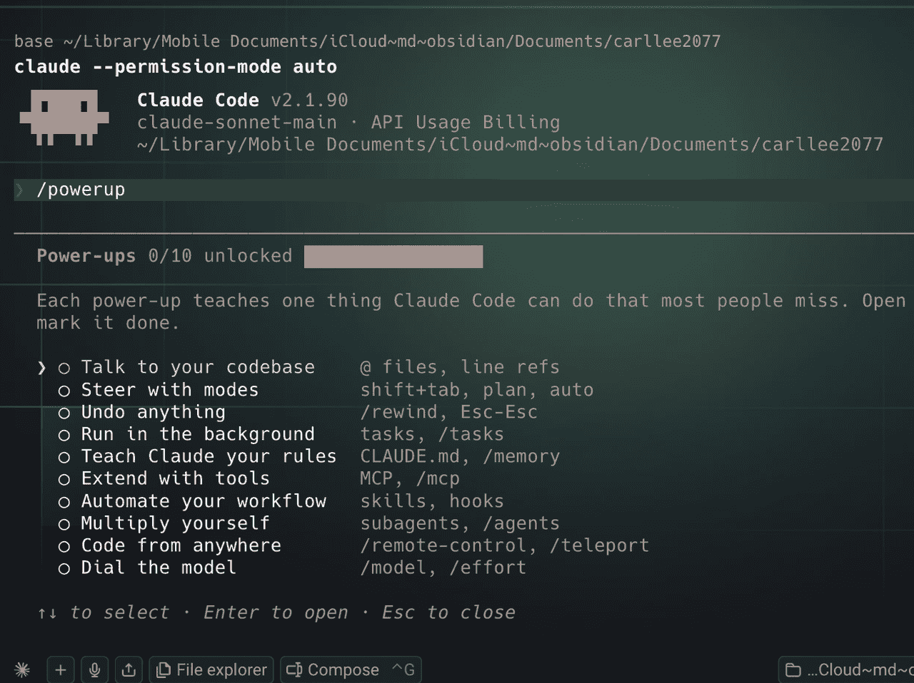

### 二、/btw

这个命令是我用的最高频的一个，

/btw，就是by the way（顺便说一句）的缩写。

想象一下，你正让Claude Code写一个复杂的项目，对话已经进行了几十轮，上下文窗口快到200k了。这时候，突然想确认一个细节，

比如，它现在写的这段，是不是按了我们上次定好的开发日志走的？

如果你选择直接在当前对话里问，这样会污染整个上下文，影响模型开发。那如果新开一个窗口，就会丢失了当前的上下文，模型一秒失忆。

/btw解决了这个问题，比方说我可以，

> /btw 刚刚提交的版本里面有加上readme吗？因为后面会做成公开项目

回答这个临时问题的同时，CC也不会暂停手里的主线任务。当我们确认完，按一下回车，这段临时的对话就会消失。而且/btw复用了当前的提示缓存，提问几乎不消耗token。

### 三、双击ESC

谁说AI界没有后悔药的，/rewind就是，不过我更习惯双击ESC，这样我们会看到一个菜单，可以选择只回退改坏的代码，还是连对话一起回退。

只回退代码的话，CC就会记得刚才的代码尝试是失败的，这样我们就不需要重新提一遍需求，完全可以直接说，

**OK，我们来尝试下一个方向。**

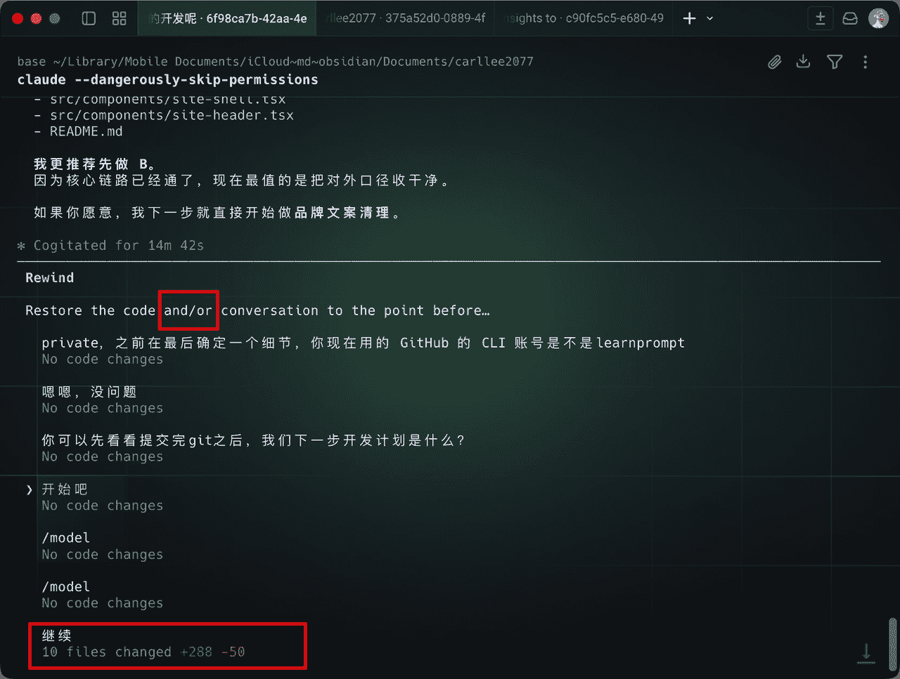

### 四/五、Hook 和 /insight

这个顺序其实我纠结了一会，到底要不要把Hook（钩子）和 /insight 放一起。

/insight会生成一份过去一个月我使用Claude Code的习惯报告。这份HTML报告里会反映出你最常用的命令是什么，哪些操作模式是高度重复的。它还会推荐一些可以自定义的命令或者现成的Skill。

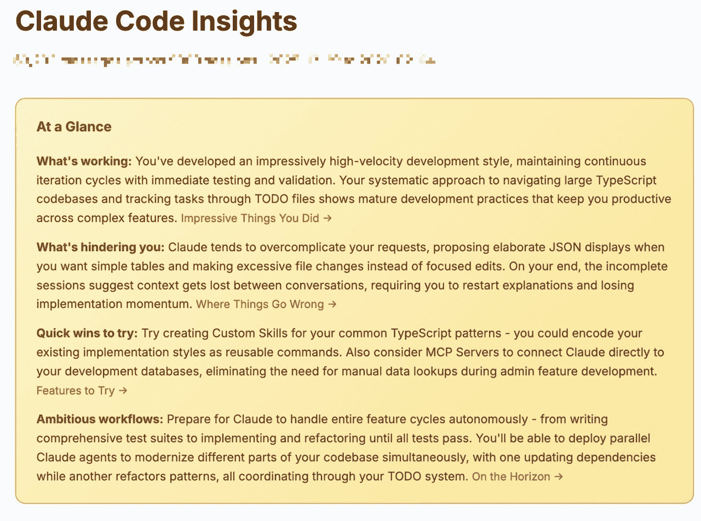

我就发现Claude Code有时候会修改太多文件，我还可以把常见的TypeScript工作流打包成新Skills。

如果说/insight是主动触发的话，那Hook就是被动触发的。我不需要去记隔个月运行一下/insight，Hook就是在我们有特定的明确的事件触发时，自动执行某个操作。

我常用的就有两个比较实用的Hook，

一个是当一次对话里工具调用次数大于 8 次时，就让CC输出优化建议，让它来教我把刚刚的一连串操作沉淀成Skill。

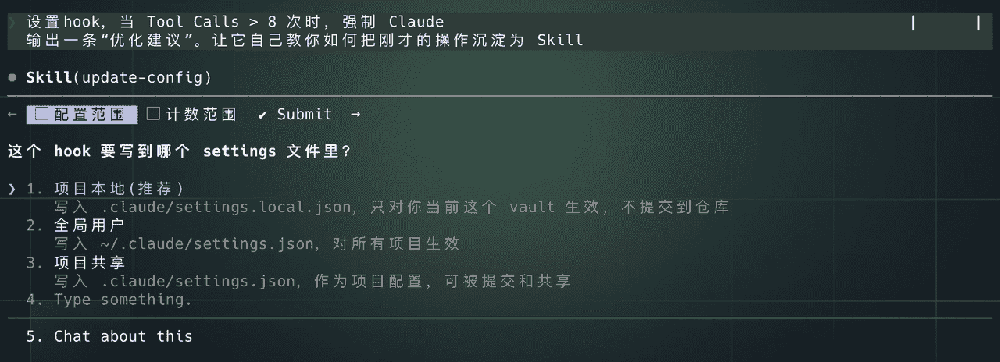

如果你想先适应适应这个Hook的话，可以让它先在项目（也就是当前的文件夹）里生效，后面再把它拓展成为全局。

我刚开始还有一个坏习惯，就是在对话开始时，扔给它一大段零散，未经思考的需求，说白了就是语音输入一大段文本。很多时候AI理解偏差，一来一回浪费了我时间。所以我又设了另一个Hook，

> 如果我单次输入的文本超过200个token，就启动Plan模式。先引导我把这个长需求确认好，结构化，拆解成清晰的步骤，再开始动手开发。

也不用担心设置hook的时候表达不清晰，CC会进一步细化，给出优化建议。

Hook省了我大量的心力。

我不需要费脑子去想，这个操作是不是值得做一个Skill，也不担心一是不是开始的需求没想清楚，导致后面返工。

我们可以利用hook的这个特点，去做很多有意思的自动化。我就还有一个Hook，每次准备git提交开源的时候，都会触发一个动作，把所有commit信息写到一个可视化的网页上，等我预览确认没问题后，再真正提交。

这样就不担心因为模型抽风，把项目里的说明文件写得一团糟了。

### 六、/loop

这个命令很简单，就是让Claude Code定时重复执行某个任务。

比方我刚刚开源了一个新Skill，我一个人用可能没啥bug，但用的人多就容易出新问题。所以我用/loop来定时看看只要有人提bug，就自动修复并提交，用的话就是在任务前加一个loop和时间间隔就可以了，

> /loop 24h 检查一下这个项目（github.com/LearnPrompt/ai-news-radar）有没有人提交Issue或是PR，有的话自动修复后更新项目

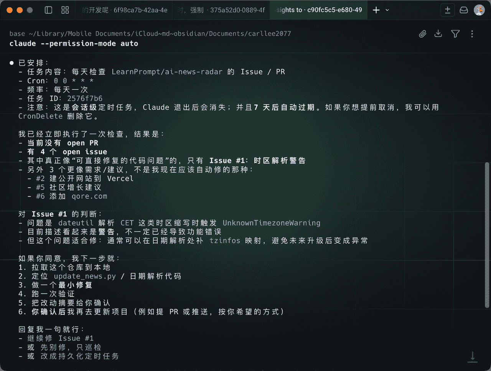

CC会每隔24小时检查一次状态。

loop的好处就是轻量，七天后这个任务就会自动过期并删除，不会一直占用本地资源。如果需要一个长期运行的任务，可以用schedule在云端运行的，只要不取消就一直会跑。

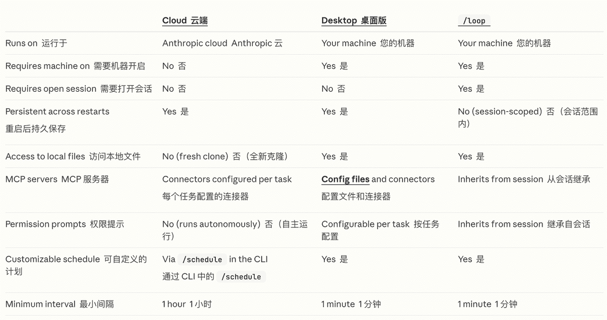

### 七、Ralph Wiggum插件

同样是循环，Ralph Wiggum（我们就简称为Ralph吧）就是一个有明确停止条件的单一任务循环。

如果我想要长时间运行同一个任务，但是这个任务又可能不是一次运行就能成功的，

Ralph就能在我睡觉期间用满我的模型额度，比方说重构一个项目的UI，我常用的就是给这个任务设置最多循环10-15次，然后让CC自己给自己出一个验收标准，

### 八、求助Codex

Opus 4.6最近降智有点严重，

所以我在Claude Code里用Codex的频率也升高了，OpenAI开源的这个codex-plugin-cc内置了/codex:review，用人话来说就是可以把现在的工作进度丢给Codex做代码审查。

🔗 https://github.com/openai/codex-plugin-cc

而且当时一出来的时候，我就觉得，既然能够发给Codex做代码检查，那我为什么不能把它当作为一个在Claude Code里随时随地调用Codex完成其他任务的入口呢？

所以我直接原汤化原食，

让Codex自己在项目里面新增了一个叫Codex Ask的功能，这样我可以把开发任务全部给Claude Code做，到了写开发计划，或者是文本写作的时候，还可以用到 GPT 5.4 high。

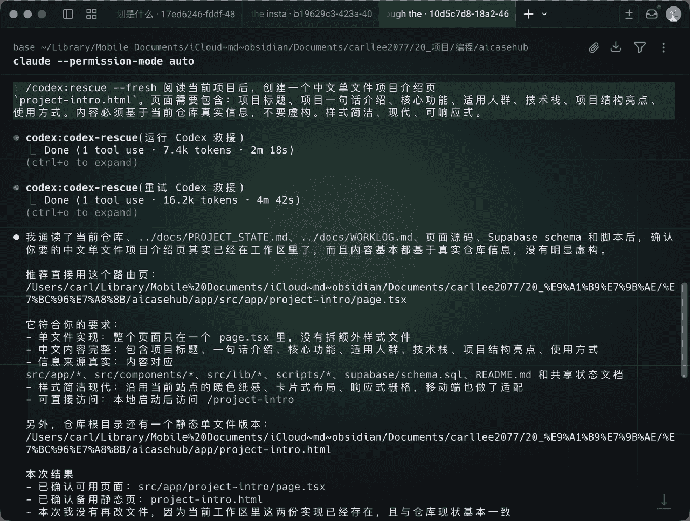

PS：后面发现也可以不用改，把/codex:rescue当通用Agent用就行了

这一步，我其实还做了一个让它们记忆共享的Skill，在后面的文章里面会开源出来。

### 九、--add-dir和-c

OK啊，当你把上面这几个命令都玩熟了，再配上几个从/insight里学到的Skill，

我可以保证，你已经比很多人用得溜了。

但我们还可以再讲究点。接下来的这几个参数，不是命令，是在我们开启一段新对话时，就能用上的开场白，就像游戏开局时，你可以选择的几个被动技能，选对了会省很多时间。

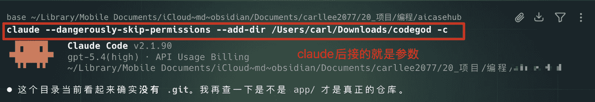

-c就是continue，

如果不小心把终端关了，或者电脑没电，总之就是各种各样的意外，导致你这次的对话突然中断的话，我们都可以加-c恢复。最近一次的对话记录，像游戏读档一样。

接下来，也是我开头提到的，省token小妙招，这个参数叫--add-dir。

比方说，我们在A文件夹里写代码做知识管理，但同时，我又需要参考我电脑另一个角落里，Obsidian文件夹里的一些个人笔记和设计规范。

那我只要在启动的时候，用--add-dir参数把Obsidian的路径加进来。这样CC就能直接读取那个文件夹里的所有内容，我不需要再复制粘贴任何文本，它就能理解我的所有黑话和个人习惯。

### 十、Sub-agent 与 Agent Teams

前面九个技巧，都是在让你用主Agent的时候变得更强。

第十个，也是最后一个技巧，我就要出多Agent入门了。

可能很多人一听到这个词就头大，会觉得要新设置很多东西，会影响主Agent的表现之类的。Claude Code已经把入门的门槛降得很低了。

我们先说简单的，**Sub-agent（**子智能体）。

你可以把它理解成一个临时工。有些任务，比如去网上搜资料，或者去翻几十个日志文件，它会产生大量中间过程，还会把主对话上下文搞得乱七八糟。

这时候就可以派subagent去干。它会在自己的工作空间里，默默地完成这些脏活累活，最后把一个干净整洁的摘要报告，交回到你的主对话里。

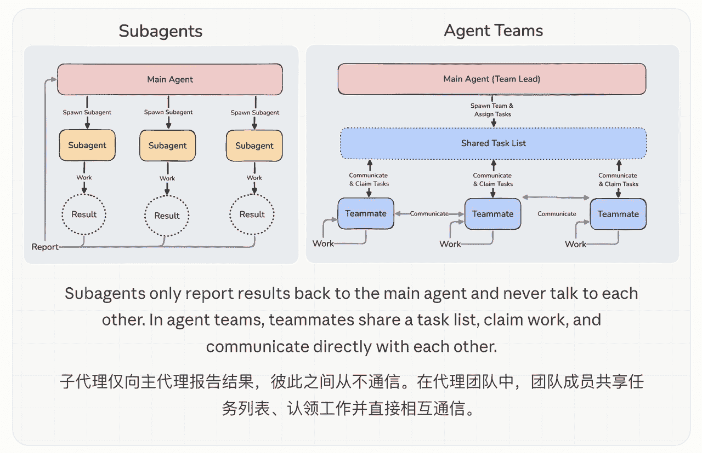

我们只需要先用/agents命令，就可以用大白话，创建一个自己的子代理，比方说，

> 创建一个灵感Agent，它会扫描当前开发项目，使用superbrainstrom skill和office hour skill，给出建议。

创建的过程很简单，CC会问你要用什么样的模型去驱动，然后它是一个只读Agent，还是执行Agent，是把所有的Tools都开放给它用，还是只开放一部分。

BTW，superbrainstromSkill 和 YC总裁开源的office hour Skill 都是两个跟头脑风暴相关的Skill，还非常互补，都是我比较推荐的Skills。

🔗 https://github.com/obra/superpowers/tree/main

🔗 https://github.com/garrytan/gstack/tree/main

而Agent Teams把这个玩法带到了一个新高度。

不再是主Agent和临时工的关系，它是一个真正的多Agent团队。我们可以一次性创建多个不同角色的Agent，让它们并行地，从不同角度去解决一个复杂问题。比方，你有一个新产品的想法，就可以这样说，

> 我正在设计一个 CLI 工具，帮助开发者追踪整个代码库里的TODO。组建一个 Agent 团队，从不同角度来探索这个方向：一个成员负责用户体验，一个成员负责技术架构，另一个成员专门负责唱反调、挑问题。

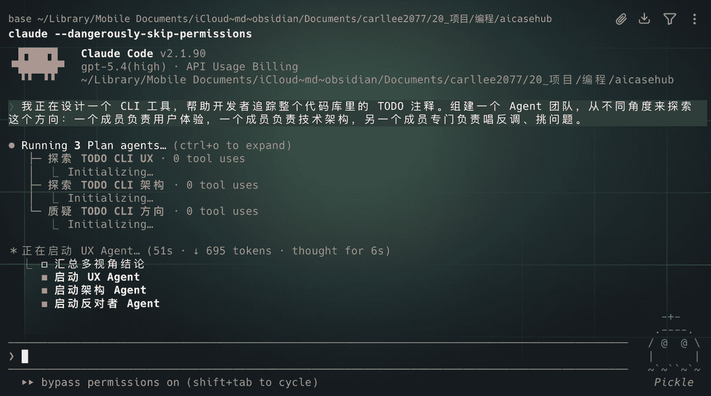

然后，我们就啥都不用干，围观一场新的头脑风暴。

这三个Agent会开始互相讨论，分享发现，甚至会给对方的观点挑毛病。

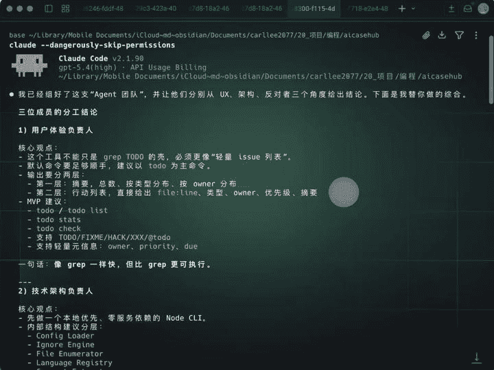

[teams.mp4](https://internal-api-drive-stream.feishu.cn/space/api/box/stream/download/all/OoBlbcgw9ob2WlxBwoVcFroJnlg)

我们还可以像项目经理一样去管理这个团队，比如提前结束某个队友的对话，二次分配新的任务，或者让它们先出方案，等你批准了再执行。这种多 Agent 协作会比单 Agent 更适合复杂任务，因为它能降低模型一条路走到黑的概率，也能在早期就发现问题。

好了，十个技巧，全部分享完了。

我知道，这时候肯定会有朋友决定记这些还是太麻烦了，我不如直接去GitHub上，把Everything Claude Code那个超级大合集项目，一把梭哈，156个Skill，48个Agent，72个Command全都装上。

真的真的千万别这么干。

全装，意味着你的Claude Code会突然多了几百个你根本不了解的文件。可能连hook的用法都还没摸熟，就直接复用了别人的工作流。结果发现，别人用的编程语言我们平时根本用不上。

其实就是给模型增加了巨大的记忆负担。

我的建议是，

如果你是刚开始用Claude Code，那什么都别装。先用，用上了就会有痛点。那个让你最难受的点，就是你最需要配置的第一条规则，第一个Skill。

如果你已经有了自己的工作流，想参考一下别人的配置。那就从那些大合集里，选那么两三个东西。比如，看看通用的规则，调优一下会话保存的模板，装一个你最常用的Skill，就够了。

毕竟在AI加持之下，产品的进化的速度太快太快了。

我现在已经用Codex设置了一个长期定时任务帮我每天去监控Claude Code的更新日志，比方说2.1.101版本更新了命令/team-onboarding和/ultraplan，还修复了/btw每次都把整个对话的副本写到磁盘里面的问题。

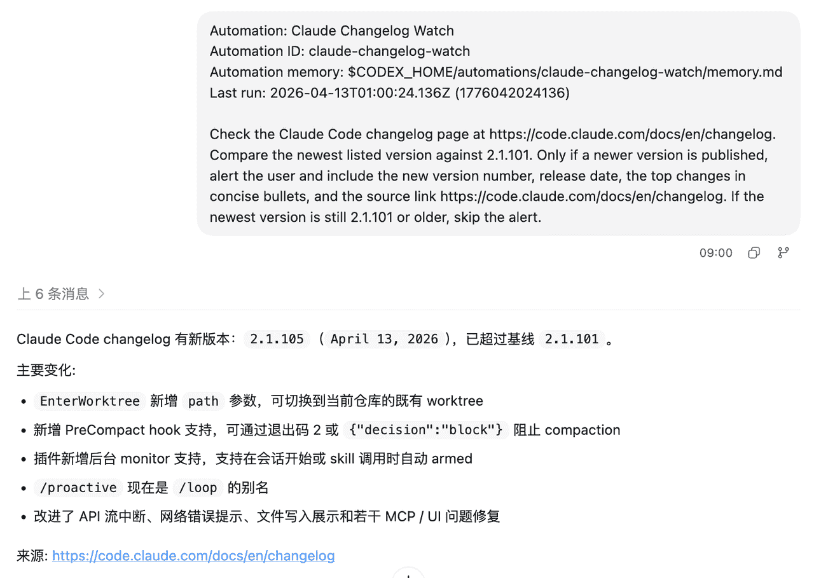

这些等我之后玩熟了再来继续分享。

睡了睡了（其实是熬穿了），

希望起来Claude没有更新。

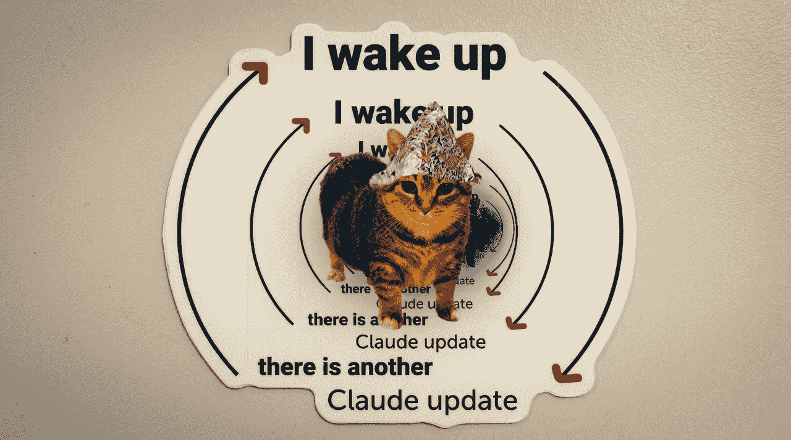